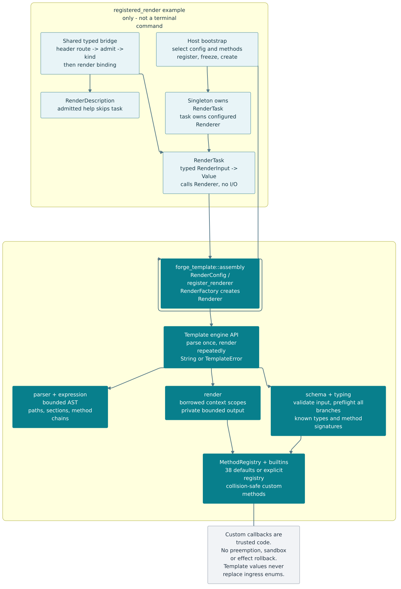
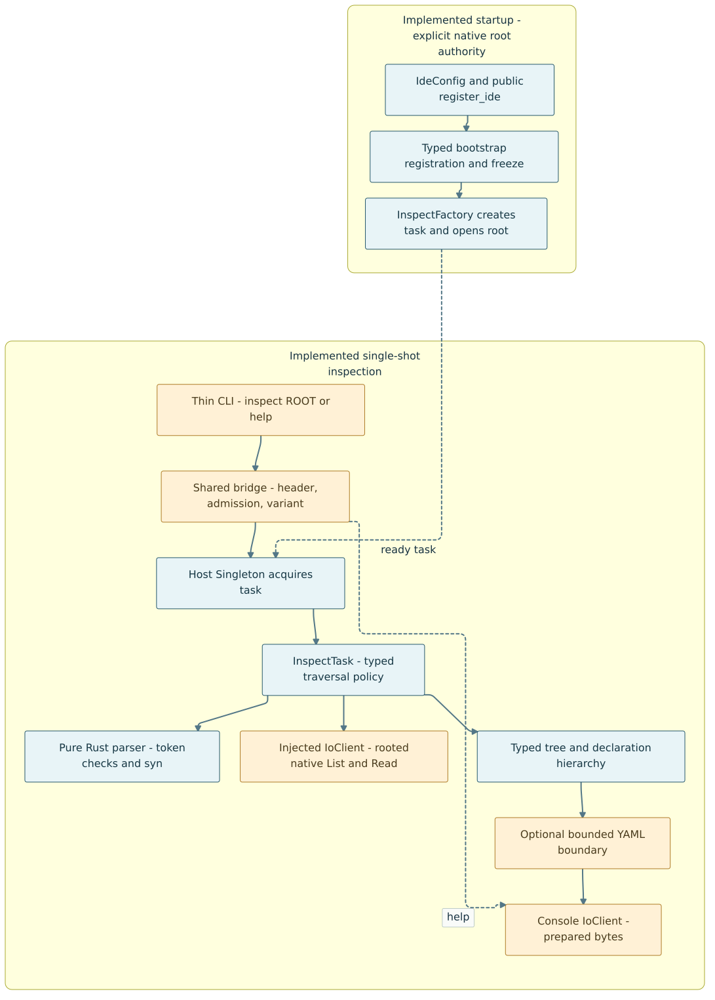

# Homelab

A professional engineering portfolio: lessons from the Forge experiments, a growing composable Rust framework, and reusable design practices.

## Forge framework portfolio

- [Documentation index](docs/README.md): observed repository findings versus proposed architecture.
- [16 repository reviews](docs/reviews/forge/README.md): reusable ideas, risks, and boundaries.
- [Framework blueprint and assembly model](docs/architecture/forge-framework-blueprint.md).
- [C4 and supporting diagrams](docs/architecture/diagrams/README.md).
- [Detailed future jobs, access and remote interfaces](docs/architecture/foundation-interfaces.md) — proposed modules, typed contracts and ownership/state diagrams.
- [Implementation roadmap](docs/roadmap/forge-framework.md).
- [Hosted kernel research and phased plan](docs/architecture/forge-kernel-plan.md): implemented local node/status and bounded jobs, plus a narrow authenticated network proof; remote deployment remains future.

The [first Rust core](src/rust/README.md) now implements typed contracts, a synchronous shared bridge, factory/provider/lease primitives, independent I/O-client/task contracts, and atomic typed bootstrap registration with runnable optional-package consumers and focused tests. An optional [forge-kernel disk module](src/rust/forge-kernel/README.md) adds native filesystem inspection and client-local navigation without shell commands. It is a hosted system-client crate, not a bootable OS. The larger framework and durable reference application remain proposals; earlier repository reviews are not fresh build/test certifications.

## Run the local Forge system

From the repository root with stable Rust, GNU Make and Python 3.9+:

```bash
cargo fetch --manifest-path src/rust/Cargo.toml --locked # once for dependencies
make                         # discover the available targets
make run ARGS='node.info'
make run ARGS='disk.list --help' # typed command arguments and defaults
make session                 # local stateful terminal
make run ARGS='jobs.submit --help' # bounded local counter
make run NO_DEFAULT_FEATURES=1 ARGS='node.status'
make test                    # workspace tests
make ci                      # the same gates used by GitHub Actions
make asm                     # release assembly for the kernel library
```

The [root Makefile](Makefile) wraps Cargo in `src/rust/`; [target/feature selection,
assembly output and CI details](src/rust/README.md#root-makefile) include the direct
Cargo equivalents. The workflow performs CI checks only: no deployment or release
publication is configured.

The terminal discovers its selected registered commands and sends typed requests through the shared bridge. A separate [command-description contract](src/rust/forge-command/README.md) supplies names, help, named argument types and required/optional/default declarations; `Task` remains an independent execution stereotype. `help COMMAND` or `COMMAND --help` describes an admitted catalog entry without running the business task/client. In a session, use `disk.pwd`, `disk.list`, `disk.cd PATH`, `disk.permissions PATH`, `node.info`, `node.status`, `help`, then `exit`. Directory changes persist only in that session, not the process or your parent shell. Paths in session input are literal remaining text—not shell quoting or expansion. [Usage, feature selection and exit codes](src/rust/forge-terminal/README.md) · [Application assembly](src/rust/forge-local/README.md).

**Implemented:** local node observations, command discovery, optional native disk navigation and [bounded local counter jobs](src/rust/forge-local/JOBS.md). In one session use `jobs.submit KEY TOTAL`, copy its ID, then `jobs.inspect ID`, `jobs.step ID`, `jobs.cancel ID` and `jobs.list`. Only explicit stepping runs work; receipts are volatile and local owner labels are not authentication. Node status reports client-instance uptime/responding, not machine health. **Later:** durable jobs, remote execution and Raspberry Pi deployment.

## First authenticated network boundary

The optional [remote node-info slice](docs/architecture/remote-node-info.md) now
sends typed `node.info` through one `/forge/v1/dispatch` HTTPS gateway, with routing
metadata in HTTP headers, mutual TLS and separate destination
operation authorization, then the existing shared bridge. It is a **loopback
proof**, not a deployed remote agent. No file/job execution is exposed.

```bash
make remote   # ephemeral in-memory demo identities; one read, then exit
```

HTTP/TLS/JSON and the private runtime stay outside core contracts. The client port,
task and typed results remain replaceable; gRPC or Bitwave is not required.
[Public adapter API and limits](src/rust/forge-remote-https/README.md) ·
[Mermaid source](docs/architecture/diagrams/mermaid/m12-remote-node-info.mmd) ·
[SVG](docs/architecture/diagrams/mermaid/images/m12-remote-node-info.svg).

## Optional template rendering

[`forge-template`](src/rust/forge-template/README.md) is a schema-checked,
bounded Mustache-like renderer with method chains and 38 builtins, plus an opt-in
[single-shot template CLI](src/rust/forge-template/CLI.md). It is not a project
generator or a command added to the separate Forge terminal.
Default builtins are pure; custom methods are explicit trusted callbacks.
It accepts capability-local typed values, returns a complete string or typed error,
and exposes reusable `forge_template::assembly` config/factory/registrar APIs.
Only bootstrap/provider contracts are unconditional dependencies; the render algorithm
remains pure. Its example consumes those exports, then adds application-owned
task/description/bridge wiring without forcing I/O or transport:

```bash
make test PACKAGE=forge-template
make template ARGS='render --template "Hello, {{name.to_uppercase()}}!" --text name=Forge'
cargo run --manifest-path src/rust/Cargo.toml --offline --locked -p forge-template --example registered_render
```

### Template architecture and render flow

These Mermaid views cover the optional renderer library and its development
example. The separate opt-in CLI now consumes the same public assembly API; its
[execution and ownership flow](src/rust/forge-template/CLI.md#execution-and-ownership)
is documented alongside usage.



- [Architecture SVG](docs/architecture/diagrams/mermaid/images/m09-template-architecture.svg) · [Mermaid source](docs/architecture/diagrams/mermaid/m09-template-architecture.mmd)
- [Method-enabled render sequence SVG](docs/architecture/diagrams/mermaid/images/m10-template-render.svg) · [Mermaid source](docs/architecture/diagrams/mermaid/m10-template-render.mmd)
- [Detailed captions](docs/architecture/diagrams/mermaid/README.md#implemented-template-renderer) distinguish library behavior, trusted callbacks and example-only composition.

## Forge IDE — project inspection

The first [Forge IDE capability](src/rust/forge-ide/README.md) emits a read-only
project tree and Rust AST-derived declaration hierarchy as YAML. Traits, impls,
methods, types, modules, spans and line counts are inspected with a real parser;
this is not type checking or a full expression AST.

```bash
cargo fetch --manifest-path src/rust/Cargo.toml --locked # first dependency setup
make ide ARGS='inspect src/rust/forge-task'
```



[Mermaid source](docs/architecture/diagrams/mermaid/m11-ide-inspection.mmd) ·
[Scope, output, limits and public integration](src/rust/forge-ide/README.md).

## Framework diagrams

**Implemented contracts**, shown as UML-like Mermaid (Rust type parameters and lifetimes are explained in the captions):


- [Contracts: SVG](docs/architecture/diagrams/mermaid/images/m01-contracts.svg) · [Mermaid source](docs/architecture/diagrams/mermaid/m01-contracts.mmd)
- [Bootstrap sequence: SVG](docs/architecture/diagrams/mermaid/images/m02-bootstrap.svg) · [Mermaid source](docs/architecture/diagrams/mermaid/m02-bootstrap.mmd)
- [Typed disk request: SVG](docs/architecture/diagrams/mermaid/images/m03-disk-request.svg) · [Mermaid source](docs/architecture/diagrams/mermaid/m03-disk-request.mmd)
- [Local checkpoint and planned phases: SVG](docs/architecture/diagrams/mermaid/images/m04-kernel-phases.svg) · [Mermaid source](docs/architecture/diagrams/mermaid/m04-kernel-phases.mmd)

The **broader foundation** has a proposed module/interface set, with the narrow local counter lifecycle now implemented:

- [Module boundaries](docs/architecture/diagrams/mermaid/images/m05-foundation-modules.svg) · [Typed ports](docs/architecture/diagrams/mermaid/images/m06-foundation-interfaces.svg)
- [Job lifecycle](docs/architecture/diagrams/mermaid/images/m07-job-lifecycle.svg) · [Remote admission sequence](docs/architecture/diagrams/mermaid/images/m08-remote-admission.svg)
- [Design and stability decisions](docs/architecture/foundation-interfaces.md) · [Rust interface sketches](docs/architecture/foundation-contracts.md)

M07 describes the implemented local counter lifecycle. The generic module/interface model and remote/authentication flows remain design artifacts, not completed services.

[Diagram captions and reproducible local rendering](docs/architecture/diagrams/mermaid/README.md) distinguish implemented code from the [kernel plan](docs/architecture/forge-kernel-plan.md). No remote transport or bootable OS is implemented by these diagrams.

## Source sets

- [Source-set guide](src/README.md): boundaries, supporting files, and how to add a tool.
- [Rust](src/rust/README.md): capability crates and internal modules.
- [Python](src/python/README.md): purpose-oriented projects and import packages.
- [Bash](src/bash/README.md): executable tools and reusable shell libraries.

## Skills

Repository skills live separately from application code in `.agents/skills/`.


### Explicit workflow skills

These three adapted workflow skills are **explicit-invocation-only** and local to
this repository; they are not installed globally. Each includes its upstream MIT
license and pinned reconstruction provenance.

- [Diagnose Bugs](.agents/skills/diagnosing-bugs/SKILL.md): build a symptom-specific reproduction, test causes and verify a scoped correction. Invoke `$diagnosing-bugs`.
- [Verify Before Completion](.agents/skills/verification-before-completion/SKILL.md): match final claims to current evidence and disclose unrun checks. Invoke `$verification-before-completion`.
- [Simplify Code](.agents/skills/code-simplification/SKILL.md): improve clarity without changing behavior, public integration or typed boundaries. Invoke `$code-simplification`.

### Forge design and implementation skills

- [Design Package Boundaries](.agents/skills/design-package-boundaries/SKILL.md): capability-first packages and practical hexagonal boundaries, without unnecessary layers.
- [Model Forge Modules](.agents/skills/model-forge-module/SKILL.md): explain the composition DSL and model a capability/module assembly.
- [Trace Forge Commands](.agents/skills/trace-forge-command/SKILL.md): follow typed header-directed admission, handlers and effects.
- [Wire Forge Providers](.agents/skills/wire-forge-providers/SKILL.md): specify typed factories, acquisition scopes, leases and lifecycle wiring.
- [Expose Forge Capability](.agents/skills/expose-forge-capability/SKILL.md): deliver public config/factory/registrar exports with an independent consumer proof, not example-only integration.

The framework-specific skills share one [DSL semantic reference](docs/architecture/framework-dsl.md). Keep these repository-local skills with their linked documentation; the broader DSL is an evolving Rust-embedded composition model, not an implemented parser; the linked core documents its real public API subset.

Examples: `Use $model-forge-module to explain the DSL and model a notifications capability.`

`Use $trace-forge-command to trace this request and identify rejection before effects.`

`Use $wire-forge-providers to specify the provider scope and cleanup for this dependency.`

`Use $design-package-boundaries to review this feature and propose cohesive packages, dependency rules, and a safe migration plan.`
