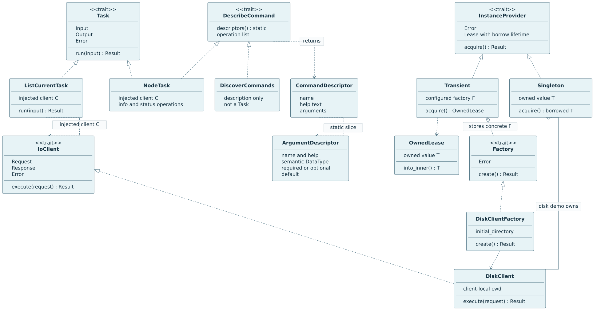

# Homelab

A professional engineering portfolio: lessons from the Forge experiments, a growing composable Rust framework, and reusable design practices.

## Forge framework portfolio

- [Documentation index](docs/README.md): observed repository findings versus proposed architecture.
- [15 repository reviews](docs/reviews/forge/README.md): reusable ideas, risks, and boundaries.
- [Framework blueprint and assembly model](docs/architecture/forge-framework-blueprint.md).
- [C4 and supporting diagrams](docs/architecture/diagrams/README.md).
- [Implementation roadmap](docs/roadmap/forge-framework.md).
- [Hosted kernel research and phased plan](docs/architecture/forge-kernel-plan.md): local node/status first, then jobs and an explicit remote boundary.

The [first Rust core](src/rust/README.md) now implements typed contracts, a synchronous shared bridge, factory/provider/lease primitives, independent I/O-client/task contracts, and atomic typed bootstrap registration with runnable optional-package consumers and focused tests. An optional [forge-kernel disk module](src/rust/forge-kernel/README.md) adds native filesystem inspection and client-local navigation without shell commands. It is a hosted system-client crate, not a bootable OS. The larger framework and durable reference application remain proposals; earlier repository reviews are not fresh build/test certifications.

## Run the local Forge system

From the repository root with stable Rust, GNU Make and Python 3.9+:

```bash
make                         # discover the available targets
make run ARGS='node.info'
make session                 # local stateful terminal
make run NO_DEFAULT_FEATURES=1 ARGS='node.status'
make test                    # workspace tests
make ci                      # the same gates used by GitHub Actions
make asm                     # release assembly for the kernel library
```

The [root Makefile](Makefile) wraps Cargo in `src/rust/`; [target/feature selection,
assembly output and CI details](src/rust/README.md#root-makefile) include the direct
Cargo equivalents. The workflow performs CI checks only: no deployment or release
publication is configured.

The terminal discovers its selected registered commands and sends typed requests through the shared bridge. In a session, use `disk.pwd`, `disk.list`, `disk.cd PATH`, `disk.permissions PATH`, `node.info`, `node.status`, `help`, then `exit`. Directory changes persist only in that session, not the process or your parent shell. Paths in session input are literal remaining text—not shell quoting or expansion. [Usage, feature selection and exit codes](src/rust/forge-terminal/README.md) · [Application assembly](src/rust/forge-local/README.md).

**Implemented:** local configured node observations, command discovery and optional native disk navigation. Node status reports client-instance uptime/responding, not machine health. **Later:** jobs, remote execution and Raspberry Pi deployment; no bootable OS or production authentication is claimed.

## Framework diagrams

**Implemented contracts**, shown as UML-like Mermaid (Rust type parameters and lifetimes are explained in the captions):



- [Contracts: SVG](docs/architecture/diagrams/mermaid/images/m01-contracts.svg) · [Mermaid source](docs/architecture/diagrams/mermaid/m01-contracts.mmd)
- [Bootstrap sequence: SVG](docs/architecture/diagrams/mermaid/images/m02-bootstrap.svg) · [Mermaid source](docs/architecture/diagrams/mermaid/m02-bootstrap.mmd)
- [Typed disk request: SVG](docs/architecture/diagrams/mermaid/images/m03-disk-request.svg) · [Mermaid source](docs/architecture/diagrams/mermaid/m03-disk-request.mmd)
- [Local checkpoint and planned phases: SVG](docs/architecture/diagrams/mermaid/images/m04-kernel-phases.svg) · [Mermaid source](docs/architecture/diagrams/mermaid/m04-kernel-phases.mmd)

[Diagram captions and reproducible local rendering](docs/architecture/diagrams/mermaid/README.md) distinguish implemented code from the [kernel plan](docs/architecture/forge-kernel-plan.md). No remote transport or bootable OS is implemented by these diagrams.

## Source sets

- [Source-set guide](src/README.md): boundaries, supporting files, and how to add a tool.
- [Rust](src/rust/README.md): capability crates and internal modules.
- [Python](src/python/README.md): purpose-oriented projects and import packages.
- [Bash](src/bash/README.md): executable tools and reusable shell libraries.

## Skills

Repository skills live separately from application code in `.agents/skills/`.

- [Design Package Boundaries](.agents/skills/design-package-boundaries/SKILL.md): capability-first packages and practical hexagonal boundaries, without unnecessary layers.
- [Model Forge Modules](.agents/skills/model-forge-module/SKILL.md): explain the composition DSL and model a capability/module assembly.
- [Trace Forge Commands](.agents/skills/trace-forge-command/SKILL.md): follow typed header-directed admission, handlers and effects.
- [Wire Forge Providers](.agents/skills/wire-forge-providers/SKILL.md): specify typed factories, acquisition scopes, leases and lifecycle wiring.

The framework-specific skills share one [DSL semantic reference](docs/architecture/framework-dsl.md). Keep these repository-local skills with their linked documentation; the broader DSL is an evolving Rust-embedded composition model, not an implemented parser; the linked core documents its real public API subset.

Examples: `Use $model-forge-module to explain the DSL and model a notifications capability.`

`Use $trace-forge-command to trace this request and identify rejection before effects.`

`Use $wire-forge-providers to specify the provider scope and cleanup for this dependency.`

`Use $design-package-boundaries to review this feature and propose cohesive packages, dependency rules, and a safe migration plan.`
