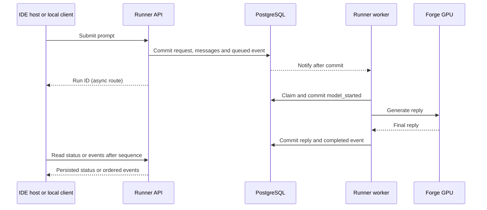

# Forge agent runner

Mission Control runs `forge-agent-runner.service` as the `forge_agent` account.
The service listens on `127.0.0.1:18083`. In legacy mode it uses the private
tunnel on `127.0.0.1:18082` to send inference requests to Forge GPU. In dispatch
mode the API stores jobs in PostgreSQL and consumes results from a worker on Forge.



## Install and verify

```bash
sudo deploy/mission-control/agent-runner/setup-runner.sh
sudo deploy/mission-control/agent-runner/connect-ide.py
sudo journalctl -u forge-agent-runner.service
```

The setup script checks the database, installs the Ubuntu psycopg2 package when
needed, and installs the native service. systemd supplies separate incoming and
outgoing bearer credentials. The incoming credential is created under
`/etc/homelab-forge/agent-runner/`. Keep it on Mission Control.

The IDE connection script updates the existing chat relay endpoint, restarts the
web host, and checks an authenticated chat plus its database events. It restores
the previous configuration if verification fails. To reconnect the IDE directly
to Forge, run `sudo deploy/mission-control/agent-runner/connect-ide.py --rollback`.

## Local API

All routes require the runner's bearer credential. The credential represents the
single Mission Control operator.

| Request | Result |
| --- | --- |
| `GET /health` | Runner readiness, including database access in dispatch mode |
| `POST /v1/runs` | Accept a run and return its run ID, conversation ID, and current status |
| `GET /v1/runs/{id}` | Read current status and the saved answer after completion |
| `GET /v1/runs/{id}/events?after=0&wait=20` | Replay events after the given sequence and wait up to 20 seconds for an update |
| `POST /v1/chat/completions` | Compatibility route for the existing IDE relay |
| `POST /v1/workspace` | Save or restore an authenticated Forge IDE workspace through PostgreSQL |
| `POST /v1/dispatch` | Header-routed saved-chat, asynchronous IDE run, Mail, and opt-in coding-job admission operations |

For a new async run, send JSON with `messages` and optional `model`,
`max_tokens`, and `temperature`. Send the returned `conversation_id` and the new
user turn on a follow-up. The service reads the saved conversation history for
inference and allows one unfinished run per conversation. Supply an
`Idempotency-Key` header to retry a submission. Reusing the key and conversation
with the same input returns the original run. A different input returns 409.

The worker pins the model ID per run and verifies that model is ready on Forge.
A model mismatch becomes a saved failure. The IDE relay sends a full transcript
for each turn. It can include a stable `chat_id` and the `expected_revision` it
opened. A successful linked turn advances the chat revision and returns its
`chat_id` and committed `revision` with the assistant reply.
The compatibility route waits up to 13 seconds. Longer runs continue in the
database and can be inspected through the local API or SQL.

The IDE sends a stable `chat_id` and, when continuing a saved chat, its
`expected_revision`. The runner commits the transcript with the successful run
and returns the new revision. The chat history routes use the
`Forge-Destination`, `Forge-Request-Id`, `Forge-Envelope-Version`, and
`Forge-Contract-Version` headers and the same bearer credential. Their DAO
checks the operator scope and the current revision for retention and deletion.
Saved chats expire by default. The first committed turn sets a fixed expiration
through the UTC calendar date 30 days later. An explicit retention choice can
replace that date or keep the chat indefinitely. Chats with the previous
default indefinite policy receive the full 30-day window from the migration
date.
The runner sweeps expired chats in bounded batches every minute. Reads exclude
chats as soon as they are due.

## IDE workspace recovery

When the web host sets `chat.workspace_persistence`, it uses the configured
runner credential to save and restore the workspace. PostgreSQL holds completed
Chat history for the operator and personal checkpoints for each browser tab.
A new tab can list and open committed Chat messages. The original tab also
restores its Chat drafts, selected conversation, pending run, and Workbench
bookmark. In addition to its random tab identifier, the browser keeps a bounded
same-tab Home/Design handoff JSON cache of drafts and bookmarks; completed
transcript bodies are excluded. The Workbench loads a fresh inspection and
verifies its selected source again. Active history uses `ide_chats`; the legacy
`ide_workspace_history` row records activation and migration metadata.

Apply the migrations with `../setup-postgres.sh` before updating the runner and
enabling persistence in the web host. Upgrade the runner before publishing a
web host with Previous chats. The first history-aware request imports the
shared workspace transcripts. Older clients can read their checkpoints
after import. Checkpoint writes require a client that supports stable chat IDs.

## Saved chat history

The browser calls `POST /forge/v1/dispatch` at the web host. The host admits the
browser session and forwards the operation to the runner’s `POST /v1/dispatch`
with its bearer credential. Both version headers are `1`. The runner checks the
`Forge-Destination` against the request kind and requires the request ID to
match the `Forge-Request-Id` header.

| Forge destination | Result |
| --- | --- |
| `ide.chat.history.list` | A bounded page of available chat summaries |
| `ide.chat.history.open` | A chat summary and committed transcript |
| `ide.chat.history.retention.set` | The updated retention policy and revision |
| `ide.chat.history.delete` | The removed chat ID and tombstone revision |

Mutation requests carry the expected chat revision. An absent or expired chat
returns 404 and an outdated revision returns 409. Long-term retention clears
the expiry. A dated policy keeps the chat through the chosen calendar date
in its stored time zone, with UTC as the default.

The runner checks for due chats every minute. Both expiration and confirmed
deletion remove the saved transcript, explicitly linked runs, and matching tab
checkpoints in a transaction. The retained tombstone prevents stale writes from
recreating the chat. Unlinked legacy run snapshots retain their independent
scope.

## Mail

Mail uses `ide.mail.list`, `ide.mail.open`, `ide.mail.send`, `ide.mail.retry`,
and the opt-in `ide.mail.archive` operation on the same versioned dispatch endpoint. Apply migration `0007` and install the
packages in `requirements-mail-tokenizer.txt` from its hashed wheel set in the
runner's Python environment. Install the matching Forge adapter and worker,
configure `gpt-oss-120b` with its Mail profile, then enable `chat.mail_enabled`
on the web host with workspace persistence and asynchronous dispatch enabled.

The `gpt-oss-120b-harmony-v1` profile uses a 4,096-token context with 1,024 tokens
reserved for generation (including reasoning), a 16-token operating margin and
a 256-token minimum follow-up allowance. The runner can admit Mail offline. Forge
verifies the rendered prompt size before inference. Each job has a four-hour
deadline and the adapter allows up to 30 minutes for inference.

PostgreSQL stores the ordered Mail transcript and job history. Each new request
replays all completed exchanges followed by its new message. The transcript stays
readable after the thread reaches its recall limit and moves to Archive. A reply
that reached the generation limit is marked in the reader. Recall exhaustion
archives a thread automatically. Manual archive is an opt-in terminal operation
stopping future follow-ups while retaining the transcript; delete and read/unread
mutations are not current Mail routes.

`ide.mail.archive` accepts `mail_archive_thread` with thread_id and expected_revision,
then returns `mail_archived` with the base_revision and result_revision after commit.
The same owner/thread/base retry returns the original receipt without changing
revision or timestamps. Manual and context_limit reasons remain distinct. The
native `chat.mail_archive_enabled` flag defaults to false. Registered migration
0008, matching runner/host and ABI 5 assets require a coordinated rollout with
session rotation; once Manual records exist, rollback needs a compatible reader.
See [host compatibility](../../../src/rust/forge-ide-web-host/README.md#workbench-asset-compatibility).
No running configuration or schema is changed by this repository work.

Current Rust UI requests optional bounded previews and per-message dates with
`include_metadata`. Inbox rows show sender, date, subject, preview and generation
status; Compose opens the new-message form and Reply to thread opens the inline
follow-up. Five-second Rust-scheduled refresh runs while visible work is pending.
Unsent Mail drafts are current-page state and same-tab navigation handoff data,
not durable or cross-device saved drafts. Model switch or restart loses prefix
KV cache; saved text is replayed instead.

### Monitor the Mail model on Forge

As the user running `forge-llama.service` on Forge, install
`monitor-forge-mail.py` as `~/.local/bin/forge-mail-monitor.py`. Add this line to
that user's crontab to take five-second samples during each minute.

```cron
* * * * * /usr/bin/python3 -B "$HOME/.local/bin/forge-mail-monitor.py" --duration 55 --interval 5 >/dev/null 2>&1
```

The sampler writes UTC JSON lines to `~/.local/state/forge-mail-monitor/telemetry.jsonl`
while the service's GPT-OSS 120B process loads or has a backend connection.
It skips a ready, idle model. Use `--duration 1 --interval 1 --include-idle` for
an immediate snapshot of a resident model, or use `--duration 10 --interval 5
--include-idle` to include interval rates. The default PCI device is Forge's
Intel Arc and the disk defaults to the model's backing block device.

A private directory and a lock keep simultaneous invocations from writing
over each other. The sampler retains the current log and two rotations up to
8 MiB each. CPU percentages for llama and the service cgroup use 100% per
logical CPU. GPU engine percentages describe the model's DRM client, while
GT activity covers the device. Missing kernel counters are omitted or `null`.
The sampler reads process, kernel and loopback health data without accessing
Mail contents, PostgreSQL or bearer tokens.

## Event and recovery behavior

The run, submitted messages, and queued event commit together. PostgreSQL
notifications wake the worker and long-poll clients after commit. The worker
subscribes before scanning the queue and scans again on wake-up or timeout, so
requests queued while it is stopped are still processed. The legacy worker
holds a database advisory lock. If it is interrupted after claiming a run,
the next legacy worker records `interrupted` and processes queued work.

The terminal status, assistant reply, and terminal event commit together.
`run_events` is the replay source. Event payloads carry status and operational
metadata. Prompts and replies are stored in `messages`.

## Repository tool runs

The private runner can process read-only repository questions against a pinned
Git commit. Configure `FORGE_RUNNER_TOOL_REPOSITORIES` as a JSON map of approved
aliases to absolute paths of locally maintained Git mirrors. Grant the runner
read access to the mirrors and load the existing `forge.token` connector
credential if repository tools are enabled alongside PostgreSQL dispatch.

Submit an authenticated `POST /v1/agent/runs` with an `Idempotency-Key` and a
JSON body containing `repository`, `revision`, and the usual `messages`.
The revision must be the full commit ID and available in the configured mirror.
Read the result and the ordered `tool_started` and `tool_finished` events
through the existing `/v1/runs` status and event routes. The model can list
regular tracked files and read bounded excerpts. Each call and its matching
result are stored with the run. Recovery marks an unfinished tool call as
having an unknown outcome. The operator maintains the mirrors.

## PostgreSQL dispatch mode

Apply the dispatch migration before installing
`forge-agent-runner-dispatch.service` under the existing
`forge-agent-runner.service` name. Drain legacy runs before switching the unit.
The dispatch unit sets `FORGE_RUNNER_MODE=dispatch` and loads the runner's inbound
credential. `FORGE_RUNNER_MODEL` sets the default for IDE submissions and defaults
to `gpt-oss-20b`. `FORGE_RUNNER_MODELS` accepts a comma-separated list of known
model IDs and must include the default when set. The catalog offers only the
default when the list is omitted. The API can accept new jobs while Forge is
offline.

Install `forge_gpu_worker.py` and `model_adapter.py` under
`~/.local/lib/forge-gpu-worker/` on Forge with psycopg2 available to Python.
Install `forge-gpu-worker.service` as a user unit. The unit expects
`forge-postgres-tunnel.service` to forward Forge loopback port 15432 to
Mission Control PostgreSQL, and `forge-llama.service` to serve the authenticated
model adapter on Forge loopback port 18080. The worker authenticates with a
private libpq passfile for the `forge_gpu_worker` database login. Supply its path
in `PGPASSFILE` and the existing local model credential path in
`FORGE_WORKER_MODEL_TOKEN_FILE`. `FORGE_WORKER_POSTGRES_PORT` and
`FORGE_WORKER_MODEL_PORT` override the loopback ports for staging.

IDE requests use the same Forge version and request ID headers as saved-chat
requests. Every body includes those requests' matching `request_id`.

| Forge destination | Result |
| --- | --- |
| `ide.chat.run.models` | Returns the configured model labels, default, and current worker readiness |
| `ide.chat.run.submit` | Commits a new turn and returns the run ID with HTTP 202 |
| `ide.chat.run.events` | Returns run status, a bounded event page and the saved answer when complete |
| `ide.chat.run.cancel` | Cancels a linked run or returns its terminal status |

The browser includes an optional `model_id` in its submission. The runner pins
that ID in the queued run. A retry with the same idempotency key and a different
explicit selection returns 409. Readiness reflects a recent heartbeat for the
loaded model. A configured choice can still queue while its model is unloaded.

Forge claims compatible jobs with a database lease and renews each lease while
inference is running. The result inbox preserves a committed reply across a
Mission Control restart. The runner drains it before waiting for notifications,
finalizes with the current chat policy, and requeues eligible interrupted
attempts. The worker role can claim, renew and publish through the restricted
database routines. Transcript writes remain with Mission Control.

For rollback, stop Forge claims and resolve distributed runs and result
receipts before restoring the legacy service template. The first rollout
handles text inference. [Dispatch design](../../../docs/architecture/forge-postgres-inference-dispatch.md)

## Coding-job durable admission (opt-in, first slice)

Coding-job admission (`ide.work.*`) is **disabled by default** and operates
independently of legacy/dispatch inference, Mail, Chat persistence, and GPU
flags. To opt in, set `FORGE_RUNNER_WORK_CONFIG` to the absolute path of a
trusted JSON configuration file containing strict keys `owner`,
`allowed_projects`, `allowed_modes` (subset of `plan`, `review`, `implement`),
optional `max_pending` (default `32`, range `1..256`), and `profiles` (mapping
each profile alias to `{backend, model, resource_profile}` where `backend` is
`antigravity` or `codex`). When `FORGE_RUNNER_WORK_CONFIG` is unset, startup
performs no work config file reads, database connections, or CLI actions, and
supported `ide.work.*` requests return `503` (`work_failed`, `unavailable`).
Unsupported `ide.work.*` destinations always return `404` (`not_found`).

Supported destinations on authenticated `POST /v1/dispatch` (version `1` Forge
headers, 16 KiB raw request bound):

| Forge destination | Request `kind` | Response `kind` & status |
| --- | --- | --- |
| `ide.work.submit` | `work_submit` | `202` `work_submitted` (idempotent; pins nonsecret recipe and commits task, `queued` event sequence 1, and empty `pg_notify('forge_coding_jobs', '')`) |
| `ide.work.get` | `work_get` | `200` `work_opened` (owner/project-scoped task summary plus `prompt` and `acceptance_criteria`, without recipe body) |
| `ide.work.list` | `work_list` | `200` `work_listed` (ascending `(created_at, task_id)` keyset pagination scoped to owner and project) |
| `ide.work.events` | `work_events` | `200` `work_events` (monotonic per-task events strictly after `after_sequence`) |
| `ide.work.cancel` | `work_cancel` | `200` `work_cancel_recorded` (queued-only CAS cancellation with immutable control-receipt replay before CAS/state checks) |

**Model-native token policy:** Pinned coding recipes always store
`generation_token_limit: null` and never inherit `llama.cpp` or Mail token
caps; native provider/model limits still apply.

**Current scope limits:** This first slice covers durable admission and queued
cancellation only. No coding-agent execution worker, subprocess runner, attempt
claiming, result chunks, `resume`, `accept`, usage collector, or UI is
implemented or started; admitted tasks remain `queued` until explicitly
cancelled. Migration `0009_coding_admission.sql` and runner config activation
are **not** deployed to production by repository changes alone.
