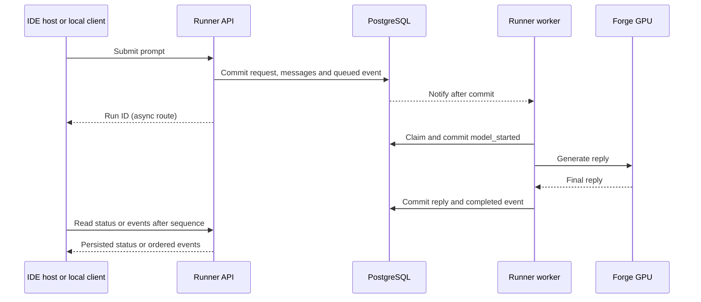

# Forge agent runner

Mission Control runs `forge-agent-runner.service` as the `forge_agent` account.
The service listens on `127.0.0.1:18083`. In legacy mode it uses the private
tunnel on `127.0.0.1:18082` to send inference requests to Forge GPU. In dispatch
mode the API stores jobs in PostgreSQL and consumes results from a worker on Forge.



## Install and verify

```bash
sudo deploy/mission-control/agent-runner/setup-runner.sh
sudo deploy/mission-control/agent-runner/connect-ide.py
sudo journalctl -u forge-agent-runner.service
```

The setup script checks the database, installs the Ubuntu psycopg2 package when
needed, and installs the native service. systemd supplies separate incoming and
outgoing bearer credentials. The incoming credential is created under
`/etc/homelab-forge/agent-runner/`. Keep it on Mission Control.

The IDE connection script updates the existing chat relay endpoint, restarts the
web host, and checks an authenticated chat plus its database events. It restores
the previous configuration if verification fails. To reconnect the IDE directly
to Forge, run `sudo deploy/mission-control/agent-runner/connect-ide.py --rollback`.

## Local API

All routes require the runner's bearer credential. The credential represents the
single Mission Control operator.

| Request | Result |
| --- | --- |
| `GET /health` | Runner readiness, including database access in dispatch mode |
| `POST /v1/runs` | Accept a run and return its run ID, conversation ID, and current status |
| `GET /v1/runs/{id}` | Read current status and the saved answer after completion |
| `GET /v1/runs/{id}/events?after=0&wait=20` | Replay events after the given sequence and wait up to 20 seconds for an update |
| `POST /v1/chat/completions` | Compatibility route for the existing IDE relay |
| `POST /v1/workspace` | Save or restore an authenticated Forge IDE workspace through PostgreSQL |
| `POST /v1/dispatch` | Header-routed saved-chat, asynchronous IDE run, Mail, and opt-in coding-job admission operations |

For a new async run, send JSON with `messages` and optional `model`,
`max_tokens`, and `temperature`. Send the returned `conversation_id` and the new
user turn on a follow-up. The service reads the saved conversation history for
inference and allows one unfinished run per conversation. Supply an
`Idempotency-Key` header to retry a submission. Reusing the key and conversation
with the same input returns the original run. A different input returns 409.

The worker pins the model ID per run and verifies that model is ready on Forge.
A model mismatch becomes a saved failure. The IDE relay sends a full transcript
for each turn. It can include a stable `chat_id` and the `expected_revision` it
opened. A successful linked turn advances the chat revision and returns its
`chat_id` and committed `revision` with the assistant reply.
The compatibility route waits up to 13 seconds. Longer runs continue in the
database and can be inspected through the local API or SQL.

The IDE sends a stable `chat_id` and, when continuing a saved chat, its
`expected_revision`. The runner commits the transcript with the successful run
and returns the new revision. The chat history routes use the
`Forge-Destination`, `Forge-Request-Id`, `Forge-Envelope-Version`, and
`Forge-Contract-Version` headers and the same bearer credential. Their DAO
checks the operator scope and the current revision for retention and deletion.
Saved chats expire by default. The first committed turn sets a fixed expiration
through the UTC calendar date 30 days later. An explicit retention choice can
replace that date or keep the chat indefinitely. Chats with the previous
default indefinite policy receive the full 30-day window from the migration
date.
The runner sweeps expired chats in bounded batches every minute. Reads exclude
chats as soon as they are due.

## IDE workspace recovery

When the web host sets `chat.workspace_persistence`, it uses the configured
runner credential to save and restore the workspace. PostgreSQL holds completed
Chat history for the operator and personal checkpoints for each browser tab.
A new tab can list and open committed Chat messages. The original tab also
restores its Chat drafts, selected conversation, pending run, and Workbench
bookmark. In addition to its random tab identifier, the browser keeps a bounded
same-tab Home/Design handoff JSON cache of drafts and bookmarks; completed
transcript bodies are excluded. The Workbench loads a fresh inspection and
verifies its selected source again. Active history uses `ide_chats`; the legacy
`ide_workspace_history` row records activation and migration metadata.

Apply the migrations with `../setup-postgres.sh` before updating the runner and
enabling persistence in the web host. Upgrade the runner before publishing a
web host with Previous chats. The first history-aware request imports the
shared workspace transcripts. Older clients can read their checkpoints
after import. Checkpoint writes require a client that supports stable chat IDs.

## Saved chat history

The browser calls `POST /forge/v1/dispatch` at the web host. The host admits the
browser session and forwards the operation to the runner’s `POST /v1/dispatch`
with its bearer credential. Both version headers are `1`. The runner checks the
`Forge-Destination` against the request kind and requires the request ID to
match the `Forge-Request-Id` header.

| Forge destination | Result |
| --- | --- |
| `ide.chat.history.list` | A bounded page of available chat summaries |
| `ide.chat.history.open` | A chat summary and committed transcript |
| `ide.chat.history.retention.set` | The updated retention policy and revision |
| `ide.chat.history.delete` | The removed chat ID and tombstone revision |

Mutation requests carry the expected chat revision. An absent or expired chat
returns 404 and an outdated revision returns 409. Long-term retention clears
the expiry. A dated policy keeps the chat through the chosen calendar date
in its stored time zone, with UTC as the default.

The runner checks for due chats every minute. Both expiration and confirmed
deletion remove the saved transcript, explicitly linked runs, and matching tab
checkpoints in a transaction. The retained tombstone prevents stale writes from
recreating the chat. Unlinked legacy run snapshots retain their independent
scope.

## Mail

Mail uses `ide.mail.list`, `ide.mail.open`, `ide.mail.send`, `ide.mail.retry`,
and the opt-in `ide.mail.archive` operation on the same versioned dispatch endpoint. Apply migration `0007` and install the
packages in `requirements-mail-tokenizer.txt` from its hashed wheel set in the
runner's Python environment. Install the matching Forge adapter and worker,
configure `gpt-oss-120b` with its Mail profile, then enable `chat.mail_enabled`
on the web host with workspace persistence and asynchronous dispatch enabled.

The `gpt-oss-120b-harmony-v1` profile uses a 4,096-token context with 1,024 tokens
reserved for generation (including reasoning), a 16-token operating margin and
a 256-token minimum follow-up allowance. The runner can admit Mail offline. Forge
verifies the rendered prompt size before inference. Each job has a four-hour
deadline and the adapter allows up to 30 minutes for inference.

PostgreSQL stores the ordered Mail transcript and job history. Each new request
replays all completed exchanges followed by its new message. The transcript stays
readable after the thread reaches its recall limit and moves to Archive. A reply
that reached the generation limit is marked in the reader. Recall exhaustion
archives a thread automatically. Manual archive is an opt-in terminal operation
stopping future follow-ups while retaining the transcript; delete and read/unread
mutations are not current Mail routes.

`ide.mail.archive` accepts `mail_archive_thread` with thread_id and expected_revision,
then returns `mail_archived` with the base_revision and result_revision after commit.
The same owner/thread/base retry returns the original receipt without changing
revision or timestamps. Manual and context_limit reasons remain distinct. The
native `chat.mail_archive_enabled` flag defaults to false. Registered migration
0008, matching runner/host and ABI 5 assets require a coordinated rollout with
session rotation; once Manual records exist, rollback needs a compatible reader.
See [host compatibility](../../../src/rust/forge-ide-web-host/README.md#workbench-asset-compatibility).
No running configuration or schema is changed by this repository work.

Current Rust UI requests optional bounded previews and per-message dates with
`include_metadata`. Inbox rows show sender, date, subject, preview and generation
status; Compose opens the new-message form and Reply to thread opens the inline
follow-up. Five-second Rust-scheduled refresh runs while visible work is pending.
Unsent Mail drafts are current-page state and same-tab navigation handoff data,
not durable or cross-device saved drafts. Model switch or restart loses prefix
KV cache; saved text is replayed instead.

### Monitor the Mail model on Forge

As the user running `forge-llama.service` on Forge, install
`monitor-forge-mail.py` as `~/.local/bin/forge-mail-monitor.py`. Add this line to
that user's crontab to take five-second samples during each minute.

```cron
* * * * * /usr/bin/python3 -B "$HOME/.local/bin/forge-mail-monitor.py" --duration 55 --interval 5 >/dev/null 2>&1
```

The sampler writes UTC JSON lines to `~/.local/state/forge-mail-monitor/telemetry.jsonl`
while the service's GPT-OSS 120B process loads or has a backend connection.
It skips a ready, idle model. Use `--duration 1 --interval 1 --include-idle` for
an immediate snapshot of a resident model, or use `--duration 10 --interval 5
--include-idle` to include interval rates. The default PCI device is Forge's
Intel Arc and the disk defaults to the model's backing block device.

A private directory and a lock keep simultaneous invocations from writing
over each other. The sampler retains the current log and two rotations up to
8 MiB each. CPU percentages for llama and the service cgroup use 100% per
logical CPU. GPU engine percentages describe the model's DRM client, while
GT activity covers the device. Missing kernel counters are omitted or `null`.
The sampler reads process, kernel and loopback health data without accessing
Mail contents, PostgreSQL or bearer tokens.

## Event and recovery behavior

The run, submitted messages, and queued event commit together. PostgreSQL
notifications wake the worker and long-poll clients after commit. The worker
subscribes before scanning the queue and scans again on wake-up or timeout, so
requests queued while it is stopped are still processed. The legacy worker
holds a database advisory lock. If it is interrupted after claiming a run,
the next legacy worker records `interrupted` and processes queued work.

The terminal status, assistant reply, and terminal event commit together.
`run_events` is the replay source. Event payloads carry status and operational
metadata. Prompts and replies are stored in `messages`.

## Repository tool runs

The private runner can process read-only repository questions against a pinned
Git commit. Configure `FORGE_RUNNER_TOOL_REPOSITORIES` as a JSON map of approved
aliases to absolute paths of locally maintained Git mirrors. Grant the runner
read access to the mirrors and load the existing `forge.token` connector
credential if repository tools are enabled alongside PostgreSQL dispatch.

Submit an authenticated `POST /v1/agent/runs` with an `Idempotency-Key` and a
JSON body containing `repository`, `revision`, and the usual `messages`.
The revision must be the full commit ID and available in the configured mirror.
Read the result and the ordered `tool_started` and `tool_finished` events
through the existing `/v1/runs` status and event routes. The model can list
regular tracked files and read bounded excerpts. Each call and its matching
result are stored with the run. Recovery marks an unfinished tool call as
having an unknown outcome. The operator maintains the mirrors.

## PostgreSQL dispatch mode

Apply the dispatch migration before installing
`forge-agent-runner-dispatch.service` under the existing
`forge-agent-runner.service` name. Drain legacy runs before switching the unit.
The dispatch unit sets `FORGE_RUNNER_MODE=dispatch` and loads the runner's inbound
credential. `FORGE_RUNNER_MODEL` sets the default for IDE submissions and defaults
to `gpt-oss-20b`. `FORGE_RUNNER_MODELS` accepts a comma-separated list of known
model IDs and must include the default when set. The catalog offers only the
default when the list is omitted. The API can accept new jobs while Forge is
offline.

Install `forge_gpu_worker.py` and `model_adapter.py` under
`~/.local/lib/forge-gpu-worker/` on Forge with psycopg2 available to Python.
Install `forge-gpu-worker.service` as a user unit. The unit expects
`forge-postgres-tunnel.service` to forward Forge loopback port 15432 to
Mission Control PostgreSQL, and `forge-llama.service` to serve the authenticated
model adapter on Forge loopback port 18080. The worker authenticates with a
private libpq passfile for the `forge_gpu_worker` database login. Supply its path
in `PGPASSFILE` and the existing local model credential path in
`FORGE_WORKER_MODEL_TOKEN_FILE`. `FORGE_WORKER_POSTGRES_PORT` and
`FORGE_WORKER_MODEL_PORT` override the loopback ports for staging.

IDE requests use the same Forge version and request ID headers as saved-chat
requests. Every body includes those requests' matching `request_id`.

| Forge destination | Result |
| --- | --- |
| `ide.chat.run.models` | Returns the configured model labels, default, and current worker readiness |
| `ide.chat.run.submit` | Commits a new turn and returns the run ID with HTTP 202 |
| `ide.chat.run.events` | Returns run status, a bounded event page and the saved answer when complete |
| `ide.chat.run.cancel` | Cancels a linked run or returns its terminal status |

The browser includes an optional `model_id` in its submission. The runner pins
that ID in the queued run. A retry with the same idempotency key and a different
explicit selection returns 409. Readiness reflects a recent heartbeat for the
loaded model. A configured choice can still queue while its model is unloaded.

Forge claims compatible jobs with a database lease and renews each lease while
inference is running. The result inbox preserves a committed reply across a
Mission Control restart. The runner drains it before waiting for notifications,
finalizes with the current chat policy, and requeues eligible interrupted
attempts. The worker role can claim, renew and publish through the restricted
database routines. Transcript writes remain with Mission Control.

For rollback, stop Forge claims and resolve distributed runs and result
receipts before restoring the legacy service template. The first rollout
handles text inference. [Dispatch design](../../../docs/architecture/forge-postgres-inference-dispatch.md)

## Coding-job durable backend & usage (opt-in)

Coding-job routes (`ide.work.*`) and provider usage routes (`ide.usage.*`) are
**disabled by default** and operate independently of legacy/dispatch inference,
Mail, Chat persistence, and GPU flags.

- Set `FORGE_RUNNER_WORK_CONFIG` to the absolute path of a trusted JSON
  configuration file containing strict keys `owner`, `allowed_projects` (max 64),
  `allowed_modes` (subset of `plan`, `review`, `implement`), optional
  `max_pending` (default `32`, range `1..256`), optional `project_labels` and
  `repair_policy`, plus `profiles` (max 64, mapping each profile alias to `{backend, model,
  resource_profile}` plus optional `label`). Profiles using
  `resource_profile: "forge-coding-v5"` pin immutable recipe version `2` with
  `policy_digest` from `work_policy.py`; legacy version `1` fixtures remain
  readable/admissible but are never claimed by workers.
- Set `FORGE_RUNNER_USAGE_CONFIG` independently to enable `ide.usage.*` through
  `UsageServiceFactory(config, lambda cfg: UsageStore(cfg, store.connect))`
  (when `usage_api.py` is installed). It may point to the same trusted config
  file, but is never implicitly enabled by `FORGE_RUNNER_WORK_CONFIG`.
- When disabled, startup performs no work/usage config file reads, database
  connections, or CLI actions; supported `ide.work.*` / `ide.usage.*` routes
  return `503` (`work_failed` / `usage_failed`, `unavailable`) and unsupported
  destinations return `404` (`not_found`).

The `forge-coding-v3` policy retains `antigravity_tool_policy: workspace-elevated-v1`
and adds receipt-owned, task-scoped Antigravity conversation continuation.
Gemini coding tasks allow shell commands and read-only URL reads without an
approval prompt (`ask: []`); filesystem tools can read the task workspace and
attempt scratch area. Implement mode grants file writes only to those two scoped
paths. Plan/review retain `write_file(*)` denial and a read-only workspace mount.
MCP and browser actuation remain denied; the invocation does not bypass the CLI
permission system. OS isolation, unprivileged UID/capability drop, canonical/DB
masks, supervision and `useG1Credits: false` remain unchanged. Apply additive
migration `0013_coding_task_session_policy.sql` through the migration registry and
verify it before activating policy3; it preserves policy1/policy2 history and
exact digest fencing. No new secret is
needed. Install the new policy in both API admission and
worker releases and explicitly select its resource profile before accepting new
work; previous policy IDs/digests retain their identity and are refused by the
new worker, never silently upgraded or automatically replayed.

Supported `ide.work.*` destinations on authenticated `POST /v1/dispatch`
(version `1` Forge headers, 16 KiB raw request bound):

| Forge destination | Request `kind` | Response `kind` & status |
| --- | --- | --- |
| `ide.work.catalog` | `work_catalog` | `200` `work_catalog` (configured projects/profiles filtered by fresh <=90s trusted worker advertisements; no host paths/binaries/auth files) |
| `ide.work.submit` | `work_submit` | `202` `work_submitted` (idempotent; pins nonsecret recipe v2/v1, prepares bounded `title`, commits task, `queued` event sequence 1, and empty `pg_notify('forge_coding_jobs', '')`) |
| `ide.work.get` | `work_get` | `200` `work_opened` (`event.task`: owner/project-scoped task detail with `title`, `prompt`, `acceptance_criteria`, nullable `attempt`, published-only `result`, and current `reconciliation_receipt_id`) |
| `ide.work.list` | `work_list` | `200` `work_listed` (ascending `(created_at, task_id)` keyset pagination scoped to owner and project across all 11 statuses; omits prompt body) |
| `ide.work.events` | `work_events` | `200` `work_events` (monotonic per-task events strictly after `after_sequence`; event sequence is independent of task revision) |
| `ide.work.cancel` | `work_cancel` | `200` `work_cancel_recorded` (queued cancels immediately to `cancelled`; running transitions to `cancel_requested`; cross-action idempotent receipt replay before state/CAS checks) |
| `ide.work.result` | `work_result` | `200` `work_result_page` (UTF-8 boundary-safe, JSON-bounded paging over published immutable full results via `<sha256>.<byte_offset>` cursor; staging unreadable) |
| `ide.work.accept` | `work_accept` | `200` `work_accepted` (explicit acceptance of confirmed-stopped `awaiting_review` tasks to `completed`; never auto-merges code) |
| `ide.work.resume` | `work_resume` | `202` `work_resumed` (explicit resume requiring current trusted `reconciliation_receipt_id`, CAS `expected_revision`, and configured grants; pins `resume_workspace_digest`) |
| `ide.work.plan.decide` | `work_plan_decide` | `work_plan_decided` for artifact-bound Resume, Revise or Cancel; optional explicit `auto_repair` on Resume. |
| `ide.work.review.decide` | `work_review_decide` | `work_review_decided` for source-bound approval, repair, escalation, infrastructure retry or cancellation; never final acceptance. |
| `ide.work.repair` | `work_repair` | `202` `work_repair_submitted`; linked completed-task correction, with null child ID while a legacy source import is pending. |
| `ide.work.publication.retry` | `work_publication_retry` | `202` `work_publication_retry_queued`; append-only retry for an exact failed publication/candidate. |

### Finished plans, feedback and verified PR publication

This is source support as of 20 November 2026, **not a deployed capability**.
Apply and verify additive migrations13,14 and15, then install matching API,
coding/publication runtime and policy `forge-coding-v5` before enabling this
lifecycle. Policy5 retains policy3 session isolation and policy4 artifact-bound
plan decisions, adding `feedback_workflow: lease-bound-immutable-feedback-review-v1`.
Deploy the portal HTML/CSS/JS/WASM together as ABI8. Historical recipes remain
immutable; upgrading does not replay or silently re-pin an old attempt.

`ide.work.plan.decide` binds the expected task revision, published plan attempt
and SHA256, profile and stable idempotency key. A stopped Plan in Awaiting review
or legacy Completed offers **Resume**, **Revise** or **Cancel**. Resume approves
the saved plan and queues Implement; Revise requires feedback and queues another
read-only Plan; Cancel preserves history without starting an execution. Generic
Accept/Resume does not advance a finished Plan. Decision replay returns its
original receipt before current-state checks.

Implement submission and Plan Resume accept optional `auto_repair: false`.
Explicit opt-in freezes a `forge-repair-v1` root-chain budget: by default three
repair rounds, two successive rounds without independently verified progress
and one same-artifact infrastructure retry. Linked children and manual repair
requests share that root budget. A config change cannot expand an existing
chain. Zero repair rounds still permit review. No coding task inherits Mail or
llama.cpp completion-token limits; the existing 1,800-second attempt bound stays.

After the implementation stops and trusted reconciliation confirms its artifact,
the worker queues independent review. `CodingWorkerFactory` injects
`ReviewContextProvider` to read exact lease-bound feedback separately from the
immutable plan. Feedback is digest/source validated and mounted read-only;
missing or stale authority prevents execution. Public requests remain bounded
at 16KiB; private immutable feedback artifacts are bounded at 64KiB. Agent claims
never close findings or authorize publication, and no DB/GitHub credentials enter
the agent scope.

`PublicationWorkerFactory` composes `ReviewWorker`, `ReviewedCandidateProvider`,
fixed isolated checks, existing workspace/snapshot/Git/GitHub ports and a hosted
observer in the existing publication process. The check scope has no publication
credentials; it records the actual toolchain, source/gate manifest, findings and
cleanup proof. Source failures can return to the selected agent only within the
owner's frozen policy. Infrastructure, quota, scope and uncertain-stop outcomes
remain distinct. Workers never query a global registry.

**A local pass pauses for an independent owner decision.** In Agents, inspect
the exact candidate and findings; attest each resolved finding explicitly with
a note, then approve. The API binds the decision to the task revision/review and
retains the owner receipt privately. Neither model success nor repair opt-in is
publication approval. Both normal queueing and missed-callback recovery require
the same reviewed candidate authorization.

Trusted providers publish a nonforce `forge/task-<publication-id>` feature branch
and **draft PR to main** from the verified candidate; they never push main,
force-push, deploy or merge. Existing remote-head receipts constrain updates and
unknown acknowledgements are reconciled by reads. The observer records required
`check`, `pr-fast-gate` and `real-browser` outcomes under their workflow identities
on the exact PR head. Missing/pending/failed/stale checks block final acceptance.
Publication and verification retries append new runs and retain prior failures.

A later correction to a Completed task uses `ide.work.repair` with an explicit
approved-project candidate. If that legacy parent has no bound review, trusted
source import verifies the exact project commit/digest before materializing the
child. `work_repair_submitted.repair_task_id` is nullable during import and
`review_id` is optional. The portal keeps the parent/result open, polls its
review and offers linked navigation only after a real child ID exists. Completed
history and older receipt-bound workspaces remain intact. Private source-import
authorization is never accepted as a browser command field.

The optional service template remains `forge-publication-worker.service` using
trusted `FORGE_PUBLICATION_CONFIG`: `worker_config`, approved `repositories`,
`github_config_dir`, optional fixed `checks` and `required_hosted_checks`. Install
the verified immutable release and configure the matching trusted providers only
after schema verification and final CI/backend/28-group actual-browser gates.
When delegated autonomous merge is enabled, the trusted publisher also needs
`ReadWritePaths=/home/lrocha/repos/homelab/.git` to import the verified merge
objects and advance `refs/forge/verified-main` before recording completion.
The matching service template includes this grant. Add only the canonical
`.git` administration directory for each additional configured autonomous
project; do not grant writes to its source tree or worktrees. The native review
scope continues to mount source and Git metadata read-only. Existing custom
publication units need the same narrow grant during the matching rollout.

Focused implementation tests are not a deployment or a real-agent repair pilot.
See [the complete flow and rollout status](../../../docs/architecture/proposals/forge-agent-feedback-loop.md)
and [the implementation checkpoint](../../../docs/design/implementation-status.md#agent-feedback-loop-source-checkpoint--20-november-2026).

### Database roles, WorkerDB, and UsageStore

Migration `0010_coding_execution_and_usage.sql` extends `coding_tasks`,
`coding_events`, and `coding_control_receipts` (adding cross-action
`(owner_id, project_alias, task_id, idempotency_key)` uniqueness) and adds
`coding_worker_grants`, `coding_worker_readiness`, `coding_attempts`,
`coding_result_chunks`, `coding_reconciliation_receipts`,
`coding_provider_usage`, `coding_provider_usage_identities`, and
`coding_usage_refresh_requests`.

- `forge_agent` receives narrow table-level CRUD/read grants only and has zero
  access to `coding_worker_grants`, `coding_provider_usage_identities`, or
  worker/reconciler schemas.
- `forge_coding_worker` (`LOGIN NOINHERIT`) has `EXECUTE` only on scoped
  `SECURITY DEFINER` routines in `forge_coding_worker_api` (fixed
  `search_path = pg_catalog, pg_temp`) and zero direct table/column access.
- `forge_coding_reconciler` (`LOGIN NOINHERIT`) has `EXECUTE` only on
  `forge_coding_reconciler_api` (`expire_leases`, `pending_reconciliations`,
  `reconcile`) with no automatic requeue.
- `forge_gpu_worker` retains zero access to all coding/usage tables and APIs.
- `work_worker_store.WorkerDB(connect_factory, owner, *, reconcile_connect_factory=None)`
  is the injected-connection worker/reconciler adapter; `usage_store.UsageStore(config, connect_factory)`
  serves `overview(project_alias, profiles=None)` and `request_refresh(project_alias, agent_profile=None)`.

**Model-native token policy:** Pinned coding recipes always store
`generation_token_limit: null` and never inherit `llama.cpp` or Mail token
caps; native provider/model limits still apply. Repository changes do not
deploy migrations, roles, or live service configurations automatically.

### Isolated API staging

`FORGE_RUNNER_PORT` selects a validated loopback port (default `18083`).
Set `FORGE_RUNNER_API_ONLY=1` with a separate staging port to serve authenticated
Work/Usage APIs without starting Chat/Mail completion, tool or expiry consumers.
Normal service behavior uses `FORGE_RUNNER_API_ONLY=0` (the default).

### Verified coding-worker credential layout

The 19 November 2026 live rollout uses an immutable release, a separately
readable nonsecret API config under `/etc/homelab-forge/coding-api/`, and a
root-owned worker config under `/etc/homelab-forge/coding-worker/`. Do not place
service-readable JSON beneath the existing root-only runner-token directory.

The stable usage HMAC source is root-only and delivered with systemd
`LoadCredential=usage.hmac:...`. Since systemd credential-file modes may include
group-read access, the installed unit uses
`ExecStartPre=/usr/bin/install -m 0600 %d/usage.hmac /mnt/data/homelab-coding-worker/usage.hmac`.
The worker config selects that private runtime copy beneath its `0700` control
state. This retains strict regular-file/owner/`0600` HMAC validation. Child
scopes mask the entire control state, credential directory and explicit key path.
The key never enters a DTO or browser response.

[Verified deployment and operational boundaries](../../../docs/design/implementation-status.md#observed-deployment-checkpoint).

The coding workspace expects `rg` on its sanitized public tool PATH
(`/usr/local/bin:/usr/bin:/bin`, following the selected Rust tools). The dashboard
authoring attempt on 19 November stopped because `rg` was absent and its `grep`
fallback was not permitted by policy1. The verified existing ripgrep 15.2.0 binary
is now installed root-owned in `/usr/local/bin/rg`; an actual isolated-scope
probe confirmed discovery without changing permissions. Policy2 additionally
authorizes ordinary coding commands, and its real Gemini check ran both `rg` and
`grep`, wrote/read its own task file, and returned a coherent result with no
approval requests. The original blocked attempt remains immutable.

The verified live policy2/ABI7 release is
`20261119T215116Z-679088c-agents-dashboard` (code `679088c`). Both API admission
profiles select `forge-coding-v2`; the worker advertised the matching digest after
restart. Migration11 was backed up, applied and verified atomically before that
activation. Existing attempts were not upgraded or retried implicitly.


### Gemini public plan and progress reporting

Migration `0012_coding_progress.sql` must be applied, granted and verified before
starting a worker with live progress enabled. The normal `CodingWorkerFactory`
injects the scoped `WorkerDB.report_progress` callback into the Antigravity
command runner. The agent uses the provisioned command helper in its attempt
scratch to publish a public plan first, then observable milestone summaries.
The trusted parent validates strict bounded reports and persists idempotent
checkpoint events; database credentials and attempt tokens remain parent-owned.
The installer includes the self-contained `work_progress.py` runtime module.

The portal reads whitelisted public progress through `ide.work.events`, keeps the
current attempt's plan and latest20 milestones, and loads finished-task history.
Checkpoint events do not bump task revision, so new events also trigger a detail
refresh at unchanged revision. Reports cannot mark a task completed: a coherent
final result plus confirmed scope stop produces Ready for review; acceptance is
explicit. A successful Gemini result without a persisted public plan fails with
an actionable message. Existing running attempts cannot receive new instructions
retroactively. Codex retains its existing sandbox and terminal-result behavior.

See [ownership and sequence](../../../docs/architecture/coding-admission.md#public-plans-and-live-progress)
and the live [dispatch design](https://portal.thedevex.com/design/coding-agents#progress).

Verified live progress release: `20261119T225400Z-aa2eb1a-agents-dashboard`
(code `aa2eb1a`, schema12, browser ABI7, unchanged policy2). The running operator
attempt was allowed to finish before activation. No historical task acquired a
retroactive plan or automatic replay. Configuration and credentials were
preserved, and the staged/live portal checks passed.

### Antigravity session efficiency and accounting (policy3)

This implementation is source support, not a claim that policy3 is live. Apply
and verify migration13, install the new runtime modules in both release packages,
and explicitly select `resource_profile: "forge-coding-v3"` in admission profiles
alongside a matching worker before submitting new work. Existing policy2 jobs
retain their pinned policy and require their matching worker or explicit reviewed
resume; upgrading never automatically replays a task. No browser ABI change or
new credential is required.

Installed `agy 1.5.12 --help` was checked without generation or account calls.
`CommandRunnerProvider` uses these fixed headless arguments:

```text
agy --settings /run/forge-coding-attempt/settings.json
    --mode plan|accept-edits --model <configured model>
    --input-format stream-json --output-format stream-json
    --print-timeout 1800s --disable-slash-commands
    [--conversation <verified conversation UUID>]
```

The assignment is one JSON `user` event on stdin, followed by EOF. It is never a
shell argument or a `-p` prompt. `--resume` is not a supported flag. Never use
global `--continue`: every isolated child mounts its workspace at the same path,
so agy's latest-workspace cache could otherwise select another task's context.

`CodingWorkerFactory` injects the selected `AntigravitySessionProvider` into the
normal runner. A fresh submission always starts fresh. An explicit `ide.work.resume`
can reuse a conversation only after the existing database reconciliation receipt
and workspace lock admit it and the parent-private record matches task, project,
workspace/base revision, profile/model/recipe, local account and pinned binary.
The claimed lease also identifies the receipt's immediately preceding attempt;
an older worker's hint cannot match just because workspace bytes stayed unchanged.
Changed/missing hints start fresh; malformed hints fail closed before execution.
The parent removes the old hint before starting a child, then remembers only a
coherent, confirmed-stopped successful result. Interrupted, failed and uncertain
runs cannot leave an older hint eligible. Records live in private
`state_root/sessions`, outside the child's native/attempt mounts, with no prompts,
credentials or account endpoint data. Reusing context permits native caching but
does not guarantee a cache hit or quota reduction.

Only the validated terminal `result.usage` contributes token accounting. AGY's
`cache_read_tokens` and compatibility alias `cached_tokens` map to the single
Forge `cached_input_tokens` field; conflicting aliases leave that metric unknown.
Cached-only telemetry is partial, including exact zero and wide integer values.
The provider's explicit `total_tokens` is authoritative: cache/thinking metrics
are not added, and cached reads are not subtracted from input as if they were a
Codex input subset. Counters remain exact decimal strings in saved job records.

The official streaming contract makes result counters cumulative within a
process, but does not establish their baseline across separate processes resumed
with `--conversation`. Such attempts are therefore recorded with
`unverified_baseline` and unknown counters; prior totals are never counted again
or guessed by subtraction. A coherent reply remains reviewable even when usage
is unavailable. Allowance remains `unsupported_headless` / **Not reported**; no
consumer OAuth polling, model-based quota probes or credit fallback is added.

Each attempt retains the 1,800-second CLI/systemd wall bound, independent
nonblocking stdout/stderr reads and output limits. Systemd explicitly uses
`KillSignal=SIGTERM`, `FinalKillSignal=SIGKILL`, `SendSIGKILL=yes` and
`KillMode=control-group`. `work_process.terminate_and_reap` separately stops and
reaps the local launcher group with bounded TERM/KILL waits, including exceptional
paths. Both launcher cleanup and the independent cgroup stop proof are required
before a successful result; an already-cancelled task launches no CLI.

Primary contracts: [Headless CLI](https://antigravity.google/docs/cli/headless)
and [session resumption](https://antigravity.google/docs/cli/commands/resume).

### Codex warm author sessions and feature controls (policy8 / migration 0017)

This implementation is source support; applying migration `0017_coding_codex_warm_sessions.sql`
and activating `forge-coding-v8` remain explicit deployment steps. Migrations `0001`–`0016`
and historical `forge-coding-v1`–`v7` recipes, attempts and receipts remain unchanged.

Against verified installed Codex `0.160.0` (`--help`), `CommandRunnerProvider` selects
two exact headless command shapes (prompts always arrive on stdin via `-`, static
boundary/task prefix first and dynamic plan/feedback context appended at the end):

```text
# Fresh exec (author plan/implement omits --ephemeral when warm TTL > 0;
# independent reviewers, review mode, and ttl == 0 always pass --ephemeral)
<codex> --no-daemon --ask-for-approval never exec \
    --ignore-user-config --ignore-rules \
    --sandbox <danger-full-access|workspace-write|read-only> \
    --disable fast_mode --disable multi_agent \
    --model <configured model> \
    --json --color never [--ephemeral] -

# Explicit warm author continuation (never --last, --all, --worktree or bypass flags)
<codex> --no-daemon --ask-for-approval never exec \
    --sandbox <danger-full-access|workspace-write|read-only> --color never \
    resume \
    --ignore-user-config --ignore-rules \
    --disable fast_mode --disable multi_agent \
    --model <configured model> \
    --json <verified thread_id UUID> -
```

Because `codex exec resume --help` does not accept `--sandbox` or `--color` after `resume`,
those options are placed on parent `codex exec` before `resume` and enforced in
`SystemdSupervisor.argv()` alongside the existing external-sandbox policy contract.
Installed `ConfigReadResponse` types `service_tier` as `string|null` with no advertised
enum; Forge therefore does not invent a `service_tier` value and instead prevents
accidental user-config, fast-mode or unrequested sub-agent multipliers via
`--ignore-user-config`, `--ignore-rules`, `--disable fast_mode`, `--disable multi_agent`
and pinned `--model`.

`CodingWorkerFactory` injects a worker-scoped `CodexSessionProvider` storing parent-private
hints in `state_root/codex-sessions` (`0700`/`0600`, atomic `os.replace`, `recorded_at` UTC
epoch seconds). `WorkerConfig.codex_session_ttl_seconds` defaults to `1800` (bounded `0..3600`;
`0` disables warm reuse and forces `--ephemeral`). Independent peer reviewers
(`workflow_review_id` set) and `review`-mode tasks always run fresh `--ephemeral` without
touching the session store. Explicit author continuations reuse a prior `thread_id` only
when owner, task, workspace/base revision, profile/model/recipe, policy, account, pinned
binary, immediately preceding attempt, workspace digest and bounded TTL all match.
A stale/missing-session error before `turn.started` triggers at most one fresh non-ephemeral
fallback only after confirmed process/cgroup stop and proven zero work (no `turn.started`,
`item.*`, or `turn.completed` events) with unchanged workspace digest within the original
attempt wall-time bound.

Fresh and fallback Codex attempts normalize `turn.completed` `input_tokens`,
`cached_input_tokens`, `output_tokens` and `total_tokens = input_tokens + output_tokens`
with `session_provenance = "fresh_session"`. Resumed Codex attempts record
`session_provenance = "unverified_baseline"` and null counters (`unknown_attempts`) so
cumulative multi-turn usage is never double-counted. Existing one-shot
`account/rateLimits/read` allowance collection and `SIGTERM`→`SIGKILL` cgroup/process-group
cleanup remain unchanged.

Tests use owned fake Python children and disposable PostgreSQL16, with no model
turns or production database changes:

```sh
python3 -B -m unittest discover -s deploy/mission-control/agent-runner -p 'test*.py' -v
```

### Grok opt-in provider (policy9 / migration0018)

The Grok1.0.92 adapter follows the existing selected worker factory, scoped
workspace, lease, supervision and independent review path. Source support does
not enable execution: Grok `execution_enabled` defaults false in both API and
worker profiles. Qualify the actual account/allowance, controlled config and
nested/outer sandbox before an operator explicitly enables matching profiles.
Antigravity/Codex remain unchanged. Usage-only listing is independent of that
execution grant and reports Not reported, with no consumer OAuth polling.

See [the Grok provider design](../../../docs/architecture/grok-coding-provider.md)
for exact documented flags, isolated state, fresh-session policy, terminal-only
cache accounting, cancellation semantics and additive migration coverage.
Native folder trust is limited to ordinary repository instructions: a fixed
metadata-only preflight rejects executable project configuration before auth or
process acquisition, while read-only managed policy blocks unmanaged hooks,
MCP servers and marketplace installs. The immutable config disables `.envrc`
loading; the outer supervisor forwards no parent API-key environment.
