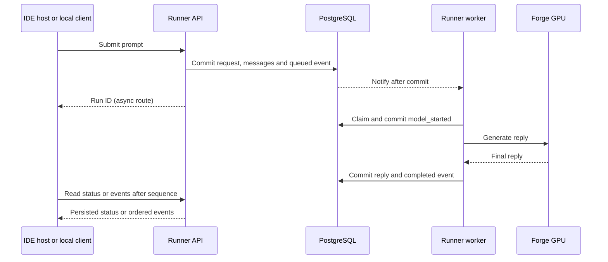

# Forge agent runner

Mission Control runs `forge-agent-runner.service` as the `forge_agent` account.
The service listens on `127.0.0.1:18083`. It uses the existing private tunnel on
`127.0.0.1:18082` to send inference requests to Forge GPU.



## Install and verify

```bash
sudo deploy/mission-control/agent-runner/setup-runner.sh
sudo deploy/mission-control/agent-runner/connect-ide.py
sudo journalctl -u forge-agent-runner.service
```

The setup script checks the database, installs the Ubuntu psycopg2 package when
needed, and installs the native service. systemd supplies separate incoming and
outgoing bearer credentials. The incoming credential is created under
`/etc/homelab-forge/agent-runner/`. Keep it on Mission Control.

The IDE connection script updates the existing chat relay endpoint, restarts the
web host, and checks an authenticated chat plus its database events. It restores
the previous configuration if verification fails. To reconnect the IDE directly
to Forge, run `sudo deploy/mission-control/agent-runner/connect-ide.py --rollback`.

## Local API

All routes require the runner's bearer credential. The credential represents the
single Mission Control operator.

| Request | Result |
| --- | --- |
| `GET /health` | Worker readiness |
| `POST /v1/runs` | Accept a run and return its run ID, conversation ID, and current status |
| `GET /v1/runs/{id}` | Read current status and the saved answer after completion |
| `GET /v1/runs/{id}/events?after=0&wait=20` | Replay events after the given sequence and wait up to 20 seconds for an update |
| `POST /v1/chat/completions` | Compatibility route for the existing IDE relay |

For a new async run, send JSON with `messages` and optional `model`,
`max_tokens`, and `temperature`. Send the returned `conversation_id` and the new
user turn on a follow-up. The service reads the saved conversation history for
inference and allows one unfinished run per conversation. Supply an
`Idempotency-Key` header to retry a submission. Reusing the key and conversation
with the same input returns the original run. A different input returns 409.

The worker pins the model ID per run and verifies that model is ready on Forge.
A model mismatch becomes a saved failure. The IDE relay sends a full transcript
with each request, so the compatibility route records a snapshot for each IDE
turn. The browser receives a single reply through its existing interface.
The compatibility route waits up to 13 seconds. Longer runs continue in the
database and can be inspected through the local API or SQL.

## Event and recovery behavior

The run, submitted messages, and queued event commit together. PostgreSQL
notifications wake the worker and long-poll clients after commit. The worker
subscribes before scanning the queue and scans again on wake-up or timeout, so
requests queued while it is stopped are still processed. A database advisory
lock allows one worker to claim inference jobs. If a worker is interrupted after
claiming a run, the next worker records `interrupted` and processes queued work.

The terminal status, assistant reply, and terminal event commit together.
`run_events` is the replay source. Event payloads carry status and operational
metadata. Prompts and replies are stored in `messages`.

This release handles text inference. The structured tool round trip and browser
progress display remain separate items in the [system inventory](../../../docs/architecture/forge-ide-system-inventory.yaml).
