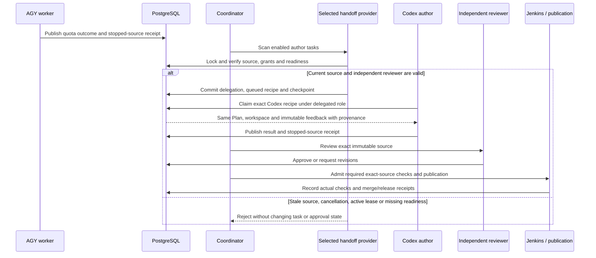

# AGY quota handoff to Codex

This optional author delegation preserves the original workflow snapshot. It
does not approve a Plan, code or merge. Source qualification and live activation
have separate receipts.

## Selection and ownership

`WorkConfig` selects `quota_handoff_profile` on an AGY source profile.
`WorkCatalog.resolve_handoff()` resolves an enabled native Codex author whose
alias differs from the independent reviewer. For example, `agy-primary`
delegates to `codex-author`, while `codex-primary` reviews in fresh sessions.
These profiles can share a subscription; aliases do not create extra allowance.
See the [configuration example](../../deploy/mission-control/agent-runner/quota-handoff-config.example.json).

The normal `WorkflowFactory` creates the selected execution-policy provider.
Its `AgentHandoffFactory` injects a ready handoff port and the original model
overlay provider. Construction has no database, filesystem, account or process
effects. The coordinator owns these ports. Workers retain their token-bound
assignment/context APIs and receive no new mutation authority.

A native worker separately selects the Codex author profile and plan/implement
modes. Its repository, workspace and state roots must match the original author
worker. A dedicated author worker can keep the reviewer worker available.

## Admission and preservation

The bounded, paginated scan covers enabled queued and quota-blocked author
tasks. A real published, stopped and reconciled quota outcome must establish an
unresolved episode for the same owner, project, AGY profile and selected model.
A successful later turn closes that episode. Model prose and local cooldown
files cannot authorize handoff.

Project and task/workflow locks serialize admission against claim and
cancellation. The provider verifies the current revision and recipe, stopped
source, approved Plan where required, absence of active execution/review or
publication, and fresh author/reviewer readiness. A never-started queued task
has no fabricated attempt or workspace receipt.

One completed `provider-author-handoff:<task UUID>` action and the queued Codex
recipe commit together. M40 independently validates source evidence, scope,
hashes and role separation before granting future author execution.

| Preserved | Changed for future execution |
| --- | --- |
| Original workflow snapshot and policy digest | Effective author alias and pinned Codex recipes |
| Task UUID, project, base, approved Plan and decision | Task revision advances once and becomes queued |
| Original attempts, usage and stop receipts | New attempts account usage to the Codex author |
| Stopped workspace, including partial edits | Codex begins a fresh provider session |
| Review targets, verdicts and feedback bytes | Lease-bound provenance permits delivery to Codex |
| Plan/code counters and per-event repair admissions | A checkpoint records source, target and quota source |

An existing Opus model overlay composes with the handoff without rewriting
either historical record. Completed handoffs do not bounce back to AGY or
follow arbitrary agent chains.

## Sequence

## Quota and delivery recovery

Handoff makes no account requests and never enables paid credits. AGY headless
allowance stays unsupported. If the delegated Codex author reports quota, it
stays on Codex and uses a bounded stopped-source retry: a reported reset, or an
explicit local fifteen-minute backoff when no reset is reported. A backoff is
not a provider reset. Twenty resumptions per unresolved availability episode
remain separate from compilation, test and review repair budgets.

Delivery recovery uses the effective author. Original build feedback can retain
its reviewed workspace digest while a current lease binds later stopped partial
edits; verified provenance binds both. Missing or unrelated proof is rejected.
The author and handoff cannot attest a reviewer finding.

Apply and verify M39/M40 using the normal migration and privilege checks. Install
matched controller/standalone V3 protection sets. Activate only qualified source
with matched configuration and quiescent native work. Verify actual process
source, shared roots, fresh readiness, API health and a genuine handoff. Normal
independent review, exact-source Jenkins and automatic merge remain required.
