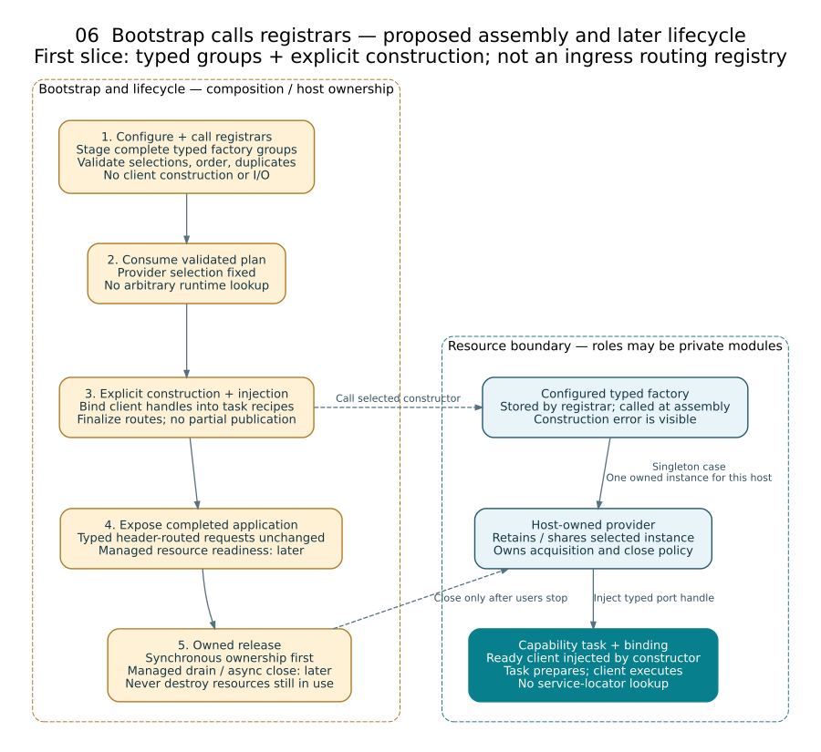

# Dependency injection: factories, providers, and owned lifetimes

**Status:** Proposed Rust assembly contract, informed by a focused source reinspection of older Forge patterns and standalone HPVS. This is not an implemented DI container or a claim of drop-in compatibility. The [initial `forge-provider` crate](../../src/rust/forge-provider/README.md) now implements only synchronous factory/provider/lease primitives plus singleton/transient scopes; graph validation, pools and managed host lifecycle below remain proposed.

## Implemented narrow step: registrars stage factories

The small [bootstrap/registrar implementation](bootstrap-registrars.md) is now present, not the entire lifecycle engine described below. Application bootstrap maps environment/configuration into package-owned typed config and calls selected implementation-crate registrars. Each stages a cohesive factory group without constructing resources. A consuming registry owns a typed nested tuple and metadata together; rejected registration returns the original builder and incoming group unchanged. This replaces the preliminary separately borrowed slot proposal. Heterogeneous groups remain typed; no universal `Any` map or dyn-compatible GAT provider is assumed. Validate the complete selected plan, freeze, then execute explicit typed constructor calls. A dependent task recipe first binds ready client handles before becoming an existing zero-argument `Factory<Task>`; `Factory<T>::create` does not gain a dependency-resolution argument.

The implemented metadata checks cover atomic group staging, required selections, duplicates and declared construction order. Automatic dependency-graph execution, arbitrary graph diagnostics, pools and managed async startup/shutdown remain later target contracts. Keep startup config distinct from runtime capability payloads, and no environment reads inside registrars/factories. The [roadmap](../roadmap/forge-framework.md#next-core-slice-bootstrap-and-registrars) defines the bounded implementation gates.

## The decision

Use **explicit typed construction with small factory/provider boundaries**. A factory creates a value; a provider governs how callers obtain a value or lease over time; the composition root chooses implementations and owns their lifecycle. Normally, resolve dependencies during bootstrap and inject the resulting capability ports into handlers. Inject a narrow provider or factory into a use case only when runtime acquisition or creation is itself a real requirement.

This extends the [blueprint](forge-framework-blueprint.md), not the ingress protocol. Capability-owned payload enums, generic `Envelope<P>` / `Bridge<P>`, header-selected routing, and rejection of header/variant mismatches remain unchanged. Dependency selection is not command routing. No transport, global service locator, reflection engine, or new crate per provider is required.

## What the source actually contributes

| Source | Observed mechanism | Retain / adapt, not overclaim |
| --- | --- | --- |
| Older `forge_rust` | Historical generated provider accessors delegate to templates for cached `Arc<T>` singleton, fresh transient, and thread-local variants; the underlying cache implementation is unavailable | Retain the distinction between access and creation. Do not copy global caches, assumed zero-argument constructors, or thread-local state as request scope. These experiments are historical, not the active workspace runtime; the cache dependency is absent and their behavior was not executed in this review. |
| `forge` | Typed task factories create executable tasks from requests; an I/O provider separates access from a caller-supplied construction closure | Task construction is not a general service DI system. Its generic task factory has no injected dependency state (`PhantomData` plus a static build call), so it is not a ready-to-use captured service factory. Keep execution and service lifetime separate. |
| `forge-framework` | Explicit `Arc` composition and test examples using a trait-backed service or injected typed strategy factory | These demonstrate seams, not a production general-purpose DI runtime. |
| Standalone HPVS | `Factory<T>::create`; provider acquisition with a borrow-tied lease; singleton, transient, and pool implementations; explicit registration followed by consuming freeze | Retain construction/lifetime separation and lease ownership. Its default pool uses `RefCell`, is not a shared async pool, and returns retained state without resetting it. Its bootstrap receives concrete collaborators; it is not a reflective resolver. |

Source context: [older Forge review](../reviews/forge/forge_rust.md), [Forge runtime review](../reviews/forge/forge.md), [framework review](../reviews/forge/forge-framework.md), [HPVS review](../reviews/forge/forge-hpvs.md). This focused synthesis adds source-backed DI distinctions without rewriting the historical reviews into claims about the target design. HPVS's receiver-factory binding creates the receiver once while forming the execution closure, not once per request; its injected executor is an `Fn` contract, not evidence of an existing universal executor trait. These timing details must be preserved or deliberately changed during extraction. HPVS freezes an operation registry, not a service graph; its freeze is infallible, performs no missing-dependency/cycle validation, and failed incremental registration can leave an externally retained builder partially populated. Discard failed assembly rather than publish it. Source and test definitions were read; no source-repository tests were executed in this focused review.

## Give each responsibility one owner

| Role | Contract | Owner / boundary |
| --- | --- | --- |
| Capability port | The conversation a use case needs, including failures and ownership | Consuming capability; no adapter or host lookup API |
| Factory | Construct one typed owned instance from explicit configuration and already supplied dependencies; preserve construction failure | Concrete implementation/boundary module; a normal function or closure often suffices |
| Provider | Select acquisition behavior and lifetime: shared handle, fresh value, or exclusive lease; expose capacity/closed/acquisition failures where relevant | Resource-owning adapter or narrow consumer-owned acquisition port |
| Lease | Bound use of an acquired resource and its return/disposal behavior | Provider implementation; must not outlive borrowed owner or permit use after return |
| Registration | Registrar stages one complete group of typed configured factories/recipes and its identity, requirements, scope and override metadata; no resource construction | Optional implementation/capability package supplies it; bootstrap owns the unpublished typed registry |
| Bootstrap / host | Validate selection, construct in order, inject handles, freeze bindings, start/supervise and shut down | Application composition plus focused lifecycle machinery |

Do not inject a bag of every application service. A `JobsHandler` receives its `JobStore` and other actual collaborators, not a host registry. The store adapter may privately use a connection provider; jobs policy need not learn connection pooling. If a capability genuinely requires a per-operation session, model that purposeful session/acquisition contract beside the capability, rather than expose generic database connections or `get<T>(name)`.

Record ownership transfer separately from scope: a host closes resources it owns, not an externally owned borrowed instance. Factories/leases may borrow assembly-owned backing when Rust lifetimes permit; do not force every dependency to be global, heap-allocated or `'static`. A factory owns cleanup of its partially acquired internals on error/cancellation until a successful return transfers ownership.

### A small Rust-feasible shape

This synchronous contract sketch illustrates the ownership distinction; it is **not a stable SDK, complete implementation, or async contract**:

```rust
use std::ops::Deref;

trait Factory<T> {
    type Error;
    fn create(&self) -> Result<T, Self::Error>;
}

trait Provider<T: ?Sized> {
    type Error;
    type Lease<'a>: Deref<Target = T>
    where
        Self: 'a,
        T: 'a;

    fn acquire<'a>(&'a self) -> Result<Self::Lease<'a>, Self::Error>
    where
        T: 'a;
}
```

A provider may hold a configured factory; the factory is not responsible for deciding whether an instance is cached, pooled or reused. Use an ordinary `FnOnce` constructor for one-time host assembly when a repeatable factory is unnecessary. The example only exposes shared access; a resource requiring exclusive mutation needs a corresponding exclusive lease contract, not an unsafe cast.

The generic associated lease type deliberately supports borrowed ownership. It is not a promise that `dyn Provider<T>` works: a trait with a generic associated type is not dyn-compatible. Keep this boundary generic/concrete, or design a separate **capability-specific**, object-safe interface with a concrete owned handle/lease. Choose that only when runtime substitution is actually needed. Likewise, native async trait methods are not a shortcut to a dyn-compatible async provider; a selected async interface must state its future, lifetime and `Send` requirements. [Rust trait dyn compatibility](https://doc.rust-lang.org/reference/items/traits.html#dyn-compatibility)

For the first reference application, the simplest binding is a host-owned store adapter exposed as `Arc<dyn JobStore + Send + Sync>` if its port is object-safe and its implementation supports those bounds. Composition passes it into the jobs handler constructor. The host separately retains the resource owner's lifecycle handle. A new generic registry of unrelated service types is unnecessary; explicit typed assembly functions and a small plan for diagnostic identities can coexist without `Any` or downcasts.

## Scope is a behavior, not a label

| Scope | Actual guarantee | Failure / ownership rule |
| --- | --- | --- |
| Host singleton | One selected instance per assembled host, shared through valid handles | Not a process-global static. Validate readiness on that instance; close only after its users stop. `Arc` cloning does not confer exclusive access. |
| Transient | A factory constructs a new instance for each successful acquisition | State whether dependencies are shared; fresh outer objects do not imply fresh subordinate resources. Owner releases each instance. |
| Bounded pool | A lease grants access to one available instance under the pool's exclusivity contract | Define capacity, waiting/rejection, deadline/cancellation, return, reset/validation and invalid-instance quarantine. Returning a lease does not imply a clean instance. |
| Operation/request scope, only if needed | Explicit scope object owns values for one operation | Pass it explicitly; never equate request lifetime with an OS thread or a task-local cache without a separately justified contract. |

HPVS's singleton borrows a prebuilt value, transient invokes its factory on acquisition, and pooled leases return preconstructed values on drop. Its tests demonstrate retained state after reacquisition. Therefore **reset, contamination prevention and discard policy are additional contracts**, not automatic benefits of pooling.

`Arc<T>` makes shared ownership possible, not arbitrary contents thread-safe; its thread-safety depends on the relevant bounds of `T`. Wrapping `RefCell` in `Arc` does not make the HPVS pool suitable for a multithreaded host. Do not hold synchronous borrows or locks across suspension without a justified API guarantee. A lease crossing `.await` must satisfy the selected executor's ownership and mobility rules. [Rust `Arc` thread safety](https://doc.rust-lang.org/std/sync/struct.Arc.html#thread-safety)

## Full target: assembly and shutdown are explicit phases



1. **Describe:** bootstrap supplies package-owned typed configuration to selected registrars. They stage cohesive factory groups, provider identity/scope, declared requirements, defaults and corresponding typed assembly functions without constructing resources. Provider IDs support diagnostics/allowlisted override selection; they are not ingress destinations or strings for loading code.
2. **Validate before freezing or starting:** choose explicit overrides before defaults; reject duplicate explicit providers, missing requirements, incompatible contracts, dependency cycles, and invalid lifetime captures. A long-lived owner cannot retain a short-lived borrowed resource. Diagnostic dependency keys do not replace Rust's constructor type checking. Validate without opening resources; failure leaves the prior plan unchanged.
3. **Freeze the validated plan:** consume its mutable builder. Instantiate only the chosen factories/providers in dependency order, then construct handlers with resolved typed ports and finalize the frozen route bindings. No handler resolves arbitrary services on demand. Runtime acquisition through an already injected narrow provider is not new dependency discovery.
4. **Start and admit:** start managed resources/workers and check the actual injected implementation. Open admission only after all required resources are ready. If creation/start fails, stop and release already-acquired resources in reverse dependency order; preserve the original failure and report cleanup failures too. Do not claim that HPVS's existing eager registration already provides this entire side-effect-free planning and rollback protocol.
5. **Drain and close:** stop admission and new acquisitions, stop producers, drain/cancel and join owned work, release operation leases, then close providers/resources in reverse dependency order. Define pool close behavior for waiting callers and outstanding leases, including whether already-admitted operations may finish acquisition or receive controlled cancellation. Report grace exhaustion; do not destroy a resource still used by uncooperative work while reporting success.

Rust's normal destructor hook is synchronous. A lease's drop path can return an in-memory slot or mark an instance unusable, but it cannot itself promise an awaited rollback, flush, network close or async reset. Use explicit awaited cleanup where needed and define a safe drop fallback, such as quarantine plus a supervised reaper. Cleanup after ordinary error/cancellation must be tested; process aborts, leaked guards and external effects are not magically rolled back by RAII. [Rust `Drop`](https://doc.rust-lang.org/std/ops/trait.Drop.html)

## Minimum proof, then extension

Start with one host-owned store provider and one alternative test implementation; do not implement every scope to demonstrate DI. Keep provider/factory implementations in relevant adapter or composition modules until independent consumers justify a reusable package. The generic host knows the lifecycle plan, not domain service types. The ingress bridge remains independent of providers and concrete capability implementations.

Required checks for the chosen scope:

- Missing dependency, cycle, invalid scope capture or duplicate override fails before factory side effects; a rejected registration leaves the plan unchanged.
- A default backs off only for its explicit matching override; factory failure remains visible rather than selecting an unnoticed fallback.
- Singleton identity and isolation between assembled hosts, transient construction count, or pool exclusivity/return matches the declared scope. Distinguish fresh wrappers from shared backend state; a one-call test does not prove lifetime semantics. Pool state is reset/validated or deliberately retained according to contract, including failure/cancellation.
- Partial construction/start cleans acquired resources exactly once in valid order; cleanup failures remain visible. Shutdown rejects new acquisitions and does not free resources under active leases.
- Handler tests inject ports directly; integration tests exercise the actual selected provider and truthful readiness. No request obtains dependencies from a global locator.
- Typed payload, header-routing, authorization and durable-acceptance tests remain unchanged by swapping an implementation.

See [module authoring](module-authoring.md) for registration ergonomics and the [roadmap](../roadmap/forge-framework.md) for staged delivery. Pools, request scopes and async factory abstractions enter only when a concrete capability needs their additional guarantees.
