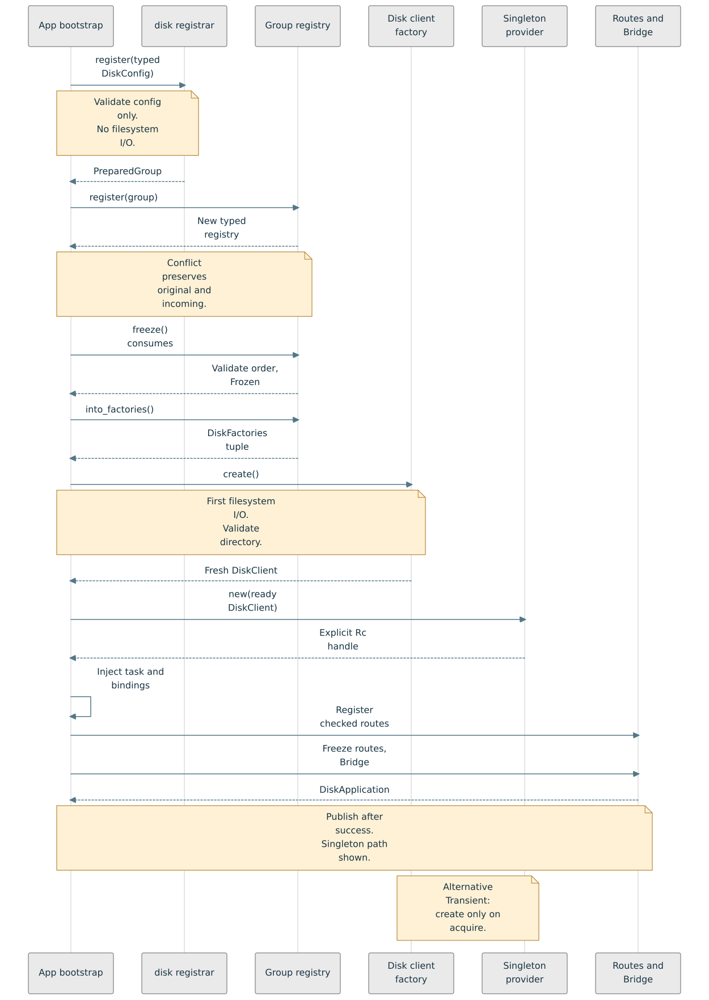
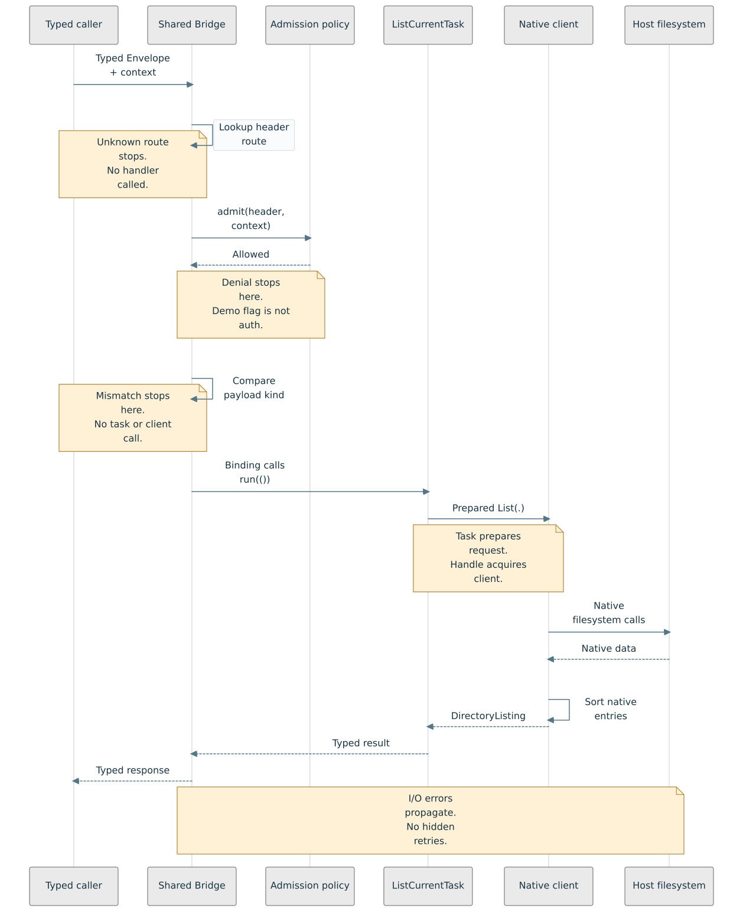
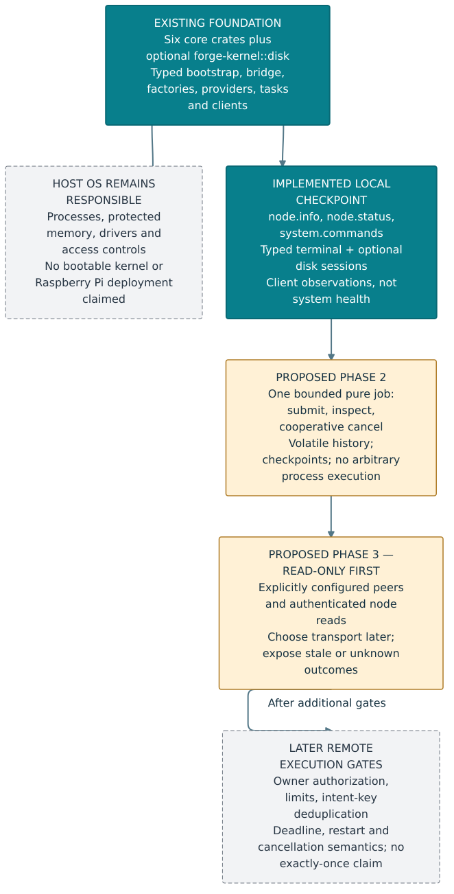
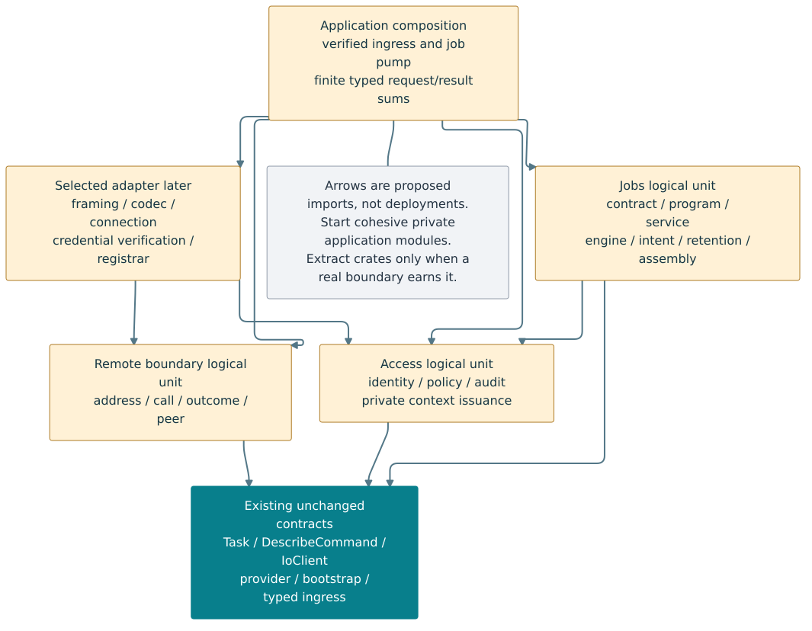
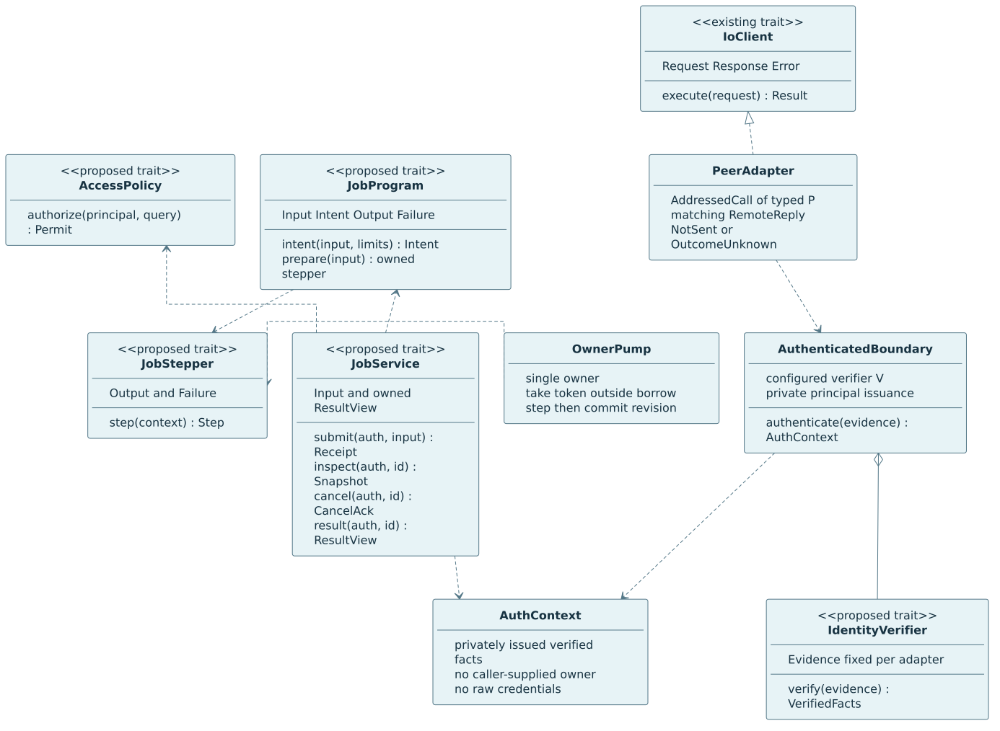
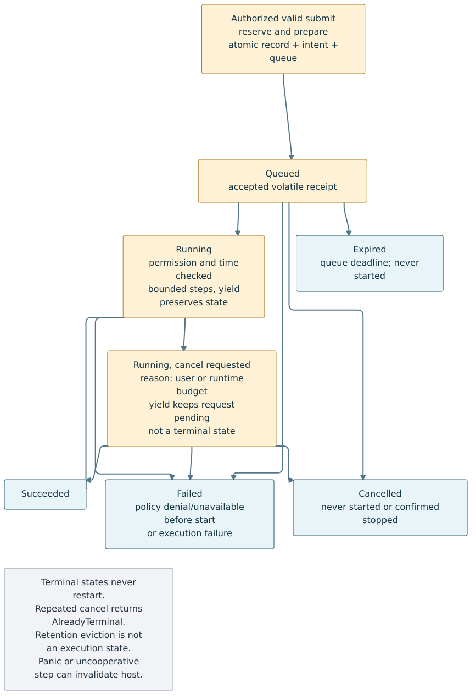
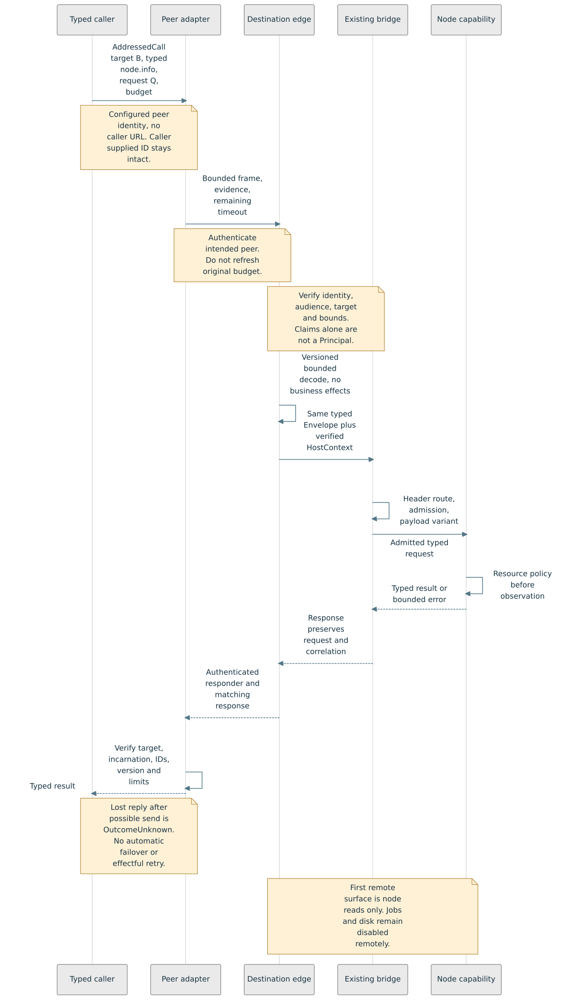

# Mermaid UML-like views

Editable Mermaid sources and committed SVGs for the current Forge framework. **M01–M03 describe implemented synchronous code. M04 distinguishes the implemented local checkpoint from proposed later phases. M05–M08 detail proposed future interfaces, not runtime implementations.** These complement, rather than replace, the existing [DOT/C4 architecture views](../README.md). M04 is a milestone view; DOT07 remains the hosted-kernel component planning view.

| View | Status and purpose | Source | Image |
| --- | --- | --- | --- |
| M01 — Contracts | Independent execution/description traits, ownership and native examples | [Mermaid](m01-contracts.mmd) | [SVG](images/m01-contracts.svg) |
| M02 — Bootstrap | Implemented disk singleton assembly, successful path | [Mermaid](m02-bootstrap.mmd) | [SVG](images/m02-bootstrap.svg) |
| M03 — Request | Implemented checked list-current path, with rejection gates | [Mermaid](m03-disk-request.mmd) | [SVG](images/m03-disk-request.svg) |
| M04 — Kernel phases | Implemented local system versus proposed jobs/remote phases | [Mermaid](m04-kernel-phases.mmd) | [SVG](images/m04-kernel-phases.svg) |

## M01 — Implemented contracts


UML-like notation abbreviates Rust, not a generated API reference. Dashed hollow-triangle arrows mean trait implementation; diamonds mean ownership; other labeled arrows show construction or use. Type parameters are omitted from class names for readability: the actual contracts include `Factory<T>` and `InstanceProvider<T>`, and the concrete containers are generic. `InstanceProvider::Lease<'a>` is a borrow-tied **GAT** promising `Deref`, not a dyn-compatible universal provider. `Singleton` owns one prebuilt value per provider and returns a borrow; `Transient` retains its factory and constructs an `OwnedLease` on each acquisition. Associated errors are preserved in `Result`.

`Task` and `IoClient` have independent normal dependency graphs. A pure task requires no client. `ListCurrentTask<C>` demonstrates constructor-injected client use, not a dependency of the Task contract on disk. The client accepts the task's prepared typed request. See the [actual Rust API](../../../../src/rust/README.md), [provider contracts](../../../../src/rust/forge-provider/src/lib.rs) and [disk consumer](../../../../src/rust/examples/forge-bootstrap-demo/src/disk.rs).

`DescribeCommand` is independent of `Task`: `NodeTask<C>` implements both,
while discovery implements description without Task and the older list-current
Task need not expose metadata. Static per-operation descriptors own names/help
and semantic argument types/presence; they are not reflection over Rust input
fields. The terminal owns its help-option syntax and renders only the admitted
catalog. See [command descriptions](../../../../src/rust/forge-command/README.md).

## M02 — Implemented bootstrap



This is the successful `DiskApplication` assembly path. The disk registrar is an ordinary package function returning a typed cohesive factory group, not a universal registrar trait. Registration validates configuration syntax without filesystem I/O. Consuming registry operations own metadata and typed tuples together; a conflict returns the unchanged original and incoming group. Freeze validates declared dependency availability/order; it is not an automatic graph executor or route-descriptor coverage checker. Factory creation is explicit after freeze; errors return no assembled application. The application itself wraps the singleton in `Rc`; the handle arrow is ownership shorthand, not a provider method returning `Rc`. The shown singleton path does not eagerly create transient instances. See [bootstrap contracts and limits](../../bootstrap-registrars.md).

## M03 — Implemented request



The main arrows show **success**, with rejection points annotated rather than alternate executions drawn over the same path. Exact header destination/version lookup precedes admission, which precedes registered payload-kind consistency. Unknown route, denied policy or mismatched variant returns a typed error before calling the task/client. The task prepares `DiskRequest::List`; the injected handle acquires the singleton client; native filesystem inspection preserves paths and sorts entries. I/O errors propagate, not hidden retries. Header routing does not guess from payloads. The demo admission flag is not production authentication, and the current bridge is synchronous and not `Send`/`Sync`-shareable unchanged. A separate change-directory binding updates only client-local state after successful validation. See [typed ingress](../../framework-dsl.md) and [disk semantics](../../../../src/rust/forge-kernel/README.md).

## M04 — Local checkpoint and proposed kernel phases



The foundation and narrow local node/discovery/terminal checkpoint are implemented. Teal marks existing code; amber marks proposed phases; gray marks host responsibilities or later gates. Later phase arrows show recommended delivery order, not runtime calls. No transport is selected, jobs are not OS processes, and cancellation is cooperative. The host OS still supplies protected memory, processes and drivers. This is not a bootable kernel or a tested Raspberry Pi deployment. Follow the [researched kernel plan](../../forge-kernel-plan.md) for acceptance gates and open decisions.

## Proposed foundation interfaces

The [module design](../../foundation-interfaces.md) and [Rust contract sketches](../../foundation-contracts.md)
are the source of semantics for these four views. Every new module/port/state
machine is **proposed**; names are not exported APIs and diagrams do not establish
stability. Existing Task, description, I/O, provider and bridge contracts remain
independent and unchanged.

### M05 — Module and dependency boundaries



[Mermaid source](m05-foundation-modules.mmd). Amber nodes are logical units that may
start as private application modules; teal is the existing contract family.
Arrows are allowed **imports**, not calls, deployment units or registration order.
Access does not import jobs; concrete adapters depend inward on contracts. Crate
extraction requires an actual consumer boundary, not one package per class.

### M06 — Typed interface contracts



[Mermaid source](m06-foundation-interfaces.mmd). “Proposed trait” marks new seams;
IoClient is existing. Rust associated types/lifetimes are abbreviated: each dyn
use fixes them; there are no generic dyn methods. The access-unit boundary owns
private principal issuance. JobService returns an owned bounded projection, not a
borrow escaping a RefCell guard. The owner pump releases engine borrows before
calling injected program code. Neither this diagram nor Arc makes today's bridge
concurrent; the provider GAT remains a separate non-universal-dyn contract.

### M07 — Job lifecycle and cancellation



[Mermaid source](m07-job-lifecycle.mmd). Arrows show allowed state transitions; the [state table](../../foundation-interfaces.md#state-and-cancellation-rules) defines their triggers. This is a state-machine-style flowchart,
chosen from the renderer's supported Mermaid subset. “Running, cancel requested”
is a flag on Running, not confirmation of stopping. Queued expiry means never
started; a runtime overrun requests cooperative cancellation. Terminal states
never restart. Completion/failure can win the cancellation race. Retention and
uncertain remote outcomes are deliberately not execution states.

### M08 — Authenticated remote read sequence



[Mermaid source](m08-remote-admission.mmd). The successful path shows verification,
bounded typed decoding, unchanged bridge checks and resource policy. Denials stop
before business effects; possible delivery followed by a lost/malformed reply is
OutcomeUnknown. Destination identity and original/delegated caller authority are
not interchangeable. No protocol is selected; first remote exposure is node
reads only, not disk navigation or job submission. No exactly-once claim follows.

## Rebuild locally

The canonical renderer for these SVGs is **`mermaid-rs-renderer` 0.3.1 (`mmdr`)**, a native Mermaid parser/layout renderer supporting class, sequence and flowchart diagrams. It is not the official browser renderer and does not promise pixel parity with it. We use a deliberately small syntax subset and separately validate it with official **Mermaid 12.2.0**. No repository contents are sent to a rendering service. The official CLI was not usable in the restricted authoring host; no browser isolation was disabled. [Renderer documentation](https://docs.rs/mermaid-rs-renderer/0.3.1/mermaid_rs_renderer/), [Mermaid class syntax](https://mermaid.js.org/syntax/classDiagram.html), [sequence syntax](https://mermaid.js.org/syntax/sequenceDiagram.html).

From the repository root, with Rust/Cargo, Python3, Node24 (24.15 or newer) and DejaVu Sans available:

```bash
D=docs/architecture/diagrams/mermaid
# Documentation tools only; neither modifies the application Cargo workspace.
cargo install mermaid-rs-renderer --version 0.3.1 --locked --root "$D/.tools"
npm --prefix "$D" ci --ignore-scripts --no-audit --no-fund
python3 "$D/render.py" --renderer "$D/.tools/bin/mmdr" --png-dir "$D/previews"
python3 "$D/render.py" --renderer "$D/.tools/bin/mmdr" --check
```

`render.py` first runs the official grammar validator, then generates all eight SVGs in a temporary directory. It rejects active/external SVG references before writing the images and [hash manifest](render-manifest.json). `--check` independently rerenders and compares exact bytes and input hashes without changing tracked files. Fonts/platform changes can change layout: review the difference, do not silently bless it. PNGs are local previews; scalable SVGs are committed. Keep sources, configuration, manifest and images in the same change. **Inspect every render** for lost labels, clipping, ordering and semantics; parser success and matching hashes alone cannot prove visual correctness. Do not hand-edit generated SVGs.
