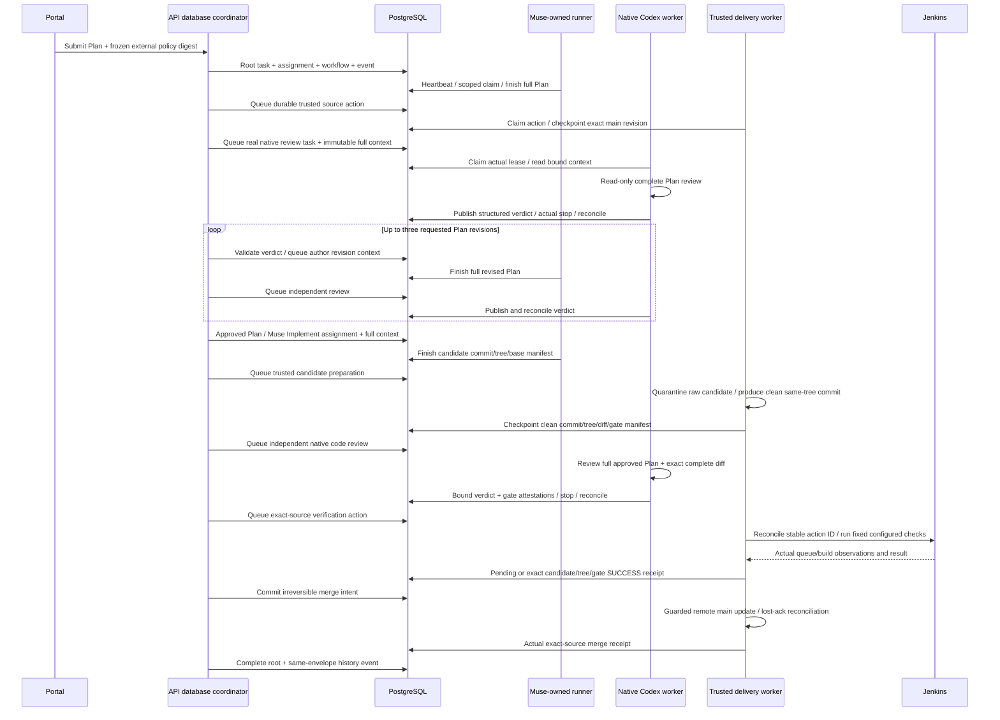

# External author and native reviewer SDLC

M22 closes the Muse database handoff through independent review, implementation,
Jenkins and exact-source merge. It preserves native P10 and old external v1
recipes; external results never manufacture a native attempt, stop proof,
reconciliation or native source approval.



The diagram abbreviates equivalent bounded code repair/review/CI rounds. Invalid
reviewer JSON is retried once on the same source before a human exception; it
consumes no author revision. Main movement refreshes trusted source before a
bounded rebase. Cancelled/revoked workflows retain scoped Jenkins cleanup work.
Notifications only wake discovery. Rows, generation/token fences, current grants,
immutable hashes and actual receipts determine every transition.

| Bootstrap owner | Ready port and lifetime | Effects |
| --- | --- | --- |
| API WorkServiceFactory | Owner/project-scoped ExternalWorkflowStore injected through ExternalWorkDAO and WorkflowCoordinator | PostgreSQL only; no model, Git, Jenkins or remote merge credentials |
| Native CodingWorkerFactory | Worker-owned ExternalReviewContextProvider, selected by external_reviews | Actual native lease validation, readonly full artifact staging, verified candidate workspace |
| Delivery service factory | ExternalDeliveryStoreFactory plus trusted source/prepare/verify/merge/cancel ports | Separate reconciler account owns bounded Git/Jenkins/merge effects; model receives none of its secrets |
| Muse runner | Existing scoped SQL claim/renew/progress/finish functions | Muse owns its process and compute; no Mission Control Muse CLI or email |

Configuration example (profile names are installation-specific):

```json
{
  "profiles": {
    "muse-db-primary": {"backend":"muse","model":"external-runner","resource_profile":"forge-external-db-v2","execution_enabled":true}
  },
  "external_workflows": {
    "homelab": {"author_profile":"muse-db-primary","reviewer_profile":"codex-primary","max_plan_revisions":3,"max_code_revisions":3,"auto_merge":true}
  }
}
```

Native worker configuration must explicitly set `external_reviews: true`.
M22 installs no new login. An operator enables the existing reconciler principal
in `forge_external_workflow.delivery_grants` for the configured owner/project.
Normal migrations and `verify-external-workflows.sql` pin private tables,
immutable binding triggers, scoped APIs and ACLs. Muse's existing thirteen read
grants and future-table SELECT default remain intact; private schema access and
mutation rights are not widened.

A delivery claim returns a typed action lease with `action_id`, `workflow_id`,
project, kind, generation, secret token, expiry and immutable request. The request
contains the root correlation ID and the previous checkpoint receipt. Pending
checkpoints release the lease for later observation; a worker first reconciles
Jenkins using that stable action identity rather than blindly submitting again.
Cleanup actions reference the original verify action/request/receipt and may
only stop that owned job. Cancellation is not a process-stop receipt.

For source selection, the trusted worker reports `base_revision`. Prepared
candidates include exact commit/tree/integration-base, full diff hash and
protected gate manifest/hash. Verification reports `result: SUCCESS` only after
actual checks and binds the same candidate/tree/gate manifest. Merge records the
actual merge commit and tree. None advances `refs/forge/verified-main` or creates
a native source-approval receipt; that native provider retains its original
receipt semantics.

## Jenkins execution and recovery

`deploy/mission-control/jenkins/setup-ci.py --execute` provisions the fixed
`forge-exact-candidate` job and a single WebSocket agent. The controller retains
zero executors. The Jenkins account supervises the agent; candidate checks run
as the separate `forge_ci` account with no supplementary groups, credential
mounts or privilege gain. A root-owned UUID-only supervisor verifies an immutable
bundle, source tree and protected-gate manifest before checkout, then runs exactly
`make ci`, `make ui-qa`, and the complete agent-runner Python test suite. The
candidate cannot select another command. The supervisor confirms all build-user
processes are reaped and writes a source-bound, root-owned check receipt.

`forge-external-delivery.service` selects an owner-scoped PostgreSQL DAO and
trusted delivery ports from its private typed configuration. It uses Forge's
Rust Jenkins `IoClient` through the pinned `forge` executable, rather than a
second Python HTTP adapter. Its separately selected Jenkins configuration must
enable mutations and observe only the seven public parameters: action, workflow,
commit, tree, expected main, gate-manifest digest and correlation ID. The existing
operator read-only configuration remains separate.

The admitted CLI operations are `jenkins.queue-list`, `jenkins.recent-builds`,
`jenkins.build`, `jenkins.queue`, `jenkins.stop-build` and `jenkins.cancel`, all
with an explicit `--jenkins-config` path. There are no background model or OAuth
requests in this worker. Database leases bound each action; transient transport
failure preserves the same action and its deadline. A durable journal precedes
the first Jenkins POST. Lost acknowledgements trigger observation, never a
blind second POST. Duplicate conflicting runs or incomplete observations cannot
establish success or absence. Cancellation waits for an actual cancelled queue
or a stopped build with the supervisor's cleanup receipt.

Publication imports a same-tree commit with public main as its sole parent.
Private author history stays in quarantine. After independent approval and all
three exact-source gates, the worker publishes this clean candidate and performs
a non-forced main update. Main movement requires fresh integration, review and
checks; lost merge acknowledgements are reconciled against real main ancestry.
