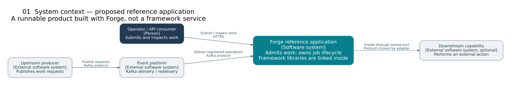
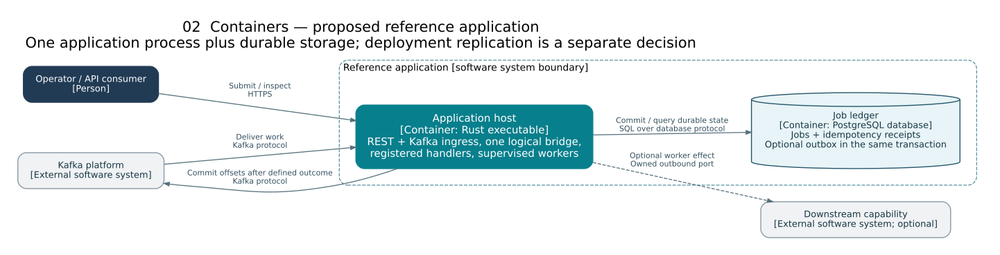
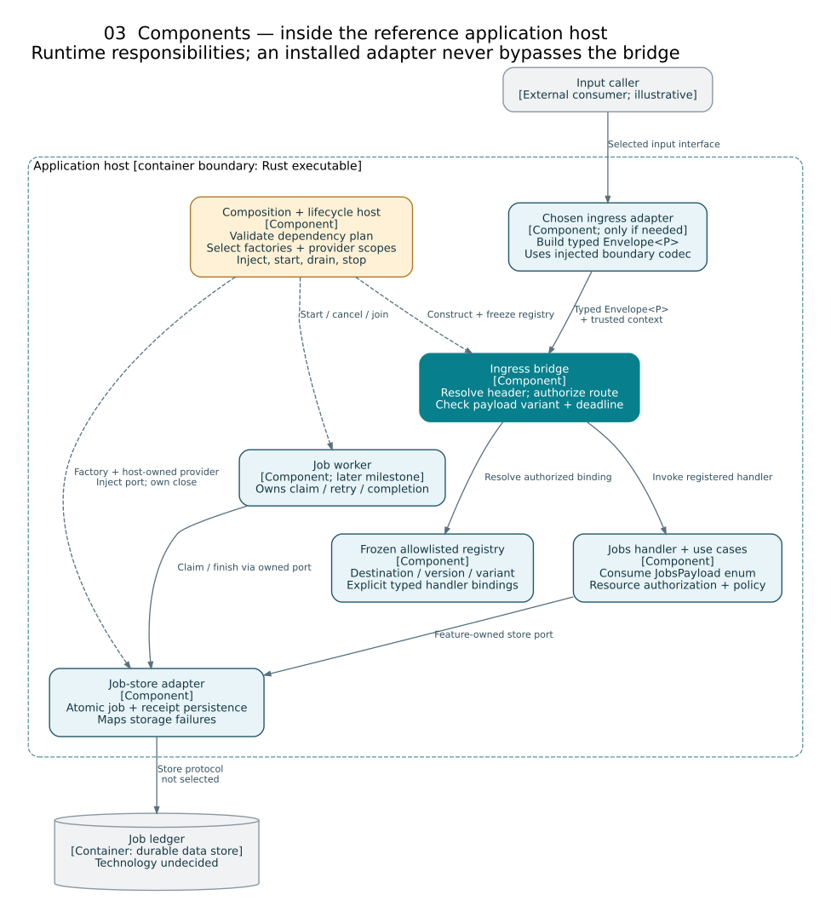
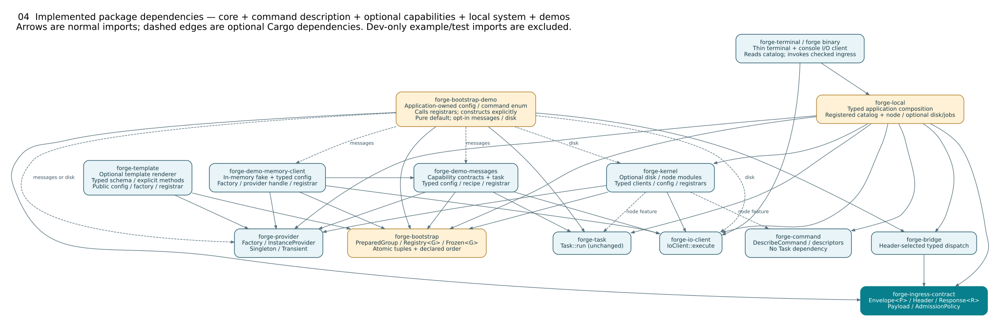
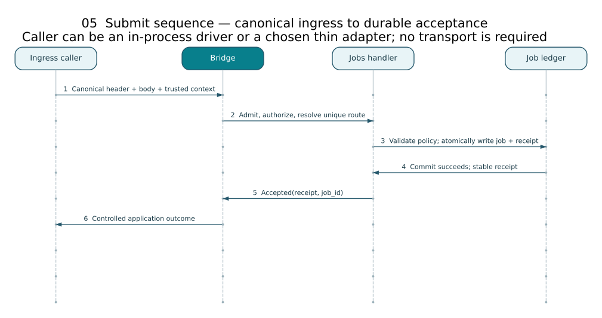

# Forge framework: small kernel, explicit starters, cohesive capabilities

**Status:** Proposed target architecture, based on the complete 15-repository review set dated 30 October 2026. This remains the full target design, not a production-validated framework. A [first synchronous Rust core subset](../../src/rust/README.md) is now implemented and tested; the local guide explicitly distinguishes implemented primitives from planned assembly, transport and durability features.

## The product decision

Build **a Rust application-assembly framework**, not a new all-purpose application. Its promise is: select optional capability/implementation crates, give their registrars typed configuration through bootstrap, and receive predictable assembly, admission and test seams. Registrars stage cohesive factory groups; construction and provider ownership follow only after validation/freeze. Full managed lifecycle remains a later target. Keep business workflows out of the framework. Keep developer tools, model execution, client SDKs, and domain-specific engines outside its mandatory dependency graph.

The framework is linked into a **reference application** that proves the developer experience. That application owns an illustrative jobs capability and proves the shared logical ingress with an in-process contract driver. No transport has been selected: a network API, broker, or CLI is added only for an actual consumer, not to satisfy the framework design. A separate deployment for every crate is neither required nor desirable.

“Spring Boot-like” means convenient starters, conditional defaults, explicit overrides, consistent configuration, and dependable application startup—not copying Java reflection or building a universal service locator. Spring Boot's own guidance describes packaged auto-configuration, conditional defaults that can yield to user configuration, and focused tests for those combinations. The Rust mechanism proposed here is explicit and statically linked. [Spring Boot auto-configuration](https://docs.spring.io/spring-boot/reference/features/developing-auto-configuration.html)

The selection is evidence-led: retain the small framework command seams, Mission Control’s shared command-port/lifecycle patterns, and HPVS’s registration/ownership discipline rather than combining whole workspaces. See the [bootstrap/registrar next slice](bootstrap-registrars.md), [repository reuse map](reuse-map.md), [provider/factory DI design](dependency-injection.md), [module authoring contract](module-authoring.md), [decisions](decisions.md), and [delivery roadmap](../roadmap/forge-framework.md).

## 1. One logical ingress, independent of transport

```text
Chosen input adapter, if needed -> Envelope<P>        -> shared bridge
In-process contract driver ----/                        admission + dispatch
                                                        -> registered binding
                                                        -> feature use case
                                                        -> owned ports / fan-out
```

The canonical header carries enough explicit information to resolve exactly one allowed operation and contract version. A single stable `command` identifier can be the destination; separate destination/operation fields are optional, not a requirement. Envelope schema identity and operation-contract identity are distinct when independently versioned.

Adapter mappings may supply routing values, with documented precedence and conflict rejection. The payload is not inspected to guess the route. Adapters preserve correlation, original deadlines, and stable idempotency metadata. Verified identity/context is separate from claims supplied inside an untrusted envelope.

If a future input arrives through an intermediary, that connection's credentials do not automatically attest the original caller or tenant. The adapter needs a documented trust mapping or independently verified caller claims before constructing context. Unverified header assertions cannot become an authorized principal.

The bridge owns envelope/header consistency, supported versions, deadline admission, allowlisted route lookup, route authorization, and dispatch. It does **not** own domain validation, resource-level authorization, storage operations, transport responses/acknowledgments, or business orchestration. A registered binding checks the typed payload variant against the header-selected route before invoking its capability's application API. Any wire decoding stays at an external serialization boundary, not inside domain handlers. Fan-out begins only after admission and is governed by that use case.

The top-level catalog selects a capability-owned binding. Typed payload enums, context, and secondary command registries belong to that capability; adding a domain must not enlarge a universal request enum or application context in the bridge. The registration object should provide both inspection metadata and its executable binding, so a capability cannot appear installed in one catalog but be absent from a separate dispatch map.

There must be no alternate public dispatch API that avoids admission. A route names a registered operation; it never names executable code, a class path, a shell command, or a library to load. “One path” is a logical contract, not one thread, one server, or one bottleneck process. Replicas and concurrent workers may implement it.

### Typed payloads inside; serialization only at the edge

The internal contract is **`Envelope<P>` with a capability-owned Rust enum as `P`**, not JSON or a generic map of business fields. The shared admission/dispatch implementation is generic over that typed payload (`Bridge<P>` / `Registry<P>` conceptually). Keep typed results as typed values until an actual external boundary needs serialization. No `serde_json::Value`, `Any`/downcast, string-keyed value tree, or `Unknown(Json)` escape hatch substitutes for the internal business contract.

Illustrative type shape only—not a production API, complete header, or implementation:

```rust
struct Envelope<P> {
    header: Header,
    payload: P,
}

// Owned by the jobs capability, not the framework:
enum JobsPayload {
    Submit(SubmitJob),
    Status(JobId),
}

type JobsEnvelope = Envelope<JobsPayload>;
```

`Header`, `SubmitJob`, and `JobId` stand for the relevant validated contract types. The framework owns the generic envelope and admission machinery; it does not import `JobsPayload`. A single-capability host can use `Bridge<JobsPayload>` directly when the owning capability implements `Payload` and imports the narrow ingress contract. To keep that capability free of ingress dependencies, use an application-owned wrapper/sum implementing `Payload` instead. Rust's orphan rules prevent the application from implementing that foreign trait directly for another crate's enum.

One heterogeneous registry cannot accept unrelated payload types without an explicit unifying design. **Only if one host genuinely needs a single ingress for several capabilities**, its composition package may define a finite sum such as `AppPayload::Jobs(JobsPayload)` and `AppPayload::Notifications(NotificationsPayload)`, then instantiate `Bridge<AppPayload>`. All entries in that registry share `AppPayload`; capability bindings unwrap only their registered variants and pass the owned enum to the relevant feature API. This sum belongs to that application and contains only its selected capabilities; adding a capability can extend this local sum as a composition-only change. It is not a framework-wide enum that every new domain must edit. Do not hide the type mismatch behind JSON or runtime downcasts. If the common ingress also returns heterogeneous result types, apply the same explicit application-owned result sum or retain per-route typed results; a generic `Outcome<R>` alone does not unify unrelated result types.

Routing order is explicit: **header → registered destination/version → authorization → expected payload-variant validation → handler**. For example, a `jobs.submit` header with `JobsPayload::Status` is a controlled mismatch, rejected before handler effects. Do not guess the destination from the enum variant, overwrite the header to make it agree, or offer a typed-caller shortcut that skips this check. Business validation and resource-level authorization still belong to the selected capability.

An in-process caller constructs the enum directly; no serialization round trip is needed. If a selected external adapter receives JSON or another encoding, its bounded, side-effect-free boundary codec converts it to the capability enum before entering the typed bridge. The codec is selected from the same registered header/contract mapping, never from guessed business-body contents; transport code does not invent its own handler routes. Conflicting tags, unknown fields/variants as required by the versioned contract, unsupported versions and malformed data are rejected. The bridge independently checks header/variant agreement, including for directly constructed typed envelopes. Concrete codec bindings live in an application/capability boundary module that knows the payload enum and selected format. The generic input adapter receives that codec over `P` from composition; it does not need to import the capability. JSON libraries and wire DTOs remain in that optional boundary, not in the domain or generic ingress payload.

This preserves the prior projects' typed-command direction while strengthening it. The inspected snapshots of both `forge-framework` and Mission Control use a custom fields-or-bytes payload enum and generic typed-request command APIs; that is not the same as an existing generic capability-enum envelope. The proposed `Envelope<P>` is an adaptation, not a claim that those repositories already implement it. See the [verified reuse distinction](reuse-map.md#typed-payload-lineage).

## 2. The diagrams answer different questions

C4 offers system context, container, component, and code views at different levels of detail. Here the first three describe the **reference application**. A C4 container is an application or data store, not a Rust crate; the separate dependency diagram describes packages. The component view zooms into one application host. These distinctions follow the official [C4 diagram overview](https://c4model.com/diagrams), [container guidance](https://c4model.com/diagrams/container), and [component guidance](https://c4model.com/diagrams/component).

### System context: who uses the assembled application?



The downstream action is optional. Neither the framework nor its crates appear as independently deployed systems.

### Containers: what runs and stores state?



One Rust host contains admission, dispatch, capability handlers, and any selected input adapters or supervised workers. The durable-store technology and external input interface are deliberately undecided. No broker or network server is required. Replicas and deployment topology are outside this container view.

### Components: where does responsibility live?



Dashed arrows show construction/lifecycle control; solid arrows show runtime interactions. Registry and bridge are conceptual components and may be private modules within one crate. Workers are a later milestone; the first acceptance slice need not pretend to execute work.

This component view focuses on admission and durable job state. The optional downstream effect shown in the context/container views is deliberately not expanded here; when introduced, its worker invokes a capability-owned effect port through a separate adapter, with the recovery guarantees below.

### Packages: what may import what?



The application is the composition boundary. Handler bindings and small feature-specific adapters can start as its boundary modules, depending on both ingress contracts and the `jobs` capability. Extract a reusable adapter crate when another real consumer or an enforceable dependency need justifies it. Never move feature-owned ports into a universal framework `ports` crate.

## 3. A deliberately small package surface

The six current core packages are `forge-ingress-contract`, `forge-bridge`, `forge-provider`, `forge-io-client`, `forge-task` and `forge-bootstrap`. Three separate demo packages prove optional selection; they are not mandatory framework dependencies. The broader runtime/capabilities below remain later roles.

| Unit | Owns | May depend on | Must not depend on |
| --- | --- | --- | --- |
| `forge-ingress-contract` | Generic `Envelope<P>`/header, typed ingress/handler/admission contracts, controlled outcomes | Small transport-neutral value dependencies | Transport libraries, concrete handlers, domain models, storage drivers |
| `forge-bridge` | Generic typed registry, header/variant checks and admitted dispatch | Ingress contract | Concrete capabilities or transport implementations |
| `forge-provider`, `forge-io-client`, `forge-task` (implemented, independent) | Construction/acquisition contracts; prepared-request I/O; computation/orchestration | No normal dependencies on each other | Concrete implementation crates, mandatory transports or service lookup |
| `forge-bootstrap` (implemented subset) | Prepared groups, atomic consuming registration, declared-order validation/freeze; typed tuple extraction | Std only | Concrete clients, business enums, environment reads or universal DI execution |
| Optional implementation crate + registrar | Concrete client, dependencies, typed config, cohesive factories and reusable registrar | Implemented contracts and bootstrap helpers as needed | Mandatory core imports back into this implementation |
| `forge-runtime` (deferred) | Managed startup/shutdown supervision and later lifecycle facilities | Focused runtime facilities | Domain policy or transport-specific mandatory dependencies |
| Chosen ingress adapter, optional | Input framing, delegation to an injected codec over `P`, protocol lifecycle and outcome encoding | Generic ingress/codec contracts; runtime or transport library only as needed | Concrete business handlers or capability imports hidden in the generic adapter |
| `jobs` | `JobsPayload` enum, invariants, use cases and owned persistence/effect ports | Domain values and stable policy dependencies | Framework bridge, transport DTOs, SQL client |
| `reference-app` | Typed factory/provider selection and constructor injection, handler bindings, concrete edge-codec bindings and selected adapters | Selected framework packages and capability | Unrelated tools or domains merely because they exist |

The ingress contract is justified by actual shared consumers, not a license for `common-core` growth. Keep domain and application logic together inside a cohesive capability until a real dependency or change driver warrants another boundary. The framework must build without optional starters. Adding a starter must not silently enable every available transport.

## 4. Assembly without a second monolith

**Implemented narrow scope:** [bootstrap invokes typed registrars](bootstrap-registrars.md) and a consuming registry owns factory-group tuples and metadata together, returning unchanged state on conflict. Validate selections and explicit construction order, freeze, construct clients/providers/tasks, then publish the existing shared bridge. The numbered lifecycle below is the full target, not a demand to implement a universal container now. The application front door may eventually serve local or remote tools; it is not defined by a CLI parser or any mandatory transport.

Use a two-phase host plan: **describe and validate**, then **construct and start**. Separate the construction/lifetime graph from the operation registry: factories construct typed values, providers control scoped acquisition/reuse, and bootstrap injects resolved ports into handlers. The bridge never looks up arbitrary services. The [DI design](dependency-injection.md) explains the source evidence, Rust lease contracts and scope choices.

1. Load typed, namespaced startup configuration once at the application boundary, separately from runtime command payloads. Registrars/factories receive explicit values rather than reading environment variables. A possible application policy is package defaults → explicit file → environment overrides → explicit programmatic overrides; this precedence is not a core requirement. Record the winning source without exposing secret values. Reject unknown critical keys, invalid values, and incompatible enabled modules.
2. Explicitly opt in to linked modules/starters. Bootstrap configures/calls their reusable registrars; each stages a complete cohesive factory group and declares identity, requirements, defaults, and lifecycle ownership. Registration must not construct its clients or start resources. Nothing scans arbitrary packages or executes names from a configuration file.
3. Apply explicit user-provided implementations before conditional defaults. A default backs off only for a documented matching provider. Two explicit providers or duplicate route/version registrations fail with a diagnostic; never let insertion order choose silently.
4. Validate missing provider requirements, version compatibility, aliases, dependency cycles and lifetime compatibility **before factory side effects, freezing the plan or opening admission**. Registration failure leaves the existing plan unchanged. Consume the validated mutable builder into an immutable assembly plan.
5. Construct the selected factories/providers in dependency order; inject ready capability ports into handlers and finalize frozen route bindings from the same validated plan. Start managed resources, then admit only after required readiness checks succeed. Construction/startup failure closes already-acquired resources in reverse order; retain both the original failure and any cleanup failures.
6. On shutdown: stop admission, stop new input delivery, drain bounded in-flight work, cancel remaining cooperative tasks, join them, then close resources in reverse dependency order. Report unfinished or ambiguous work; do not label cancellation as rollback. If a task ignores cancellation or a blocking operation exceeds the grace period, record the unfinished work and apply an explicit host-failure/termination policy. A cancellation signal cannot guarantee a bounded join or undo committed effects; do not destroy resources still owned by a running task while pretending shutdown succeeded.

Keep construction and lifecycle management distinct from business workflows. Extension registration can use ordinary Rust functions, traits, and explicit `Arc` ownership. An in-process trait object is not a dynamic library/plugin ABI. Runtime library loading, reflection, distributed discovery, hot reload, and a large DI framework are out of scope until a real requirement proves their value.

Start with a host-owned store provider, not a universal DI container or every possible scope. A factory creates an instance; a provider may reuse one host-owned instance, construct a transient per acquisition, or grant an explicitly scoped lease. Inject a provider only for a real per-operation acquisition need; otherwise inject the ready port. A transient is not automatically request scope, and an OS thread is not an async request.

Lease return, retained-state/reset policy, capacity, cancellation and shutdown are explicit. HPVS’s synchronous `RefCell` pool cannot be copied into an async shared host as-is, and returning its lease does not reset the value. `Drop` is not awaited cleanup; any required async reset/flush/close needs an explicit lifecycle contract. See the [provider assembly diagram](diagrams/06-provider-assembly.svg).

**Health must report the injected implementation, not a separate memory double.** Liveness means the process can make progress; readiness means its validated configuration and required resources can serve the promised operations. Optional capability degradation is reported separately. Beginning shutdown removes readiness before draining. A database outage should not automatically turn a meaningful liveness probe into a restart loop; an uninitialized required store must never produce false readiness.

Define request/body limits, queue capacity, per-route concurrency, and retry budgets. When capacity is exhausted, apply documented backpressure or controlled rejection rather than accumulating unbounded futures or receipts. Health, queue depth, latency, and outcome diagnostics need stable semantics and redaction; headers are not permission to emit arbitrary high-cardinality or secret log fields.

See [module authoring](module-authoring.md) for the plug-and-play contract and override test matrix.

## 5. Reliability is a contract, not a transport feature

### Outcome semantics

| Outcome | Meaning | Adapter responsibility |
| --- | --- | --- |
| Rejected | No handler invocation after failed admission; later business rejection has its own effect contract | Controlled response or poison-message policy; no secret/internal detail |
| Completed | The operation's stated synchronous guarantee is satisfied | Map result; do not assume every side effect is transactional |
| Accepted | A named durable handoff/receipt has committed | Return accepted response or acknowledge delivery only at this point |
| Retryable failure | A transient condition exists; retry safety is separately defined | Respect retry budget, original deadline and idempotency identity |
| Failed / partial outcome | A contract-defined failure, possibly after earlier effects | Preserve actionable state and recovery information |
| Canceled / deadline exceeded | Work stopped or admission refused according to the contract | Do not imply prior committed effects disappeared |

An in-memory queue or successful header check is not durable acceptance. A handler returning quickly does not justify reporting durable acceptance or acknowledging durable handoff. Define route-specific completion points and teach each adapter to translate them.

### Idempotency and durable handoff

For the reference `jobs.submit` workflow, propose one atomic store operation covering the job record and its idempotency receipt. Scope the key to authenticated tenant/actor policy, route/version, and client key; compare a defined semantic request digest. The same key and same request replays the stable receipt. The same key with different content is a conflict. Concurrent first submissions must produce one winning job.

Replaying a receipt must **not** re-emit its original external effects. Define receipt retention and the supported retry window; expiration must not silently promise lifetime deduplication. A process-local map can support unit tests, not cross-restart correctness.

If a later milestone requires an external effect, a database transaction cannot atomically commit both local state and an unrelated remote service. Use an owned durable outbox/worker when required, plus destination idempotency or explicit reconciliation. Do not promise exactly-once external execution from at-least-once delivery.

### Input lifecycle and cancellation

An installed input adapter owns its actual protocol lifecycle, including any response, retry, ordering, or acknowledgment requirements. Specify and test only the mechanisms that exist; do not introduce a broker or delivery machinery for an in-process caller. If a future queued transport is chosen, its settlement point must match the route's completion or durable-handoff guarantee, including failure and shutdown behavior.

A deadline is not reset on retry. Canceling a caller's wait after durable acceptance does not erase the job. Canceling an accepted job is a separate authorized domain transition. An ambiguous database commit or lost response is recovered by the same idempotency key, not by issuing a new one.

### Submission sequence



This is the new-key success path. Admission rejection stops before handler effects. Store failure produces no accepted receipt unless durable commit is confirmed or recovered. Replay returns the existing receipt without another job/effect. Any protocol-specific response or acknowledgment remains adapter-owned.

## 6. Evidence needed before calling it a framework

- Core rules run without a server, broker, database, or framework container.
- An in-process driver constructs capability enums and proves the generic typed ingress contract. Each selected adapter maps equivalent logical inputs to that contract; mapping conflicts and spoofed identity are rejected. Compare multiple real adapters only when they are actually needed.
- Every ingress entry point checks header/version/admission and header/payload-variant consistency; mismatches, including direct typed construction, have zero handler effects. No convenience method bypasses these checks.
- Duplicate registration fails without replacing the original binding. Missing module requirements, incompatible versions, and override conflicts fail assembly deterministically.
- Each installed adapter has real boundary tests for its parsing, outcome mapping, capacity and shutdown semantics. Retry, ordering or acknowledgment checks apply only when its protocol has those mechanisms; mocks alone do not establish them.
- Real storage tests establish concurrent idempotency claims, persistence across restart, failure after acquisition, and ambiguous-result recovery.
- Startup failure and shutdown leave no leaked tasks/listeners/connections; cancellation reaches the owner of the work.
- Package/dependency checks forbid transport-to-concrete-handler bypasses, bridge-to-feature imports, and internal JSON/value-tree fallback payloads. Optional boundary serialization must not become a mandatory core dependency.
- A second small capability can be added without changing bridge internals, adding a global registry lookup, or making unrelated starters mandatory.

Performance claims require a defined workload, environment, and measurement. This architecture is not a benchmark result. Existing passing tests in a source repository do not certify the assembled framework; the [roadmap](../roadmap/forge-framework.md) defines the necessary proof sequence.
