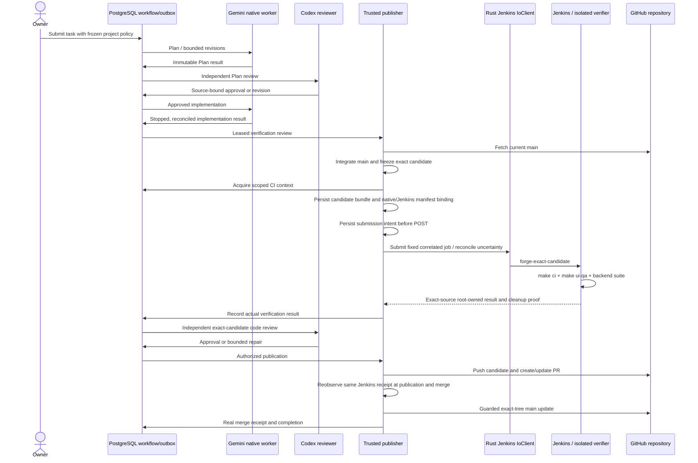

# Jenkins client and Forge CLI

Implemented source: the optional [`forge-jenkins`](../../src/rust/forge-jenkins/README.md)
Rust capability implements `forge_io_client::IoClient`. Its public `Config`,
`Credentials`, `ClientFactory`, `register` and opt-in `register_http` compose with
Forge's existing bootstrap and provider contracts. No dependency selection or
global registry lookup occurs in a request handler. The library default omits
native HTTP; the terminal's explicit `jenkins` feature selects the Ureq transport.
Existing terminal features and default dependency profiles remain unchanged.

## Construction and ownership

Application bootstrap selects a typed configured factory, stages the registrar,
validates/freezes the plan, then creates the selected client. Hosts choose
`Singleton` or `Transient` ownership. The independent Cargo consumer imports the
public library exports and exercises both policies with a substituted transport.
This verifies construction and resource identity rather than relying on a diagram
or private example include.

The terminal selects a fixed configuration-file path at startup. Its factory is
registered and frozen without reading that file. The first admitted, validated
Jenkins request loads the bounded configuration and private token through the
terminal's selected client. It explicitly creates the configured native client
and retains it for that CLI/application lifetime. No runtime dependency registry
is consulted. Help, command discovery and unrelated node/disk/jobs actions do not
load credentials or call Jenkins. Restart a CLI session to load changed files.

## Command flow

Terminal metadata/argument decoding constructs the application-owned
`JenkinsCommand`. `Application::invoke` constructs a header/envelope and uses the
same admitted bridge as direct typed callers. Header destination/version and
payload kind must match before the binding invokes its Task. The Task prepares
and validates the typed request, then calls the injected Jenkins `IoClient`.
The concrete adapter encodes it for Jenkins and projects a bounded typed response.
The terminal formats that outcome using its existing console I/O boundary.

| Forge route | Jenkins effect | Completion meaning |
| --- | --- | --- |
| `jenkins.status` | GET controller information | One observed response |
| `jenkins.jobs` | GET visible job summaries | One observed list |
| `jenkins.build` | POST a prepared job and parameters | HTTP201 plus a validated queue ID; build is queued |
| `jenkins.queue` | GET one queue item | One observation; absent flags remain unknown |
| `jenkins.build-status` | GET one numbered build | One observation; no background polling |
| `jenkins.cancel` | POST queue cancellation | Request accepted; no claim that a running build stopped |
| `jenkins.queue-list` | GET a bounded queue snapshot | Correlation observation, including a truncation flag |
| `jenkins.recent-builds` | GET up to 50 numbered builds for one configured job | Correlation observation, including a truncation flag |
| `jenkins.stop-build` | POST a numbered build's stop action | Request accepted; cleanup must still be observed |

Mutations are denied by default. An explicit client configuration opt-in is
required for build or cancellation. Unexpected/lost write receipts, transport
errors and timeouts require reconciliation, with no automatic retry. This client
is used by Forge's durable delivery providers; it does not itself own workflow
state or infer CI completion. The stopped Grok workflow remains stopped.

## Native Gemini workflow

The publisher's explicit `hosted_provider: "jenkins"` selects the native Jenkins
verification provider and its shared check runner. `jenkins_delivery_config`
names a private operator-owned delivery configuration with the pinned Rust CLI,
installed verifier, spool, results and credentials. Bootstrap constructs and
injects these collaborators; review and merge handlers do not select a transport
or look up a registry. Existing configurations retain the historical
`github-actions` default, but Mission Control selects Jenkins.

The native Plan/Implement recipe, execution policy, independent Codex reviewer
and frozen workflow budgets remain unchanged. The logical gate names `check`,
`pr-fast-gate` and `real-browser` remain compatibility identifiers; new
observations explicitly identify Jenkins as their provider. They do not claim
that a GitHub Actions run occurred.



The full fixed suite runs once per admitted verification action. Later stages
reobserve the same correlated build and root-owned source/cleanup receipt.
Changed source or an explicitly admitted bounded verification retry needs a new
action and verification. No task-controlled command, URL, path or
credential is accepted as a Jenkins parameter.

Two manifest identities have distinct purposes. The native manifest preserves
the reviewed candidate's existing authorization contract. The Jenkins manifest
binds the exact tree, installed verifier and all fixed gates. A private immutable
mapping binds both to the actual workflow, task, attempt and candidate. Neither
digest is substituted for the other or written over a historical receipt.

Migration 24 supplies narrowly scoped native CI context/status functions to the
reconciler. It adds no table-read permission or model database access. Live lease
authority is required to admit CI; status reads let the trusted publisher clean
up its own durable actions after cancellation or restart. Stop requests remain
pending until Jenkins and the verifier establish actual cleanup. A lost POST
acknowledgement triggers correlated queue/build reads, never a blind resubmission.

The author's original source base remains receipt-owned. Before verification,
native candidate preparation fetches and integrates actual remote main. Checks
and independent review apply to that integrated candidate. Only a genuine
successful native merge advances `refs/forge/verified-main`; switching the
verification provider does not manufacture a source receipt.

## Authentication and transport

Jenkins uses preemptive Basic authentication with username and API token.
API-token requests are CSRF-exempt; the adapter leaves Jenkins's CSRF protection
enabled. [Official scripted-client authentication](https://www.jenkins.io/doc/book/system-administration/authenticating-scripted-clients/),
[CSRF behavior](https://www.jenkins.io/doc/book/security/csrf-protection/).

Mission Control has a named token, **Mission Control - Forge CLI**, expiring
2027-05-20. The provisioning script used a password-authenticated, cookie-bound
crumb once to issue it. Token values remain outside Git in private files. The
local configuration is `/home/lrocha/.config/forge/jenkins/mission-control.json`;
the token file is adjacent. The token inherits the existing `forge-admin`
permissions. Read-only CLI policy is not a server-side permission restriction.
No bearer-authentication gateway, new server user or authorization plugin was added.

The native transport permits numeric loopback HTTP for local Mission Control;
other destinations require verified HTTPS. It disables ambient proxies,
redirect following and retries. Queue Locations must match the selected origin
and context path and are reduced to a canonical positive ID. Job segments and
parameters are bounded and encoded, never interpreted as arbitrary URLs or shell.
Response bodies/headers and network deadlines are bounded; authentication and
parameter bodies are redacted from Debug/errors. Private file loading rejects
symlinks, unsafe ownership/modes, hardlinked secrets and nonregular inputs.

## Running and verification

Build with the installed supported Rust toolchain, for example:

```sh
RUSTUP_TOOLCHAIN=1.97.1 make run FEATURES=jenkins ARGS='--no-disk --jenkins-config /home/lrocha/.config/forge/jenkins/mission-control.json jenkins.status'
```

See the [terminal guide](../../src/rust/forge-terminal/README.md) for argument
syntax and the [deployment guide](../../deploy/mission-control/jenkins/README.md)
for native service and credential setup. Source/transport fixtures, the separate
public consumer, CLI admission/private-file tests and live read-only acceptance
are distinct evidence. Fake HTTP tests never submit a real Jenkins build.

Mission Control's installed `forge` command is qualified against Jenkins 2.580.2.
The `forge-exact-candidate` job runs on the dedicated single-executor
`forge-mission-control-ci` node; the controller retains zero executors. External
Muse delivery already uses that job. A real full-suite smoke build passed on
2026-11-21; it proves only its recorded source, not a later task's candidate.
Native-provider tests use owned fixtures and do not impersonate production
model approvals or Jenkins results. Deployment and live-task evidence are
recorded in `AGENT_WORK.md`.
