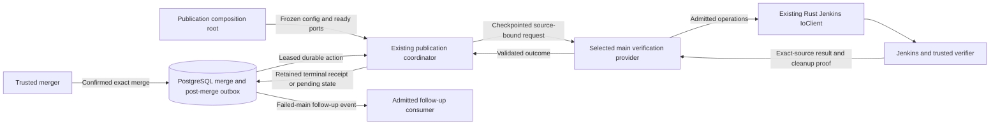
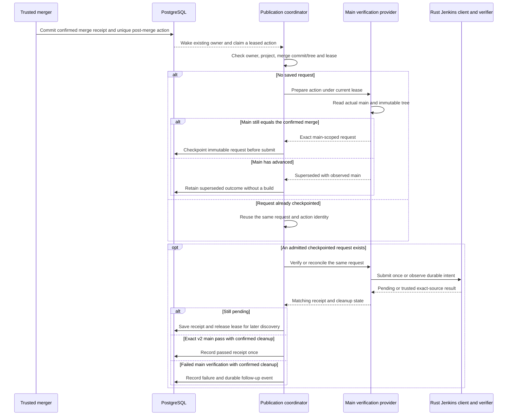

# Coordinator-owned post-merge verification

**Status: source implementation; activation is separate.** This closes the gap
between a trusted exact-tree merge and full main verification. It extends the
existing publication coordinator, PostgreSQL outbox and Rust Jenkins I/O client.
It introduces no service, broker, global registry or model publication authority.
The installed verifier/profile configuration and last qualified portal release
are not changed by this document or by the source implementation.

See the [versioned CI contracts](ci-pipeline.md#7-versioned-execution-and-accounting),
[native Jenkins workflow](forge-jenkins.md#native-gemini-workflow) and
[autonomous author/reviewer design](proposals/forge-autonomous-agent-workflow.md).
The diagrams below are editable Mermaid source; they are not rendered assets
served by the portal.

## The completed merge and its new obligation

A trusted merge produces a different commit identity from the authored candidate,
even when both commits have the same tree. Main verification binds the actual
confirmed **merge commit and tree**, not the feature candidate or a mutable branch
name. Recording the merged outcome and its unique post-merge action occurs in one
database transaction. A duplicate acknowledgement cannot create a second action.
The previous review, checks, merge receipt and completed task remain immutable.

Migration28 adds this capability after the already registered migration27 Jenkins
observations. Historical migrations remain unchanged. M27 observations remain
untrusted telemetry: an event saying Jenkins succeeded cannot satisfy the trusted
main check contract or authorize deployment.

## Ownership and composition

| Owner | Responsibility | Limit |
| --- | --- | --- |
| PostgreSQL | Atomically retain the merge receipt and unique successor; lease/checkpoint the action; preserve outcomes and failed-main follow-up events. | A notification wakes discovery; it is not an execution or approval credential. |
| Publication composition root | Read frozen opt-in configuration, choose factories, construct ready dependencies and inject the selected post-merge worker. | Disabled selection constructs no unused post-merge provider; workers do not query registries. |
| Post-merge worker | Claim the durable action, verify its owner/project/source, checkpoint the request before I/O, renew its lease and validate the terminal evidence. | It does not mutate historical approval, merge another tree or run a model. |
| Main verification provider | Read actual main/tree, prepare an immutable main-scoped request and reconcile the same Jenkins action through the existing delivery provider. | It cannot retarget an old action to a newer main or treat a raw Jenkins status as trusted success. |
| Rust Jenkins I/O client | Perform the configured bounded submit/observe/cancel operations. | It receives no arbitrary browser destination, command or merge authority. |
| Trusted verifier | Execute the exact v2 main gates and write source/request-bound results with cleanup evidence. | Branch coverage and unsigned observations cannot stand in for main results. |

The existing publication process owns this worker's lifetime and shutdown signal.
The selected factory receives the ready store and provider. Configuration opts in
with `post_merge_enabled` and a separate absolute
`post_merge_jenkins_delivery_config`; trusted merge and Jenkins publication must
also be enabled. The main provider requires the scope-aware v2 main contract.
The original branch publication configuration and frozen legacy v1 workflows
retain their own identities.

## Durable request sequence

The request has twelve fields: `action_id`, `prepare_action_id`, `workflow_id`,
`project_alias`, `candidate_commit`, `candidate_tree`, `integration_base`,
`source_branch`, `branch_scope`, `verification_profile`,
`gate_manifest_sha256` and `correlation_id`. `action_id` is `post_merge_id`;
`prepare_action_id` is UUIDv5 using that UUID and the name `prepare-v1`.
Both commit fields equal the confirmed merge commit; `candidate_tree` equals its
confirmed tree. Both branch fields are `main`, and the profile is
`forge-sdlc-jenkins-v2`. A restart cannot allocate a different intent or repeat
preparation after the checkpoint exists.

## Success, retry and cancellation

| Situation | Required behavior |
| --- | --- |
| Lost notification or coordinator restart | Scan the durable queue; resume the saved request and reconcile its existing action. |
| Database checkpoint rejected or lease lost | Do not submit or continue authority-dependent work. A future valid owner resumes the durable state. |
| Jenkins acknowledgement uncertain | Preserve the same action identity; reconcile before another write. |
| Pending build | Persist its actual receipt and schedule another observation of the same action. |
| Main advanced before preparation | Retain `superseded` and observed main; do not silently substitute the new head. |
| Raw Jenkins reports SUCCESS | Continue to require the trusted result, exact source/request/profile/scope, all three command records and cleanup proof. |
| Full main verification fails | Retain the build receipt and emit a source-bound follow-up event; do not rewrite the original task's successful merge history. |
| Deadline expires or cancellation is requested | Persist cancellation intent, cancel the existing action and continue reconciliation until the provider proves cleanup or that no process started. |

Success requires the configured Jenkins provider, matching action/workflow/
correlation, exact commit/tree/expected-main/gate digest, version2 result/profile,
the complete v2 main coverage declaration, valid trusted-result/log hashes, and
three ordered command records with their exact argv, indices and zero return
codes. Cleanup must be confirmed. The delivery adapter additionally validates
the protected verifier result and request binding; an application receipt does
not create protected evidence.

A failed-main check creates an independent durable remediation record with its
source and diagnostics. This record is follow-up evidence; this change does not
automatically admit another coding task. A new repair assignment must pass the
current WorkService author/reviewer and publication policy. The completed parent
is never reopened. A passed main check is verification evidence, not portal
activation or an automatic deployment instruction.

## Verification and rollout

Focused tests cover opt-in configuration and factory substitution, disabled zero
construction, source/lease rejection, checkpoint ordering, restart recovery,
terminal receipt validation and cancellation cleanup. Disposable PostgreSQL
tests cover the atomic outbox, unique identities, replay/lease fencing,
follow-up emission and privilege negatives. Source qualification must include
the intentional changes and all strict verifier dependencies before full gates.

Full main coverage still requires the real browser stage and all four backend
suites with zero silent skips. An in-memory branch run explicitly reports
browser/database not-run. This source work does not install a verifier, apply
migration28, modify live provider credentials or enable the coordinator in
production; those actions require a separately verified rollout.
