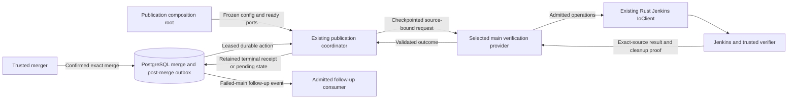
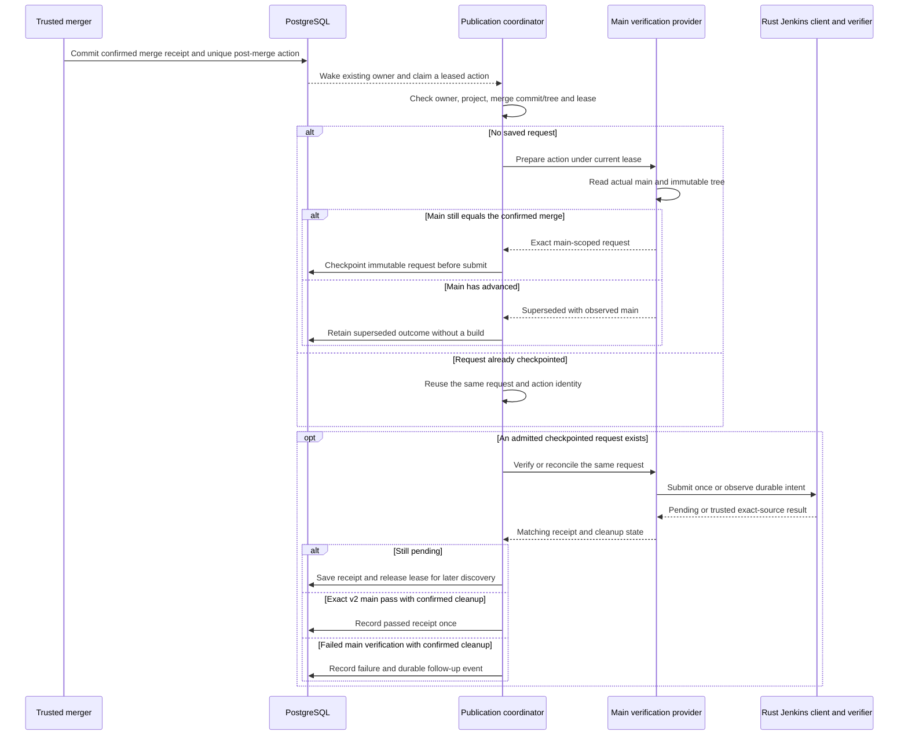
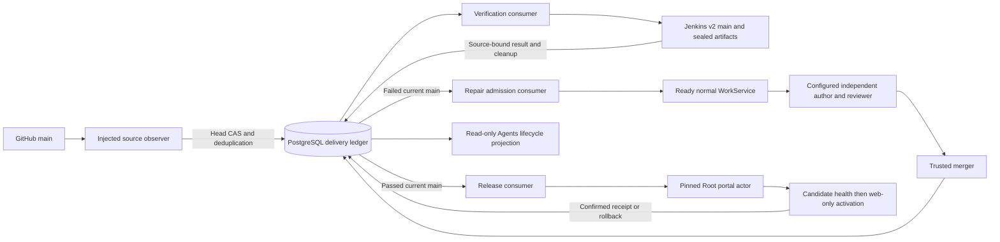

# Coordinator-owned post-merge verification

**Status: implemented delivery pipeline; runtime state requires receipts.** This closes the gap
between a trusted exact-tree merge and full main verification. It extends the
existing publication coordinator, PostgreSQL outbox and Rust Jenkins I/O client.
It introduces no service, broker, global registry or model publication authority.
Migration29 extends the original migration28 handoff with bounded repair,
observed-main verification and guarded portal activation. The Agents delivery
projection and protected operational receipts identify actual runtime outcomes;
a source document never substitutes for a successful rollout.

See the [versioned CI contracts](ci-pipeline.md#7-versioned-execution-and-accounting),
[native Jenkins workflow](forge-jenkins.md#native-gemini-workflow) and
[autonomous author/reviewer design](proposals/forge-autonomous-agent-workflow.md).
The diagrams below are editable Mermaid source; they are not rendered assets
served by the portal.

## The completed merge and its new obligation

A trusted merge produces a different commit identity from the authored candidate,
even when both commits have the same tree. Main verification binds the actual
confirmed **merge commit and tree**, not the feature candidate or a mutable branch
name. Recording the merged outcome and its unique post-merge action occurs in one
database transaction. A duplicate acknowledgement cannot create a second action.
The previous review, checks, merge receipt and completed task remain immutable.

Migration28 adds this capability after the already registered migration27 Jenkins
observations. Historical migrations remain unchanged. M27 observations remain
untrusted telemetry: an event saying Jenkins succeeded cannot satisfy the trusted
main check contract or authorize deployment.

## Ownership and composition

| Owner | Responsibility | Limit |
| --- | --- | --- |
| PostgreSQL | Atomically retain the merge receipt and unique successor; lease/checkpoint the action; preserve outcomes and failed-main follow-up events. | A notification wakes discovery; it is not an execution or approval credential. |
| Publication composition root | Read frozen opt-in configuration, choose factories, construct ready dependencies and inject the selected post-merge worker. | Disabled selection constructs no unused post-merge provider; workers do not query registries. |
| Post-merge worker | Claim the durable action, verify its owner/project/source, checkpoint the request before I/O, renew its lease and validate the terminal evidence. | It does not mutate historical approval, merge another tree or run a model. |
| Main verification provider | Read actual main/tree, prepare an immutable main-scoped request and reconcile the same Jenkins action through the existing delivery provider. | It cannot retarget an old action to a newer main or treat a raw Jenkins status as trusted success. |
| Rust Jenkins I/O client | Perform the configured bounded submit/observe/cancel operations. | It receives no arbitrary browser destination, command or merge authority. |
| Trusted verifier | Execute the exact v2 main gates and write source/request-bound results with cleanup evidence. | Branch coverage and unsigned observations cannot stand in for main results. |



The existing publication process owns this worker's lifetime and shutdown signal.
The selected factory receives the ready store and provider. Configuration opts in
with `post_merge_enabled` and a separate absolute
`post_merge_jenkins_delivery_config`; trusted merge and Jenkins publication must
also be enabled. The main provider requires the scope-aware v2 main contract.
The original branch publication configuration and frozen legacy v1 workflows
retain their own identities.

## Durable request sequence



The request has twelve fields: `action_id`, `prepare_action_id`, `workflow_id`,
`project_alias`, `candidate_commit`, `candidate_tree`, `integration_base`,
`source_branch`, `branch_scope`, `verification_profile`,
`gate_manifest_sha256` and `correlation_id`. `action_id` is `post_merge_id`;
`prepare_action_id` is UUIDv5 using that UUID and the name `prepare-v1`.
Both commit fields equal the confirmed merge commit; `candidate_tree` equals its
confirmed tree. Both branch fields are `main`, and the profile is
`forge-sdlc-jenkins-v2`. A restart cannot allocate a different intent or repeat
preparation after the checkpoint exists.

## Success, retry and cancellation

| Situation | Required behavior |
| --- | --- |
| Lost notification or coordinator restart | Scan the durable queue; resume the saved request and reconcile its existing action. |
| Database checkpoint rejected or lease lost | Do not submit or continue authority-dependent work. A future valid owner resumes the durable state. |
| Jenkins acknowledgement uncertain | Preserve the same action identity; reconcile before another write. |
| Pending build | Persist its actual receipt and schedule another observation of the same action. |
| Main advanced before preparation | Retain `superseded` and observed main; do not silently substitute the new head. |
| Raw Jenkins reports SUCCESS | Continue to require the trusted result, exact source/request/profile/scope, all three command records and cleanup proof. |
| Full main verification fails | Retain the build receipt and emit a source-bound follow-up event; do not rewrite the original task's successful merge history. |
| Deadline expires or cancellation is requested | Persist cancellation intent, cancel the existing action and continue reconciliation until the provider proves cleanup or that no process started. |

Success requires the configured Jenkins provider, matching action/workflow/
correlation, exact commit/tree/expected-main/gate digest, version2 result/profile,
the complete v2 main coverage declaration, valid trusted-result/log hashes, and
three ordered command records with their exact argv, indices and zero return
codes. Cleanup must be confirmed. The delivery adapter additionally validates
the protected verifier result and request binding; an application receipt does
not create protected evidence.

A failed-main check creates an independent durable repair operation with its
source and diagnostics. Its consumer invokes the ready normal WorkService under
the current project author/reviewer policy. A frozen idempotency key and verified
queued receipt link the actual new task; the completed parent is never reopened.
The lineage permits at most 20 repair admissions, including failures after a
repair itself merges. A passed main check separately queues a release operation;
only a healthy Root activation receipt establishes deployment.

## Verification and rollout

Focused tests cover opt-in configuration and factory substitution, disabled zero
construction, source/lease rejection, checkpoint ordering, restart recovery,
terminal receipt validation and cancellation cleanup. Disposable PostgreSQL
tests cover the atomic outbox, unique identities, replay/lease fencing,
follow-up emission and privilege negatives. Source qualification must include
the intentional changes and all strict verifier dependencies before full gates.

Full main coverage requires the real browser stage and all four backend suites
with zero silent skips. An in-memory branch run explicitly reports
browser/database not-run. Live rollout applies the additive migration, provisions
scoped capabilities, installs the pinned Root verifier/actor, and activates the
matching coordinator/API configuration. Preserve the database backup and prior
portal release. Operational evidence is retained outside Git to avoid creating a
new main build merely to record the preceding build.


## Portal lifecycle projection

The ABI14 portal requests `Forge-Delivery-Version: 1` through its native Work
relay. The header is fixed by the host, not selected by browser input. Matching
backend responses may include an optional `delivery` on project catalog entries,
task summaries and task details. Legacy requests omit the header and retain their
previous payload; new clients also accept old responses without this field.

A projection binds `verification_id`, source kind, actual commit/tree and update
time to three independent stages: verification, repair and release. Completed
merge history still says **Merged**. The current delivery pill distinguishes
queued/running main checks, repair, release building/activation and **Deployed**.
A successful verification does not imply deployment; missing activation evidence
is displayed as unverified. Exact source identities and receipts remain in a
native disclosure, with relative times in summaries. A project-level projection
can show observed main work without inventing a coding task.

The projection is read-only and creates no approval, cancellation or publication
authority. A repair link opens the actual related task through the existing
admitted Work path. Nullable IDs and absent delivery remain supported for inactive
and historical data. The old ABI13 decoder rejects unknown response fields, so
matching host, WASM and generated assets must be deployed atomically with the
negotiated backend contract. Source support is separate from actual live rollout.


## Unified delivery and external main changes

The publication composition root selects exactly one verification store: the
legacy M28 port when delivery is disabled, or the M29 unified port when enabled.
It injects ready verification, source-observation and release consumers. The
scheduler rotates these consumers and yields between them to normal review,
merge and publication work. No worker reads a global registry.

The observer checks one configured project per turn, at most once per minute.
PostgreSQL persists the previous head, compare-and-swap generation and next poll.
A manual push/merge therefore enters the same exact-source verification path.
Canonical owner/project/commit identity deduplicates an observation against a
coordinator merge. A genuine manual change has no invented coding task or workflow;
its Jenkins transport correlation UUID carries no coding authority. A later real
merge link can associate its actual root with the canonical verification.
Returning main to a previously seen commit creates a new release occurrence while
retaining the old immutable evidence.



## Safe release sequence

```mermaid
sequenceDiagram
    participant C as Publication coordinator
    participant DB as PostgreSQL
    participant R as Fixed Root actor
    participant J as Root-sealed Jenkins export
    participant W as Portal web service
    C->>DB: Claim release and renew private generation/token lease
    C->>R: Plan own release (private authority on stdin)
    R->>DB: Verify current capability, lease and exact identity
    R->>J: Verify main gates, request, source and artifact hashes
    R->>R: Stage immutable binary/assets; preserve replay files
    R->>W: Probe isolated candidate and stop it
    R-->>C: Public immutable plan with digest (no lease token)
    C->>DB: Checkpoint exact plan before activation
    C->>R: Activate checkpointed plan
    R->>DB: Fresh lease, current main and exact checkpoint digest
    R->>R: Save restart intent before service write
    R->>W: Replace fixed override and restart homelab-web
    alt Exact binary/config and authenticated origin/entry health pass
        R-->>C: Root activation receipt and confirmed cleanup
        C->>DB: Record deployed
    else Candidate or live health fails
        R->>W: Restore preceding override and verify old portal
        R-->>C: Failed receipt with confirmed rollback/health
        C->>DB: Record failed; preserve evidence
    end
```

The caller selects an identity, never a filesystem path, command or service. The
Root actor validates a fixed configuration, protected ancestry and pinned export.
Its public plan has nine identity fields plus version, policy, artifact manifest
and plan digest. Private generation/lease tokens travel only over stdin. Model
workers receive neither the actor sudo grant nor Jenkins/publication credentials.
The fixed existing `bitwave-portal-cloudflare.service` socket proxy is restored
after its web dependency restarts. Both the origin and the port8090 entry must
serve the exact bundle and pass authenticated admission/negative probes before a
healthy activation or rollback is recorded. Fresh database authority is checked
immediately before the privileged write.
A lost acknowledgement reconciles the actual running binary/config without a
second restart. If staging completed before the database checkpoint was saved,
the actor recovers its own sealed journal. Revoked start authority still permits
cleanup of the previously admitted operation; it never starts a new candidate.

## Configuration and visibility

| Capability | Explicit selection | Result |
| --- | --- | --- |
| Unified main verification | `delivery_enabled` plus scoped v2 post-merge provider | One durable verification owner for coordinator and observed changes. |
| Manual-main capture | `source_observation_enabled`, fixed 60-second interval | Durable scoped head observation, no OAuth quota polling. |
| Failed-main repair | API `delivery_enabled` and `delivery_repair_projects` | Normal current-policy author/reviewer task, shared maximum 20 rounds. |
| Portal activation | `release_enabled` and pinned `release_actor_sha256` | Fixed web-only Root actor after full main proof; automatic rollback. |

Database grants separately fence observe, repair and release per worker role,
owner and project. Defaults remain disabled for an unprovisioned installation.
The portal shows merged history separately from verification, repair and release.
Pending successors remain Active; a terminal exhausted repair or failed release
appears in Attention. Header-absent legacy clients retain their previous payload
and scope behavior before pagination; ABI14 clients negotiate the new projection.
