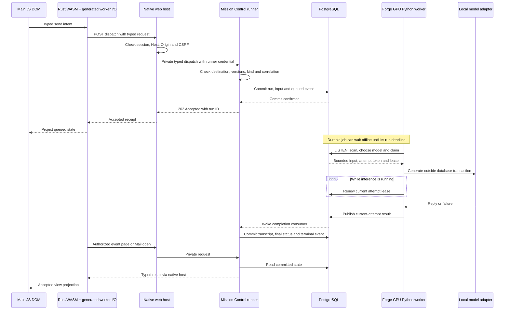

# PostgreSQL event dispatch for Forge GPU inference

**Implemented, reviewed 2026-11-18.** This describes the repository's dispatch
mode, not a new deployment or GPU measurement. Mission Control accepts and
commits Chat or Mail work while Forge is offline. Forge's Python worker claims
eligible jobs, calls its local model adapter, and publishes results through
PostgreSQL. The Mission Control completion consumer commits the final transcript.

## Implemented ownership

| Component | Responsibility and implementation |
| --- | --- |
| Main JavaScript thread | DOM, focus, local presentation, worker lifecycle, and typed input forwarding. No business API fetch. |
| Rust/WASM in the browser worker | Application state, guards, model selection, effect preparation, accepted response projection, and polling decisions. |
| Generated worker adapter | Bounded codecs, admitted HTTP effects, checkpoint I/O, timers, and cancellation of local waiting. |
| Native Forge web host | Browser session, configured Host/Origin and CSRF checks; private relay credentials remain native. |
| Mission Control runner | Typed header dispatch, fixed configured `mission-control` owner scope, queue admission, history retention, completion, and event replay. |
| Forge GPU Python worker | Model readiness/loading, restricted claims, lease renewal, and result publication. Its local inference thread allows renewal while the adapter is running. |
| PostgreSQL | Durable jobs, input messages, ordered events, result inbox, and worker readiness; notifications are wake-ups. |

The browser's command endpoint remains `POST /forge/v1/dispatch`. The runner's
private endpoint is `POST /v1/dispatch`; the native host does not expose its
credential or trust a browser-supplied owner. The separate workspace checkpoint
route remains `POST /forge/v1/dispatch/workspace` → `POST /v1/workspace`.

The supplied dispatch service sets `FORGE_RUNNER_MODE=dispatch`. It starts the
completion consumer instead of the legacy Mission Control inference worker. A
configured tool repository can still start a **tools-only** local worker; it must
not claim distributed Chat/Mail inference. `legacy` is retained as an explicit
alternate mode, including the compatibility request that may wait up to 13 seconds.
[Runner composition](../../deploy/mission-control/agent-runner/runner.py) ·
[Service declaration](../../deploy/mission-control/agent-runner/forge-agent-runner-dispatch.service)

## Request and completion sequence

The published [portal sequence](../../src/rust/forge-ide-web-host/design/chat-dispatch-sequence.mmd)
is the same ownership flow in a compact diagram. Rust/WASM owns application
intent even though the native runner and database own durable execution.

## Durable data and delivery

`runs`, `messages`, and `run_events` hold admission and replay. Migration `0005`
adds the lease, attempt, run deadline, `inference_results` inbox, and
`gpu_worker_readiness`; `0006` adds eligible-model selection and `0007` extends
the same queue for Mail. Notifications use empty payloads on
`forge_agent_jobs`, `forge_agent_results`, and `forge_agent_events`.

The Forge worker subscribes before scanning, rescans at most five seconds after
a missed wake-up, and reconnects after connection loss. It loads the next eligible
model locally before claiming it. Claims use `FOR UPDATE SKIP LOCKED`, a fresh
attempt token, and a 60-second lease bounded by the run deadline. Renewal runs
every ten seconds using database time. Model execution does not hold the claim
transaction open. [Worker loop](../../deploy/mission-control/agent-runner/forge_gpu_worker.py)

Publication checks the current attempt and lease, stores a bounded result, and
moves the run to `result_ready`. The unique inbox receipt permits an identical
publication retry; it does not permit a different stale result. Mission Control
scans result batches of 20 with a two-second wake-up timeout and commits the
terminal event and transcript in the completion transaction. A result accepted
before the deadline can still finalize afterward if its chat remains available.

Inference can execute again after lease loss. The guarantee is guarded result
acceptance and single transcript finalization, not exactly-once model execution.
Cancellation invalidates future result acceptance; socket interruption is best
effort and is not proof that every local model computation stopped. Deletion and
expiration lock the chat before its linked runs, purge linked content and
checkpoints, and leave a tombstone that blocks late recreation.
[Queue and finalization](../../deploy/mission-control/agent-runner/queue_store.py) ·
[History DAO](../../deploy/mission-control/agent-runner/chat_history_store.py)

## Header routing and DTOs

| Destination | Implemented request and result |
| --- | --- |
| `ide.chat.run.models` | Request ID → configured model IDs, default model, and recorded readiness. |
| `ide.chat.run.submit` | Stable chat ID, optional expected revision/model, new turn, idempotency key → 202 receipt after commit. |
| `ide.chat.run.events` | Run ID and `after_sequence` → bounded ordered events, next cursor, status, and saved reply/revision on completion. |
| `ide.chat.run.cancel` | Run ID → current cancellation or terminal state. |
| `ide.mail.list` / `ide.mail.open` | Inbox/Archive or thread cursor → saved summaries or ordered message page. |
| `ide.mail.send` / `ide.mail.retry` | New/follow-up turn or failed run identity → committed thread/run receipt. |

Both version headers are `1`; the request ID must match the correlation header.
Rust DTOs validate the browser contract, Python command dataclasses validate the
private runner contract, and neither side accepts an arbitrary endpoint or owner.
[Chat DTOs](../../deploy/mission-control/agent-runner/chat_run_api.py) ·
[Mail DTOs](../../deploy/mission-control/agent-runner/mail_api.py)

Chat's configured catalog supports GPT-OSS 20B and Qwen2.5-Coder 7B. Each job pins
the selected model; the current Chat run admission reserves 384 generation tokens
and has a ten-minute deadline. GPT-OSS 120B is the fixed Mail recipient. Mail's
committed `gpt-oss-120b-harmony-v1` profile has a 4,096-token context, 1,024-token
completion reserve, 16-token margin, and 256-token minimum follow-up. Its queue
deadline is four hours and the local adapter allows up to 30 minutes of inference.
The adapter can be configured up to 8,192 context tokens, but Mission Control's
admission budget and Forge's profile must agree; adapter capacity alone is not
an enabled 8k Mail profile.
[Profile](../../deploy/mission-control/agent-runner/mail_tokenizer.py)

The IDE checkpoints a pending Chat run ID and resumes event pages after reload,
including before a first reply creates a visible saved chat. The generated worker
uses short bounded requests, not a held-open browser SSE channel; the native host
still serves requests serially. Mail uses Rust-scheduled five-second refresh while
visible work is processing. Paging display messages never changes the full saved
inference replay or token budget.

## Retention, recall, and browser recovery

Saved Chat defaults to an inclusive UTC keep-through date 30 days after its first
committed turn, expiring at midnight after that date. Later turns retain the
policy. Long-term storage and a changed date are explicit revision-checked edits.
The runner sweeps up to 20 expired chats each minute; reads already exclude due
chats. The Conversations drawer searches the currently loaded saved-history page.
Rename and cross-page full-text search are not implemented.

Mail stores every submitted message for review. Replay contains completed pairs
plus the next user message; failed submissions are not completed recall pairs.
After a saved reply, too little useful follow-up allowance or the transcript
message/byte bound automatically archives the thread. Manual archive, delete,
read/unread persistence, summaries, vector memory, and persistent KV snapshots are
not implemented Mail operations. Prefix KV reuse is in-memory only and is lost
on model switch or process restart.

Completed Chat and Mail are durable. Chat drafts and bookmarks belong to per-tab
checkpoints. Unsent Mail drafts are page state plus the bounded same-tab
Home/Design navigation handoff, not a cross-device saved-draft store. The handoff
excludes completed transcript bodies. On return, the worker restores authorized
state, then applies and consumes the requested view fragment.

## Connection and privilege boundary

The supplied `forge-postgres-tunnel.service` forwards Forge loopback port `15432`
to Mission Control's loopback database listener. Mission Control uses its Unix
socket. The dedicated forwarding account is restricted to the database target;
worker login and function grants are provisioned separately. These declarations
do not establish that a remote Forge machine is currently powered on.

The worker receives only execution grants on `forge_agent_worker_api`
`advertise`, `next_model`, `claim`, `renew`, and `publish`. It has no direct
chat/checkpoint table grants. The migrations derive worker identity from
`session_user`, set trusted `SECURITY DEFINER` search paths, and revoke default
public function execution.
[Dispatch migration](../../deploy/mission-control/sql/migrations/0005_inference_dispatch.sql) ·
[Model selection](../../deploy/mission-control/sql/migrations/0006_inference_model_selection.sql) ·
[Mail migration](../../deploy/mission-control/sql/migrations/0007_ide_mail.sql)

## Validation and operational limits

The runner/worker unit tests and SQL fixture tests describe admission, retries,
current-attempt publication, and guarded completion. Browser acceptance separately
covers actual WASM, local fixtures, history mutation, queue polling, and navigation
recovery. A documentation refresh is not a fresh GPU performance trial. Keep
powered-off submission, lost notifications, worker loss, model mismatch, deadline,
retention during inference, and cold-prefix replay as checks for any new deployment
or context setting.

PostgreSQL is a shared availability dependency: an outage prevents new confirmed
admission, claims, and publication until recovery. Before changing legacy versus
dispatch mode, stop admission/claims and drain or resolve existing leases/results.
Do not run legacy owner-wide recovery concurrently against distributed jobs.
