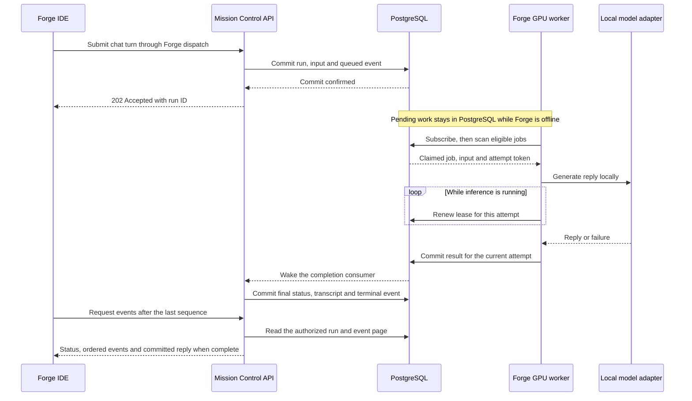

# PostgreSQL event dispatch for Forge GPU inference

**Proposed design.** Mission Control accepts chat requests and commits them to PostgreSQL. A worker on Forge GPU claims those jobs and runs inference locally. Forge can be offline while Mission Control accepts work. When Forge reconnects, it reads the pending queue and picks up jobs that are still eligible.

## Deployed behavior

The queue store already commits a run, its input messages and a `queued` event in one transaction. PostgreSQL delivers the `forge_agent_jobs` notification on commit. The worker claims with `FOR UPDATE SKIP LOCKED` and keeps a replayable sequence in `run_events`. The private API already returns a run ID from `POST /v1/runs` and supports status and event reads. [Queue store](../../deploy/mission-control/agent-runner/queue_store.py) · [Private runner API](../../deploy/mission-control/agent-runner/README.md)

The runner process currently runs the inference worker on Mission Control. Its compatibility route can check the active GPU model before queuing the request. The worker calls Forge over the existing HTTP tunnel, and the compatibility request can wait up to 13 seconds for a reply. The deployed PostgreSQL cluster uses a local Unix socket. [Runner process](../../deploy/mission-control/agent-runner/runner.py) · [PostgreSQL configuration](../../deploy/mission-control/postgres-local.conf)

## Request and completion sequence

The existing Mission Control runner continues to own admission, chat history, expiry and deletion. It also consumes results and commits the final transcript. Forge owns inference and calls its model adapter on loopback. Admission chooses an allowed model from the request or Mission Control configuration and pins it in the job. Forge advertises its ready model and last-seen time in PostgreSQL so Mission Control can show **Waiting for Forge** without probing the GPU on each request.

## Durable dispatch and data access

Reuse `runs`, `messages`, and `run_events`. Add a lease deadline, attempt number, attempt token, next-eligible time and absolute run deadline to the queue. Add a result inbox with a unique row per run and a cascading foreign key. A result transaction checks the current lease, stores the bounded reply or failure, moves the run to `result_ready`, and signals Mission Control. An identical publication retry can return the current receipt or terminal status for the accepted attempt. The completion consumer drains the inbox on startup and reconnect. It uses the existing chat DAO rules to apply and acknowledge each result in the same transaction as the terminal event and transcript update.

`LISTEN/NOTIFY` wakes the workers. Run and result rows provide durable delivery. Commit `LISTEN`, scan in a new transaction, then rescan on a notification, a bounded timer or reconnect. Use empty notification payloads, since PostgreSQL notifications are visible to other database users. [PostgreSQL 16 LISTEN](https://www.postgresql.org/docs/16/sql-listen.html) · [NOTIFY](https://www.postgresql.org/docs/16/sql-notify.html)

A worker claims the oldest eligible unlocked job for its supported model in a short transaction using `FOR UPDATE SKIP LOCKED`. It renews its lease using the database clock and runs the model outside the transaction. A worker that loses its lease stops renewing and cancels local inference where possible. After an expired lease, PostgreSQL can admit a new attempt within the retry and run limits. Inference may execute again. Only the current attempt can publish an accepted result, and the inbox makes `result_ready` ineligible for another claim. [PostgreSQL 16 row locking for queue consumers](https://www.postgresql.org/docs/16/sql-select.html#SQL-FOR-UPDATE-SHARE)

The Mission Control scheduler expires uncompleted jobs at their run deadline, including when Forge stays offline. A published result can still finalize after that deadline if it was accepted before the deadline and the chat is still available. For linked chats, take locks in chat, run, then result order and check current chat availability under the lock. Cancel, delete and chat expiration invalidate further writes. Deletion and chat expiration purge linked work and receipts through the existing run relationship. A retention edit during inference can still succeed. Finalization checks the current policy and the accepted attempt before committing.

## Header routing and transfer objects

The browser keeps `POST /forge/v1/dispatch` and the existing session and CSRF admission. `Forge-Destination` selects the operation.

| Destination | Request fields | Result |
| --- | --- | --- |
| `ide.chat.run.models` | Request ID | Configured model IDs, default model and current readiness |
| `ide.chat.run.submit` | Stable chat ID, expected revision for a continuation, new turn, optional model ID and an idempotency key | `202 Accepted` with run ID, chat ID and queued status after commit |
| `ide.chat.run.events` | Run ID and `after_sequence` | Current status, bounded ordered events, the next sequence cursor and, when completed, the saved reply and chat revision |
| `ide.chat.run.cancel` | Run ID | Current cancellation or terminal status |

The worker receives a separate claim DTO with the run ID, model, bounded inference input, attempt token and deadline. Its result DTO carries the run ID, attempt token and a bounded reply or failure. PostgreSQL derives worker identity from the connection role. Mission Control derives chat ownership from its admitted session. Neither DTO uses an owner field supplied by the caller.

An explicit model ID is pinned with the run. The Forge worker uses its local model catalog and the next eligible job to choose what to load. It claims the job after the adapter reports that model ready.

The IDE keeps the pending run ID in its tab checkpoint and resumes authorized event reads after a reload, including for a first turn that has yet to appear in Previous chats. A submit retry with the same idempotency key returns the existing run after an ambiguous connection failure. The browser starts with short event-page requests because the current web host serves one request at a time. Chat history actions continue to use their existing destinations. [Web host request loop](../../src/rust/forge-ide-web-host/src/bin/forge-ide-web-host.rs)

## Connection and privileges

For the first rollout, use a Forge-initiated SSH forward to a PostgreSQL TCP listener bound to Mission Control loopback. Update the PostgreSQL provisioning check for that specific listener and keep the existing Unix-socket connection for Mission Control. Restrict the forwarding account to the database destination with shell and subsystem sessions disabled. Limit host-based authentication on the loopback endpoint to the agent database and the Forge worker login. [OpenSSH forwarding and session controls](https://man.openbsd.org/sshd_config#PermitOpen) · [PostgreSQL host-based authentication](https://www.postgresql.org/docs/16/auth-pg-hba-conf.html)

Give the Forge login only the database connection and execution grants needed to advertise availability, claim, renew and publish. The worker reads inference input through its claim and has no table grants for chat history, browser checkpoints or unrelated jobs. Define the database functions with a trusted search path and revoke default public execution in the same transaction that creates them. [PostgreSQL function privilege guidance](https://www.postgresql.org/docs/16/sql-createfunction.html#SQL-CREATEFUNCTION-SECURITY)

## Cutover and acceptance checks

1. Stage the new queue operations, role and API with a fake Forge worker and disposable PostgreSQL. Stop the notification listener during submission and verify that a reconnect scan recovers the work.
2. Verify a send with Forge powered off returns a run ID and stays queued. Start Forge and verify the IDE picks up the result. Test a duplicate submit, a worker crash after claiming, a late result after retry, and a Mission Control restart after result publication.
3. Test first-turn reload, cancellation, chat deletion and expiry during inference. Verify that pending or stale results cannot re-create a removed transcript. Track queue age, last worker heartbeat, lease expirations and time spent in `result_ready`.
4. Drain and disable the legacy inference worker before enabling Forge claims. Its owner-wide recovery currently marks running jobs interrupted. Retire the Mission Control-to-Forge inference tunnel after the new path passes the checks. For rollback, stop Forge claims and resolve its leases and receipts before restoring the legacy worker.

PostgreSQL stays on Mission Control and is a shared availability dependency. During a database outage, the API cannot confirm new jobs and Forge cannot claim or publish work. Already committed jobs and results remain available after recovery. The cutover above applies to chat inference.
