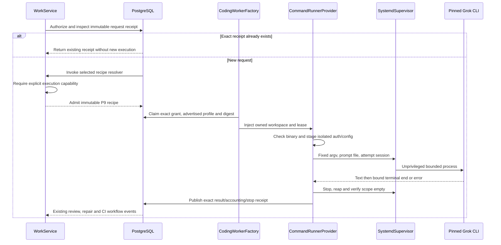

# Grok coding provider

Status: source support for Grok1.0.92 (`b06756fd6256`), policy9 and additive
migration0018. This page does not claim that the provider is deployed or that
an authenticated account has an available allowance. Grok execution defaults
**off**, independently in API and worker configuration. Existing Antigravity
and Codex defaults and frozen historical workflows are preserved.

## Selection and admission

The normal `WorkProfile`/`WorkCatalog` → immutable recipe →
`CodingWorkerFactory` → `CommandRunnerProvider` path selects Grok. There is no
parallel command runner, global registry lookup from task code, arbitrary
program field or native Muse Code dependency. The Rust protocol's backend enum
requires `grok`/Grok so its catalog and usage rows can be decoded.

Grok profiles require an explicit trusted `execution_enabled:true` in **both**
API and worker configuration after operator qualification. Omission defaults
Grok to false; existing providers retain their previous true default. Disabled
profiles cannot resolve an execution recipe, pass API admission, appear in the
runnable catalog, be advertised or pass worker recipe verification. A global
ready worker for another provider cannot establish Grok readiness. Database
claims additionally require an exact Grok alias/backend/model/mode in the fresh
worker advertisement, the actual role grant and the recipe's exact policy
digest. The flag is configuration authority, not a task or browser override.

Exact immutable receipt replays are resolved before current execution-capability
checks. Disabling a profile blocks new work while preserving a prior submit,
resume or repair receipt. The DAO invokes the current recipe resolver only for a
new admission; owner and project authorization still apply to every request.

A separate usage configuration can include Grok while execution remains off.
Allowance is **Not reported** / `unsupported_headless`; no numeric quota, free
usage or unlimited allowance is inferred. Manual refresh does not start a Grok
model, daemon or consumer OAuth polling loop. Account login and model discovery
are separate facts from subscription/free-preview qualification. No API key,
purchase, account rotation or paid fallback is provisioned.

## Scoped native execution

The selected native binary is pinned by version and SHA-256:
`add4d201dbf2c0bd6077a36feb55a76939de30bae48dbb06f16b2307d38ceacb`.
Admission never selects the launcher or an auto-updated binary. Fixed arguments
come from the installed help and bundled headless/config/permission guides:

```text
grok-bin --no-auto-update --trust --prompt-file <immutable attempt prompt>
  --output-format streaming-json --model <configured model>
  --cwd /run/forge-coding-workspace --session-id <attempt UUID>
  --leader-socket <attempt-owned socket>
  --no-memory --no-subagents --no-plan --disable-web-search
  --permission-mode dontAsk --tools <fixed local tool set>
  --allow Read(*) --allow Bash(*) --deny MCPTool(*)
  --sandbox read-only|workspace
```

Implementation also allows `Edit(*)` and the fixed write/edit tools. Plan and
independent Review remain read-only at the outer mount boundary, including for
shell commands. `dontAsk` uses explicit tool grants and avoids an automatic
permission-review model. Forge's Plan mode still controls the assignment; native
`--no-plan` suppresses a separate Grok planning flow. No `--continue`, implicit
latest session, shared leader, default subagents or hidden observer is selected.

Each attempt owns fresh HOME, GROK_HOME, configuration, logs, session storage and
IPC paths. Only the selected owner-private `auth.json` inode is staged through
no-follow handles; host settings, plugins, MCP configuration, session history
and other providers' state are not copied. System Grok settings are hidden.
The controlled config disables the shared leader/registry, updates, memory,
auto-wake, workflows, goal tools and telemetry; the immutable argv and outer
supervisor retain final ownership. Project instructions remain project context,
not authority to change the admitted recipe.

### Supported project trust subset

Grok1.0.92 requires folder trust to load repository instructions and skills in
headless mode. Forge explicitly selects the verified `--trust` flag for ordinary
`AGENTS.md` and `.agents/skills` text. It does not grant a repository permission
to install native extensions or run startup configuration. Before authentication
staging, scratch acquisition or process startup, a fixed metadata-only preflight
rejects any of these documented discovery paths, including dangling symlinks:

| Native surface | Rejected project paths |
| --- | --- |
| Grok executable configuration | `.grok/config.toml`, `.grok/sandbox.toml`, `.grok/lsp.json` |
| Grok hooks, plugins and agent definitions | `.grok/hooks`, `.grok/plugins`, `.grok/agents`, `.grok/personas`, `.grok/roles`, `.grok/workflows` |
| Compatibility settings/plugins | `.claude/settings.json`, `.claude/settings.local.json`, `.claude/plugins` |
| Compatibility hooks/MCP | `.cursor/hooks.json`, `.cursor/mcp.json`, `.mcp.json` |
| Executable environment setup | `.envrc` |

The `.grok`, `.claude` and `.cursor` containers themselves must be real
directories when present; symlink or non-directory containers are rejected.
Checks do not traverse or parse the rejected content and do not recursively
scan arbitrary files. This subset applies at the owned worktree root used as
Grok's fixed cwd. Repository executable extensions are unsupported and require
separate design/qualification. Disabling `lsp_tools` is not used as evidence
that passive LSP startup is blocked.

The immutable native config also sets documented `session.load_envrc=false`.
The supervisor builds an empty inherited environment with a fixed allowlist:
no `XAI_API_KEY`, `GROK_AUTH`, parent `GROK_CONFIG` or provider credentials are
forwarded. Guides02/05 describe per-model config, the active auth session and
`XAI_API_KEY` as credential sources; project config is rejected, the controlled
native config defines no key or alternate model provider, and only the owned
account auth file is staged. No additional automatic `.env` key-discovery path
is documented in this version; ordinary files are not interpreted as auth.

A separate immutable `managed_config.toml` contains tighten-only native policy:
`allow_managed_hooks_only=true`, `allow_managed_mcp_servers_only=true`,
`allowed_mcp_servers=[]`, `enable_all_project_mcp_servers=false` and
`strict_known_marketplaces=[]`. Installed guides09/10 describe these policies;
network-disabled native `inspect --json` with a fresh no-auth HOME confirmed
project instructions loaded, unmanaged hooks were disabled by enforced policy
and a deliberately configured project MCP server was locked down. This
inspection made no model/account call and did not run a project hook/server.
The source preflight also rejects those fixture paths before native execution.

The supervisor verifies bounded exact control-file bytes and exact argv, then
mounts both config files and authentication read-only. Missing, altered or
symlinked policy files fail before launch. Policy9's digest includes the trust
subset and exact config/managed-policy hashes before its initial deployment; old policies and
receipts retain their identities.

The staged authentication file is read-only. A native refresh that requires
rewriting it is intentionally unavailable: it must fail as an account/setup
problem rather than update the host account or silently retry with another
credential. Qualify this boundary before enabling execution. The existing outer
supervisor enforces1800-second wall time and TERM→KILL cleanup, with verified
empty cgroup and launcher reaping before any result is accepted. Cancellation
preserves actual workspace changes for reconciliation; it does not imply a
rollback. Grok's nested sandbox remains enabled and also needs qualification
under the actual outer process boundary.

The parent owns a retained directory descriptor and the original copied-auth
inode descriptor. It removes that copy only after both the launcher and native
scope are proven stopped, or after a setup failure proves no process started.
Partial credential writes and later invocation setup failures use the same
cleanup. Unlinking is relative to the retained directory and requires the exact
regular-file inode with one link; a renamed or symlink-replaced `.grok` cannot
redirect deletion into the host account. Unrelated leaf replacements and extra
hard links fail closed. All descriptors close when the bounded attempt ends.

An uncertain scope or unresolved inode returns `needs_reconcile` and retains
the copy. A nonsecret identity witness is written under the parent-owned
`auth-cleanup/<attempt UUID>.json`, outside the child's writable alias; it is
evidence for explicit reconciliation, not automatic deletion authority. No
result is accepted while credential cleanup is uncertain. Prompts, receipts,
workspace changes and session metadata are retained. Policy9 pins this cleanup
boundary independently of its configuration hashes.

## Terminal events and token accounting

The bounded JSONL parser accepts documented `streaming-json` events. It retains
only public text and terminal metadata; thoughts, tool inputs/results and native
reasoning are discarded. A successful result requires coherent nonempty text,
exact fresh attempt session, expected workspace, request identity,
`stopReason:end_turn`, terminal `end`, exit0 and the trusted scope-stop proof.
Duplicate terminal records, malformed output, changed identity, truncated
streams, unknown stop reasons and error events cannot become success.

The documented interrupted boundary permits an empty request identity **only**
for `stopReason:cancelled` plus `usage_is_incomplete:true`, while preserving the
session/workspace binding. Such accounting remains unknown. A cancellation or
error is not a completed task or a review approval.

Per-response `usage` events are not summed with the terminal aggregate. The
installed contract reports disjoint prompt buckets:

```text
Forge input = native uncached input + cache read + cache creation
Forge cached input = native cache read
Forge total = full prompt input + output
```

The terminal's supplied total must agree with those buckets when all are
present. Missing counters remain unknown; `usage_is_incomplete` discards the
unverified aggregate instead of recording fake zeros. Provenance is
`grok-headless-end-v1` / `fresh_session`. No warm-cache benefit is claimed;
unrelated tasks and reviews always start fresh. Related-session reuse can be
added later only through a receipt-bound session provider with verified native
storage/continuation semantics.

## Observed preview and qualification limits

An explicitly authorized, isolated one-turn `grok-4.7` preview returned the exact
test marker with zero tool executions. Native terminal usage reported 582
uncached input, 2,816 cache-read input, zero cache creation and 42 output tokens:
3,398 full input and 3,440 total. Reasoning tokens were a subset. The sanitized
47-event regression fixture retains event order and counters, replaces private
identities and signatures, and omits reasoning contents. The vendor's calculated
price is not evidence of an account debit or remaining allowance.

Standalone `grok usage --json` did not support plan reporting on this account;
the official dashboard requested SuperGrok and advertised a limited free preview
without a numeric allowance. Offline, network-disabled inspection separately
qualified instruction loading and enforced managed policies without credentials
or a model request. Neither observation qualifies the production worker's entire
repository/sandbox/auth-refresh path. Execution remains explicitly off until
that path and its account limits are qualified; usage visibility stays separate.



Migration0018 only extends exact backend/policy/provenance fences and current
strict verifier expectations. It does not modify old tasks, attempts, results,
Plan decisions, reconciliation receipts or frozen workflow policies. P1–P8
history remains attributable; workers cannot reinterpret it under P9. There is
no new execution mode, database role or default workflow author/reviewer.
