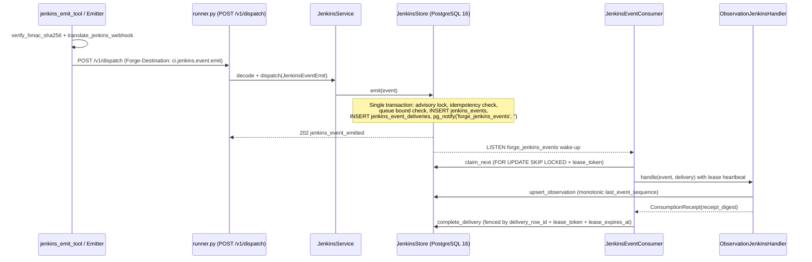

# Jenkins Events in Forge's Event-Driven System

This document describes the implemented, optional Mission Control Jenkins event
modules and their runtime contract. Typed configuration selects the store,
emitter and consumer providers through the runner's factories; webhook data
cannot select its own dependencies or grant authority.

The capability is disabled by default. Enabling it requires the normal reviewed
deployment of matching source, schema migration 0027, narrowly granted database
access and trusted operator configuration. Source support alone does not prove
that the service or its consumers are active.

Each workflow's persisted records identify its actual source, CI, independent
review and deployment status. This design does not replace those receipts or
authorize a merge or activation. Historical qualification reports remain
attributed to their recorded revisions and are not relabeled by later changes.

## 1. Scope and Trust Boundaries

Jenkins build and stage webhooks are treated as **untrusted external CI observations**:

- Payloads **never** select a Forge destination, override `owner_id`, `project_alias`, or `jenkins_instance`, spawn processes, approve Forge plans/reviews, satisfy exact-source Jenkins checks, or authorize Git pushes/merges. The existing Rust Jenkins `IoClient`, trusted delivery providers and root verification receipts retain those responsibilities.
- The Mission Control runner (`deploy/mission-control/agent-runner/runner.py`) remains loopback-only and bearer-authenticated on `POST /v1/dispatch`. No unauthenticated public webhook endpoint is added.
- The capability is **disabled by default**: when `FORGE_RUNNER_JENKINS_CONFIG` is unset, the Jenkins selection performs zero config file reads, zero database queries, and spawns zero consumer threads. Known `ci.jenkins.*` routes return `503` (`jenkins_failed`, `unavailable`) and unknown `ci.jenkins.*` routes return `404` (`jenkins_failed`, `not_found`).
- Enabled consumers participate in both API-only and existing full-host lifecycles. In API-only mode Chat and inference remain inactive; this capability adds no GPU/model-process startup. The host owns partial startup cleanup and reverse-order shutdown. All-disabled consumer catalogs retain API access without a consumer thread.
- Lease heartbeats remain owned until stopped. Lost leases cannot complete or dead-letter an event; blocked renewal I/O stops admission and leaves its delivery for fenced recovery. Bounded shutdown surfaces failure while retaining handlers if a supporting thread has not quiesced.
- Operator configuration accepts HTTPS or explicit loopback HTTP origins (`127.0.0.1`, `localhost`, `[::1]`). Other plaintext HTTP origins are rejected, and build URLs must match the selected scheme, host and port.
- Delivery claims and lease effects use the current allowed projects, instances, jobs, origins and enabled consumer project/event subscriptions. A supplied consumer list cannot enable a revoked handler. Narrowed catalogs preserve previous rows while excluding them from processing; observation projection also checks current owner/project/instance/job/origin grants.

## 2. Implemented Module Boundaries

All modules live under `deploy/mission-control/agent-runner/`:

| Module | Responsibility | Dependencies |
| --- | --- | --- |
| `jenkins_events.py` | Pure domain value types (`JenkinsEventEmit`, `JenkinsEventRecord`, `JenkinsDeliveryRecord`, `ConsumptionReceipt`), finite enums (`JenkinsEventKind`, `JenkinsBuildResult`, `JenkinsStageStatus`), bounds/origin validation, canonical `payload_sha256` | Python stdlib only |
| `jenkins_config.py` | Strict, defensively frozen startup configuration (`JenkinsConfig`, `JenkinsInstanceConfig`, `JenkinsConsumerConfig`, `load_jenkins_config`) | stdlib, `jenkins_events` |
| `jenkins_codec.py` | Pure edge translator for Jenkins webhook JSON + constant-time HMAC-SHA256 verification (`verify_hmac_sha256`, `translate_jenkins_webhook`) | stdlib, `jenkins_events` |
| `jenkins_store.py` | PostgreSQL DAO (`JenkinsStore`) for atomic emit + fan-out + `pg_notify('forge_jenkins_events', '')`, keyset pagination, `FOR UPDATE SKIP LOCKED` claims, lease renewal, fenced completion/failure/dead-letter, and monotonic observation upsert | stdlib, `psycopg2`, `queue_store.Rejected`, `jenkins_events`, `jenkins_config` |
| `jenkins_consumer.py` | `JenkinsEventHandler` protocol, default `ObservationJenkinsHandler`, `JenkinsConsumerFactory` (explicit handler map; no global registry), and `JenkinsEventConsumer` background worker | stdlib, `jenkins_events`, `jenkins_config` (injected store & handlers) |
| `jenkins_api.py` | Header-routed `ci.jenkins.*` command decoder, `JenkinsService`, `JenkinsServiceFactory`, `dispatch()`, and `failed()` | stdlib, `chat_history_api`, `queue_store.Rejected`, `jenkins_config`, `jenkins_events`, `jenkins_store`, `jenkins_consumer` |
| `jenkins_emitter.py` / `jenkins_emit_tool.py` | Injectable `JenkinsEventEmitter` protocol (`InProcessJenkinsEmitter`, `HttpDispatchJenkinsEmitter`) and preview-by-default CLI bridge | stdlib, `jenkins_events`, `jenkins_codec`, `jenkins_config` |

## 3. Single Front Door Mapping (`POST /v1/dispatch`)

All operations require `Authorization: Bearer <token>`, `Content-Type: application/json`, `Forge-Envelope-Version: 1`, `Forge-Contract-Version: 1`, `Forge-Destination`, `Forge-Request-Id`, exact `body.request_id == Forge-Request-Id`, exact destination/kind agreement, and a `16 KiB` body limit:

| `Forge-Destination` | Request `kind` | Response `kind` & HTTP status | Behavior |
| --- | --- | --- | --- |
| `ci.jenkins.event.emit` | `jenkins_event_emit` | `202` `jenkins_event_emitted` | Enforces allowlisted `project_alias`, `jenkins_instance`, `job_name`, and exact configured `build_url` origin; idempotent replay on matching `(project_alias, jenkins_instance, delivery_id)` + `payload_sha256`; `409 idempotency_conflict` on digest mismatch; `503 queue_full` when pending deliveries exceed `max_pending_deliveries` |
| `ci.jenkins.events.list` | `jenkins_events_list` | `200` `jenkins_events_listed` | Monotonic `after_sequence` keyset pagination scoped to `(owner_id, project_alias)` with optional `job_name`, `event_kind`, and `commit_sha` filters |
| `ci.jenkins.event.get` | `jenkins_event_get` | `200` `jenkins_event_opened` | Committed event detail plus API-safe per-consumer delivery states (internal `lease_token` omitted) |
| `ci.jenkins.deliveries.list` | `jenkins_deliveries_list` | `200` `jenkins_deliveries_listed` | Bounded listing of delivery states per project with optional `consumer_name`, `status`, and `(after_sequence, after_consumer)` keyset pagination |

## 4. Durable PostgreSQL Schema (Migration `0027`)

The new additive migration `deploy/mission-control/sql/migrations/0027_jenkins_events.sql` adds three tables in `forge_agent` with `PUBLIC` revoked. The never-applied saved `0018_jenkins_events.sql` is renumbered; installed migrations 1–26 retain their bytes and identities:

1. `forge_agent.jenkins_events`: append-only immutable event log with cross-column `CHECK` constraints, `UNIQUE (owner_id, project_alias, sequence)`, `UNIQUE (owner_id, project_alias, jenkins_instance, delivery_id)`, and a `BEFORE UPDATE OR DELETE` trigger raising `P0009`.
2. `forge_agent.jenkins_event_deliveries`: per-consumer leased delivery queue (`pending`, `leased`, `consumed`, `failed`, `dead_lettered`) with a `BEFORE UPDATE` trigger (`P0009`) freezing terminal (`consumed` / `dead_lettered`) rows and identity columns, plus a partial `jenkins_event_deliveries_claimable` index.
3. `forge_agent.jenkins_observations`: idempotent built-in consumer projection keyed by `(owner_id, project_alias, jenkins_instance, job_name, observation_key)` (`build:<n>` or `queue:<id>`) updated only when `EXCLUDED.last_event_sequence > jenkins_observations.last_event_sequence`.

Least-privilege grants (`management/grant-runner.sql` and `management/verify-runner-privileges.sql`):
- `forge_agent`: `SELECT, INSERT` on `jenkins_events`; `SELECT, INSERT, UPDATE` on `jenkins_event_deliveries` and `jenkins_observations` (no `DELETE`/`TRUNCATE`).
- `forge_gpu_worker`, `forge_coding_worker`, `forge_coding_reconciler`: zero privileges on all Jenkins tables.

## 5. Event Emission and Leased Consumption Flow

## 6. Deferred Future Work (Not Implemented Here)

- **No mutation of coding workflow or merge gates:** Jenkins observations remain decoupled from `coding_hosted_checks` and autonomous PR merge authority. They do not replace the existing admitted push/build/review/merge event flow.
- **No public webhook listener or outbound Jenkins build trigger:** External webhook ingress uses the pure codec and authenticated emitter bridge; triggering remote Jenkins jobs is excluded.
- **Live deployment:** Applying migration `0027` to live Mission Control PostgreSQL and provisioning runtime `FORGE_RUNNER_JENKINS_CONFIG` / HMAC secrets require the normal reviewed deployment. The existing Rust Jenkins client continues to own Jenkins process I/O; this feature adds observational ingestion and fan-out.
