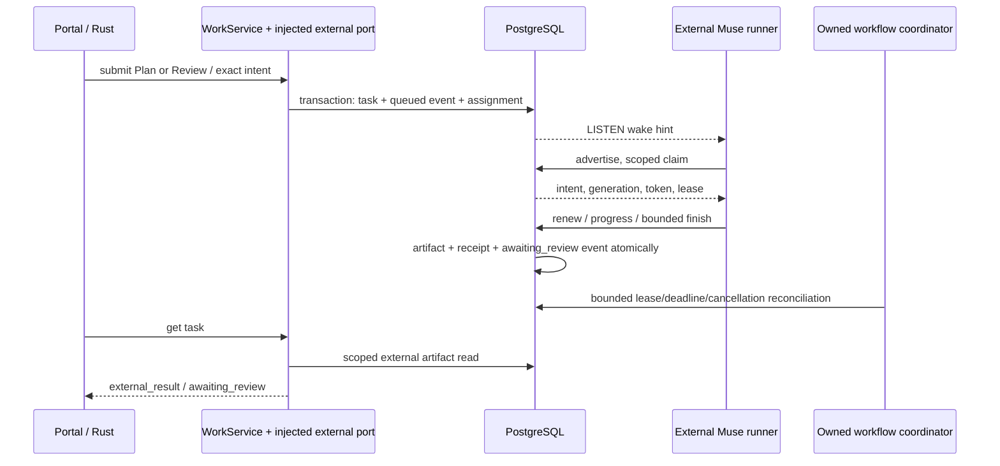

# Muse database provider

Forge supports an external Muse runner through PostgreSQL. Muse owns its runner
and compute; Mission Control does not launch its CLI or send email. Bootstrap
selects a scoped external provider through the normal WorkService factory and
injects its narrow DAO into WorkStore. The old [intake prototype](proposals/muse-intake-rejected.md)
remains dormant and is not this protocol.

The configured profile is `muse-db-primary`, backend `muse`, model metadata
`external-runner`, resource `forge-external-db-v1`, with explicit
`execution_enabled: true`. The external policy digest is SHA-256 of that resource
identifier. It is separate from frozen native P10. Native `muse-primary` stays
disabled, and native workers cannot claim external recipes. Existing AGY/Codex
project workflows retain their configured roles and immutable policy identities.

## Admission, dispatch and artifacts

A task submitted through the existing portal/API creates its ordinary durable
`coding_tasks` row, queued event and external assignment in one transaction.
Idempotent receipt lookup happens before recipe resolution or enqueue, including
when a profile is subsequently disabled. Changed intent conflicts. Scope grants
bind the authenticated database principal, service, owner, project and profile;
caller-supplied names do not grant authority.

The task picker exposes an external profile only after a fresh scoped heartbeat.
It emits `transport: external_db`; its display model does not assert a discovered
model version or account allowance. The existing trusted project revision is
used. An installation with no known project revision cannot invent one merely
because the external runner advertised. Account usage configuration stays
separate: this provider does not request native Muse quota or model metadata.

External Plan and Review modes return text artifacts. Their detail projection is
`external_result`, containing `assignment_id`, `provider: muse-db`, `sha256`,
`content`, `submitted_at` and `summary`. Content is at most 256KiB and the summary
at most 4096 UTF-8 bytes. These are report-transport bounds, not generation-token
limits. No native attempt, systemd proof, workspace digest or reconciliation
receipt is manufactured.

The terminal task status is `awaiting_review`: an actual artifact has arrived.
This transport does not turn the artifact into an approved Plan or trusted code
candidate. External Implement, native Resume/Plan decisions/repair targeting this
provider, automatic independent-review context delivery, and a Jenkins/candidate
bridge are not implemented. A Review artifact cannot approve another task or
merge code. The existing native autonomous flow remains separate.



## Runner SQL interface

Connect using the operator-provisioned account. Do not embed credentials in
prompts, task payloads, logs or the repository. The existing thirteen read grants,
owner/schema-scoped future-table SELECT default, database connectivity and
localhost SCRAM rule remain intact. New external operations use only the
reviewed function allowlist; private assignment/artifact tables are not directly
writable by the runner.

```sql
SELECT forge_external_agent_api.capabilities();
SELECT forge_external_agent_api.advertise('homelab', 'muse-db-primary', 'my-runner');
LISTEN forge_external_agent_jobs;
SELECT forge_external_agent_api.claim('homelab', 'muse-db-primary');
```

Subscribe before scanning and rescan after reconnecting. Notifications are wake
hints; durable rows determine whether work exists. Advertise regularly before
the 90-second freshness window expires. A null claim means no eligible work.
The runner binds the returned assignment ID, generation and secret token as
parameters to subsequent calls; it must not log the token.

```sql
SELECT forge_external_agent_api.renew($1::uuid, $2::integer, $3::uuid);
SELECT forge_external_agent_api.progress($1::uuid, $2::integer, $3::uuid, $4::text);
SELECT forge_external_agent_api.finish($1::uuid, $2::integer, $3::uuid, $4::text, $5::text);
SELECT forge_external_agent_api.release($1::uuid, $2::integer, $3::uuid);
SELECT forge_external_agent_api.artifact($1::uuid);
```

A claim carries a bounded five-minute lease and an overall 24-hour deadline.
Renewal cannot extend the deadline. Up to three generations are allowed;
expired claims return to queued or fail when the budget/deadline is exhausted.
The existing owned coordinator runs scoped database maintenance at most once
per 30 seconds even when no portal page is open. No extra Muse process, account
poller or email watcher runs on Mission Control.

Finish binds the exact scope, generation, token, content digest and summary.
Retry the same finish only to reconcile a lost acknowledgement; changed content
or stale authority fails. Progress and completion events commit with their row
changes. Progress summaries are database-only in this slice; the portal shows
task status and the final external artifact, without a native progress or attempt
projection. Cancellation fences further mutations. The external runner owns
stopping its computation; a database receipt does not claim that Mission Control
observed or killed an external process.

## Construction and verification

WorkServiceFactory selects ExternalWorkProviderFactory only for configured
external profiles. Factory construction is effect-free. WorkStore owns each
connection/transaction cursor and supplies that cursor to the external port;
workers do not look up registries. The existing coordinator owns maintenance
lifetime and quiesces through its normal close path before scoped ports close.

Tests use substituted factories, fake ports and owned socket-only PostgreSQL.
They cover admission rollback, duplicate/disabled-profile replay, scoped
readiness, native-claim exclusion, real external artifacts without native
receipts, escaped response-size bounds and lease recovery. No real Muse/model,
email, account or paid API request is needed to verify this transport.
