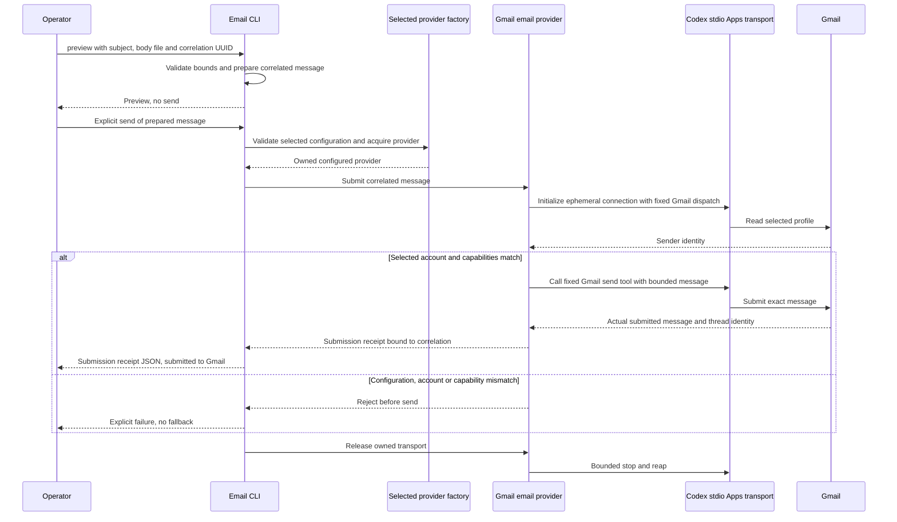
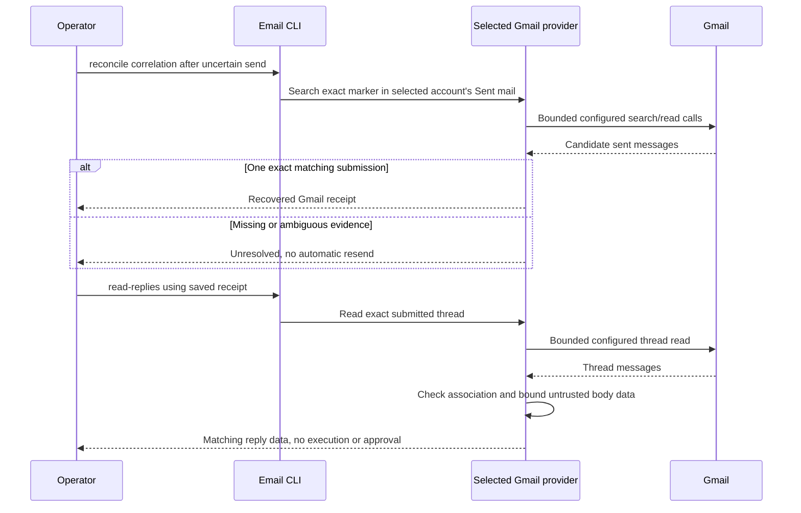
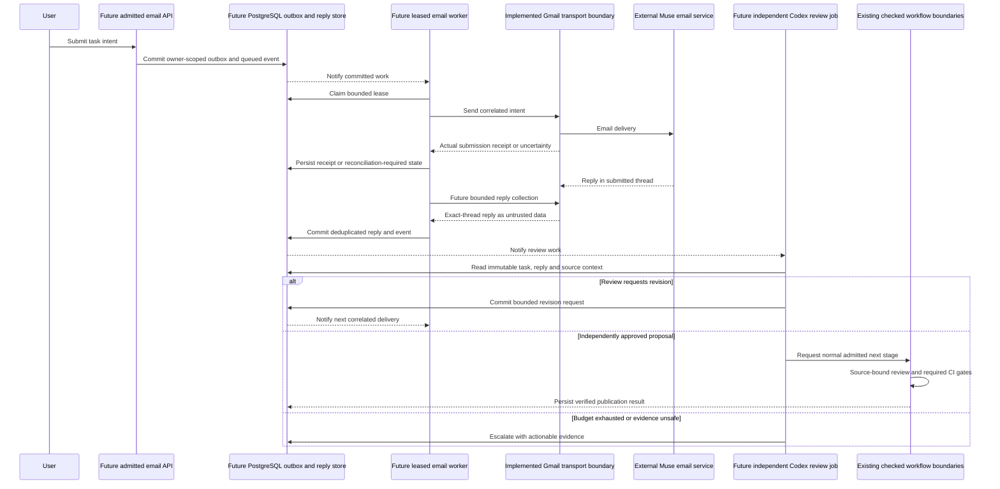

# Muse email transport

## Scope

The email transport gives an operator a small, model-free way to contact Muse
through the connected Gmail account. The entry point is
[`muse_email_tool.py`](../../deploy/mission-control/agent-runner/muse_email_tool.py),
with the selected provider and transport in
[`muse_email.py`](../../deploy/mission-control/agent-runner/muse_email.py).
It uses Codex app-server's structured stdio Apps/MCP interface to call Gmail;
it does not start a Codex model turn or invoke the Muse coding CLI.

Transport configuration must explicitly supply `expected_sender` and the
allowed `recipients`; no personal sender address is built into the source. For
example, an operator may configure `owner@example.test` and allow
`roachmaster@muse.ai`. The CLI defaults the requested recipient to
`roachmaster@muse.ai`, but that address must also be in the configured allowlist.
Trusted configuration and the fixed native adapter policy own the account,
server identity and exact tool allowlist. Message contents cannot select a
server, tool, recipient policy, executable or account.

```json
{
  "expected_sender": "owner@example.test",
  "recipients": ["roachmaster@muse.ai"]
}
```

Pass the operator-owned configuration through `--config`. For `preview`, `send`
and `reconcile`, also supply `--subject`, `--body-file` and a canonical UUID in
`--correlation-id`. `read-replies` takes `--receipt-file` containing the submitted
receipt object; when reconciliation returns a wrapper, save its `receipt` object
for that read. Configuration and receipt files belong outside the repository.

This change implements an operator-invoked transport and receipt boundary.
PostgreSQL dispatch, background reply collection, review jobs and automatic
merging for Muse email are future work. It introduces no migration, new
`WorkBackend` or workflow coordinator. Existing agent workflows retain their
current authority and gates.

| Available operation | Meaning |
| --- | --- |
| `preview` (default) | Prepare a bounded subject/body and correlation UUID for inspection without sending. |
| `send` | Explicitly submit the prepared message through the selected Gmail tool and retain its actual submission receipt. |
| `reconcile` | Search Sent mail for the exact correlation marker after an uncertain send; never resend automatically. |
| `read-replies` | Use a saved receipt to read the exact submitted Gmail thread and return matching replies as untrusted data. |
| `profile` | Inspect the selected Gmail profile without sending or generating a model response. |

## Provider assembly and ownership

Bootstrap selects the configured Gmail provider before acquiring any process or
account connection. Configuration and request validation are effect-free. The
CLI injects that selected provider into the operation; message handling does
not consult global registries or discover another backend on failure.

| Responsibility | Owner |
| --- | --- |
| Validate action, body-file bounds, subject and correlation UUID | CLI adapter and typed request boundary |
| Select fixed account, server and permitted Gmail tools | Trusted configuration and provider factory |
| Acquire one stdio connection, frame requests and bound output/time | Selected Codex Apps transport |
| Check sender/profile and bind Gmail response to the requested message | Gmail email provider |
| Retain submission or uncertainty evidence for a later read | Caller-owned receipt file |
| Stop and reap the owned process on success, failure or cancellation | Transport that acquired it |

The transport uses `initialize` followed by `initialized`, an ephemeral
`thread/start` and fixed `mcpServer/tool/call` operations against `codex_apps`.
An ephemeral thread provides connection and configuration scope; it is not a model request. No `turn/start` is issued.
Approval-review agents and automatic sign-in are outside this transport.
Unexpected server requests must not trigger approval, login, process execution
or a model call.

The pinned native schema establishes the finite Gmail tool names and argument
shapes. The current transport does not discover, register or install servers:
it dispatches only its fixed Gmail operations and verifies the selected profile
before sending. If a required capability is absent or fails, the operation
returns an error or a submission-uncertain result rather than selecting another
server. `app/list` metadata and display-only `app/read` tool summaries are not
used as proof of a successful submission. The transport does not change the
account's configuration.

## Explicit send and submission receipt

This sequence describes the synchronous transport. Participant names summarize
roles rather than claiming new framework-wide interfaces.



A successful send means Gmail accepted the message. It does not establish that
Muse received it, generated a response, approved a plan or changed a repository.
Only the real Gmail result may establish the submitted message/thread identity;
a locally generated UUID or preview is not a delivery receipt.

The receipt retains correlation and message identity needed to find the same
submission again. Keep receipt files private: they contain mailbox identifiers
and may refer to private task material. The body file is task input, not a shell
script; it never becomes executable code or CLI arguments evaluated by a shell.

## Uncertain sends and bounded reads

A timeout, disconnect or malformed response after dispatch can mean Gmail
accepted the message while the caller lost its receipt. Preserve that
uncertainty. Do not automatically repeat the send.

`reconcile` searches the selected sender's Sent mail for the exact correlation
marker and checks the returned message against the intended recipient and
message identity. A unique matching submission can restore a real receipt.
No match is not proof of non-delivery: indexing or propagation may be delayed.
Ambiguous matches remain unresolved and require explicit inspection. Neither
case authorizes a retry or chooses an arbitrary result.

`read-replies` consumes a saved receipt and follows only its exact Gmail thread.
The provider checks sender/thread association and returns bounded message bodies
as data. Email headers, HTML, quoted instructions and attachments are untrusted
external input. A reply cannot authorize another tool, change recipients,
approve a plan, execute code, merge a branch or bypass independent review.



## Future event-driven integration — not implemented

The transport is a replaceable edge for a later durable email worker. A future
integration must add owner-scoped outbox records, claims, leases, correlation,
receipt persistence, reply deduplication and source-bound review before enabling
this flow. Notifications wake a consumer after commit; PostgreSQL remains the
state authority.



That future reviewer must be independent of the author and bind its decision to
an immutable task/reply/source target. An email saying “approved” is not a Forge
approval receipt. Existing plan, implementation, code-review and publication
gates cannot be replaced by sender text. Automatic merging remains conditional
on the normal review and required CI checks; the synchronous email CLI does not
initiate any of those stages.

## Verification boundary

Local verification uses injected fake provider ports and owned fake stdio
processes. It must cover preview with zero send effects, exact configured
server/tool selection, account mismatch, actual receipt validation, uncertain
send without resend, strict correlation/thread checks, bounded malformed
responses and process cleanup. These tests make no model calls and send no
email. An operator's explicit live send is separate evidence and must not be
claimed merely because fake-transport tests pass.

## Qualification

The installed native Codex0.160.0 protocol was inspected locally. A model-free
profile read verified the selected sender through canonical structured `email`.
A separately authorized operator test returned a real Gmail submission receipt
and an exact-sender reply in the same thread, confirming the email round trip.
Sender and mailbox identifiers remain private operational evidence. The reply
reported read-only public repository visibility; GitHub write permissions and
repository changes were not tested. Email content does not grant execution or
review approval.

The module tests use injected sessions and owned fake native processes. They
cover explicit sending, dry-run effects, sender/recipient denial, uncertain sends
without retries, exact receipt/thread correlation, safe reply text, bounded
protocol frames and a stalled process receiving a large body. They make no real
Gmail or model calls. The durable email-job pipeline remains unimplemented.
