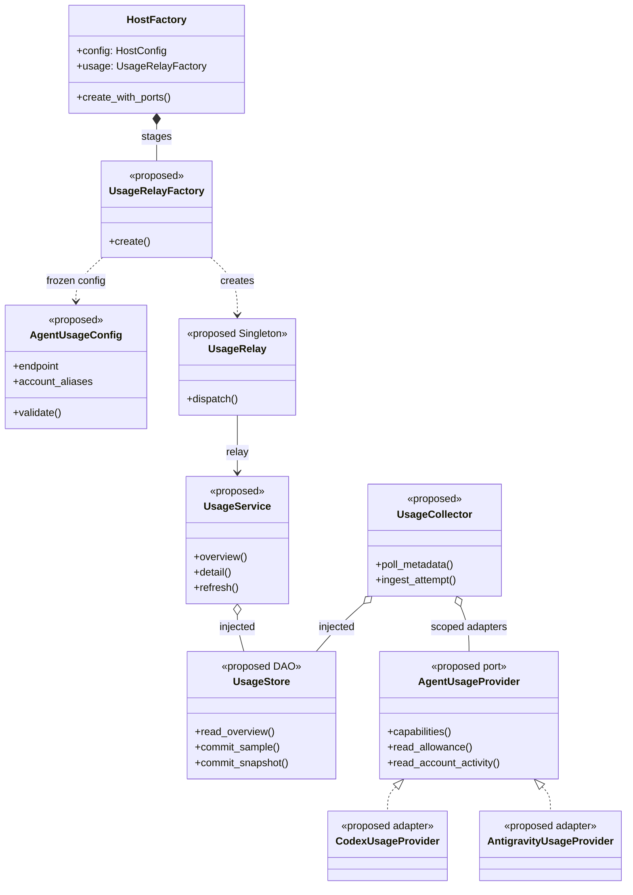
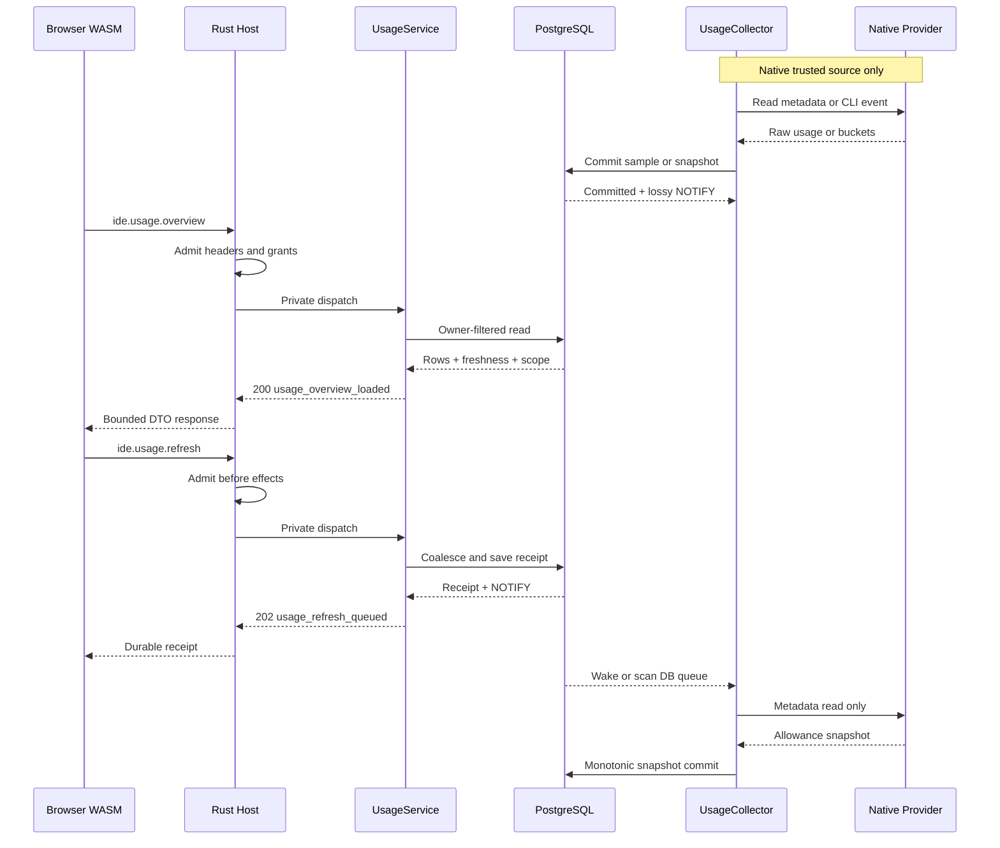

# Agent token limits and portal usage visibility

**Status: implemented in source; deployment verification pending.**
**Updated: 19 November 2026.** This supersedes the earlier design-only scope at
`2e1300a00da92e9f97bdb1a656c2b182d4219a6c`. Generated Agents views, Work/Usage
relays, provider adapters, collector and storage now exist. Optional configuration
still governs enablement; this page does not assert a live portal rollout.

See [Coding-agent workflow](../coding-admission.md) for execution, role fences,
result paging and explicit review/resume. The original diagram stereotypes below
are retained design history; the implementation mapping here is authoritative.

## 1. Coding limits and separate measurements

Coding recipes pin `generation_token_limit: null`: native provider/model context,
subscription and rate limits govern generation. They never inherit Chat/Mail/
llama.cpp output caps and never send a numeric sentinel for unlimited tokens.
Process wall/resource bounds, JSON framing and the 16 MiB full-result storage
ceiling are separate. Result pages/preview length never truncate a stored reply.
This does not change local-inference Chat/Mail limits.

The implemented portal separates:

1. **Provider allowance:** Provider-reported buckets/windows/reset and tri-state
   permission; may include work performed outside Forge.
2. **Forge project jobs:** Observed input/output/cached/total token counters,
   known/unknown attempt counts and measured elapsed time for the selected
   owner/project/profile only.
3. **Account activity:** Provider-reported lifetime/daily token observations with
   their own provenance; never added to Forge project totals.

Model context occupancy, billed cost and price-based estimates are **not current
wire/UI fields**. They remain future extensions; no fabricated combined usage
percentage, remaining-message estimate or token-to-dollar bill is displayed.
Unknown is distinct from zero, unsupported from provider outage.

## 2. Implemented provider capabilities

| Adapter | Per-job canonical feed | Account metadata | Limits |
| --- | --- | --- | --- |
| Codex, pinned `codex-cli 0.160.0` | Validated fresh-session `turn.completed.usage`; terminal attempt counted once. | Bounded app-server `account/read`, `account/rateLimits/read`, `account/usage/read`; read-only authenticated capability probe verified allowance and daily activity. | Nullable permission/windows/counters stay nullable. Prefer the multi-bucket quota view, fall back to the single view, never sum both. No model turn for metadata. |
| Antigravity/Gemini, pinned execution `agy 1.5.12` | Fresh-session terminal result usage, normalized once; no summing step updates. | Headless allowance explicitly `unsupported` with `reason: unsupported_headless`; account activity unknown. | No hidden-endpoint/TUI scraping or synthetic quotas. Execution usage remains useful when account allowance is unsupported. The allowance adapter's unprobed version stays `unknown`. |
| Future adapters | Must supply an explicit versioned canonical feed. | Only a supported bounded metadata interface. | Register capabilities; absent feeds remain unknown/unsupported. |

A successful metadata probe is not a successful model generation or production
activation. Codex metadata may perform normal provider-managed OAuth refresh;
there is no interactive login, generation, credit purchase/reset or fallback flow
in the collector. Raw emails, account IDs, provider logs and auth files are not
stored or returned.

## 3. Portal and public contract

Home enters `/#agents`; `/agents` redirects to the declared same-tab view. The
Rust/WASM model owns task and usage selection/actions, generated main JavaScript
renders, and generated I/O workers perform admitted requests. No sixth global
tab is added. Phone provider details stack with readable source/freshness, rather
than squeezing identifiers into narrow columns.

The current view includes catalog-backed assignment, task list/detail/events,
result paging, explicit acceptance/resume and provider usage details. Context/
cost controls from the original static wireframe are not implemented metrics.
The design-page wireframe remains a static illustration, not live account data.

Public `POST /forge/v1/dispatch` relays admitted requests to existing private
`POST /v1/dispatch`, using the four version-1 Forge headers, strict kinds and
matching request IDs. Native grants and runner owner/project/profile scoping
are independent of Work, Mail/GPU and source-inspection grants.

| Destination | Request fields beyond kind/request ID | Success |
| --- | --- | --- |
| `ide.usage.overview` | `project_alias` | `200 usage_overview`: `{project_alias, providers}` |
| `ide.usage.detail` | `project_alias`, `agent_profile` | `200 usage_detail`: same shape, exactly one admitted provider |
| `ide.usage.refresh` | `project_alias`, selected `agent_profile` | `202 usage_refresh_queued`: project, UUID refresh ID, profiles and `coalesced` flag |

The public native grant requires an explicit selected profile for refresh;
omitted/null is denied before I/O. The private operator API can request all its
configured profiles, which is broader authority and is not blindly relayed by
the browser host. General overview reload is read-only. Refresh durably coalesces
metadata requests; it is never an agent task and needs no model turn.

`ProviderUsage` has alias/label/provider/model, worker state/active task,
snapshot state/observation/source/version/error, refresh pending, allowance,
project jobs and account activity. Every declared nullable field remains present.
At most 64 providers, 16 quota buckets and 31 daily buckets are exposed. Wide
counters use canonical decimal strings (up to 40 digits), not lossy JavaScript
numbers. Reset timestamps do not synthesize replenished quota or permission.

## 4. Factories and database ownership

Native `UsageRelayFactory` creates the host-owned relay after pure startup
validation/freeze. Runner `UsageServiceFactory(config, store_factory)` injects
`UsageStore`; absent config returns `None` without file/DB/CLI effects.
`FORGE_RUNNER_USAGE_CONFIG` enables Usage independently from
`FORGE_RUNNER_WORK_CONFIG`, even if both point to the same trusted JSON file.

The worker composition root injects `UsageCollector` and provider factories with
ready database/process ports; it never looks up a global registry. The collector
runs between jobs and when idle, outside active CLI generation/lease-critical
work. CLI children receive neither database credentials/sockets nor the parent
HMAC control key. The API process imports no CLI process dependency.

Migration `0010` implements:

- `coding_attempts`: canonical per-attempt usage at immutable publication;
- `coding_provider_usage`: current generation/epoch-bound sanitized snapshot,
  last-success freshness and latest poll error;
- `coding_provider_usage_identities`: private HMAC identity bindings, invisible
  to runner/browser;
- `coding_usage_refresh_requests`: durable coalesced metadata refreshes.

This replaces the original four proposed historical sample-table names. There
is no general historical usage import or arbitrary cumulative-session importer.
Worker/reconciler execute-only role fences and runner/GPU separation are defined
in the [current workflow](../coding-admission.md#database-fences).

## 5. Exact accounting, ordering and failure behavior

`normalize_attempt_usage` returns exactly input/output/cached-input/total tokens,
source, coverage and session provenance. Counts are nullable decimal strings.
Codex uses input plus output for total; cache/reasoning subdivisions are not
added. Antigravity uses the provider-reported total without adding cache/thinking.
Only a validated fresh terminal session establishes the zero baseline. Missing
or untrusted telemetry stays partial/unknown; it never makes a successful coding
result fail. Replayed immutable publication cannot add the attempt twice.

Provider metadata is not a job-usage feed. Each poll allocates its generation and
configuration epoch **before** I/O. Current account identity is represented only
by a parent-held-key HMAC, not an alias/email/raw ID. Epoch/generation fences
reject delayed or switched-account snapshots. Failed polls preserve last good
observations and report a separate error; stale data remains labeled stale.
Passing a reset time never invents a fresh quota.

Codex metadata uses fixed app-server RPC methods/arguments, a clean environment,
version validation, bounded frames/notifications/overall time and owned-process
group cleanup. Stderr/provider logs are discarded. No generation or interactive
auth method is in the usage adapter's allowlist. The original model discovery
was a separate operator metadata probe, not an expanded production quota method.

A bounded in-memory sanitized outbox retries a database acknowledgement without
re-polling the provider. Expiry produces a visible error/coverage gap rather than
an invented observation. Durable refresh requests stay in PostgreSQL. Telemetry
failures remain separate from engineering-result success and never rerun coding
work. Quota/auth blocks require explicit user review and receipt-gated resume;
metadata does not trigger automatic account rotation or credit fallback.

## 6. Retained provider ownership diagram

Original stereotypes/port sketches are preserved so the checked-in SVG remains
traceable. Actual modules are `usage_api.py`, `usage_store.py`,
`usage_provider.py`, `usage_rpc.py`, `usage_collector.py`, `usage_types.py` and
native `usage.rs`; the current DTO/table mapping above supersedes sketch names.

## 7. Retained collection/read/refresh sequence

Attempt usage is committed once with the result; account polls are separate
metadata observations. The exact current event names are `usage_overview`,
`usage_detail` and `usage_refresh_queued`, rather than the original `_loaded`
sketch names. No browser request can initiate a provider model turn here.

## 8. Validation and rollout boundary

Provider/RPC mocks, disposable PostgreSQL grants/replay tests, generated UI
journeys, authenticated metadata probes and real supervised CLI persistence are
different checks. Requalify them for the release, then explicitly configure
roles/services and deploy one atomic ABI-6 bundle. This design update reports
implemented source and the supported metadata capability; it does not certify
the final live service rollout. Future work includes supported Antigravity
headless quota, context/cost metrics and task/worktree retention policy, each
requiring its own truthful contract and authorization.
