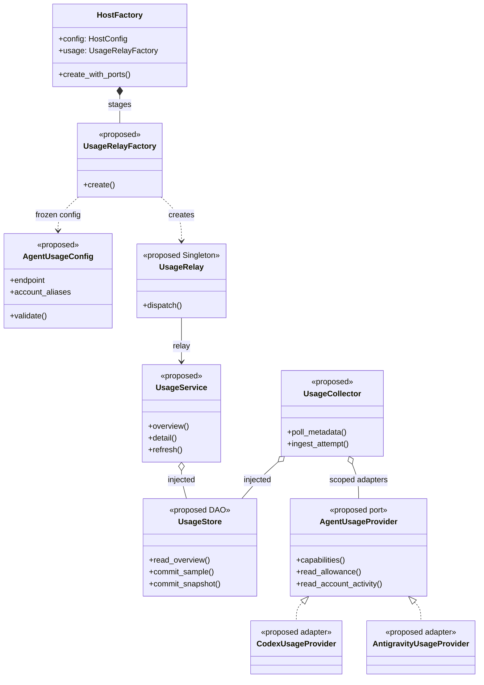
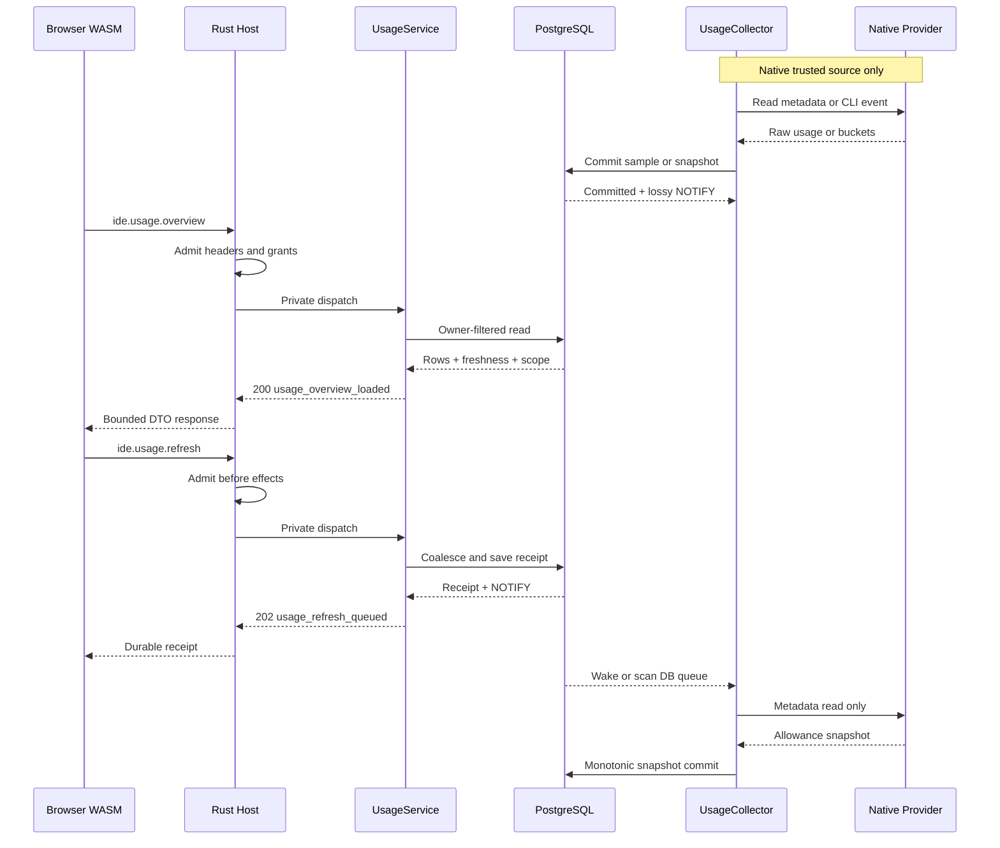

# Proposed Architecture: Coding-Agent Token Limits & Portal Usage Visibility

**Status:** Proposed / not implemented (design-only).
**Date:** 2026-11-19 | **Base revision:** `2e1300a00da92e9f97bdb1a656c2b182d4219a6c` (`main`).
All contracts, tables, endpoints, adapters, and UI views below are **proposed**; no runtime code, migrations, live account probes, or portal deployments are authorized in this step.

**Operator story:** An operator running coding work through Codex, Antigravity (Gemini), and future CLIs wants two things: (1) coding agents run under native provider limits without inheriting Forge's local `llama.cpp` reply caps, and (2) the Forge portal shows each agent's observed Forge work and provider allowance side by side with clear freshness and provenance—without fake combined percentages, fabricated billing, or extra model turns.

## 1. Coding-Agent Token Limits & Local-Cap Separation

- **Default `generation_token_limit = null` (provider-managed):** Coding-agent recipes leave generation tokens unset and **never** emit an arbitrary numeric "unlimited" sentinel to providers. Native provider context windows, subscription/API allowances, and rate limits still apply.
- **No inheritance from local inference caps:** Coding CLIs never copy Mail/Chat `max_tokens`, `n_predict`, `max_output_tokens`, or local context-budget reservations. Verified current code observations (not freshly queried live host config):
  - Chat sends `max_tokens=384` ([`chat.rs#L146`](../../../src/rust/forge-ide-web-host/src/chat.rs#L146)) and saves cap `384` ([`queue_store.py#L159`](../../../deploy/mission-control/agent-runner/queue_store.py#L159)).
  - Legacy/local inference caps completion at `2048` ([`runner.py#L175`](../../../deploy/mission-control/agent-runner/runner.py#L175); [`driver.rs#L27`](../../../src/rust/forge-llama/src/driver.rs#L27), [`#L256`](../../../src/rust/forge-llama/src/driver.rs#L256)).
  - Mail defaults to `4096` context / `1024` completion / `16` margin / `256` min-followup ([`mail_tokenizer.py#L13-L16`](../../../deploy/mission-control/agent-runner/mail_tokenizer.py#L13-L16)), validated in [`queue_store.py#L242`](../../../deploy/mission-control/agent-runner/queue_store.py#L242) and [`driver.rs#L279-L296`](../../../src/rust/forge-llama/src/driver.rs#L279-L296).
- **Resource bounds stay distinct:** Per-adapter OS/process, framing/storage and timeout controls remain independent of token generation. The [dispatch proposal](forge-coding-agent-dispatch.md#7-pinned-execution-recipes--cli-process-adapter-proposed) stores accepted full responses in chunks behind paged readers; preview/page size never truncates the stored full reply. Framing and storage ceilings remain configured explicitly. These are proposed contracts, not changes to today's Chat/Mail limits.
- **Local `llama.cpp` future note:** Upstream [`llama.cpp` server docs](https://github.com/ggml-org/llama.cpp/blob/master/tools/server/README.md) support `n_predict=-1` (still bounded by finite context, RAM, EOS, and gateway policy), whereas current Forge `u32` validators reject `-1`. Any local-inference cap change is a separate future task.

## 2. Separated Metrics & Provider Capability Matrix

The portal strictly separates four quantities—each carrying `source`, `scope`, `observed_at`, and `fresh | stale | unknown | unavailable`—and never computes a single combined percentage across providers, hardcoded daily/weekly windows, or invented remaining-message counts:

1. **Provider/account allowance:** Quota buckets and reset times reported by the provider (may include work outside Forge).
2. **Forge-observed job tokens:** Token counters observed on Forge-managed attempts/turns (`scope = "Forge-observed jobs"` unless a provider account summary explicitly reports wider totals).
3. **Model context occupancy:** Prompt/context window usage for an active or recent turn.
4. **Cost / billing:** Subscription and API costs stay distinct (`null != 0`); provider cost figures are labeled as **estimates**, and included-plan tokens are never converted into a bill.

| Adapter (Installed CLI, safe help only) | Observed Job Tokens | Provider Allowance / Windows | Context / Cost & Constraints |
| --- | --- | --- | --- |
| `CodexUsageProvider` (`codex-cli 0.160.0`) | Per-turn `turn.completed.usage` ([exec schema](https://github.com/openai/codex/blob/rust-v0.160.0/codex-rs/exec/src/exec_events.rs)); app-server `last` vs cumulative `total` ([thread schema](https://github.com/openai/codex/blob/rust-v0.160.0/codex-rs/app-server-protocol/schema/typescript/v2/ThreadTokenUsage.ts)). | `account/rateLimits/read` and updates ([official docs](https://developers.openai.com/codex/app-server/)): meter buckets with nullable primary/secondary windows, used percentage, duration and reset. | `account/usage/read` exists in the [installed-version request schema](https://github.com/openai/codex/blob/rust-v0.160.0/codex-rs/app-server-protocol/schema/typescript/ClientRequest.ts). Its [response](https://github.com/openai/codex/blob/rust-v0.160.0/codex-rs/app-server-protocol/schema/typescript/v2/GetAccountTokenUsageResponse.ts) supports nullable account activity/daily buckets; optional thread cost estimates remain separate from invoices. Authenticated availability is untested. |
| `AntigravityUsageProvider` (`agy 1.5.12`) | Session-cumulative result usage, turn count and duration ([headless docs](https://antigravity.google/docs/cli/headless)). | Headless results do not establish remaining quota. [Statusline docs](https://antigravity.google/docs/cli/statusline) expose TUI bucket `remaining_fraction`/`remaining_amount`, reset and disabled fields; a headless collection feed is unverified. | Context and list-price estimates are separate. Absent a verified feed, allowance stays unknown/stale. A later native observer filters emails/transcript paths; no hidden-endpoint scraping or model turns to poll quota. |
| Future registered adapters | Version-probed capability flags per installed CLI. | Explicit per-metric `unsupported` / `unavailable` when absent. | Same provenance, scope, and privacy rules. |

No account-level metric is added to job totals. Codex `ordinaryUsageAllowed` remains tri-state backend permission; percentages and elapsed reset times alone do not establish readiness. Missing counters, unsupported feeds and provider outages retain distinct reasons.

## 3. Portal UX & Textual Wireframes (Deferred UI Slice)

- **Navigation & chrome budget:** Link proposed **Agents** (`/agents`) from Home and compact IDE overflow—no top-level tab sprawl. Keep shared Forge identity + nav with **at most two mobile bars** below 640 px.
- **Views & actions:** Desktop uses a responsive summary table; phone uses compact scannable rows (provider + model/account alias, worker status/current task, provider quota buckets & reset, Forge-observed tokens/duration, last update + freshness). Selecting a row opens a detail reader with allowance windows, jobs/checkpoints/review links, and progressively disclosed context/cost diagnostics (closed by default).
- **Truthful controls & execution boundary:** Refresh queues supported metadata reads only—never starting generation, auth flows, spending/credit top-ups, quota resets, or auto agent rotation. Cross-node telemetry is opt-in; default coverage label is `Forge-observed jobs`. v1 is **backend-first**; the later UI uses generated Rust/YAML, main-thread JS presentation -> Rust WASM state, and JS worker I/O only. Native backend processes own all provider/account access; the browser holds no credentials and makes no direct provider calls.

```text
Desktop /agents (placeholders only — no live metrics)
+--------------------------------------------------------------------------------------+
| Forge  [Home] [Chat] [Mail] [Workbench] [More v]   Scope: Forge-observed jobs [Refresh] |
+--------------------------------------------------------------------------------------+
| Provider / Model / Alias  | Worker / Task      | Allowance Buckets        | Forge Usage   | Updated    |
|---------------------------+--------------------+--------------------------+---------------+------------|
| <prov> <model> (<alias>)  | <status> <task_id> | <bucket>: <val> <reset>  | <tok> / <dur> | <ts> <st>  |
| <prov> <model> (<alias>)  | <status> <task_id> | unknown (<reason>)       | <tok> / <dur> | <ts> <st>  |
+--------------------------------------------------------------------------------------+
| Detail: <alias>  [Allowance Windows]  [Jobs / Checkpoints / Review]  [> Context & Cost (closed)] |
+--------------------------------------------------------------------------------------+

Phone /agents (<= 2 bars, placeholders only)
+-----------------------------------+
| Forge  Agents         [Refresh]   |  <- Bar 1: identity + action
| [Chat] [Mail] [Workbench] [More]  |  <- Bar 2: shared compact nav
+-----------------------------------+
| <prov> · <model>/<alias> <fresh>  |
| Worker: <status> (<task_id>)      |
| Quota:  <bucket> <val> · <reset>  |
| Forge:  <tokens> · <dur> · <ts>   |
+-----------------------------------+
| <provider> · <alias>    unknown   |
| ...  (tap row -> Detail reader)   |
+-----------------------------------+
```

## 4. Composition, Providers & Lifecycle

Following [`wire-forge-providers`](../../../.agents/skills/wire-forge-providers/SKILL.md), `AgentUsageConfig` and effect-free factory registrars validate configuration and freeze at the native composition root before opening sockets, DB connections, or subprocesses. Host injects a host-scoped `UsageRelay` (reusing existing loopback transport). Runner owns `UsageService` and `UsageStore`. A separate native `UsageCollector` owns configured `AgentUsageProvider` adapters with versioned CLI capabilities and server-configured account aliases and stable dedup IDs (never caller-supplied emails or secrets). Workers never query global registries; pure DTOs require no registrars. DB connections and provider subprocesses use explicit per-operation leases and drain cleanly on shutdown before resource release. Collector placement follows the signed-in account's OS boundary; the web runner receives sanitized DTOs, not OAuth files. Metadata polling invokes only explicitly supported reads, never a general agent prompt.

An alias is a display label, not account identity. Trusted native identity plus configuration epoch binds samples; an account switch invalidates old current snapshots and rotates the binding. Merge cross-profile allowance only for a verified shared principal; otherwise show `identity_unverified` and keep profiles separate.


*Simplification note:* Rust lifetimes, `Option<Singleton<T>>` wrappers, retention config, and DB connection/process lease guards are omitted. Injection edges do not imply a global registry.

## 5. Admitted API, DTOs & PostgreSQL Storage

- **Single front door:** Public `POST /forge/v1/dispatch` -> admitted native `Host` -> private `POST /v1/dispatch`. Headers: `Forge-Destination`, `Forge-Envelope-Version: 1`, `Forge-Contract-Version: 1`, `Forge-Request-Id` matching body `request_id`; strict matching `kind` and unknown-field rejection. Owner/project/account grants apply at both Host and `UsageService`. Every SQL read filters configured owner; project grants filter task rows **before** aggregation or link construction. Account-wide allowance/activity has separate authorization and labeling, never project attribution.
- **Proposed destinations:**
  - `ide.usage.overview` (`usage_overview` -> `usage_overview_loaded`, `200`): bounded paginated summary (`limit`, `cursor`), per-metric capability flags, and overall `coverage` (`complete | partial | unavailable`).
  - `ide.usage.detail` (`usage_detail` -> `usage_detail_loaded`, `200`): one server-configured `account_alias` / provider detail, allowance windows, bounded job/checkpoint links, and optional context/cost diagnostics.
  - `ide.usage.refresh` (`usage_refresh` -> `usage_refresh_queued`, `202`): configured `account_alias`, `idempotency_key`; rate-limit and coalesce by verified account/configuration epoch. Persist request/business receipt before notifying the collector. Exact replay returns the same receipt under current `request_id`; changed intent conflicts. Unsupported feeds return a capability result, never a fake queued generation.

DTOs use bounded UTF-8 strings, nullable metrics, declared units and timestamps. Large counters use validated decimal strings end to end, avoiding lossy JavaScript `Number` conversion. Poll errors (`auth_required`, `unsupported`, `unavailable`) remain separate from last-success freshness.

```json
{"protocol_version":1,"event":{"kind":"usage_overview_loaded","request_id":"req-u1","coverage":"partial","scope":"Forge-observed jobs","items":[{"provider":"agy","account_alias":"agy-primary","worker_status":"unknown","capabilities":{"allowance":"unsupported","job_tokens":"session_cumulative"},"allowance":{"state":"unknown","reason":"unsupported_headless","source":"none","observed_at":null,"buckets":[]},"forge_usage":{"scope":"Forge-observed jobs","input_tokens":null,"output_tokens":null,"total_tokens":null,"duration_ms":null},"cost":{"plan_kind":"subscription","estimated_usd":null,"is_estimate":true}}],"next_cursor":null}}
```

- **Proposed PostgreSQL tables (migration numbering remains unfrozen):**
  1. `attempt_usage_samples`: immutable sample ID, owner/task/attempt, adapter, account alias + verified account binding/epoch, node, session/thread/turn, stable source event ID/sequence, metric kind/scope, counter epoch, observed time, nullable token categories, measured duration, feed/version, lineage/covered-child identities, attribution state and collector receipt. Composite owner/task and task/attempt FKs. Unique canonical origin key `(owner_id, adapter, account_dedup_id, account_epoch, session_id, counter_epoch, source_event_id, metric_kind)`; derive stable IDs from an owned stream (persist turn ordinals if exec supplies no turn ID). Changed duplicate payloads conflict.
  2. `agent_allowance_snapshots`: immutable sample ID, owner/provider/account binding/epoch, meter ID, model applicability, primary/secondary window identity, nullable duration/provider timestamp, preallocated collection generation, received time, scope, nullable used/remaining fraction or amount + unit, reset, status, backend permission and provenance. Preserve multiple windows; never sum historical snapshots or count a shared account twice.
  3. `agent_account_activity_snapshots`: same owner/account/epoch/generation provenance; nullable provider summary/daily buckets and separately labeled thread cost estimates with currency/unit/source. Account activity and cost estimates never join task-token totals or invoices.
  4. `agent_usage_refreshes`: server request ID, owner/account/epoch, idempotency key/intent hash, immutable admission receipt, state, collection generation, worker token/lease, attempt/deadline and result/error timestamps. Unique `(owner_id, idempotency_key)`. Coalesced callers reference the same collection while retaining replayable request receipts. A monotonic per-account generation/watermark is allocated before I/O under the owner/account lock. Native collector DB permissions allow only these narrow operations.

**Retention and hygiene:** Every sample has byte bounds and authenticated collector identity. Credentials, OAuth files, emails and transcript paths stay out of storage and child env. Usage/refresh retention is separate from task/worktree retention. Keep dedup receipts and baselines while sessions can replay; expired-history imports become raw-only/attribution unknown rather than counted anew.

Context occupancy is a separate `metric_kind` with nullable used/capacity fields and current turn identity. A provider's zero/absent unknown capacity becomes `null`, never a computed 0% or division by zero. Costs retain amount, currency, estimate/billed provenance and measurement scope; absent billing data remains unknown.

## 6. Exact Accounting, Resilience & Execution Sequence

- **Delta vs cumulative math:** Pin one canonical accounting feed per attempt: Codex exec **or** app-server, AGY session results **or** verified step records. Exec usage is per-turn; app-server totals and AGY result metadata are cumulative. Compute a delta once against a verified matching session/epoch baseline in the transaction that commits its dedup receipt/watermark. Missing baseline means cumulative-only data and unknown attempt attribution; only a verified new session starts at zero. Decreasing counters do not prove reset: delayed samples stay historical, ambiguous decreases stay raw-only/unknown. A new summable epoch requires trusted reset/session evidence plus a new baseline.
- **Lineage/category overlap:** Parent-inclusive subagent totals need explicit covered child/turn identities. Without that evidence, secondary feeds/children stay diagnostic and are not added to rollups. Cached/reasoning counters may be subdivisions; never add overlapping fields to invent totals. Account activity remains separately scoped.
- **Crash, ordering & non-blocking telemetry:** Record partial/unknown usage on timeout/crash with independently measured monotonic duration. Allocate poll generation **before** I/O; stale generation/lease cannot replace a newer current snapshot, even when provider time is absent. Preserve last success separately from latest poll error and compute freshness from a configured TTL. Passing reset time never synthesizes replenished allowance. Metadata reads may retry with bounded backoff; never rerun coding work for telemetry. A bounded native outbox retains sanitized repair samples during DB outages; expiry records a visible coverage gap. Telemetry failures do not turn completed engineering work into failure.



## 7. Phased Verification & Rollout Gates

1. **Phase 1 — Backend + Disposable PostgreSQL + Fake Providers (no model calls):** Verify replay/conflicts, canonical-feed deduplication, cumulative baselines/deltas, delayed/decreasing/reset samples, known/unknown child coverage, overlapping categories, null/large counters, absent timestamps and out-of-order poll generations, account switches, pre-aggregation owner/project/account isolation, coalesced receipts, outage/outbox expiry and telemetry failure isolation. Verify long-result pagination independently from tokens.
2. **Phase 2 — Generated UI Gate (separate):** Implement typed Rust/YAML `/agents` views per `design-modern-ui`, `design-forge-ui`, and `test-forge-ui`; verify via `make ci` and `make ui-qa` (desktop + phone 2-bar budget, keyboard/focus, honest `unknown`/`stale` rendering).
3. **Phase 3 — Versioned Real-CLI Capability Smoke (future gate):** Run read-only capability verification against installed CLI versions before enabling live collectors; never auto-enable unverified providers or TUI-only hooks headless.
