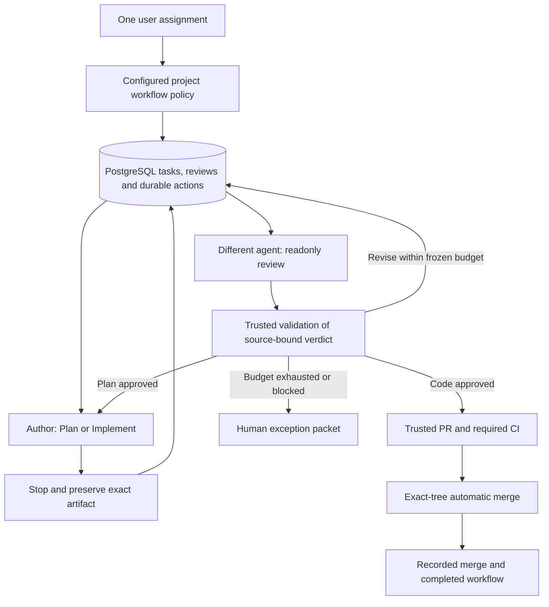
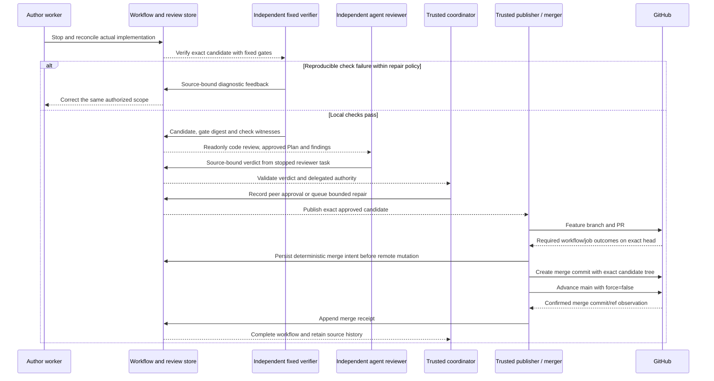

# Autonomous agent author and reviewer workflow

**Status: implementation in progress; not deployed.** This extends the source
[review and repair lifecycle](forge-agent-feedback-loop.md). The earlier manual
approval path remains for legacy/manual tasks. The intended new default for a
configured project delegates ordinary planning, review, execution and merge to
agents and trusted services. Humans resolve exceptions rather than carry plans
between agents.

## Requested outcome

A user submits one assignment. The configured author (initially Gemini) creates
a plan. Its stopped, preserved result generates a durable event that assigns the
configured independent reviewer (initially Codex). The reviewer approves the
exact plan or supplies actionable revision findings. Approval starts execution;
revision returns to the author. An initial plan may receive up to three revised
versions. Approval of the third revised version is valid; a fourth revision
request escalates with the complete plan and review history.

The same separation applies to code. Independent fixed checks run before peer
code review. The reviewer can approve or request bounded corrections. After
approval and all required checks on the exact published head, a trusted merge
provider merges automatically under the project's recorded delegation. The user
explicitly authorized that merge stage. A successful model response never
constitutes a merge receipt.

Profiles express roles, not hardcoded model names. A future Muse adapter can fill
an author or reviewer role after its capabilities and execution contract are
implemented and verified. This design does not claim Muse is already installed.

## Ownership and factory/provider composition

| Owner | Responsibility | Excluded authority |
| --- | --- | --- |
| Project configuration | Select distinct author/reviewer profiles, bounded revision policy and automatic merge delegation; freeze their recipes and policy digest per root workflow. | No per-task browser-selected next command or arbitrary merge target. |
| Rust portal model | Show configured roles, workflow phase, revision counters, last evidence and escalation reason. Submit one assignment with the current policy digest. | No routine manual approval prompt for an autonomous task. Generated main JS renders; I/O workers relay admitted requests. |
| API process coordinator | Consume leased PostgreSQL actions; enqueue author/reviewer tasks and apply validated delegated transitions transactionally. | No native model process or GitHub credential is needed in this process. |
| Coding worker | Execute an ordinary leased Plan, Review or Implement task through the selected CLI provider; report progress, stop, preserve result and reconcile its workspace. | Models receive neither DB nor publication credentials. A reviewer is read-only and cannot approve its own author task. |
| Verifier/publication process | Run fixed isolated checks; preserve the exact candidate; publish its PR, observe hosted checks and execute authorized exact-tree merges. | No admin/protection bypass, force push, account rotation or paid fallback. |
| PostgreSQL | Persist workflow, review target/verdict, durable action, event, lease, budget and merge receipt. | Notifications wake discovery; a notification alone grants no execution authority. |

Bootstrap selects these implementations and injects narrow ready ports. Runtime
workers do not reach into global registries. The API process hosts a DB-only
coordinator; existing coding and publication workers retain their separate
process ownership. Construction stays effect-free until validated creation.



## Plan sequence and revision semantics

```mermaid
sequenceDiagram
    participant U as User
    participant API as Admitted Work service
    participant DB as PostgreSQL workflow/outbox
    participant C as Trusted workflow coordinator
    participant A as Author worker / Gemini
    participant R as Reviewer worker / Codex
    U->>API: Assignment and current project policy digest
    API->>DB: Freeze delegation; enqueue Plan; commit event
    DB-->>A: Claim leased Plan task
    A->>DB: Stopped result, source hash and reconciliation proof
    DB-->>C: Durable source-ready action
    C->>DB: Enqueue readonly review bound to exact Plan
    DB-->>R: Claim review task and immutable target context
    R->>DB: Structured approve/revise/escalate result; stopped proof
    DB-->>C: Durable verdict-ready action
    C->>C: Verify source, recipe, current delegation and lease
    alt Approve exact Plan
        C->>DB: Record delegated Plan approval; queue Implement
        DB-->>A: Implement approved immutable Plan
    else Revise and fewer than three revisions used
        C->>DB: Increment persistent revision count; retain full findings
        DB-->>A: New Plan attempt with exact prior Plan and review feedback
    else Another revision after third revised Plan
        C->>DB: Escalate; preserve all plans, verdicts and counters
        DB-->>U: Human attention with concrete exception packet
    end
```

Counters belong to the workflow, not the worker process or a transient event.
Duplicate events, lost acknowledgements, reconnect scans and linked attempts
cannot reset them. Authentication, quota, missing tooling and uncertain cleanup
are explicit blocked states rather than source revision requests. Reviewers
should request concrete corrections while repairable issues remain; ordinary
plan disagreement is not a reason to ask the human to create a plan from scratch.

## Code review, checks and automatic merge



The merge commit's tree is the reviewed and checked candidate tree. Its parents
are the observed main head and the approved PR head. The provider first proves
that observed main is an ancestor of the candidate. A concurrent divergent main
update makes the nonforce ref update fail; it cannot introduce an unreviewed base
merge. Existing branch protections are respected. If they deny the operation,
record the block rather than bypass them. A lost write acknowledgement triggers
read-only reconciliation of the persisted intent and remote refs.

## Persisted contracts

Migration 16 adds workflow state, source-bound peer reviews and leased durable
actions. These extend existing Work tasks rather than invent a model-specific
runner. The configured role recipes, revision policy, required checks and merge
authority are frozen for each workflow. Each new invocation also checks current
project/profile/mode grants; old exact receipts retain their replay semantics.

A private reviewer target binds workflow/review/task/attempt IDs, exact result
hash and source revision, role aliases, policy digest and immutable content. Code
review also binds the candidate commit, workspace and gate digests, approved Plan
and independent check witnesses. The reviewer returns strict JSON with the same
identities, exact context hash, approve/revise/escalate, a summary, actionable open
findings and optional explicit finding attestations. Unknown fields, duplicate
keys, stale sources, self-review, unbound approvals and forged check/closure
claims are rejected before state changes.

Full Plans retain the existing 16MiB result resource bound. Review feedback is
not squeezed into the old 2KiB decision note: the author receives the complete,
hash-validated readonly verdict as a separate artifact. The original approved
Plan and repair feedback remain separate. These are storage/execution bounds;
they are not llama.cpp generation-token limits.

New mandatory peer context requires the matching policy 6 worker. Prior policy
history remains readable. Public Work DTO fields are additive, and the existing
browser ABI 8 primitives can render the new readonly workflow summary; matching
host/generated assets still ship atomically.

## Portal and human escalation

For configured projects, the composer shows the author and reviewer roles as
readonly context. It automatically submits the current workflow policy digest;
the user does not choose a reviewer or click Resume/Approve for ordinary stages.
The reader shows planning, review, implementation, checks, publication, hosted CI,
merge and terminal phases with separate Plan/code revision counters. It only
reports Merged from the trusted merge receipt. Cancellation applies to the whole
workflow, including an active peer-review child.

Escalation preserves the original assignment, latest Plan/candidate, actionable
review findings, counters and blocked-operation reason. That gives the human
concrete work to inspect, rather than an empty request to invent and execute a
plan. Manual legacy tasks retain their prior controls. Missing autonomous
projection/context fails closed and cannot re-enable manual approvals by accident.

## Required proof before rollout

- Real PostgreSQL event/recovery/idempotency, initial Plan plus three revisions,
  approval of the third revision, and escalation of another revision request.
- Reviewer/author separation, strict verdict and context hashes, revoked grants,
  stale leases after lock waits, source changes and immutable completed history.
- Actual readonly reviewer context delivery and complete author feedback, with
  factory-selected substitution and no reviewer warm-session leakage.
- Code checks, delegated approval, exact-head hosted observations, deterministic
  merge intent, concurrent main changes, lost acknowledgement and protection denial.
- Typed Rust/native host/generated asset/browser flows showing automated roles,
  phase polling, no routine manual decisions and truthful escalation/cancellation.
- A coordinated migration 15/16, policy 6, service and atomic portal rollout, then
  a separately identified real-agent pilot. Mocked CLI/GitHub tests are not evidence
  that the new production workflow has run.
