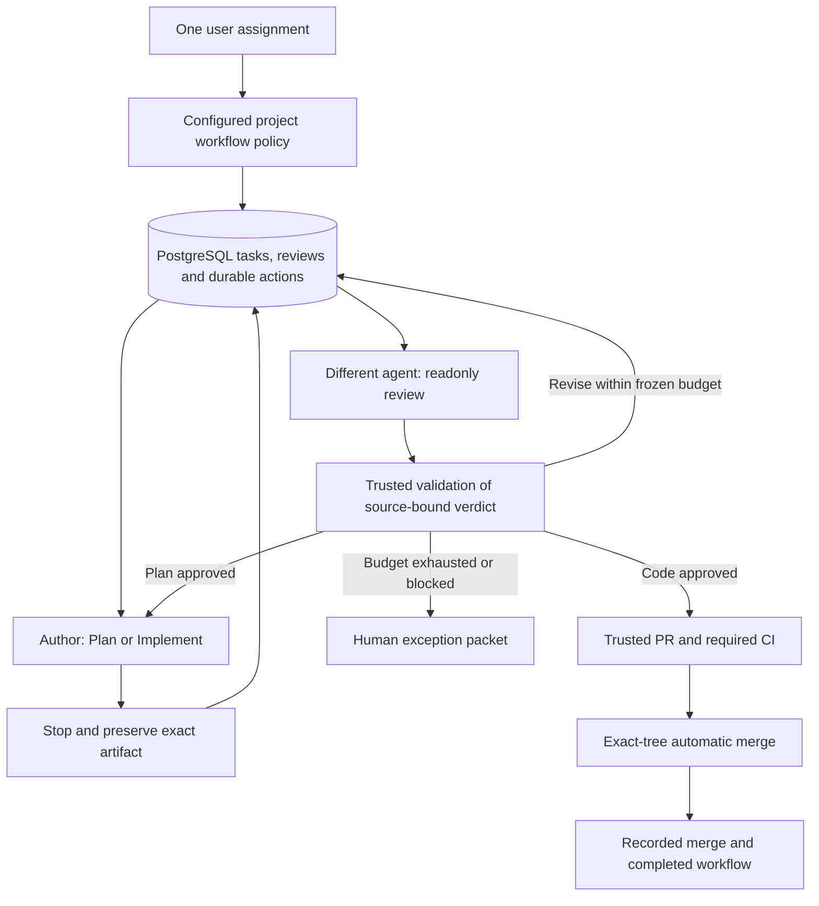
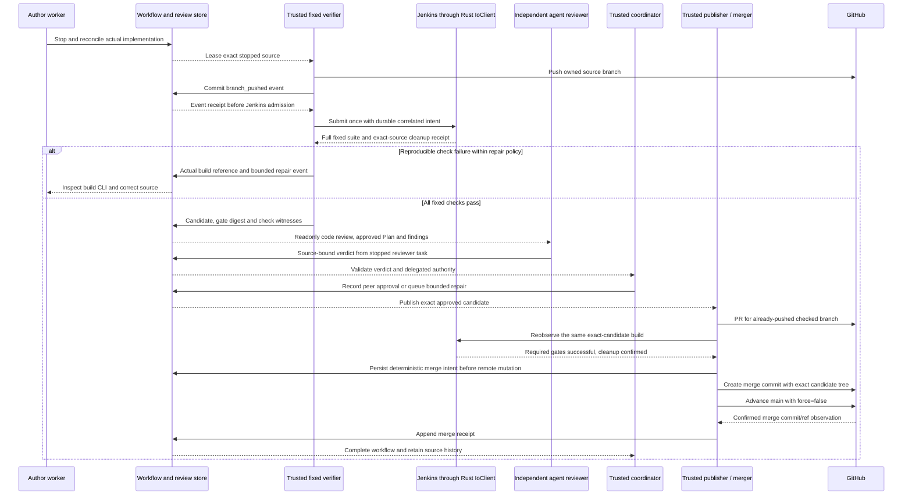

# Autonomous agent author and reviewer workflow

**Status: base lifecycle deployed; native Jenkins provider added in source.** This extends the
[review and repair lifecycle](forge-agent-feedback-loop.md). The earlier manual
approval path remains for legacy/manual tasks. The intended new default for a
configured project delegates ordinary planning, review, execution and merge to
agents and trusted services. Humans resolve exceptions rather than carry plans
between agents.

## Requested outcome

A user submits one assignment. The configured author (initially Gemini) creates
a plan. Its stopped, preserved result generates a durable event that assigns the
configured independent reviewer (initially Codex). The reviewer approves the
exact plan or supplies actionable revision findings. Approval starts execution;
revision returns to the author. An initial plan may receive up to three revised
versions. Approval of the third revised version is valid; a fourth revision
request escalates with the complete plan and review history.

The same separation applies to code. Independent fixed checks run before peer
code review. The reviewer can approve or request bounded corrections. After
approval and all required checks on the exact published head, a trusted merge
provider merges automatically under the project's recorded delegation. The user
explicitly authorized that merge stage. A successful model response never
constitutes a merge receipt.

Profiles express roles, not hardcoded model names. Muse now has a separate
[external database workflow](../external-agent-workflow.md); it does not borrow
native attempts or stopped-process evidence. Native Gemini's current
[Jenkins provider and sequence](../forge-jenkins.md#native-gemini-workflow)
retain this author/reviewer separation and the existing frozen gate identities.

## Ownership and factory/provider composition

| Owner | Responsibility | Excluded authority |
| --- | --- | --- |
| Project configuration | Select distinct author/reviewer profiles, bounded revision policy and automatic merge delegation; freeze their recipes and policy digest per root workflow. | No per-task browser-selected next command or arbitrary merge target. |
| Rust portal model | Show configured roles, workflow phase, revision counters, last evidence and escalation reason. Submit one assignment with the current policy digest. | No routine manual approval prompt for an autonomous task. Generated main JS renders; I/O workers relay admitted requests. |
| API process coordinator | Consume leased PostgreSQL actions; enqueue author/reviewer tasks and apply validated delegated transitions transactionally. | No native model process or GitHub credential is needed in this process. |
| Coding worker | Execute an ordinary leased Plan, Review or Implement task through the selected CLI provider; report progress, stop, preserve result and reconcile its workspace. | Models receive neither DB nor publication credentials. A reviewer is read-only and cannot approve its own author task. |
| Verifier/publication process | Run fixed isolated checks; preserve the exact candidate; publish its PR, observe hosted checks and execute authorized exact-tree merges. | No admin/protection bypass, force push, account rotation or paid fallback. |
| PostgreSQL | Persist workflow, review target/verdict, durable action, event, lease, budget and merge receipt. | Notifications wake discovery; a notification alone grants no execution authority. |

Bootstrap selects these implementations and injects narrow ready ports. Runtime
workers do not reach into global registries. The API process hosts a DB-only
coordinator; existing coding and publication workers retain their separate
process ownership. Construction stays effect-free until validated creation.

The selected supervisor owns execution isolation. Codex 0.160's nested
Bubblewrap sandbox cannot initialize its loopback interface in Forge's existing
capability-free process scope. Policy 7 therefore selects Codex's supported
external-sandbox mode only when the injected supervisor explicitly enforces the
coding sandbox. The invocation records that selection and the real supervisor
checks it before launch. Readonly reviewers still receive readonly source and
context mounts; UID, capability, credential-mask and process-lifetime boundaries
are unchanged. An unsupervised/custom runner retains Codex's inner sandbox.
This changes the immutable execution-policy identity rather than reinterpreting
previous policy receipts.

Native CLI tools share the host network and selected native-account state
mounted into their scope; this is not a private copy of account state or the
verifier's network-isolated scope. The policy records that allowance explicitly.
Database/publication credentials remain masked, and verification continues to
use its private network namespace.



## Plan sequence and revision semantics

```mermaid
sequenceDiagram
    participant U as User
    participant API as Admitted Work service
    participant DB as PostgreSQL workflow/outbox
    participant C as Trusted workflow coordinator
    participant A as Author worker / Gemini
    participant R as Reviewer worker / Codex
    U->>API: Assignment and current project policy digest
    API->>DB: Freeze delegation; enqueue Plan; commit event
    DB-->>A: Claim leased Plan task
    A->>DB: Stopped result, source hash and reconciliation proof
    DB-->>C: Durable source-ready action
    C->>DB: Enqueue readonly review bound to exact Plan
    DB-->>R: Claim review task and immutable target context
    R->>DB: Structured approve/revise/escalate result; stopped proof
    DB-->>C: Durable verdict-ready action
    C->>C: Verify source, recipe, current delegation and lease
    alt Approve exact Plan
        C->>DB: Record delegated Plan approval; queue Implement
        DB-->>A: Implement approved immutable Plan
    else Revise and fewer than three revisions used
        C->>DB: Increment persistent revision count; retain full findings
        DB-->>A: New Plan attempt with exact prior Plan and review feedback
    else Another revision after third revised Plan
        C->>DB: Escalate; preserve all plans, verdicts and counters
        DB-->>U: Human attention with concrete exception packet
    end
```

Counters belong to the workflow, not the worker process or a transient event.
Duplicate events, lost acknowledgements, reconnect scans and linked attempts
cannot reset them. Authentication, quota, missing tooling and uncertain cleanup
are explicit blocked states rather than source revision requests. Reviewers
should request concrete corrections while repairable issues remain; ordinary
plan disagreement is not a reason to ask the human to create a plan from scratch.

## Code review, checks and automatic merge



Mission Control selects `native_delivery_mode: "branch-first-v1"`. A confirmed
merge failure also emits an author-repair event with the actual Jenkins build
reference. Unresolved integration content is a new unapproved source, retaining
the real conflict markers and nonconflicting main changes. Each correction
returns through push/event/build and independent review. M25 records those
transitions without resetting budgets; the existing owner-scoped CLI exposes
only that repair's build metadata and sanitized log pages. See the
[current delivery sequence](../forge-jenkins.md#native-gemini-workflow).

The merge commit's tree is the reviewed and checked candidate tree. Its parents
are the observed main head and the approved PR head. The provider first proves
that observed main is an ancestor of the candidate. A concurrent divergent main
update makes the nonforce ref update fail; it cannot introduce an unreviewed base
merge. Existing branch protections are respected. If they deny the operation,
record the block rather than bypass them. A lost write acknowledgement triggers
read-only reconciliation of the persisted intent and remote refs.

The merge stage is a committed operation boundary: cancellation is unavailable
once the workflow enters `merging`. Earlier stages can still be cancelled as one
workflow. This avoids reporting cancellation while an already admitted remote
main update is being confirmed.

## Starting the next task from merged code

The trusted merger imports the confirmed merge commit's objects and advances
only `refs/forge/verified-main` with a compare-and-swap. It does not move the
operator's local main branch, reset files or write `FETCH_HEAD`. Only after that
source synchronization succeeds does it record the durable merged-head receipt.
An uncertain remote update or source-sync failure stays in reconciliation.

For an opted-in project, the coding worker's selected source provider requires
the private ref to match the scoped database receipt. The next advertised base
and task workspace use that exact commit. Missing or conflicting evidence blocks
new acquisition. First use may bootstrap from the canonical checkout when both
the receipt and private ref are absent. Legacy projects keep their existing HEAD
selection. New admission and merge acknowledgement share a project lock so a
stale-base task cannot slip in after the new merged head is recorded.

## Configuration and rollout

Three explicit selections enable the flow; installing code alone does not
silently delegate an existing project. In the admitted Work configuration, use
current `forge-coding-v7` profiles and add:

```json
{
  "project_workflows": {
    "homelab": {
      "author_profile": "agy-primary",
      "reviewer_profile": "codex-primary",
      "max_plan_revisions": 3,
      "auto_merge": true,
      "merge_method": "merge"
    }
  }
}
```

The coding-worker configuration also selects
`"autonomous_projects": ["homelab"]`; the publication configuration selects
`"merge_enabled": true`. These are additions to their existing validated
configurations. Both role profiles must have the required project/mode grants.
The existing repair policy bounds code revisions and names required hosted
checks. Those names remain logical compatibility IDs. Mission Control explicitly
selects `"hosted_provider": "jenkins"` and a private
`"jenkins_delivery_config"`; GitHub Actions stays disabled. All three fixed
gates run once before independent code review, and later stages reobserve the
same source-bound Jenkins receipt. Models and account configuration remain
explicit profile settings. Migration 24 adds narrow reconciler CI context/status
ports without rewriting frozen workflows or granting direct table access.

The original rollout required matching M15/M16 database migrations, policy 7 workers and
atomic ABI 8 host/generated assets. Drain or preserve old active leases before
switching versions. Verify normal service startup and source selection before
opening new admission. Preserve historical receipts and native workspaces;
the new workflow does not retroactively approve or merge old manual tasks.

## Persisted contracts

Migration 16 adds workflow state, source-bound peer reviews and leased durable
actions. These extend existing Work tasks rather than invent a model-specific
runner. The configured role recipes, revision policy, required checks and merge
authority are frozen for each workflow. Each new invocation also checks current
project/profile/mode grants; old exact receipts retain their replay semantics.

A private reviewer target binds workflow/review/task/attempt IDs, exact result
hash and source revision, role aliases, policy digest and immutable content. Code
review also binds the candidate commit, workspace and gate digests, approved Plan
and independent check witnesses. The reviewer returns strict JSON with the same
identities, exact context hash, approve/revise/escalate, a summary, actionable open
findings and optional explicit finding attestations. Unknown fields, duplicate
keys, stale sources, self-review, unbound approvals and forged check/closure
claims are rejected before state changes.

Full Plans retain the existing 16MiB result resource bound. Review feedback is
not squeezed into the old 2KiB decision note: the author receives the complete,
hash-validated readonly verdict as a separate artifact. The original approved
Plan and repair feedback remain separate. These are storage/execution bounds;
they are not llama.cpp generation-token limits.

New mandatory peer context requires the matching policy 7 worker. Prior policy
history remains readable. Public Work DTO fields are additive, and the existing
browser ABI 8 primitives can render the new readonly workflow summary; matching
host/generated assets still ship atomically.

## Portal and human escalation

For configured projects, the composer shows the author and reviewer roles as
readonly context. It automatically submits the current workflow policy digest;
the user does not choose a reviewer or click Resume/Approve for ordinary stages.
The reader shows planning, review, implementation, checks, publication, hosted CI,
merge and terminal phases with separate Plan/code revision counters. It only
reports Merged from the trusted merge receipt. Cancellation applies to the whole
workflow, including an active peer-review child.

Escalation preserves the original assignment, latest Plan/candidate, actionable
review findings, counters and blocked-operation reason. That gives the human
concrete work to inspect, rather than an empty request to invent and execute a
plan. Manual legacy tasks retain their prior controls. Missing autonomous
projection/context fails closed and cannot re-enable manual approvals by accident.

## Required proof before rollout

- Real PostgreSQL event/recovery/idempotency, initial Plan plus three revisions,
  approval of the third revision, and escalation of another revision request.
- Reviewer/author separation, strict verdict and context hashes, revoked grants,
  stale leases after lock waits, source changes and immutable completed history.
- Actual readonly reviewer context delivery and complete author feedback, with
  factory-selected substitution and no reviewer warm-session leakage.
- Code checks, delegated approval, exact-head hosted observations, deterministic
  merge intent, concurrent main changes, lost acknowledgement and protection denial.
- Typed Rust/native host/generated asset/browser flows showing automated roles,
  phase polling, no routine manual decisions and truthful escalation/cancellation.
- A coordinated migration 15/16, policy 7, service and atomic portal rollout, then
  a separately identified real-agent pilot. Mocked CLI/GitHub tests are not evidence
  that the new production workflow has run.

## Native deadline recovery

`forge-native-deadline-recovery-v1` permits **one native deadline recovery per
workflow**. This is a distinct fixed allowance; it does not spend or expand the
existing verifier infrastructure-retry allowance. Plan revisions, code repair
rounds, the frozen workflow policy and the original Plan decision stay unchanged.

The factory-owned `WorkflowCoordinator.retry_native_timeout` port is a supported
private operator entry point. The same scoped store method runs automatically
when the existing durable-event scan finds a reconciled deadline stop. Public
`WorkResume` remains closed to autonomous-task overrides. Neither agents nor
browser requests can assert the private retry authority.

Admission requires the exact latest Implement attempt, current task revision
and reconciliation receipt, zero remaining writers, no coherent result,
unchanged author profile/recipe/Plan, current role grants and fresh matching
worker readiness. A trusted `deadline_exceeded` event is sufficient provenance;
the `record_stop` race is also supported when its trusted
`stopped_without_publication` event, database `finished_at`, stop proof and
reconciliation all occur after the immutable attempt deadline. A summary string
or a lease-only expiry is never deadline authority. Authentication, quota,
permission, cancellation, unrelated sibling failures, active publication/review
work and arbitrary human escalations remain blocked.

The transition uses the existing locked `WorkStore.resume` path with a
nonserializable, cursor/task/attempt-bound server capability. An immutable
attempt-keyed completed workflow action and the existing resume control receipt
make retries idempotent and prevent concurrent callers from granting a second
turn. The committed `resumed` event wakes the normal coding worker, which verifies
the preserved workspace digest before starting another writer. No schema change,
new daemon, raw task SQL recovery or new workflow/Plan is required.

The trusted resume note tells the author to inspect preserved work, continue the
same approved Plan, finish focused checks and publish a final report promptly.
It avoids another full cold CI run inside the native turn; the independent
verifier still runs **all** required checks. A bounded operator note can point to
an audited outstanding issue without granting commits, pushes, scope changes,
account rotation or paid-credit fallback. A second deadline stop escalates.

## Saved peer-verdict compatibility recovery

The peer decoder accepts the single wire alias `correctness` as `source`;
canonical feedback categories and all other unknown values remain strict. The
stored reviewer bytes, result SHA, target SHA and full author feedback never
change. Reviewer instructions enumerate categories and field/packet limits.

`WorkflowCoordinator.retry_peer_verdict` is a private factory-owned recovery port;
the ordinary durable scan invokes the same method automatically. It accepts only
the precise parser-error escalation for a stopped, reconciled code reviewer whose
saved decision is `revise` and contains that alias. Current source revision,
immutable target, approved Plan, candidate, successful local gates, frozen roles,
recipes, grants, readiness and remaining code budget must still match. Cancelled,
blocked, concurrent or published work cannot be revived. This path cannot recover
an approval, fabricate a verdict or accept a generic parser error.

A project lock and one immutable completed recovery ledger entry per workflow
make concurrent/repeated requests idempotent. Recovery queues the original
handed-off decision action, then the normal controller validates and applies the
saved verdict. The usual code repair allowance is consumed by that transition;
no Plan, native-deadline, verifier retry or code budget is reset. An unchanged
candidate keeps its existing exact-head local evidence; repaired source goes
through all normal checks and another independent review before publication.

## Linked candidate preparation retries

A linked repair base can exist only as an immutable canonical Git object, with
no branch naming it. After cloning, candidate preparation explicitly fetches and
verifies that exact admitted commit from the configured local canonical source,
without changing canonical refs, files or `FETCH_HEAD`. No task-supplied source
path, remote fallback or upload-pack setting is accepted.

The private factory-owned `retry_preparation` port and normal durable scan can
recover the known pre-candidate `publication_command_failed` handoff. They require
the latest linked author result, stopped/reconciled matching workspace, approved
scope, unchanged frozen roles/grants/readiness, no checks or candidate yet, and
no cancelled, blocked or competing work. They use the existing
`review_decide(retry_infrastructure)` path and its existing frozen infrastructure
allowance of one. No author reruns, code repair rounds, Plan revisions or native
deadline allowances are granted or reset. The failed review receipt stays intact.

The appended review preserves inherited Plan scope and all stopped source hashes.
A local infrastructure retry without a candidate takes a fresh digest-validated
snapshot and runs normal preparation and **all** fixed checks; it cannot reuse a
missing candidate manifest as approval. Retries with an existing candidate retain
the existing exact-candidate reuse contract. Source merge conflicts, authentication
failures and unrelated handoffs are not asserted to be successful preparation.

## Source acquisition and delivery readiness

The workspace provider reports trusted lock contention as `WorkspaceBusyError`.
The verifier waits at most30 seconds for snapshot acquisition on the same review
lease, checks cancellation throughout, and rechecks its lease before using the
snapshot. Lease renewals are bounded separately from the short cancellation wait.
No check, source preparation or model starts while the source is unavailable.
Failure receipts contain a stage and exception class only, without raw exceptions
or credentials.

For a stopped legacy review that failed before any candidate or check, one
`forge-source-readiness-delivery-v1` receipt per workflow may deliver the checks
after a **newer trusted reconciliation** confirms the exact same attempt, result,
workspace digest, current revision and approved Plan. The original immutable
failure receipt must identify the legacy pre-check failure or an explicit
snapshot `WorkspaceBusyError`; revoked roles, changed source, cancellation and
competing work remain blocked. The successor preserves the spent infrastructure
retry count, code/Plan counts, findings and stagnation. It changes neither the
task revision nor the original failed receipt, and grants no approval or model
turn. All fixed checks still run normally from the new source-ready receipt.

Both explicit `queue_review` and implicit `review_claim` admission acquire the
same owner-scoped transaction advisory lock before their SQL functions. This
serializes the two initial review producers without new table grants or schema.
Both coding-worker and publication-service facades must receive this update;
the lock is not a substitute for the existing scoped SQL checks and task leases.
