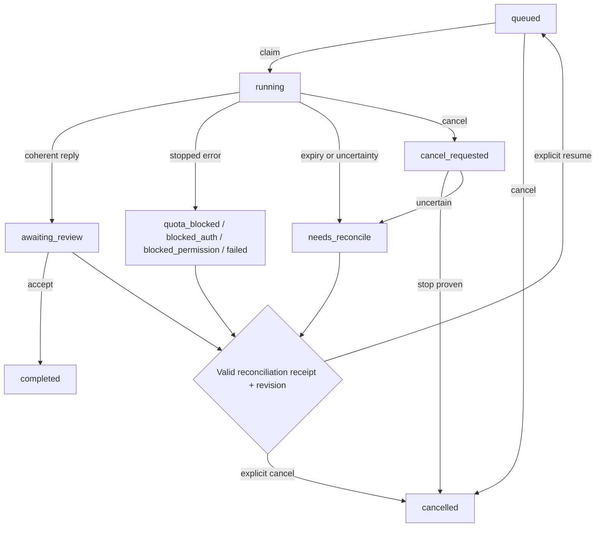
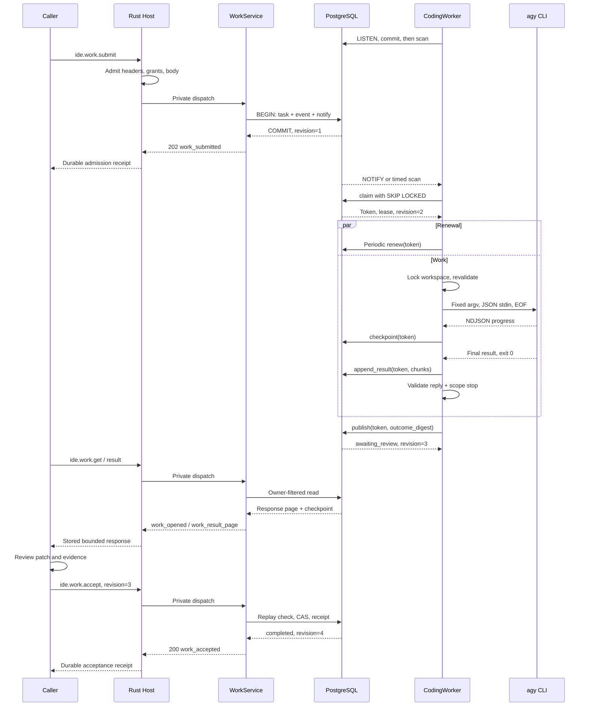
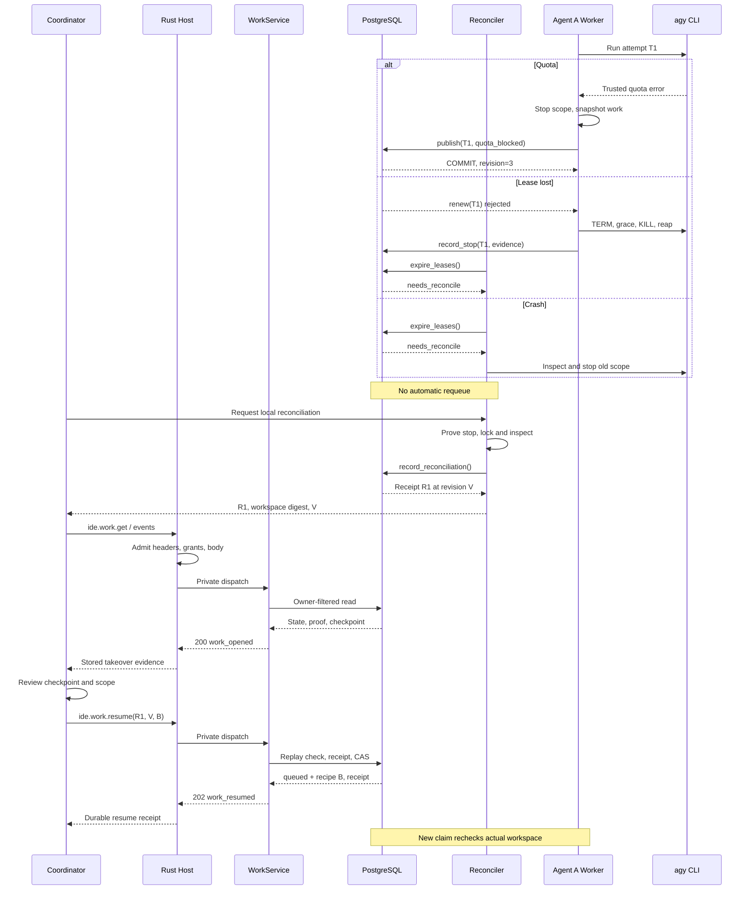

# Coding-agent dispatch: implementation and sequence design

**Status: implemented and deployed on 19 November 2026 (code `619ac0a`, ABI6).**
**Updated: 19 November 2026.** This supersedes the admission-only checkpoint and
the original design-only status at `2e1300a00da92e9f97bdb1a656c2b182d4219a6c`.
Work remains optional/default-off until explicitly configured. The live Homelab
portal now enables the two verified profiles; see the
[deployment checkpoint](../../design/implementation-status.md#observed-deployment-checkpoint).

The authoritative current contract is [Coding-agent workflow](../coding-admission.md).
It covers exact destinations, bounded DTOs, role grants, execution policy,
publication, paging, explicit review/resume and failure behavior. The retained
UML and sequence diagrams below explain responsibility and flow; original
`proposed` stereotypes and illustrative port names are historical notation,
not evidence that the corresponding source capability remains unimplemented.

## 1. Current source implementation

Home enters `/#agents` in the same tab; `/agents` redirects there. The generated
Rust/WASM application supports catalog-backed assignment, task list/detail,
events, cancellation, bounded result reading, explicit acceptance and receipt-
gated resume. Work and Usage are separate admitted capabilities; neither is
inherited from Chat/Mail or source-inspection grants.

One authenticated front door, `POST /forge/v1/dispatch`, admits strict version-1
Forge envelopes and relays to the runner's existing `POST /v1/dispatch`.
`WorkServiceFactory` injects the DAO; `CodingWorkerFactory` injects database,
workspace and process ports. Effect-free registration/validation precedes
creation, and consumers never access global registries. Pure values do not
need empty provider wrappers.

All nine Work destinations are implemented: `catalog`, `submit`, `get`, `list`,
`events`, `cancel`, `result`, `accept`, `resume`. Owner/project/profile/mode grants
are enforced independently at each boundary. Work catalogs expose approved
labels, models, modes and worker-observed base revisions, not paths/auth files.

## 2. Database and execution mapping

Migration `0009_coding_admission.sql` is unchanged. Migration
`0010_coding_execution_and_usage.sql` extends tasks/events/control receipts and
adds attempts, chunks, reconciliation, readiness/grants and provider usage/refresh
storage. This replaces the original tentative single-migration numbering.

The SQL worker role can execute only scoped `forge_coding_worker_api` routines;
it has no direct table/column rights. Administrator-owned grants bind its login
to owner/project/profile/mode. The reconciler uses a separate role/connection for
`expire_leases`, `pending_reconciliations` and `reconcile`. The runner cannot
mint these proofs, and the GPU role has no new coding/usage access. PUBLIC
execution is revoked and security-definer functions fix the safe search path.

Recipe version 2 pins `forge-coding-v1` and its canonical `policy_digest` plus
an explicit backend/model/mode. Version-1 admission recipes are never silently
upgraded or executed. Coding generation tokens stay `null` (provider-managed),
with no inherited llama.cpp or Mail response limit. Wall, memory, framing and
storage bounds remain separate controls, not a promise of unlimited generation.

A root-managed supervisor runs only fixed namespace/privilege-drop launchers
before executing the CLI under the signed-in unprivileged UID/GID with all
capabilities cleared and `no_new_privs` set. It hides canonical repositories,
database/control sockets and credentials. Plan/review mounts are read-only;
implement is independently opted in and writes only its isolated worktree.
This is stronger than the original tentative user-scope-only proposal.

## 3. Lifecycle, results and reviewed takeover

Claims use a 60-second DB-time lease, renewed every 10 seconds during setup,
generation and cleanup. Workspace reservation plus an OS lock prevents concurrent
writers. Cancellation requests stop; it does not establish stop. Review-ready
publication requires a coherent owned nonempty final CLI result, no unresolved
error, validated full-result manifest and confirmed stopped supervision scope.

Full responses are stored in fenced UTF-8 chunks and published atomically.
`ide.work.result` pages the immutable result with a digest/byte-offset cursor;
the browser holds one page and bounded history. The 16 MiB storage ceiling is
explicit and is not a completion-token cap. `ide.work.accept` records explicit
review approval and never performs an automatic Git merge.

Lease expiry/crash/uncertain stop enters `needs_reconcile` and retains the
workspace reservation. No expired attempt or quota-blocked job is automatically
requeued. The trusted reconciler proves the old scope stopped, hashes the locked
workspace and issues a receipt bound to current revision. Only an explicit
`ide.work.resume` with this receipt and an admitted profile can queue a new
attempt; the worker verifies the digest again before spawn. Quota handoff never
silently rotates accounts/models or enables purchased credits.

## 4. Ownership diagram

The diagram retains original illustrative port names. Current concrete modules
are `work_api.py`, `work_store.py`, `work_worker_store.py`, `work_worker.py`,
`work_executor.py`, `work_worker_config.py` and native `work.rs`.


## 5. Lifecycle diagram

The state/receipt ownership remains the implementation intent; the exact public
wire/state checks are specified in the current workflow reference.




## 6. Assignment to reviewed completion

The source includes both Antigravity and Codex adapters; the original sequence's
Antigravity lane represents the selected configured CLI. Readiness comes from
trusted fresh advertisements, and polling repairs missed notifications.




## 7. Quota exhaustion and uncertain outcomes

Explicit user review/resume remains mandatory. Provider account metadata is a
separate observation, never an automatic permission to retry a stopped task.




## 8. Verification and remaining work

Backend, native relay, worker/process, generated UI and usage code are implemented
in the current source. Their test and release evidence must be assessed
separately: fake providers/disposable PostgreSQL; actual namespace, write-denial
and descendant-cleanup probes; authenticated metadata; real CLI result persistence;
browser phone/desktop checks; then explicit production configuration and atomic
bundle deployment. This document does not report those final deployment gates as
complete.

Still outside this slice: automatic account rotation, purchased-credit fallback,
automatic Git merge/push, arbitrary user commands/paths and general worktree
retention/garbage collection. Uncertain or reserved workspaces must not be removed
by a generic cleanup. See [usage visibility](forge-agent-usage.md),
[runner operations](../../../deploy/mission-control/agent-runner/README.md) and
[current source status](../../design/implementation-status.md).

### Structured defect filing

The existing `work_submit` dispatch accepts `task_kind: "defect"` and a `defect`
object in the same call. Omitted `task_kind` remains `feature`; a feature request
must not carry a defect payload. Filing does not pause or change the discovering
assignment. Supply the existing project, base revision, profile, mode, prompt,
acceptance criteria, idempotency key and configured workflow policy as usual.

```json
{
  "task_kind": "defect",
  "defect": {
    "summary": "Report parser drops a failed check",
    "location": {
      "repo_path": "src/report.rs",
      "function": "parse_report",
      "commit": "0123456789abcdef0123456789abcdef01234567"
    },
    "observed_behavior": "A failed check disappears from the report",
    "expected_behavior": "The report retains the failed check",
    "severity": "high",
    "evidence": "Reproduce with the failing-check fixture",
    "discovering_task_id": "11111111-1111-4111-8111-111111111111"
  }
}
```

All six top-level defect fields shown before `discovering_task_id` are required.
`location` requires all three fields, a relative repository path without traversal,
and a full lowercase 40-character commit. Text limits in UTF-8 bytes are 512 for
summary and function, 1024 for repository path, 4096 each for observed and expected
behavior, and 8192 for evidence. Severity is `low`, `medium`, `high`, or `critical`.
Discovery task and workflow UUIDs are optional and must belong to the authorized
owner and project. Unknown fields and mismatched marker/payload pairs fail before
admission. Metadata participates in defect idempotency; historical feature intent
hashes retain their original representation.

Defects use the normal plan–implement–review workflow. Their Plan performs triage:
reproduce, identify root cause or remaining uncertainty, and recommend fix or
defer with reasons. Deferring still requires the existing review and decision
process. Revisions and repair descendants retain defect identity and context.

`work_list` accepts optional `task_kind_filter` (`feature` or `defect`), composed
with existing status/scope and pagination. List/detail records expose `task_kind`,
`defect`, and bounded `filed_defects` links. Agents displays the marker and severity,
structured details, discovery navigation, and an All kinds/Features/Defects filter.
Migration 53 adds the metadata, constraints, inheritance and lease-scoped worker
reader; apply through `sql/apply.sql` and check through `management/verify.sql`.
