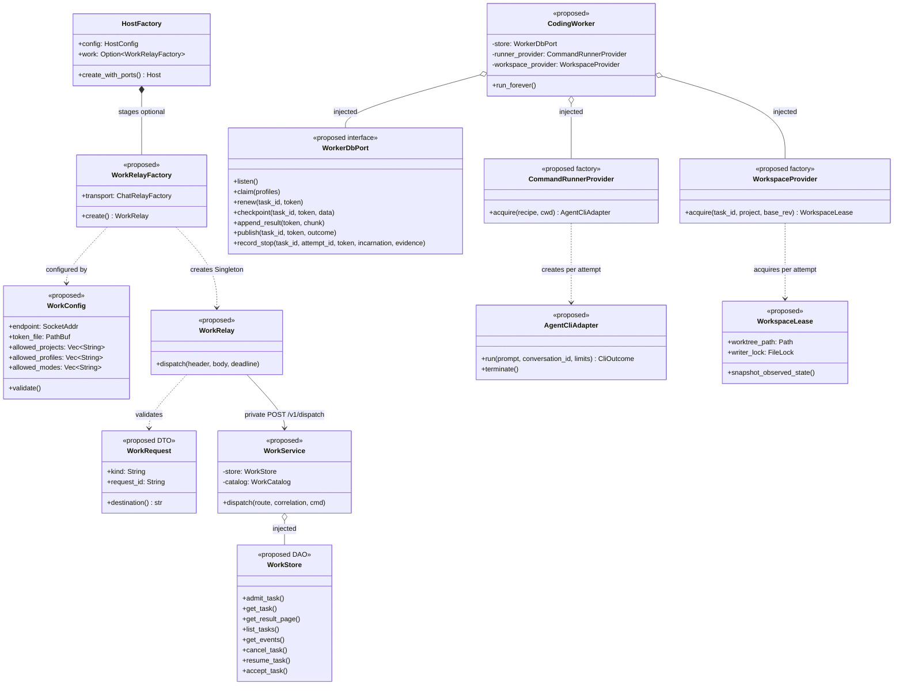
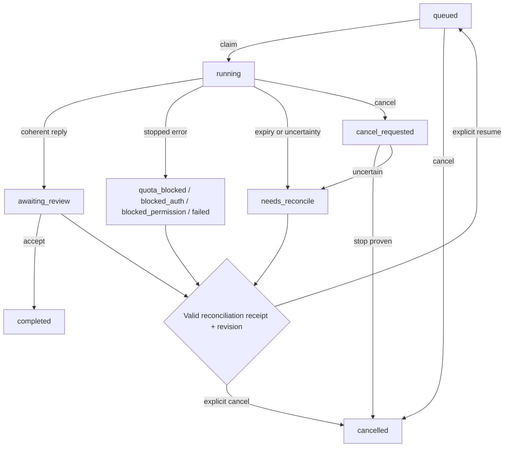
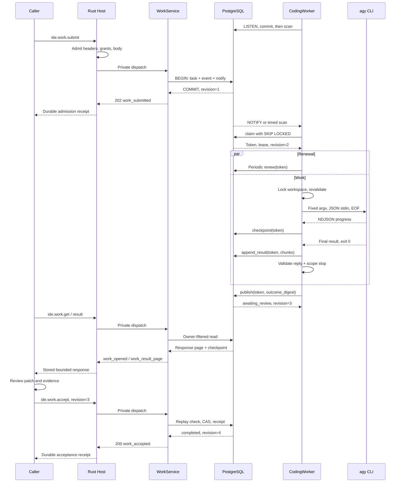
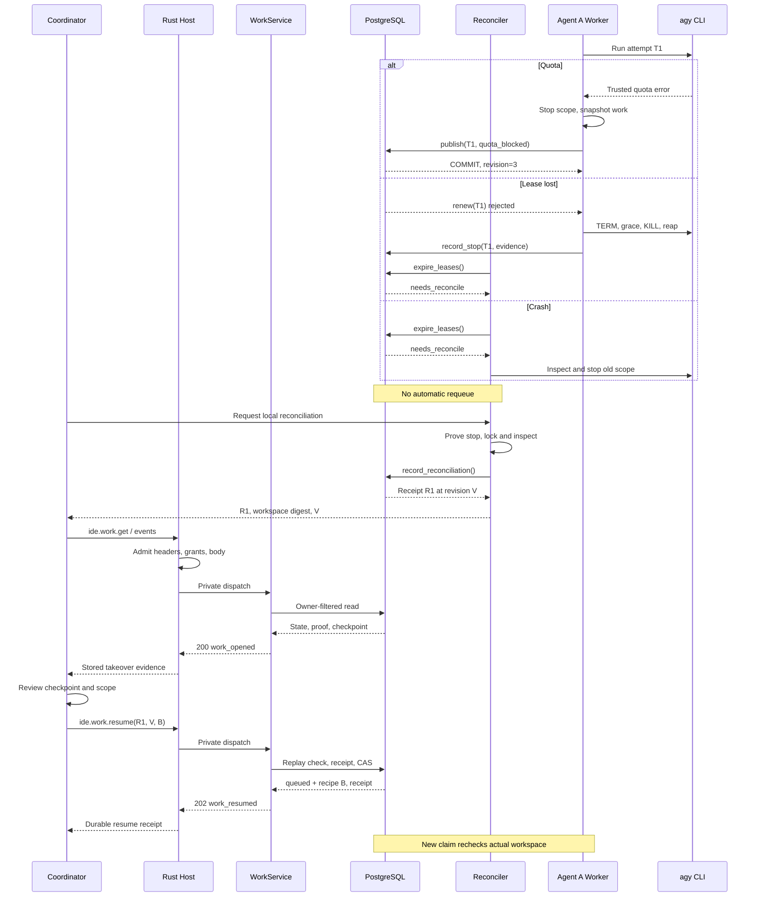

# Proposed Architecture: PostgreSQL-Backed Coding-Agent Dispatch

**Status:** Execution/review flow proposed; admission-only backend implemented in source, disabled by default.
**Date:** 2026-11-19 | **Base revision:** `2e1300a00da92e9f97bdb1a656c2b182d4219a6c` (`main`).
The [implemented admission contract](../coding-admission.md) is the authority for the first slice: `submit/get/list/events/queued cancel`, independent Rust/runner configuration, and three tables in migration `0009`. It is not enabled live. Attempts, CLI execution, full results, reconciliation, resume, acceptance and usage collection below remain **proposed**; their additional tables need later migrations. All implemented requests require `project_alias`, and acceptance criteria are bounded text. Current source code takes precedence over dated documents (for example, [`mail_api.py`](../../../deploy/mission-control/agent-runner/mail_api.py) and [`service.rs`](../../../src/rust/forge-ide-web-host/src/service.rs) implement opt-in `ide.mail.archive`, superseding stale text in [`forge-postgres-inference-dispatch.md`](../forge-postgres-inference-dispatch.md)).

An operator submits an assignment through the same gateway used by Mail. PostgreSQL saves the assignment and wakes a separate worker, which runs the configured coding agent and saves its response for review. A CLI reply means **ready for review**; completion requires acceptance. Agent takeover uses the saved checkpoint and proof that the previous writer stopped.

**Token and usage policy:** Coding agents default to `generation_token_limit: null` (provider-managed), with no inherited Chat/Mail or llama.cpp output-token budget. Provider context/allowance limits still apply. See [agent usage and portal visibility](forge-agent-usage.md) for the separate allowance, token, context and cost views. Long results are stored in chunks and paged for reading; a preview limit never truncates the stored reply.

Read the [normal sequence](#sequence-1-normal-assignment-to-reviewed-completion) and [recovery sequence](#sequence-2-quota-exhaustion--uncertain-outcome--reviewed-takeover), then the [provider boundaries](#4-ownership-composition--provider-boundaries) and [proposed data contracts](#5-proposed-api-dto--dao-contracts).

## 1. Reviewed Sources & Reference Authority

| Source | Role in this design |
| --- | --- |
| [`AGENTS.md`](../../../AGENTS.md), [`GEMINI.md`](../../../GEMINI.md), [`AGENT_WORK.md`](../../../AGENT_WORK.md) | Reuse as-is: plug-and-play policy, single-writer worktree rules, quota/handoff discipline. |
| [`wire-forge-providers/SKILL.md`](../../../.agents/skills/wire-forge-providers/SKILL.md), [`bootstrap-registrars.md`](../bootstrap-registrars.md) | Reuse as-is: effect-free registrars, validate/freeze before creation, explicit scopes, no global registry. |
| [`document-forge-uml/SKILL.md`](../../../.agents/skills/document-forge-uml/SKILL.md), [`forge-worker-ownership.md`](./forge-worker-ownership.md) | Reuse as-is: diagram contract and existing browser/worker ownership (unchanged by this proposal). |
| [`service.rs`](../../../src/rust/forge-ide-web-host/src/service.rs), [`mail_dispatch.rs`](../../../src/rust/forge-ide-web-host/src/mail_dispatch.rs), [`studio.rs`](../../../src/rust/forge-ide-web-host/src/studio.rs) | Proposed integration: model `WorkConfig`/`WorkRelayFactory` on `StudioRelayFactory` inside `HostFactory`. |
| [`runner.py`](../../../deploy/mission-control/agent-runner/runner.py), [`chat_history_api.py`](../../../deploy/mission-control/agent-runner/chat_history_api.py), [`mail_api.py`](../../../deploy/mission-control/agent-runner/mail_api.py), [`queue_store.py`](../../../deploy/mission-control/agent-runner/queue_store.py) | Reuse & v1 placement: header-routed `POST /v1/dispatch` (`Forge-Envelope-Version`, `Forge-Contract-Version`), transactional commit + `pg_notify`, cursor replay. |
| [`forge_gpu_worker.py`](../../../deploy/mission-control/agent-runner/forge_gpu_worker.py), [`forge-agent-runner-dispatch.service`](../../../deploy/mission-control/agent-runner/forge-agent-runner-dispatch.service) | Reference & contrast: copy least-privilege `SECURITY DEFINER` worker API, `LISTEN` loop, and 60 s/10 s lease cadence; do **not** run CLI under `forge_agent` (`ProtectHome=true`) or auto-replay expired leases. |
| [`studio_store.py`](../../../deploy/mission-control/studio/studio_store.py), [`forge-postgres-inference-dispatch.md`](../forge-postgres-inference-dispatch.md) | Reference & contrast: row-locked event sequencing and lease fencing; explicitly reject `MAX_ATTEMPTS` automatic requeue for code-editing attempts. |

**Primary external docs (paraphrased):**
- PostgreSQL 16 `NOTIFY` ([sql-notify.html](https://www.postgresql.org/docs/16/sql-notify.html)): notifications deliver only after transaction `COMMIT`; rolled-back transactions emit nothing.
- PostgreSQL 16 `LISTEN` ([sql-listen.html](https://www.postgresql.org/docs/16/sql-listen.html)): listeners commit `LISTEN` before scanning durable rows so concurrent commits are not missed.
- PostgreSQL 16 `SELECT ... FOR UPDATE SKIP LOCKED` ([sql-select.html](https://www.postgresql.org/docs/16/sql-select.html)): concurrent queue consumers claim distinct eligible rows without blocking each other.
- Antigravity Headless CLI ([cli/headless](https://antigravity.google/docs/cli/headless/)): streaming JSON mode reads structured user events on stdin and emits newline-delimited JSON events including a final result record on stdout.

## 2. Scope, Non-Goals & Authority Boundaries

- **Scope:** Durable coding-assignment admission through Forge's single gateway, PostgreSQL task/attempt/event/receipt persistence, wake-up notification to a separate local coding worker, bounded CLI invocation in an isolated worktree, provenance-separated checkpoint/result persistence, and explicit reviewed completion or takeover.
- **Non-goals:** Browser/portal UI changes (deferred to a later generated Rust/YAML slice; first implementation is backend-only), overloading Mail `runs`/`messages`, automatic expired-lease replay of code edits, automatic quota switching or purchased-credit fallback, arbitrary command/path/env/owner submission, or live production provisioning.
- **Queue vs checkpoint authority:** PostgreSQL admitted tasks, attempts, events, and DB checkpoints are the **sole durable authority**. `AGENT_WORK.md` may serve as a human/agent projection, never as a second mutable queue or a channel for agent-written text to override owner, scope, lease, or task state.
- **Security posture:** Default-off, single trusted operator. First rollout targets headless `plan`/`review` modes only; **`implement` write-profile rollout is blocked** until verified process supervision, OS/credential isolation, and workspace policy exist. Existing browser ownership and source-vs-live deployment facts remain separate.

## 3. End-to-End Flow

1. An authenticated caller posts a typed assignment to public `POST /forge/v1/dispatch` with `Forge-Destination: ide.work.submit`, `Forge-Envelope-Version: 1`, `Forge-Contract-Version: 1`, and `Forge-Request-Id` matching `body.request_id`.
2. The native Rust host checks session, Host/Origin, CSRF, header/body `kind`/`request_id` agreement, and independent coding-project and profile/mode grants in `WorkConfig` (rejecting before effects), then relays via host-scoped `WorkRelay` to existing private runner `POST /v1/dispatch`.
3. The optional injected Python `WorkService` independently validates project/profile/mode grants, pins an immutable non-secret execution recipe snapshot/digest, checks admission idempotency for the configured owner, generates `task_id` server-side, inserts `coding_tasks` + sequence-1 `queued` `coding_events`, emits `pg_notify('forge_coding_jobs', '')`, and commits. Only after `COMMIT` does it return `202 Accepted` with the durable receipt.
4. A separate local coding worker (running under an approved signed-in OS account, not `forge_agent`) has already committed `LISTEN forge_coding_jobs`, wakes (or rescans on bounded timeout/reconnect), and claims one eligible task via `FOR UPDATE SKIP LOCKED`, creating `coding_attempts` with a fresh `attempt_token`, DB-time lease, and incremented task `revision`, then commits.
5. **Immediately after claim** (outside any DB transaction), the worker starts periodic lease renewal (`RENEW_SECONDS`), acquires the task's isolated approved worktree and local writer lock, revalidates `(attempt_token, lease, pinned recipe_digest)` right before spawn, spawns the real `agy` binary (`shell=False`, fixed argv, streaming JSON stdin), drains stdout/stderr concurrently, records bounded observational `checkpoint` updates, and continues renewal through cleanup. A resumed attempt also recomputes the actual worktree digest under that lock and compares it with the consumed reconciliation receipt; mismatch returns to `needs_reconcile` without spawning.
6. The adapter stages validated response text via fenced `append_result` calls. After confirmed process/supervision-scope stop, the worker validates exit `0`, coherent NDJSON `SUCCESS`, nonempty response, owned `conversation_id`, and zero unresolved invocation infrastructure errors, then atomically calls `publish` with the complete result manifest (fenced by `(task_id, attempt_token)` with `canonical_outcome_digest`) to enter `awaiting_review` (or a typed blocked/failure state).
7. The reviewer reads the summary/checkpoint via `ide.work.get`, ordered events via `ide.work.events`, and the full response via `ide.work.result` pages, verifies the patch/evidence, and calls `ide.work.accept` (`awaiting_review` -> `completed`) or `ide.work.resume` with a bound `reconciliation_receipt_id` and `expected_revision`.

## 4. Ownership, Composition & Provider Boundaries

- **v1 placement (decided):** Mount `ide.work.*` on the existing private runner `POST /v1/dispatch` ([`runner.py`](../../../deploy/mission-control/agent-runner/runner.py)) via an optional injected `WorkService` enabled by its own startup configuration, completely independent of Mail, GPU readiness, or `async_dispatch` (`distributed`) flags. No second `work-api` loopback listener is added for v1.
- **Rust native host (proposed):** `HostConfig` gains `work: Option<WorkConfig>` validated at startup: loopback endpoint, absolute token file, and **independent** `allowed_projects`, `allowed_profiles`, and `allowed_modes` grants. Read-only inspection grants in `NodeConfig` never grant code-write authority. `HostFactory` stages `Option<WorkRelayFactory>` (reusing `ChatRelay` loopback transport like [`StudioRelayFactory`](../../../src/rust/forge-ide-web-host/src/studio.rs), with no global registry). After startup validation/freeze, `HostFactory::create_with_ports` constructs `Option<Singleton<WorkRelay>>` and injects it into `Host`; `Host::work_dispatch` acquires a borrow-tied lease only for `ide.work.*`.
- **Python admission composition (proposed):** Runner startup validates coding config, builds `WorkCatalog` (projects, agents, pinned execution recipes, modes) and `WorkStore(connect_fn, owner_id)`, and injects `WorkService(store, catalog)` into the HTTP server. Constructors perform no DB or subprocess I/O; each call opens a short-lived transaction with `statement_timeout` and `lock_timeout`.
- **Separate local coding worker (proposed):** Because [`forge-agent-runner-dispatch.service`](../../../deploy/mission-control/agent-runner/forge-agent-runner-dispatch.service) runs as `forge_agent` with `ProtectHome=true` while `agy` and Google OAuth belong to `lrocha`, the coding worker runs as a **separate local process** under the approved signed-in OS account (`lrocha`), never copying OAuth into the runner or DB. Its composition root validates config and injects `CodingWorker(store, command_runner_provider, workspace_provider, clock, stop)`. Workers never access a global registry.
- **Database privilege separation:** The coding worker connects as a dedicated least-privilege DB role granted `EXECUTE` only on proposed `forge_coding_worker_api.{claim, renew, checkpoint, append_result, publish, record_stop}` `SECURITY DEFINER` functions with pinned `search_path` and `session_user` identity. A separate trusted local `Reconciler` receives injected `ReconciliationDbPort`, `Supervisor`, and `WorkspaceProvider` ports; its restricted DB operations are `expire_leases` and `record_reconciliation`. It can inspect/stop an expired scope and attest filesystem state, but cannot submit or spawn a replacement. Neither the caller nor child CLI can mint reconciliation receipts. DB credentials and runner bearer tokens are never placed in child CLI env.
- **Pure contracts:** Proposed DTO structs/dataclasses (`WorkRequest`, `WorkResponse`, `ExecutionRecipe`, `CheckpointSnapshot`) are pure values and require no empty registrars.

| Component (proposed) | Scope / Owner | Acquisition | Release / Cleanup |
| --- | --- | --- | --- |
| `WorkRelay` (Rust) | `Singleton` owned by `Host` | Borrow lease per `ide.work.*` dispatch | Dropped on `Host` shutdown after admission stops |
| `WorkStore` / `WorkerDbPort` | Runner/worker-owned connection factory | Short-lived DB conn per call; one `LISTEN` conn | Closed in `finally` / worker shutdown |
| `WorkspaceProvider` | Worker-owned factory -> per-attempt lease | Acquire isolated worktree + local writer lock after claim | Release lock only after scope stop confirmed; durable DB reservation retained on uncertainty |
| `CommandRunnerProvider` | Worker-owned factory -> per-attempt runner | Spawn real `agy` (never `forge-agy`) in own group/scope | Close stdin, drain pipes, terminate group/scope (grace -> kill), wait/reap |
| `Reconciler` | Trusted local supervisor, independent of a worker attempt | Inject DB, supervision and workspace ports after config validation | Close scans/connections and release inspection lock; never release uncertain reservations |


*Simplification note:* Rust lifetimes, generic `Singleton<T>`/`Factory<T>` bounds, `WorkCatalog`, `Clock`, `Stop`, and the separate trusted reconciliation ports are omitted for readability. Injection associations do not imply a global registry.

## 5. Proposed API, DTO & DAO Contracts

Public endpoint: `POST /forge/v1/dispatch`. Private endpoint: existing runner `POST /v1/dispatch`. Required headers match [`chat_history_api.py`](../../../deploy/mission-control/agent-runner/chat_history_api.py): `Forge-Destination`, `Forge-Envelope-Version: 1`, `Forge-Contract-Version: 1`, and `Forge-Request-Id`. Every request JSON object must include `request_id` (matching `Forge-Request-Id`) and a strict `kind` matching the destination (`deny_unknown_fields`). Every response uses the standard envelope `{"protocol_version": 1, "event": {"kind": "<response_kind>", "request_id": "<correlation>", ...}}`. Arbitrary binaries, flags, paths, env vars, or caller-supplied owners are rejected before effects. **All DAO reads, lists, event queries, and mutations independently filter `owner_id = $configured_owner`**, returning `404 not_found` for cross-owner IDs.

| Proposed Destination | Request `kind` & Fields (`+ request_id`) | Response `kind` & Status | Key Rejections |
| --- | --- | --- | --- |
| `ide.work.submit` | `work_submit`: `project_alias`, `base_revision`, `mode`, `agent_profile`, `prompt`, `acceptance_criteria`, `idempotency_key` (server generates `task_id`) | `work_submitted` (`202` after commit): `task_id`, `revision`, `status`, `recipe_digest` | `400` invalid, `403` grant denied, `409` `idempotency_conflict`, `503` queue full |
| `ide.work.get` | `work_get`: `task_id`, `include_checkpoint` | `work_opened` (`200`): task header, `recipe_digest`, attempt summary, `response_preview`, `result_manifest`, optional provenance-split checkpoint | `404` `not_found` |
| `ide.work.result` | `work_result`: `task_id`, `attempt_id`, optional opaque `cursor`, bounded `limit_bytes` | `work_result_page` (`200`): accepted result digest, UTF-8 content page, `next_cursor`, `complete` | `404` owner/result absent, `409` mismatched result identity, `400` invalid cursor/limit |
| `ide.work.list` | `work_list`: `status_filter`, `project_alias`, `limit`, `cursor` | `work_listed` (`200`): paginated task summaries | `400` invalid cursor/limit |
| `ide.work.events` | `work_events`: `task_id`, `after_sequence`, `limit` | `work_events` (`200`): ordered `coding_events`, `next_sequence`, `status`, `revision` | `404` `not_found` |
| `ide.work.cancel` | `work_cancel`: `task_id`, `expected_revision`, `idempotency_key`, optional `reconciliation_receipt_id` (non-running) | `work_cancel_recorded` (`200`): `base_revision`, `result_revision`, `status` (may be `cancel_requested`, not yet stopped) | `404`, `409` `idempotency_conflict` / `revision_conflict` / `reconcile_required` |
| `ide.work.resume` | `work_resume`: `task_id`, `expected_revision`, `agent_profile`, `reconciliation_receipt_id`, `note`, `idempotency_key` | `work_resumed` (`202`): `base_revision`, `result_revision`, `status=queued`, new `recipe_digest` | `404`, `409` `idempotency_conflict` / `revision_conflict` / `stale_reconciliation` / `task_active` |
| `ide.work.accept` | `work_accept`: `task_id`, `expected_revision`, `review_note`, `idempotency_key` | `work_accepted` (`200`): `base_revision`, `result_revision`, `status=completed` | `404`, `409` `idempotency_conflict` / `revision_conflict` / `not_reviewable` |

Error replies return `event.kind = "work_failed"` with matching `request_id` and typed error `code`.

**Compact submit request & `202` receipt example (proposed):**
Request headers: `Forge-Destination: ide.work.submit`, `Forge-Envelope-Version: 1`, `Forge-Contract-Version: 1`, `Forge-Request-Id: req-9f2a`.
```json
{"kind":"work_submit","request_id":"req-9f2a","project_alias":"homelab","base_revision":"2e1300a00da92e9f97bdb1a656c2b182d4219a6c","mode":"plan","agent_profile":"agy-plan-v1","prompt":"Draft fix plan","acceptance_criteria":"Bounded plan","idempotency_key":"task-001"}
```
`202 Accepted` response after `COMMIT` (server-generated `task_id`):
```json
{"protocol_version":1,"event":{"kind":"work_submitted","request_id":"req-9f2a","task_id":"8c1d4c3e-6b4f-4d2e-9a1b-2c3d4e5f6a7b","revision":1,"status":"queued","recipe_digest":"sha256:..."}}
```

## 6. Proposed PostgreSQL Schema (Proposed Migration Slot `0009`)

Migration slot `0009` is **proposed only** and must be rechecked against `deploy/mission-control/sql/migrations/` before implementation; applied migrations `0001`–`0008` are never edited.

1. **`forge_agent.coding_tasks`:**
   - *Immutable admission identity:* `id uuid PK`, `owner_id text NOT NULL`, `project_alias text NOT NULL`, `base_revision text NOT NULL`, `mode text NOT NULL`, `prompt text NOT NULL`, `acceptance_criteria text NOT NULL`, `idempotency_key text NOT NULL`, `intent_fingerprint text NOT NULL`, `initial_recipe_digest text NOT NULL`, `initial_recipe_json jsonb NOT NULL`, `admission_receipt_json jsonb NOT NULL`, `created_at timestamptz NOT NULL`. Unique `(owner_id, idempotency_key)` and `(owner_id, id)`.
   - *Mutable control state:* `revision bigint NOT NULL DEFAULT 1 CHECK (revision BETWEEN 1 AND 9007199254740991)`, `status text NOT NULL`, `active_recipe_digest text NOT NULL`, `active_recipe_json jsonb NOT NULL`, `current_attempt_id uuid NULL`, `resume_receipt_id uuid NULL`, `workspace_id text NULL`, `workspace_reserved boolean NOT NULL DEFAULT false`, `updated_at timestamptz NOT NULL`.
   - *Constraints:* Composite FK `(id, current_attempt_id) REFERENCES coding_attempts(task_id, id)` (deferrable or updated after insert); partial unique index `UNIQUE (workspace_id) WHERE workspace_reserved = true`; reserved workspaces require a non-null ID. `resume_receipt_id` points to this task's immutable reconciliation receipt and is copied to its new attempt on claim, so pre-spawn digest validation cannot lose the admitted baseline.
2. **`forge_agent.coding_attempts`:**
   - `id uuid PK`, `task_id uuid NOT NULL REFERENCES coding_tasks(id)`, `attempt_number integer NOT NULL CHECK (attempt_number >= 1)`, `attempt_token uuid NOT NULL UNIQUE`, `worker_incarnation text NOT NULL`, `recipe_digest text NOT NULL`, `recipe_json jsonb NOT NULL`, `status text NOT NULL`, `lease_until timestamptz NOT NULL`, `attempt_deadline timestamptz NOT NULL`, `workspace_id text NOT NULL`, `conversation_id text NULL`, `stop_confirmed_at timestamptz NULL`, `stop_evidence_json jsonb NULL`, `workspace_digest text NULL`, `outcome_code text NULL`, `canonical_outcome_digest text NULL`, `publication_receipt_json jsonb NULL`, `response_preview text NULL`, `result_manifest jsonb NULL`, `observed_checkpoint_json jsonb NULL`, `model_claims_json jsonb NULL`, `usage_json jsonb NULL`, `provider_quota_json jsonb NULL`, `started_at timestamptz NOT NULL`, `finished_at timestamptz NULL`.
   - *Constraints:* Unique `(task_id, id)`, unique `(task_id, attempt_number)`, partial unique index ensuring **at most one live attempt per task** (`UNIQUE (task_id) WHERE status IN ('running', 'cancel_requested')`), and bounded `octet_length(...)` `CHECK` constraints on text/JSON columns at implementation. Each attempt also stores nullable `resume_receipt_id`; task `(id, resume_receipt_id)` and attempt `(task_id, resume_receipt_id)` reference reconciliation receipts' unique `(task_id, id)` key.
3. **`forge_agent.coding_events`:**
   - `(task_id uuid, sequence bigint) PK` with `CHECK (sequence BETWEEN 1 AND 9007199254740991)`, `attempt_id uuid NULL`, `event_type text NOT NULL`, `payload_json jsonb NOT NULL`, `created_at timestamptz NOT NULL`. Direct FK `task_id REFERENCES coding_tasks(id)` also protects queued events with no attempt; composite FK `(task_id, attempt_id) REFERENCES coding_attempts(task_id, id)`. Always inserted while holding `SELECT ... FROM forge_agent.coding_tasks WHERE owner_id = $1 AND id = $2 FOR UPDATE`.
4. **`forge_agent.coding_control_receipts`:**
   - `id uuid PK`, `owner_id text NOT NULL`, `task_id uuid NOT NULL`, `idempotency_key text NOT NULL`, `mutation_kind text NOT NULL` (`cancel`|`resume`|`accept`), `canonical_intent_hash text NOT NULL`, `pinned_recipe_digest text NULL`, `base_revision bigint NOT NULL`, `result_revision bigint NOT NULL`, `response_json jsonb NOT NULL`, `created_at timestamptz NOT NULL`. Unique `(owner_id, task_id, idempotency_key)`; composite FK `(owner_id, task_id) REFERENCES coding_tasks(owner_id, id)`.
5. **`forge_agent.coding_reconciliation_receipts`:**
   - Append-only `id uuid PK`, `owner_id text NOT NULL`, `task_id uuid NOT NULL`, `prior_attempt_id uuid NOT NULL`, `expected_revision bigint NOT NULL`, `workspace_id text NOT NULL`, `workspace_digest text NOT NULL`, `stop_evidence_json jsonb NOT NULL`, `issuer_identity text NOT NULL`, `created_at timestamptz NOT NULL`. Composite owner/task and task/attempt FKs as above. Store immutable full proof, not just a UUID on the attempt; retain old receipts for replay/audit. Resume control receipts record the consumed reconciliation ID. All revision fields use the same positive safe-integer bound, and every text/JSON field receives a byte bound.
6. **`forge_agent.coding_result_chunks`:**
   - `(attempt_id, chunk_index) PK`, `task_id`, UTF-8 `content`, `content_digest`, `created_at`; nonnegative chunk index and bounded chunk bytes, with `(task_id, attempt_id)` FK as above. Fenced `append_result` accepts only the current live attempt; identical indexed chunk retries are idempotent, changed bytes conflict. Chunks stay staged until `publish` verifies contiguous indexes, full byte count and digest, then commits an immutable `result_manifest` with the outcome. Readers expose only that accepted manifest and its pages; incomplete output is explicitly partial evidence, not a completed reply. Cursor identity binds owner/task/attempt/result digest. A storage ceiling produces a typed resource-limit outcome, never a silently shortened success.

- **Idempotency & replay order:** On `submit`, replay compares `intent_fingerprint` against the **original stored `initial_recipe_json`/`initial_recipe_digest`** (not a newly resolved catalog alias, so later catalog drift blocks new submissions/spawns without breaking reads or replays of prior receipts). On `cancel`/`resume`/`accept`, lookup `(owner_id, task_id, idempotency_key)` and verify `canonical_intent_hash` **before** `expected_revision` CAS; exact replay returns immutable `response_json` (including `base_revision`/`result_revision`) after a lost ACK, while changed intent returns `409 idempotency_conflict`. Canonical intent hashes include pinned recipe identity (where applicable) and **exclude** correlation `request_id`.
- **Receipt vs envelope:** Stored admission/control receipts contain immutable business fields, excluding transport `request_id`. Exact replay re-envelopes that receipt with the current request's correlation ID. A reused key with changed intent never returns another mutation's receipt.
- **Revision increments & provenance:** `claim` and every durable control/state transition (`cancel`, `publish`, `record_stop` state changes, `resume`, `accept`) increment `coding_tasks.revision`. Lease `renew`, observational `checkpoint`, and staged `append_result` writes do **not** increment `revision`. Worker/supervisor-observed fields (`observed_checkpoint_json`: `source_revision`, `diff_digest`, `changed_files`, `stop_evidence_json`) are stored separately from unverified model-reported claims (`model_claims_json`: `checks_run`, `next_action`) and from the accepted response. Raw thoughts and tool-argument traces are excluded by default.

## 7. Pinned Execution Recipes & CLI Process Adapter (Proposed)

- **Immutable execution recipe:** At `submit` and every explicit `resume`, admission resolves the configured `agent_profile` into a non-secret `recipe_json` + `recipe_digest`: `{backend_binary, adapter_compat_version, model_id, logical_mode, native_cli_mode, permission_policy, generation_token_limit: null, resource_profile, workspace_policy}`. The worker revalidates `recipe_digest` against its allowed catalog immediately before spawn; drifted or revoked recipes are rejected before starting a subprocess rather than silently reinterpreting a queued alias. The adapter omits generation-token options; it never copies Mail's context/completion budget or sends `-1` to an unrelated API.
- **Logical-to-native mode mapping:** Logical `plan` and `review` map to native CLI `--mode plan`. Logical `implement` maps to an explicitly approved native write mode (for example, `accept-edits` or another approved profile). **Never** pass `--mode review` or `--mode implement` literally to `agy`.
- **Invocation & streaming JSON:** Fixed argv from pinned recipe using the real `agy` binary (never `forge-agy`), `shell=False`, approved isolated worktree `cwd`, minimal sanitized env (no `PGPASSFILE`, DB password, or runner bearer token). Pass `--input-format stream-json --output-format stream-json` (never combined with `-p`), write one stdin JSON line `{"event":"user","message":{"content":"<assignment+checkpoint>"}}`, then close stdin. Task text never enters argv. Explicit resume uses only an owned `conversation_id`; never `--continue`.
- **Observational `checkpoint` & timing:** Do **not** assume `agy` emits a native checkpoint event. The adapter drains stdout/stderr concurrently, measures attempt duration via `time.monotonic()`, derives bounded sanitized progress from supported NDJSON events plus worker-observed git worktree snapshots, and records missing `next_action` as `unknown / review required`.

| Proposed Config Bound | Policy (proposal, not provider quota) | Rationale |
| --- | --- | --- |
| `generation_token_limit` | `null`: provider-managed | No Forge generation-token cap for coding agents. Native model and account constraints remain. |
| Prompt/framing/storage ceilings | Versioned per-adapter `resource_profile`; no shared 32 KiB/64 KiB final-reply ceiling | Validate admission, framing and storage independently. Incrementally parse/spool supported output and retain the accepted full response in chunks. A single-record adapter must accommodate its configured maximum escaped result plus metadata; pagination alone does not fix oversized NDJSON parsing. |
| Result chunk/page bytes; preview bytes | Suggested 16 KiB chunks/pages; independently bounded small preview | Bounds one row/HTTP reply without imposing a total generation-token budget. Readers can fetch every accepted page. |
| Stdout/stderr capture ceilings | Per-adapter resource profile; bounded sanitized diagnostics | No shared 8 MiB run-output cutoff borrowed from a short smoke run. Explicit configured ceilings still produce typed resource failures. |
| `LEASE_SECONDS` / `RENEW_SECONDS` | 60 s / 10 s | Coherent with existing [`forge_gpu_worker.py`](../../../deploy/mission-control/agent-runner/forge_gpu_worker.py) lease cadence. |
| Attempt wall/deadline | Finite per-adapter/task resource profile, declared before admission | Long coding assignments use an appropriate policy rather than a shared 15/30-minute cutoff; independent of token generation and provider quota. |
| `STOP_GRACE_SECONDS` | 10 s | Allows clean termination before `SIGKILL` of process group/scope. |

## 8. Lifecycle, Cancellation, Reconciliation & Outcome Classification


*Diagram grouping:* The stopped-error node groups four distinct persisted task states; it is not a fifth status.

*Terminal & guard invariants:* `completed` and `cancelled` have no outgoing transitions. There is **no** automatic `running` -> `queued` transition on lease expiry. Every transition back to `queued` passes through `resume_gate`.

- **No auto-replay & workspace durability:** Coding effects are **not** exactly once; a DB `attempt_token` fences result publication, not filesystem writes. Lease expiry, worker crash, or unconfirmed cancellation enters `needs_reconcile` while keeping `workspace_reserved = true`. Because OS `flock` releases automatically on crash, the **durable PostgreSQL `workspace_reserved` constraint** (not the dead local lock) prevents concurrent writers. Each task uses one isolated approved worktree pinned to `base_revision`; reuse requires confirmed process stop plus reconciled dirty state/hashes. A future fresh-worktree-per-attempt policy must export/verify/apply a bounded change manifest rather than copying unknown dirty state.
- **Surviving expiry actor:** The trusted `Reconciler` periodically calls bounded `expire_leases` scans and does so on startup. Under task-then-attempt row locks, DB-time lease/deadline expiry changes current `running`/`cancel_requested` task and attempt to `needs_reconcile`, advances the task revision, and appends an event, retaining the workspace reservation. This operation never requeues or assumes the old process stopped. Clock passage alone cannot update status; if the reconciler is unavailable, publication is still fenced by DB time and takeover stays blocked.
- **Immutable reconciliation receipt (no bare boolean bypass):** There is **no** `reconcile_ack` boolean. After any stopped outcome (including normal `awaiting_review`), the trusted `Reconciler` proves the old supervision scope stopped, acquires the workspace inspection lock, and computes its digest. Restricted `record_reconciliation` checks configured owner/workspace, current prior-attempt identity, non-running task state, supervisor-verified stop proof (also attached to the prior attempt when the worker died), and the **committed current task revision**, then appends the immutable receipt without advancing that revision. This works after a worker crash without impersonating its old token/incarnation. It cannot spawn, reopen a task or overwrite an outcome. Every `ide.work.resume` requires that receipt bound to `(task_id, prior_attempt_id, workspace_id, workspace_digest, observed_stop_evidence, expected_revision)`; bare caller assertions never mint one. Unverifiable stop leaves `needs_reconcile`. Changed attempt/revision/digest invalidates a receipt (`409 stale_reconciliation`); the next worker recomputes the actual digest under its writer lock immediately before spawn to catch filesystem drift after the SQL check.
- **Cancellation rules:** `queued` -> `cancelled` immediately (no child). `running` -> `cancel_requested` fences result publication and requests scope stop, entering `cancelled` only after confirmed scope stop (uncertainty -> `needs_reconcile`). If `publish` won the row lock and advanced revision, a cancel using the old revision returns `409 revision_conflict` and preserves the published response; the caller reads current state. Non-running `awaiting_review`/`blocked_*`/`failed`/`needs_reconcile` tasks cancel only with a valid reconciliation receipt proving stop + workspace state; never clear an uncertain reservation solely because the CLI parent exited.
- **Lease renewal & post-expiry `record_stop`:** Lease renewal runs immediately from `claim` through worktree setup, CLI execution, and cleanup. `record_stop(task_id, attempt_id, attempt_token, worker_incarnation, stop_evidence)` is accepted **even after lease expiry or cancellation** (without requiring an active lease) to attach stop/workspace evidence and close `cancel_requested` -> `cancelled` when confirmed, but it can never reopen a task, overwrite a published outcome, or touch a newer attempt.
- **Stop-proof identity:** Supervision records identify the host boot, worker incarnation and attempt-specific scope (plus process start identity where needed); a recycled PID or the CLI parent's exit is insufficient. The reconciler verifies that exact scope has no remaining writers. Missing or ambiguous evidence blocks receipt issuance and replacement spawn.
- **Containment honesty:** Process-group `SIGTERM`/`SIGKILL` does not contain intentionally detached grandchildren, and env sanitization under the same OS user (`lrocha`) is **not** credential isolation. Production `implement` write profiles remain blocked until verified supervision (e.g., transient `systemd-run --user --scope`) and OS/credential isolation policy are approved.
- **Strict outcome classification:** Entering `awaiting_review` requires **all five**: child exit `0`, coherent bounded final NDJSON `SUCCESS` with nonempty `final_response`, owned `conversation_id` match, zero unresolved current-invocation CLI/infrastructure/permission errors, and confirmed process/scope stop. Stderr-only auth/permission failures classify as `blocked_auth`/`blocked_permission`; exit-0 `SUCCESS` with empty response classifies as `failed` (or `blocked_permission` if permission denial occurred). `quota_blocked` requires trusted CLI error channels / recognized error codes—never regex-matching agent prose or labeling every HTTP `429` as quota. Deliberate failing unit tests or nonzero test exits during coding are review evidence, not automatically CLI transport failures. Unknown parser errors or uncertain writer stop are never classified as cleanly stopped.

## 9. Event Delivery, Fencing & Sequence Diagrams

Admission commits `coding_tasks`, `coding_events` (`sequence = 1`), and `pg_notify('forge_coding_jobs', '')` atomically. Multi-table transactions lock `coding_tasks` before `coding_attempts`. First `publish` requires the current attempt/token, authorized `session_user` and worker incarnation, task `running`, active DB-time lease and attempt deadline, confirmed scope-stop evidence, and (for `awaiting_review`) a verified complete nonempty response manifest. Blocked/failure outcomes may record absent or explicitly partial output without presenting it as a completed reply. Publication atomically saves outcome, accepted result reference, state/revision and event. The immutable `canonical_outcome_digest` + `publication_receipt_json` permits only an identical publication replay after lost ACK, even after lease expiry or later task transitions; replay returns the old receipt without changing state or rerunning the CLI. Changed/stale outcomes cannot replace it.

### Sequence 1: Normal Assignment to Reviewed Completion


### Sequence 2: Quota Exhaustion / Uncertain Outcome & Reviewed Takeover


## 10. Quota Handoff & Reviewed Takeover

On `quota_blocked`, the worker stops cleanly without busy-retrying, persists observed source/diff hashes, partial outcome, and provider quota snapshot, and requests trusted reconciliation of the stopped attempt and workspace digest. The same reconciler path issues receipts for normal stopped outcomes and crash recovery. Never enable purchased-credit fallback, spoof quota, or silently swap models. Takeover requires an explicit `ide.work.resume` passing `idempotency_key`, `expected_revision`, `reconciliation_receipt_id`, and a configured available `agent_profile` (pinned to a fresh `recipe_digest`). Cross-agent continuity relies strictly on persisted task + checkpoint rows, never shared provider conversation memory. If prior writer stop cannot be verified, the task remains `needs_reconcile` until an operator/supervisor confirms stop—timeout alone never proves process stop.

## 11. Phased Rollout & Verification Plan

1. **Phase 1 — Backend + Disposable PostgreSQL + Fake CLI (no paid calls):** Implement proposed schema migration, Rust `WorkConfig`/`WorkRelayFactory` wiring, runner-hosted `WorkService`, `CodingWorker`, and process adapter. Verify on socket-only disposable PostgreSQL with a deterministic fake CLI: concurrent `SKIP LOCKED` claims, owner-filtered `404` isolation, idempotent `submit`/`cancel`/`resume`/`accept`/`append_result`/`publish` (including replay-before-CAS and catalog-drift replay safety), missed `NOTIFY` rescan, lease renewal during setup/cleanup, pre-spawn recipe/lease revalidation, post-expiry `record_stop`, **zero** auto-replay on lease expiry, coherent/empty/malformed/oversized NDJSON, exit-0 permission-denied and stderr-only auth/permission classification, trusted quota detection (and non-quota `429` handling), process-group cleanup, surviving expiry scans, trusted post-crash receipt minting, bound reconciliation-receipt takeover (including stale-receipt and actual-filesystem-drift rejection), fresh-correlation receipt replay, full replies above 64 KiB, UTF-8 chunk boundaries, staged-result invisibility, manifest/cursor integrity, and env/argv secret isolation.
2. **Phase 2 — Real Read-Only Smoke (separate gate):** Run bounded `plan`/`review` assignments against the real `agy` binary under the approved signed-in account in an isolated disposable worktree; verify persistence, provenance separation, and review acceptance.
3. **Phase 3 — Optional Generated UI:** Author typed Rust/YAML UI components per `design-modern-ui`, `design-forge-ui`, and `test-forge-ui`; verify via `make ci` and `make ui-qa` (separate browser gate preserving existing worker ownership).
4. **Phase 4 — Provisioning & Opt-In Enablement:** Provision the least-privilege worker DB role and isolated worker service/scope; enable `plan`/`review` opt-in first. **Write-profile (`implement`) enablement remains blocked** until verified supervision, OS/credential isolation, and workspace policy are signed off.

## 12. Remaining Decisions Before Implementation

- **Supervision & credential isolation for `implement` mode:** Confirm the exact containment boundary required before unblocking write profiles (transient `systemd-run --user --scope` + worktree allowlist vs dedicated OS user / sandboxed profile).
- **Migration slot & worktree/task retention:** Recheck migration numbering (`0009` vs newer applied migrations) and define configurable retention/GC TTLs for completed/cancelled tasks and worktrees (while guaranteeing active and uncertain `workspace_reserved = true` / `needs_reconcile` worktrees are **never** garbage-collected).
- **Final configuration bounds:** Confirm proposed starting bounds (prompt/response/NDJSON/stdout/stderr caps, wall limits, per-owner queue cap) before freezing SQL `CHECK` constraints and DTO validators.
