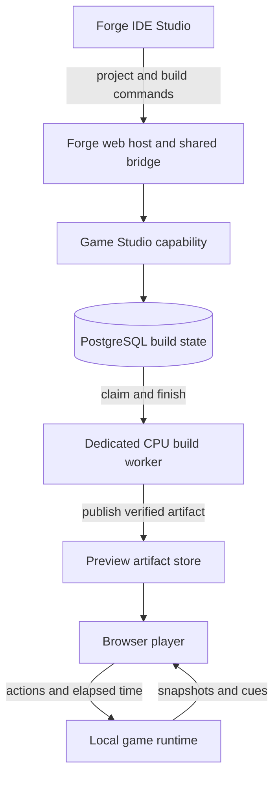
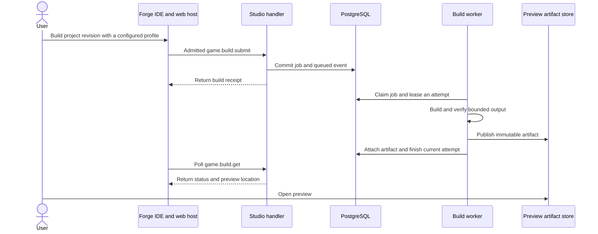

# Extending Homelab with a Rust Game Engine

Add an optional Rust game runtime to Homelab and use Forge IDE as the place to inspect projects, launch playtests, and eventually submit builds. Run the game on the player's device. Mission Control can coordinate builds and publish artifacts, while PostgreSQL records durable build state. A first playable version needs only a headless runtime, one versioned level, and a small browser preview.

**Planning baseline** — GitHub `main` at `01b6bf7` on 2026-11-17. The proposed first target is a single-player 2D browser game so it can be opened from the portal. A native Linux player is a second host for the same runtime. Timings below are design targets.

## What Homelab already provides

| Existing component | What the game engine can reuse |
| --- | --- |
| Typed envelopes, the shared bridge, and optional registrars | Register game project and build operations at the composition root with capability-owned request and response types. The runtime itself can use ordinary Rust construction. [Module authoring](https://github.com/roachmaster/homelab/blob/01b6bf7e2c355c63cf008d198a5c1cca4d4a0c9a/docs/architecture/module-authoring.md) · [Bootstrap](https://github.com/roachmaster/homelab/blob/01b6bf7e2c355c63cf008d198a5c1cca4d4a0c9a/docs/architecture/bootstrap-registrars.md) |
| Earlier game-framework experiment | Reuse its separation of authoritative state, typed intent, and ordered effects. Scope receipts to durable commands. Identify gameplay effects by tick and sequence so replay can reproduce them without playing the same sound twice. [Game framework review](https://github.com/roachmaster/homelab/blob/01b6bf7e2c355c63cf008d198a5c1cca4d4a0c9a/docs/reviews/forge/forge-game-framework.md) |
| Forge IDE and generated browser assets | Reuse admitted project aliases, bounded source inspection, Rust-owned browser state, and generated HTML/CSS/JS. Managed edits are specific to the existing Workbench path. Scene editing needs its own revision and validation contract. [IDE web generator](https://github.com/roachmaster/homelab/blob/01b6bf7e2c355c63cf008d198a5c1cca4d4a0c9a/src/rust/forge-ide-web/README.md) · [Host command bindings](https://github.com/roachmaster/homelab/blob/01b6bf7e2c355c63cf008d198a5c1cca4d4a0c9a/src/rust/forge-ide-web-host/src/service.rs) |
| Hosted dispatch and Mission Control runner | Reuse session admission, CSRF checks, request correlation, and the pattern of a quick receipt followed by polling. The tracked runner's Postgres store is inference-specific. The local Forge jobs module is a volatile, manually advanced counter. [Web host](https://github.com/roachmaster/homelab/blob/01b6bf7e2c355c63cf008d198a5c1cca4d4a0c9a/src/rust/forge-ide-web-host/README.md) · [Runner store](https://github.com/roachmaster/homelab/blob/01b6bf7e2c355c63cf008d198a5c1cca4d4a0c9a/deploy/mission-control/agent-runner/queue_store.py) · [Local jobs](https://github.com/roachmaster/homelab/blob/01b6bf7e2c355c63cf008d198a5c1cca4d4a0c9a/src/rust/forge-local/JOBS.md) |

The workspace manifest at this revision has no game-engine crate. Main contains the initial runner migration and an inference-specific claim path, while its portal contains Chat and Mail client paths. The separate local `feature/forge-chat-history` branch at `5c7f64c` carries migrations through `0007` and a GPU worker. Reconcile runner and migration provenance before introducing a game-build schema. [Workspace manifest](https://github.com/roachmaster/homelab/blob/01b6bf7e2c355c63cf008d198a5c1cca4d4a0c9a/src/rust/Cargo.toml) · [Main SQL migrations](https://github.com/roachmaster/homelab/tree/01b6bf7e2c355c63cf008d198a5c1cca4d4a0c9a/deploy/mission-control/sql/migrations)

## Package layout and ownership

Start with two crates and one example. The engine owns the rules and fixed clock. Each platform host owns wall time, input capture, drawing, and device lifecycle. The game owns the level, movement rules, and win condition.

```text
src/rust/
  forge-game-runtime/             clock, input, scene, world, events, snapshots
  forge-game-web/                 browser canvas, frame callbacks, WASM glue
  examples/forge-game-demo/       one playable level, game rules, replay fixture
  forge-game-desktop/             later, Linux windows/input and GPU renderer
  forge-game-studio/              later, project metadata and build orchestration
```

In `forge-game-runtime`, start with focused Rust modules and typed IDs. `clock` advances fixed ticks, `input` queues normalized actions, `scene` validates versioned authored data, `world` owns mutation, and `events` and `snapshot` expose the results. Keep game rules in the example through a small local rule interface and keep browser types inside `forge-game-web`. Extract an asset-cooking package when multiple games or targets need the same importer or pack format. Add another crate when it owns a distinct dependency or lifecycle.



Ship the initial browser preview from a reviewed build. Add Studio and the queue when building from the portal saves a concrete workflow step. Native Linux runs the same level locally through a desktop host. Mission Control can run headless replays and CPU builds. Forge GPU is an optional graphics test target with its own resource budget. Interactive play and CPU builds work while Forge GPU is off.

## In-process engine API

The API below is a Rust-shaped sketch. The first contracts to stabilize are tick input, authored level validation, and read-only view data.

```text
Engine::new(config: TickConfig, level: ValidatedLevel, rules: GameRules) -> Result<Engine, InitError>
Engine::advance(&mut self, elapsed: Duration, actions: &[ActionEdge]) -> FrameOutcome
Engine::set_paused(&mut self, paused: bool)
Engine::snapshot(&self) -> &WorldSnapshot

When introducing streaming:
Engine::stage_level(&mut self, level: PreparedLevel) -> Result<(), StageError>
```

| Contract | Proposed behavior |
| --- | --- |
| `ActionEdge`, `TickInput` | The platform maps keys and on-screen touch controls to the same named actions. The runtime buffers press and release edges across frames with no tick, then consumes them once at the first eligible tick. Held state is tracked separately. Focus loss clears held state and pending input. A replay supplies canonical per-tick input. |
| `ValidatedLevel`, `PreparedLevel` | Validate the schema, dimensions, spawn position, references and resource bounds before activation. A later loader prepares a specific asset generation off the tick path. The simulation publishes it at a tick boundary if it is still the requested generation. |
| `WorldSnapshot`, `FrameOutcome` | Return read-only previous/current views, interpolation fraction, completed tick index, ordered effect values and catch-up statistics. Rendering interpolates positions for display. Gameplay and collision read authoritative tick state. |
| `GameRules`, `GameEvent` | Rules act on controlled world state. Applying input, moving entities and resolving collisions precede trigger and goal evaluation. Presentation receives events after snapshot publication. Identify each event by play session, tick and within-tick sequence. |

At 60 Hz a tick represents about 16.67 ms of simulation. Use an accumulator that preserves fractional time. Start with at most four catch-up ticks per browser frame and report discarded time after a hitch. Reset elapsed debt when a paused or backgrounded player resumes. Keep the published snapshot's y-up entity and event coordinates and let the canvas adapter map them to y-down pixels. The [physics proposal](forge-game-physics.md) defines a y-down fixed-point simulation space and converts at the snapshot boundary. The [asset pipeline proposal](forge-game-asset-pipeline.md) stages levels and collision data outside simulation and records when the runtime activates them.

## Platform and library APIs

| Layer | API | Use in Homelab |
| --- | --- | --- |
| First browser target | Canvas 2D, `requestAnimationFrame`, DOM keyboard and focus events | Draw tiles and sprites on the main thread. Rust/WASM receives elapsed time and normalized input and returns view data. Generate the thin browser adapter and shell from the same style of typed declarations used by Forge. [WHATWG canvas](https://html.spec.whatwg.org/multipage/canvas.html) · [WHATWG animation frames](https://html.spec.whatwg.org/multipage/imagebitmap-and-animations.html#animation-frames) |
| Native Linux host | `winit` `ApplicationHandler` and window/input/redraw events | Compose the window and event loop in `forge-game-desktop`. Turn window events into engine actions and keep redraw separate from fixed simulation ticks. Select a stable version and use its lifecycle docs when implementing. [winit API](https://docs.rs/winit/latest/winit/application/trait.ApplicationHandler.html) |
| GPU rendering | `wgpu` adapter/device selection, surface configuration, render passes, queue submission and presentation | Add after the 2D renderer exposes a concrete need. Use native backends on Linux and test a browser WebGPU target separately if needed. Select supported limits and recover when a surface is resized or unavailable. Canvas 2D gives the initial preview a simpler dependency profile. [wgpu backends](https://wgpu.rs/) · [Surface API](https://docs.rs/wgpu/latest/wgpu/struct.Surface.html) |
| Rigid bodies | `rapier2d` physics pipeline, fixed integration step, scene queries and position-based kinematics | Use simple tile collision first. Add Rapier for a moving-platform or rigid-body milestone. Gameplay supplies kinematic targets before stepping. The solver owns dynamic body transforms, and the renderer reads the resulting snapshot. [Simulation structures](https://rapier.rs/docs/user_guides/rust/simulation_structures/) · [Rigid bodies](https://rapier.rs/docs/user_guides/rust/rigid_bodies/) |
| Audio | Web Audio or CPAL | Send a typed, predecoded cue from the browser player after user activation. Add CPAL for native audio output when needed, with a bounded handoff to the audio callback. Audio work must meet its own buffer deadline and avoid filesystem I/O on that callback. [Web Audio](https://www.w3.org/TR/webaudio/) · [CPAL](https://github.com/RustAudio/cpal) |
| 3D assets | Khronos glTF 2.0 | Add an offline importer when moving to 3D. Convert spaces and validate limits at import, then cook meshes, textures and animations into versioned runtime data. The engine controls its runtime asset IDs and lifetimes. [glTF specification](https://registry.khronos.org/glTF/specs/2.0/glTF-2.0.html) |

## Forge project and build APIs

Keep control operations behind the existing `POST /forge/v1/dispatch` gateway, using the existing header-routed command protocol. New `Forge-Destination` values below are proposals. Carry the existing envelope and contract version and request ID headers, with the authenticated session and CSRF token. A typed `ProjectRef` names the configured node and project aliases. The binding checks that the typed body matches the destination and admits that project before effects. The current browser header allowlist gives inspection-specific headers special handling, so any expansion of those headers must be explicit. [Request contract](https://github.com/roachmaster/homelab/blob/01b6bf7e2c355c63cf008d198a5c1cca4d4a0c9a/src/rust/forge-ide-web-host/README.md#request-contract) · [HTTP adapter](https://github.com/roachmaster/homelab/blob/01b6bf7e2c355c63cf008d198a5c1cca4d4a0c9a/src/rust/forge-ide-web-host/src/http.rs)

| Destination | Request DTO | Response and effect |
| --- | --- | --- |
| `game.project.list` | Bounded page cursor | Authorized game project aliases and supported profiles. |
| `game.project.get` | `ProjectRef` | Admitted revision, available build profiles and latest accessible artifact. |
| `game.build.submit` | `ProjectRef`, immutable source revision, configured profile, idempotency key | `BuildReceipt` with build ID and state after commit. Matching repeats return the prior receipt. A key reused for different input returns a conflict. |
| `game.build.get` | `ProjectRef`, build ID, optional event cursor | `BuildStatus` with state, bounded diagnostics, latest event cursor and artifact metadata when ready. |
| `game.build.cancel` | `ProjectRef`, build ID | Receipt for requesting cancellation. Completion and cancellation resolve through a guarded state transition. |
| `game.artifact.get` | `ProjectRef`, build ID | `ArtifactRef` with content hash, byte size, target and an authorized preview location. Preview bytes go through the artifact-serving boundary. |

For the first Studio build flow, implement project lookup, build submission and status. Add cancellation once the worker supports it and add artifact metadata with the first preview release. During CI-only playtests, a configured preview link supplies a useful Studio view before this command set exists. Gameplay input, physics, save points inside a level, rendering and audio stay within the player. Future multiplayer would need its own identified session and synchronization protocol.

### Build data and worker lifecycle

- **DTOs** carry bounded external data such as `SubmitBuildDto`, `BuildReceiptDto`, `BuildStatusDto`, and `ArtifactRefDto`. Translate them at the host boundary. A build profile is a server-selected configuration and resolves to a fixed toolchain, target and resource limits.
- **Domain state and DAO** belong to the Studio capability. An owned `BuildStore` port can expose `enqueue`, `get_for_project`, `request_cancel`, `claim`, and `finish`. Its Postgres DAO owns tables for builds, ordered build events, and artifact metadata in a game schema. Use dedicated producer and worker permissions. Keep build output bytes in an artifact directory or object store keyed by content hash.
- **Durable dispatch** writes the job and its initial event in one short transaction. The worker claims a row in a separate transaction using a bounded lease and an attempt token. It builds a pinned revision outside the transaction, and finishes only if its attempt is still current. Expired claims can be retried under a bounded policy. `NOTIFY` can wake a worker and a periodic scan recovers missed wakeups. The database rows carry the durable state. [PostgreSQL locking clauses](https://www.postgresql.org/docs/current/sql-select.html#SQL-FOR-UPDATE-SHARE) · [PostgreSQL NOTIFY](https://www.postgresql.org/docs/current/sql-notify.html)
- **Execution and publication** start with reviewed repositories and configured profiles. Run worker processes under a dedicated account in disposable work directories, with time, disk, log and concurrency limits and without portal or inference credentials. Repo build scripts can execute code. Supporting arbitrary projects would require an isolated execution environment and its own admission policy. Verify and publish an immutable artifact before committing the pointer. If the worker dies between those operations, an unreferenced object can be reclaimed after a retention window.



## Portal integration

The [worker ownership proposal](forge-worker-ownership.md) specifies the
messages for a playtest with main-thread rendering, Rust authority, and
JavaScript I/O workers. It also traces admission and status for Studio's
later native build milestone.

Add a generated `/design/game-studio` page to the existing Design index if this proposal should be visible on the portal. Follow the Rust design renderer and its fixed asset routes. The operational Studio view can later live beside Chat, Mail and Workbench. Let it reuse the authorized project selector and keep the selected project, revision and build ID in the existing Rust-owned workspace model. Scope those fields to Studio so returning from a preview can restore the tools the user was working with. [Design renderer](https://github.com/roachmaster/homelab/blob/01b6bf7e2c355c63cf008d198a5c1cca4d4a0c9a/src/rust/forge-ide-web-host/src/design/mod.rs) · [Design asset routing](https://github.com/roachmaster/homelab/blob/01b6bf7e2c355c63cf008d198a5c1cca4d4a0c9a/src/rust/forge-ide-web-host/src/assets.rs) · [Portal UI declarations](https://github.com/roachmaster/homelab/blob/01b6bf7e2c355c63cf008d198a5c1cca4d4a0c9a/src/rust/forge-ide-web/src/generate/application.rs)

Serve executable game previews from a separate origin with its own access policy. Navigate in the same tab with a return path to Studio. Preserve the portal's session and browser state, and keep its credentials on the portal origin. Use immutable preview builds and a digest-bearing manifest so a user can tell exactly what is running. Desktop and narrow-browser tests should exercise leaving, returning, and recovering the selected build.

## Delivery and acceptance

| Milestone | Deliverable | Acceptance evidence |
| --- | --- | --- |
| 1. Headless engine and browser playtest | A bounded authored tile room with movement, one key, a locked exit, and restart. Forge can link to a reviewed preview. | Headless replay reaches the same goal tick for the same inputs. A short tap survives a zero-tick render frame and fires once. Invalid level data never activates. A 250 ms hitch caps work and reports dropped time. Blur and return clear stuck input. |
| 2. Runtime resource handoff | A second room prepared asynchronously, with one cue on successful entry. | Delay the load and confirm the current room stays playable, the exit stays blocked, and the cue fires once after commit and crossing. Reject a stale generation. Measure peak memory during the overlap of both rooms and staging. |
| 3. Studio build and preview | One configured project can submit an immutable revision and open its published preview. | Denied project causes zero jobs. A duplicate submit returns the same job. A worker crash preserves the receipt and permits bounded retry. A stale worker cannot publish a completion. An authorized playtest opens the exact artifact and Back restores Studio. |
| 4. Platform expansion | Native Linux host, then GPU renderer, physics, or richer asset tooling as selected by the next game. | Capture frame time and worst-case stalls on target hardware. Record CPU simulation and submission, GPU time where available, waits/present, and peak memory on cold and warm runs. Introduce multiplayer only with a defined gameplay requirement. |

The first implementation step is to add `forge-game-runtime` with the fixed clock, input buffer, versioned level validation, and a headless replay of the key-and-exit room. Then add the browser adapter. That sequence gives the project testable gameplay contracts before asset streaming, build orchestration or graphics hardware become dependencies.

The runtime design draws on Jason Gregory, *Game Engine Architecture*, second edition (CRC Press, ©2015), §§6.2, 7.4–7.6, 8.3–8.5, 15.3–15.7. The Study Notes checkout contains the detailed guides and the streaming-door worked example under `studies/gregory-game-engine-architecture-2e-2015/`, and the workflow under `.agents/skills/design-game-engine/`. [Study Notes repository](https://github.com/roachmaster/study-notes)
