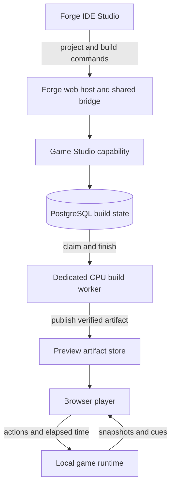
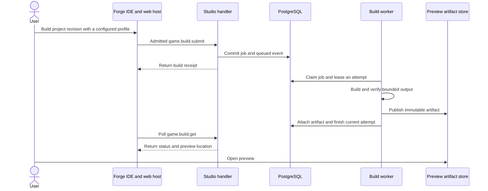

# Extending Homelab with a Rust Game Engine

**Implementation reference — reviewed 18 November 2026 against repository source.**
The browser playtest, offline asset cooker, fixed-point controller, replay system
and optional Studio service are implemented. This is a source-status review;
enabling a service or retaining a replay archive is a separate deployment choice.
The initial 17 November proposal is retained in Git history rather than presented
as the current API.

## What Homelab already provides

| Component | Implemented responsibility |
| --- | --- |
| `forge-game-runtime` | Dependency-free Rust room simulation: fixed clock, edge/held input, entity identities, tile puzzle and platform mode, contacts, animation and queries. |
| `forge-ide-web` playtest exports | Versioned world/pose/diagnostic buffers, validated asset delivery, level activation and bounded replay recording/import/playback. |
| Generated native web host | `/playtest`, fixed same-origin asset routes, verified cooked generations, optional alternate bytes and digest-addressed replay archive. |
| Python asset cooker | Validated authored levels, a 4x illustrated Scout atlas, canonical JSON, dependency/digest manifest and atomic generation publication. |
| Optional Studio service | PostgreSQL jobs/events, pinned static-web packaging, lease/attempt guards, cancellation and signed preview links. |

Source: [runtime](https://github.com/roachmaster/homelab/tree/main/src/rust/forge-game-runtime/src),
[playtest boundary](https://github.com/roachmaster/homelab/blob/main/src/rust/forge-ide-web/src/playtest.rs),
[cooker](https://github.com/roachmaster/homelab/blob/main/src/python/game-assets/README.md),
[Studio](https://github.com/roachmaster/homelab/blob/main/deploy/mission-control/studio/README.md).

## Package layout and ownership

The actual runtime is `forge-game-runtime`; browser exports live in
`forge-ide-web`, and the generated Canvas/I/O adapters live in
`forge-ide-web-host/src/design/playtest_*`. There is no separate
`forge-game-web`, `forge-game-desktop`, `forge-game-studio` Rust crate or
`Engine<GameRules>` plugin API in this implementation.

Room One is the four-direction key-and-exit puzzle. Traversal Yard exercises
gravity, jumping and swept tile contacts. Both use the same fixed clock and
publication boundary. Main JavaScript owns device capture, focus, Canvas and
image decoding. Page-hosted Rust/WASM owns game intent, simulation, validation,
activation, animation and replay. A page-scoped generated I/O worker fetches
WASM and cooked bytes; it does not own simulation or a shared global registry.

Native web-host dependencies follow the registrar/freeze/factory/provider
assembly. Pure `Room`, `Assets`, `Loader` and replay state use ordinary Rust
construction because they own no effectful runtime dependency. The native host
owns asset and relay instances; browser teardown owns its worker and pending I/O.

The diagram combines the implemented optional Studio service and browser player.
It is not evidence that Studio is enabled on a particular portal. CPU packaging
and local gameplay do not require the Forge inference GPU.

## In-process engine API

The following names exist in source; the original `Engine::new` sketch is not a
public API to copy.

| Contract | Current behavior |
| --- | --- |
| `Room::input`, `Action`, `EffectiveInput` | Queue bounded press/release edges; preserve short taps across zero-tick frames; record the canonical input applied per tick. |
| `Room::advance`, `step_one_tick`, `clear_input`, `restart` | Run 60 Hz fixed ticks, cap catch-up at four, retain fractional time, expose dropped work, and reset input/elapsed debt on lifecycle boundaries. |
| `Level::validate`, `LevelSpec`, `Loader` | Validate bounded authored data, retain the newest prepared candidate, reject stale generations and replace the room at a tick boundary. `Loader` is internal to the web boundary. |
| `physics::Character`, `MotionFrame`, `Room` queries | Q16 y-down platform motion, X/Y tile sweeps, bounded step-up, grounded/contact edges, filtered ray queries and phantom overlap. |
| `PlayerPose`, FGS1, FGP1, FGC1 | Publish Q8 y-up world data, a same-epoch/tick/player 32-byte pose, and separate collision diagnostics. Keep the version-1 world entity record stable. |

Source: [runtime API](https://github.com/roachmaster/homelab/blob/main/src/rust/forge-game-runtime/src/lib.rs),
[physics](https://github.com/roachmaster/homelab/blob/main/src/rust/forge-game-runtime/src/physics.rs),
[queries](https://github.com/roachmaster/homelab/blob/main/src/rust/forge-game-runtime/src/queries.rs),
[wire layout](https://github.com/roachmaster/homelab/blob/main/src/rust/forge-ide-web/src/playtest_wire.rs).

## Platform and library APIs

| Layer | Current status | Remaining work |
| --- | --- | --- |
| Browser player | Implemented Canvas 2D and generated browser lifecycle adapter around local Rust/WASM. | A dedicated simulation-worker placement is not shipped. |
| Native Linux / GPU renderer | No `winit`/`wgpu` game host is implemented. | Select and validate a host only when a game needs it. |
| Physics | Implemented fixed-point character controller and tile/room queries. | General dynamic bodies, joints, stacking, sleeping, slopes and a Rapier adapter are not shipped. |
| Art and animation | The 4x illustrated Scout atlas is cooked; runtime selects idle/walk/rise/fall/landing frames. | Combat, climbing, rope, ladder, ledge and barrel artwork is not proof of playable mechanics. |
| Audio / 3D / networking | Not implemented by this game slice. | Separate audio lifecycle, 3D importer/rendering and multiplayer protocols remain future work. |

The [physics reference](https://github.com/roachmaster/homelab/blob/main/docs/architecture/proposals/forge-game-physics.md)
and [asset reference](https://github.com/roachmaster/homelab/blob/main/docs/architecture/proposals/forge-game-asset-pipeline.md)
record the actual current contracts and limits.

## Forge project and build APIs

The Rust web host admits Studio commands only when its optional Studio relay is
configured. It checks session, origin, CSRF, destination/body correlation and
project grants before forwarding to the private Python API. The private API then
checks its own configured project, revision and profile.

| Destination | Current request | Current result |
| --- | --- | --- |
| `game.project.list` | Request ID; no caller-supplied filesystem path or page cursor. | Bounded configured project/profile catalog filtered by host grants. |
| `game.project.get` | Node/project aliases. | Configured project and approved revision/profile. |
| `game.build.submit` | Aliases, exact revision, `static-web` profile and idempotency key. | Durable build ID and state; matching retries reuse it, changed intent conflicts. |
| `game.build.get` | Aliases, build ID and optional event cursor. | Project-scoped state and ordered bounded events. |
| `game.build.cancel` | Aliases and build ID. | Atomic cancellation invalidates a queued/running attempt; terminal states remain terminal. |
| `game.artifact.get` | Aliases and succeeded build ID. | Digest/size metadata and a signed preview URL on the configured separate origin. |

### Build data and worker lifecycle

The actual DAO is Python `studio_store.Store`, with `submit`, `status`, `cancel`,
`claim`, `renew` and `finish`. SQL lives in `deploy/mission-control/studio/schema.sql`
and uses the `forge_game` schema with separate API/worker role grants. Jobs and
ordered events commit in short transactions; the worker polls the queue rather
than relying on `NOTIFY` as a durable dispatcher.

A claim uses a 30-second lease and unique attempt token. Expired claims retry up
to three total attempts. Only the current unexpired attempt can attach an
artifact. Cancellation clears the token before returning. The worker checks the
source recipe and approved profile, reads an exact local Git revision, and
packages the configured subtree. It executes no project build scripts. The
`static-web` profile requires an existing `index.html`, permits at most 256 files
and a 16 MiB artifact, and publishes by digest. General compilation, arbitrary
repository execution, object storage and artifact reclamation remain future work.

Here “build and verify” means the bounded static-web packaging operation above.
The preview listener verifies recorded artifact bytes and a signed link valid
for 15 minutes. API, worker and preview are separate processes with scoped
credentials. Source: [service](https://github.com/roachmaster/homelab/blob/main/deploy/mission-control/studio/studio.py),
[Store](https://github.com/roachmaster/homelab/blob/main/deploy/mission-control/studio/studio_store.py),
[artifacts](https://github.com/roachmaster/homelab/blob/main/deploy/mission-control/studio/studio_artifact.py),
[host relay](https://github.com/roachmaster/homelab/blob/main/src/rust/forge-ide-web-host/src/studio.rs).

## Portal integration

`/design/game-studio` is this reference. `/playtest` runs the local game, and
`/studio` serves the separate Studio client. A link to Studio does not mean its
optional private API, database and preview origin are configured on the live host.

The IDE and playtest preserve Rust intent ownership. Studio is an explicit
remaining authoring gap: its `MAIN` and `WORKER` JavaScript strings currently own
client orchestration, polling and tab-local selection/build state. The Rust host
owns admission, but there is no Studio Browser Rust/WASM controller yet. Moving
that intent into typed Rust and the reusable generated adapter is future work.
[Studio client source](https://github.com/roachmaster/homelab/blob/main/src/rust/forge-ide-web-host/src/design/studio.rs).

Studio revalidates its catalog after reconnect and retains its selected project,
revision and build ID in the tab. Executable previews use a separate configured
origin; portal credentials stay on the portal origin.

## Delivery and acceptance

| Slice | Source implementation | Evidence and remaining limit |
| --- | --- | --- |
| Headless room and browser game | Implemented Room One, Traversal Yard, fixed clock, input and validated levels. | Native runtime tests, actual-WASM playtest wire checks and the browser journey exercise the slice. No performance claim follows from inspection. |
| Assets, physics and animation | Implemented cooker/manifest, 4x atlas, controller, contacts, queries and FGP1 pose. | Tests cover digest/generation rejection, optional-art fallback, the 29-tick jump and authored Traversal Yard completion. |
| Replay and level handoff | Implemented bounded session recording, transitions, separate playback and historical asset acquisition. | Full exports are capped at 36,000 ticks, 128 segments and 2 MiB. Historical acquisition requires a configured retained archive. |
| Studio | Implemented optional host relay, private service, Store, static-web worker and signed previews. | Disposable integration tests cover admission, idempotency, cancellation and lease guards. A live configuration must be verified separately. |
| Expansion | Native/GPU hosts, general body solver, playable combat/climbing, audio, 3D and multiplayer are future work. | Define a concrete game requirement and its own contracts before adding a dependency. |

This page records implementation status and test locations. Fresh execution
results, browser screenshots and deployment checks belong to the current QA
run, not to a prose claim copied from an earlier release.

The design applies Jason Gregory, *Game Engine Architecture*, second edition,
chapters 6, 7, 12 and 15. The Study Notes repository retains its study guides and
original design rationale. [Study Notes](https://github.com/roachmaster/study-notes).
