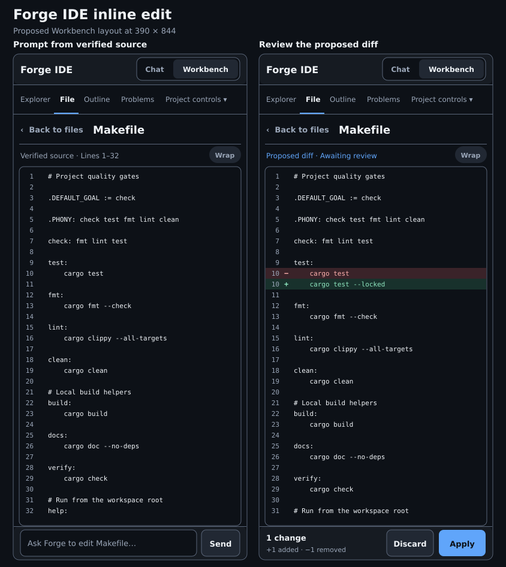
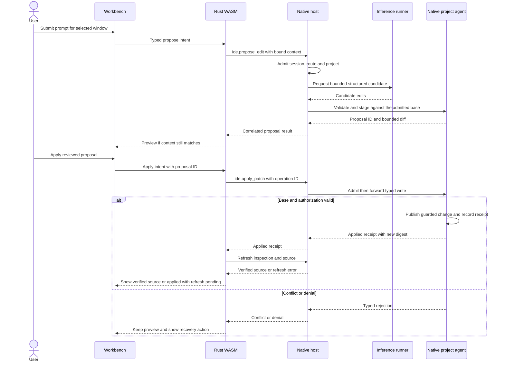
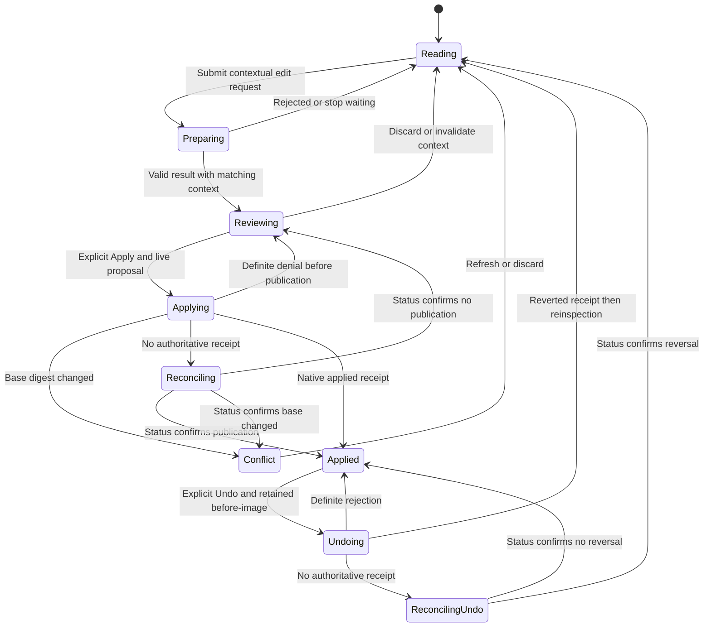

# Forge IDE inline edit

**Design proposal.** This adds a Workbench prompt and a staged, single-file diff to Forge IDE. Chat remains the place for longer conversations. The [editable wireframe](../../design/forge-ide-wireframes/forge-ide-inline-edit-mobile.svg) shows the prompt and review states at a 390 px phone width.

## Workbench layout

| State | Source pane | Bottom dock |
| --- | --- | --- |
| Reading | Verified source, existing line numbers and Wrap | One row with **Ask Forge to edit Makefile…** and **Send** |
| Preparing | Verified source stays readable | **Preparing proposal…** with an optional **Stop waiting** action |
| Reviewing | Inline diff shows unchanged context and separate **−** and **+** rows with old and new line numbers | **Discard** and **Apply** beside a short change summary |
| Base changed | Proposal remains reviewable with a conflict banner | **Refresh source** and **Discard**. Apply is unavailable. |
| Applied | Freshly verified source after inspection and read complete | **Undo edit** while the applied revision is eligible for reversal |

On desktop, dock the row under the central File pane and leave Explorer and secondary panes in place. On phones, put the dock below the scrollable source area. Reserve space for it and the safe-area inset so it never covers the last line. Use a roughly 48 px idle row and a 44 px minimum touch target. Measure visible lines on the same Makefile fixture at 390 × 844. The current 32-line measurement precedes this dock. Use 28 visible unwrapped lines as the initial target.

Keep **Wrap**, the selected pane, and keyboard focus behavior. A named **Ask Forge** action can open the dock. An optional desktop shortcut should use the same action and remain configurable where it conflicts with a browser shortcut. Make the diff review accessible by keyboard. Announce proposal ready, conflict, and applied states without moving focus out of the user's current control. Use text markers and line numbers alongside diff colors. A preview may reuse the renderer's numbered text rows, but it needs distinct diff row types so a source highlight retains its current meaning.

## Existing contracts and delivery order

1. **Contextual prompt.** Put the dock on the existing generated Workbench. WASM owns the active conversation and captures the selected file reference, accepted report identity, digest, line window, and bounded excerpt at submit time. Show the attached window in the UI. A change of file while a reply is pending must leave that reply in its originating Chat thread. In this phase, label the action **Ask Forge about Makefile…** and return a text reply. The edit label is for Phase 2.
2. **Stage and apply a diff.** Add an independently versioned structured proposal contract and explicit write admission. Release preview and discard against a read-only fixture first. Enable Apply and Undo on a write-enabled project once the native revision, journal, and recovery checks pass.

Forge currently supports digest-checked source reads through `ide.source`, a bounded `PreparedChat` text transcript through `ide.chat`, and a generated source viewer with line highlights. The Chat and Workbench docks can share the same active thread within the browser session. The runner persists runs and messages in PostgreSQL, but the IDE compatibility route sends a transcript snapshot per turn and the browser lacks conversation-list and reload hydration. Durable conversation identity and reopening require their own contract. [Source behavior](../../../src/rust/forge-ide-web/WORKBENCH.md#source-and-request-ownership) · [Current wire protocol](../../../src/rust/forge-ide-ui/src/protocol.rs) · [Runner persistence](../../../deploy/mission-control/agent-runner/README.md)

## Proposed data and ownership

| Contract | Contents and authority |
| --- | --- |
| `EditContext` | Admitted node, project, report token and entry ID. Base SHA-256 and exact line-window coordinates. Display path and a bounded excerpt for inference. The display path carries no filesystem authority. |
| `EditProposal` | Native-issued opaque proposal ID, owner/session binding, base identity, expiry, and a bounded diff projection. The native service keeps the canonical candidate bytes. A conversation message can reference the proposal ID for navigation. |
| `ApplyPatch` | Proposal ID and client operation ID. No path or replacement bytes. The native write agent resolves the staged file through its admitted project and checks ownership, operation ID, expiry, and base revision. |
| `UndoPatch` | Applied operation ID and a new operation ID. Requires the current file digest to match the recorded applied digest and an available before-image. |
| `WriteReceipt` | Operation ID, typed outcome, and resulting digest on success. Status lookup by operation ID reconciles a lost response without starting a second write. |

The generated main thread owns the prompt input, focus, dock geometry, and safe text rendering. WASM owns conversation routing, file and report identity, proposal lifecycle, and typed effects. The generated worker sends only admitted effects. The native host independently checks session, CSRF token, destination, deadline, and per-project policy. The write agent independently checks project and operation authority before accessing disk. The model returns a candidate and has no write or shell capability in this design.

## UML sequence — propose and apply

## UML state — one edit proposal

**Discard** clears the staged review without touching disk. **Undo edit** is a separate guarded write after Apply. Switching from Workbench to Chat alone preserves the proposal. Selecting another file or refreshing its base detaches the review from the current pane and rejects late replies against that context. An in-flight write remains tracked by operation ID until its outcome is known.

## Native write and recovery rules

- Start with one existing regular text file in a write-enabled project. The staged replacement must match exact base bytes, remain within source limits, and preserve line endings and bytes outside the authorized edit. Reject invalid, ambiguous, expired, or oversized candidates before creating an actionable preview.
- Recheck the file identity and current digest at the publication boundary. Use a native-owned write workspace that can enforce the writer fence from validation through atomic replacement. A digest check followed by an atomic rename alone leaves a race with other writers. Keep Apply unavailable where that fence cannot be enforced.
- Persist the operation ID, base and expected result digests, and a bounded before-image in the native write journal. Make the receipt recoverable across a lost response or process restart. A replay of the same request returns or reconciles the original operation. A reused ID with different input is rejected. Leave ambiguous recovery in **Reconciling**.
- On Apply or Undo success, invalidate the original inspected revision and re-read via the verified source path. If the user has opened another file or project, retain its current view and attach the receipt to the original operation. A refresh failure can follow a successful write. Show that distinction and offer refresh recovery. An intervening edit blocks Undo. Expired before-images remove the Undo action.

## Acceptance before enabling writes

- The Workbench prompt and Chat show the same in-session turn. File switching and late replies preserve the originating thread. Phase 1 sends no write effect.
- The diff accurately shows additions and deletions and preserves source text and Wrap. Discard performs no filesystem mutation. Mobile keyboard and touch checks cover the dock, focus, and bottom source visibility.
- Apply rejects wrong session, project, file identity, CSRF, expired proposal, base drift, and operation-ID mismatch before publication. Test concurrent Apply, response loss, restart, refresh failure, and Undo after a later edit.
- Run native contract tests, real-WASM tests, and the browser acceptance suite with owned fixtures. The diagrams and wireframe document proposed behavior.
