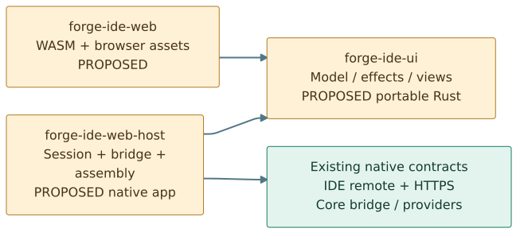
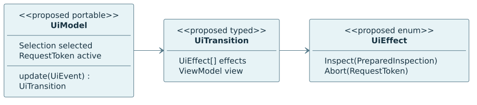
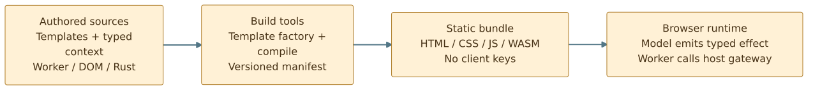
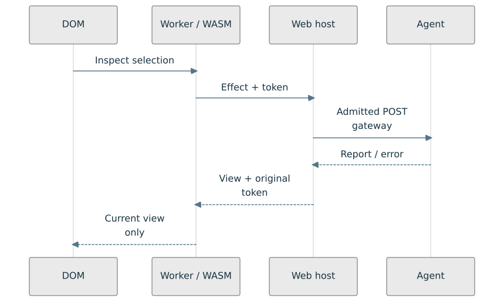
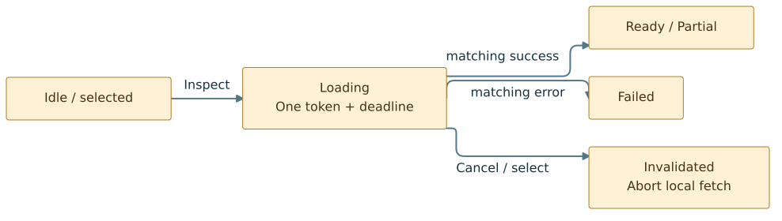
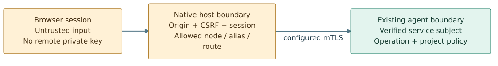

# Forge IDE UI: a proposed browser boundary, not a new backend

**Status: design proposal — 2 November 2026. No browser application or web host is implemented by this document.**
Baseline: public [homelab `175315b`](https://github.com/roachmaster/homelab/tree/175315b4fe1c993f15bb2ff52d824ee4cdaecc88).
[Visual PDF](forge-ide-ui.pdf) · [PDF rebuild guide](forge-ide-ui-pdf.md) ·
[Mermaid/SVG gallery](../diagrams/mermaid/README.md#forge-ide-ui-proposal) ·
[Existing agent](../../../src/rust/forge-agent/README.md).
The earlier [remote IDE PDF](remote-ide-proposal.pdf) remains an unchanged historical design; this report adds the proposed UI boundary on top of the now-implemented agent.

## 1. Recommendation and present baseline

Build **one read-only inspection journey**: choose an allowed node/project alias, inspect, navigate the returned file tree and Rust declaration outline, and understand partial results or failure. Reuse the Forge pattern: Rust owns application state and use-case decisions; generated assets provide the stable shell; a worker executes prepared asynchronous effects; a small DOM adapter presents typed views. No React migration, editor/LSP, arbitrary file access, remote jobs or mutations is part of this proposal.

The recommended first deployment shape is a **single-user local web host** serving its own assets and a narrow same-origin command bridge. The native host retains the remote mTLS client key; neither JavaScript nor WASM receives it. This adds a real trust boundary and admission policy, not an unrestricted reverse proxy. A multiuser or publicly exposed host requires a later identity/delegation design and is not an automatic extension of this first shape.

| Present, inspected code | New work proposed here |
| --- | --- |
| `forge-agent serve`, named-node `node.info` and `inspect` CLI | Browser shell, UI model/WASM facade, worker and DOM adapter |
| One `POST /forge/v1/dispatch`, TLS-derived subject, operation/project authorization, shared typed bridge | Same-origin host session admission and typed browser codec on the same command path |
| Native bounded `InspectTask`, declaration hierarchy and `ProjectReport`; CLI YAML output | Bounded portable report projection and navigable tree/outline view |
| Public registrars/factories/providers and real two-localhost-process tests | Public web-host capability integration, consumer proof and actual browser tests |

The current remote response is **JSON**, not CLI YAML. HTTP 200 can contain a typed application error; a browser adapter must decode the outcome, not equate `response.ok` with inspection success. The current agent has no browser asset server, session login, CORS/preflight support, arbitrary project discovery, file-body retrieval or editing API. Two localhost processes are evidence of a network boundary, not a physical-host deployment certification.

## 2. What the earlier Forge work teaches us

Mission Control is a **reference for seams, not the source of truth**. The fresh read-only review found a real Rust application-state / WASM / worker request-response loop: Rust prepared a request, the worker performed asynchronous fetch, Rust checked the response against its active request/model, and the shell applied a render view. Its native renderer assembled profile-selected embedded templates and typed context into HTML/CSS/JS, worker, WASM and manifest artifacts. Its static artifact server was separate from generation. The reviewed browser journeys used network stubs; their presence is not a fresh execution or authentication claim.

Three related approaches must not be conflated:

| Reference pattern | Useful lesson | Not a drop-in dependency or guarantee |
| --- | --- | --- |
| Mission Control embedded-template renderer | Typed UI model, prepared effects, checked response events, profile-selected assets | Different template syntax/wire protocol; internal source inclusion and product-specific catalogs should not be copied |
| Extracted Forge UI / `forge-build` integration | Portable component contracts, build-time generated resources and a small WASM shell ABI | Static site rendering and WASM shell packaging are different paths; packaging dummy WASM does not prove a running application or async agent adapter |
| Forge codegen plan/materialize/check/prune | Explicit generated artifact ownership and reviewable plans | It does not compile/test web behavior; legacy template APIs differ. The inspected stale-output marker-or-digest guard can accept edited marked output, so do not adopt its pruning or auto-push wrappers unchanged |

Use [the repository review index](../../reviews/forge/README.md) for historical context. The current source inspection supplements those reports; no unrecorded historical commit comparison is claimed. Private source, pins and operational configuration are not copied into this public proposal. All new package names and API sketches below are recommendations, not existing exports.

## 3. Cohesive packages and one-way imports



| Proposed package / modules | Responsibility and public surface | Allowed imports; exclusions |
| --- | --- | --- |
| `forge-ide-ui`: `model`, `update`, `view`, `protocol` | Pure `UiModel`, typed `UiEvent` → `UiTransition`, `UiEffect`, bounded `ReportView` and view projection. Deterministic tests, no DOM/HTTP | Portable Rust types; no `forge-agent`, `forge-ide`, native paths, cap-std, Tokio, TLS or filesystem |
| `forge-ide-web`: `wasm`, `codec`, `assets`; authored shell/worker/DOM modules | WASM facade over UI policy; versioned event/effect codec; typed asset config/factory/registrar for native build tooling, not the raw ABI | `forge-ide-ui`; optional **build-only** `forge-template` integration. Browser target must exclude build/native integration from its normal dependency tree |
| `forge-ide-web-host`: `config`, `assembly`, `session`, `gateway`, `projection`, `lifecycle` | Native application/library: public typed config, cohesive factory group + registrar, session/route admission, remote task binding and report-to-view translation | UI contract, core bridge/bootstrap/provider/task, existing `forge-ide::remote` and HTTPS adapter. Does not depend on WASM implementation; consumes versioned asset files/manifest |

These are three different change drivers: portable policy, browser mechanism/build assets, native credential-bearing composition. Keep internal roles as modules, not a crate per type. Do not introduce a generic UI framework or global `common` package first. The native host and browser facade both depend **inward** on `forge-ide-ui`; neither imports the other. Existing `forge-ide` remains a native inspection capability, not a dependency of the WASM target. Its unconditional cap-std/parser dependencies and native-name API make simply importing it into the browser the wrong starting assumption.

The native projection is intentional: `ProjectReport` describes native inspection; `ReportView` describes bounded display data. Preserve declaration/member hierarchy, counts, spans, completeness, exclusions and diagnostics rather than flattening everything into strings. Keep tagged native name encodings in the portable DTO; display escaped byte/code-unit labels without lossy identity collisions. Use stable opaque **view-local** node IDs, not filesystem paths or executable actions. Report labels, type spellings and diagnostics may be sensitive; the UI is not a redaction tool.

If a separate shared inspection-report contract becomes justified by additional consumers, extract it later with compatibility tests. Do not move all IDE/native implementation into a new shared crate merely to avoid a small, purposeful browser projection.

## 4. Typed interfaces and the versioned browser boundary



Illustrative names, **not compiled APIs**:

```rust
// In the proposed portable UI package; no IO or untyped internal values.
enum UiEvent { Select(Selection), Inspect, Cancel, Result(ResultEvent), Expand(NodeId) }
enum UiEffect { Inspect(PreparedInspection), Abort(RequestToken) }
struct UiTransition { model: UiModel, effects: Vec<UiEffect>, view: ViewModel }
// update(model, event, supplied_clock) -> Result<UiTransition, UiError>
// A pure reducer need not implement Task or provide an empty registrar.
```

`Selection` is a configured node key + project alias. The selector catalog comes only from session-filtered protected bootstrap data or a registered discovery command on the same gateway; no public node/project enumeration or per-node endpoint is introduced. The current agent has no such discovery route, so this host-owned catalog is new proposed work. `RequestToken` binds session epoch, monotonic selection/revision and request ID. `PreparedInspection` fixes the supported destination `ide.inspect@1`, typed alias, token and original deadline. It is not an arbitrary URL, HTTP request, class name or service-locator key. `ResultEvent` carries matching token/target/alias and either bounded `ReportView` or a typed error. The UI owns acceptance/stale-result rules; a worker does not decide which result becomes current.

The asynchronous browser effect adapter is not claimed to implement the existing synchronous Rust `IoClient` across a fetch promise. It shares the prepared-request/typed-result responsibility boundary; the native host still uses the actual `Task` and `RemoteIdeClient` contracts. No async change to core is required by this design.

Use a versioned, bounded browser envelope for worker/WASM/host codecs; strict tags decode into these types. JSON is boundary serialization only, not the Rust model or a `serde_json::Value` fallback. Distinguish the **browser protocol version**, the existing Forge envelope/route versions and the report/view format version. Unknown versions/fields, duplicate routing metadata, wrong destination/body variants and excessive sizes fail closed. Version mismatch displays an update-required error, not a guessed fallback.

The same-origin host translates an admitted browser request into existing `Header` + typed payload and invokes its **shared bridge**, whose registered binding owns `RemoteInspectTask`. The task prepares the existing `InspectCall`; the injected `RemoteIdeClient` performs HTTPS. The destination agent independently checks TLS identity, operation permission and project alias permission before its rooted task. The host must validate request/correlation, target/incarnation, route/version, expiry and typed report before projecting it; do not trust browser assertions or raw HTTP success.

The upstream header projection stays authoritative: `Forge-Envelope-Version`, `Forge-Destination`, `Forge-Contract-Version`, `Forge-Target-Node`, `Forge-Target-Incarnation`, `Forge-Request-Id`, `Forge-Expires-Unix-Ms`, optional `Forge-Correlation-Id`. Browser node keys resolve only through the host's allowed configuration; supplied target/incarnation must agree, never override it. Host admission may shorten a deadline but never reset an expired one or extend the original request budget. Session/CSRF data is separate from route and business arguments.

## 5. Build output is not runtime behavior



Recommended initial build flow: authored `.forge` shell/CSS templates + typed build context → the existing bounded template renderer → isolated generated-output directory; compile the real WASM facade separately; package an explicit asset manifest. Keep handwritten worker/DOM logic as source modules copied or bundled intentionally, rather than hiding complex application logic in giant template strings. Specify asset hashes, browser ABI/protocol version and expected exports; test the emitted bundle with a real WASM module.

Use the current public `register_renderer`/factory/provider integration for the native generation capability. Do not copy the legacy `forge-build` or codegen APIs unchanged: their schema/context formats differ. An initial explicit build command is sufficient; no new generic materialization engine, automatic prune, source restoration, installation or auto-commit/push script is required. Rebuilding must not overwrite hand-edited sources. Generated output has deterministic ownership, a reproducibility check, and a clear ignored-versus-committed policy decided during implementation.

At runtime, templates do **not** render each network response into executable HTML. Rust produces typed view updates; the DOM adapter updates stable regions using text nodes and safe attributes. Retain focus, selection, scroll, expanded tree nodes and event listeners across request completion. Asset generation, native host serving and browser runtime are separate lifecycle owners.

## 6. Asynchronous request and state lifecycle



One page owns a DOM adapter and one worker; the worker owns the WASM application instance and the current fetch controller. DOM events become bounded typed messages to the worker. The WASM model yields a prepared effect; the worker performs I/O, returns completion/failure as a new model event, and publishes a view. Workers communicate by messages and cannot act as the main-thread DOM owner. [Worker ownership and messaging](https://developer.mozilla.org/en-US/docs/Web/API/Web_Workers_API/Using_web_workers).



| Event | State/behavior contract |
| --- | --- |
| Select node/alias | Advance revision, invalidate prior token/report selection; request abort for old fetch; no implicit remote invocation |
| Inspect | Require allowed selection; allocate unique token, preserve absolute expiry; one in-flight request per view; repeated click is disabled/rejected, not queued infinitely |
| Matching success | Validate version/target/alias/token and bounds; Ready or Partial according to report completeness; preserve view state only for the same report identity |
| Matching failure | Failed with actionable category: denied, unavailable, timeout/unknown completion, invalid response, limit or local cancellation |
| Stale completion/failure | Ignore for active view; release bounded message/report storage; never repaint the newer selection |
| Cancel / unmount | Invalidate token first, abort local fetch, clear pending display/owned buffers; report local stop, **not proof the agent canceled inspection** |
| Worker/WASM startup or ABI failure | Visible unavailable/error state; no remote calls; deterministic teardown/retry initiated by the user |

An explicit Retry is a new user-requested operation with a new token and budget, not an automatic resend of an expired request. A browser abort can stop fetch/body consumption; it is not a remote cancellation protocol. Existing native filesystem calls and syntax parsing are synchronous and not preemptible. Preserve this distinction even for read-only work. [AbortController](https://developer.mozilla.org/en-US/docs/Web/API/AbortController/abort).

Bound request bytes, streamed response bytes **before** full decode, decode nesting/strings, view node counts, pending messages and DOM expansion. Start with at most one pending operation and a bounded report; render collapsed branches rather than thousands of nodes eagerly. The native host uses a bounded queue and a dedicated synchronous owner for the current HTTPS client/runtime, not arbitrary async calls or unbounded per-request threads. Budget queue time, I/O and decode/validation under one original deadline. Worker/client shutdown must release buffers and subscriptions; never hold a Rust borrow across callbacks. The WASM ABI must define input/output buffer ownership, maximum lengths, reentrancy and view reacquisition after memory growth before claiming safety; growth can invalidate old JavaScript buffer views. [WASM memory growth](https://developer.mozilla.org/en-US/docs/WebAssembly/Reference/JavaScript_interface/Memory/grow).

## 7. Security: a narrow host bridge, not an open proxy



**Recommendation, not implemented security:** bind the first host only to explicitly configured loopback addresses, serve its own versioned assets, and establish an ephemeral session for the trusted local operator through a protected bootstrap flow. Keep a strict expected Host/Origin allowlist and bind requests to that session with a CSRF defense; same-origin routing or SameSite alone is not authorization. Reject missing/unexpected origin/session/CSRF on command requests before any outbound call. Never put bootstrap/session tokens in query URLs, generated static files, report logs or persistent browser storage. Exact bootstrap delivery is an implementation decision that must pass the threat tests below, not a claimed existing login system. This combines explicit origin/session checks with a CSRF defense rather than treating SameSite as a complete policy. [OWASP CSRF guidance](https://cheatsheetseries.owasp.org/cheatsheets/Cross-Site_Request_Forgery_Prevention_Cheat_Sheet.html).

Allow only `POST /forge/v1/dispatch` for supported commands. Static assets may use GET/HEAD at their own fixed paths: **the one-front-door rule applies to commands, not to every asset URL**. Do not add `/inspect`, per-task controllers or a general fetch relay. No new GET/PUT/PATCH/DELETE capability is implied; future verbs need real semantics and admission tests. Current agent metadata/body schemas remain independently validated on the upstream hop.

The native host maps an admitted session to an explicit node/operation/project allowlist, then uses a configured **service** mTLS identity. Effective access is the intersection of session grants, host configuration and the agent's service-identity grants. Never forward arbitrary destinations, certificate paths, upstream URLs, redirects or browser-supplied user identities. Validate configured endpoints/TLS names/incarnations; route knowledge is not permission. The agent sees the host service subject, **not the browser user**. Multiple users require real authentication, isolation and a reviewed delegation/least-privilege model before deployment; do not relabel the single-user bridge as that model.

Browser credentials include browser-managed TLS certificates; `fetch` is not a mechanism to safely ship the native client's private key in the page. The same-origin host is our recommended credential boundary, not a claim that direct browser mTLS is universally impossible. [Browser credentials](https://developer.mozilla.org/en-US/docs/Web/API/Request/credentials). A direct cross-origin design would additionally need deliberate preflight/credential rules; blanket CORS is not a substitute for authentication or CSRF protection. [CORS](https://developer.mozilla.org/en-US/docs/Web/HTTP/Guides/CORS).

Escape source-derived names, diagnostics and type labels as **text**, never `innerHTML`; prohibit executable URLs/markup from reports. Apply a restrictive, tested asset/content-security policy compatible with the selected WASM runtime. Render non-UTF-8 names as explicit tagged encodings, not lossy normalized paths. Do not send reports to analytics or log contents by default. Rooted inspection prevents certain symlink escapes, not hostile-source parser exhaustion, all filesystem races or secret disclosure; trusted configured projects remain the initial scope.

## 8. Bootstrap, public integration and delivery slices

Keep two composition roots distinct. **Build-tool bootstrap** uses public renderer/asset registrars, freezes their factories and generates the completed versioned bundle. **Web-host runtime bootstrap** validates typed host/session/allowed-node config and the completed asset manifest, stages selected remote-client/session/listener factories, freezes registration metadata, then invokes factories, selects host-scoped providers, injects task/client handles, registers command bindings and finally advertises readiness. The runtime host serves completed assets; it does not regenerate templates or require a normal dependency on the renderer/browser implementation. New session/asset-serving integration is proposed, not an existing core registrar API. Runtime-length node configuration stages a homogeneous factory collection, not a loop that tries to grow the registry's nested tuple type. Stop admission, drain bounded admitted work according to policy and release owned handles on shutdown; report grace exhaustion honestly.

No global registry, runtime service locator or automatically dyn-compatible GAT provider is introduced. The raw WASM ABI constructs a pure model through explicit inputs; it does not need a provider container merely to expose exports. Reusable native capabilities must expose real public typed config/factory/registrar APIs and an independent consumer import test, not example-local assembly. Factory creation, provider reuse and route registration remain separate protocols.

| Slice | Deliverable | Acceptance gate before expanding |
| --- | --- | --- |
| A — Portable model | `UiEvent`/effect/view types, reducer, bounded fixture reports | Rust tests for stale token, repeated click, cancel/unmount, partial/error, invalid versions; browser target dependency tree contains no native inspection/TLS/runtime |
| B — Real browser shell | Generated stable assets + real WASM facade/worker + targeted DOM, fake effect adapter | Actual browser journey: tree/outline, keyboard/focus, selection changes, async out-of-order failures, teardown/restart; no backend needed to prove presentation |
| C — Host admission | Public host integration + same-origin session/gateway + configured clients | Separate consumer proof; rejected origin/CSRF/target/alias has zero outbound calls; no secrets in assets; deterministic generation/no overwrite; cleanup after failed startup |
| D — End to end | Browser → host bridge → two local agent processes with ephemeral test identities | Real inspect report equals expected view; HTTP200 error handled; wrong identity/denied project/offline/oversized/deadline/stale reply/shutdown tested; no claim of physical deployment |
| Later | Multiuser/delegation, richer discovery, editing/LSP, remote jobs or other transports | Separate requirements and threat model; not authorized or implemented by this document |

**Choices still open:** exact session bootstrap, browser ABI tooling, minimal view budget/virtualization threshold, generated-artifact storage policy and eventual deployment topology. The recommended package and security invariants are stable targets; signatures and implementation details remain provisional until compile/consumer/browser contract tests prove them. Do not use this proposal to claim UI or production authentication already exists.

## Evidence and reproducibility

Current facts are grounded in the [agent composition/config](../../../src/rust/forge-agent/README.md),
[agent admitted dispatch](../../../src/rust/forge-agent/src/dispatch.rs),
[typed remote inspection conversation](../../../src/rust/forge-ide/src/remote.rs),
[native report model](../../../src/rust/forge-ide/src/model.rs),
[bounded HTTPS codec](../../../src/rust/forge-remote-https/src/ide.rs),
[template public integration](../../../src/rust/forge-template/README.md), and repository skills
[front door](../../../.agents/skills/design-forge-front-door/SKILL.md),
[package boundaries](../../../.agents/skills/design-package-boundaries/SKILL.md),
[provider wiring](../../../.agents/skills/wire-forge-providers/SKILL.md) and
[capability delivery](../../../.agents/skills/expose-forge-capability/SKILL.md).
Mission Control / UI / codegen observations are source inspection, not executed legacy tests; proposals are our synthesis of those patterns and the current contracts.

Mermaid sources and SVGs are canonical, not hand-redrawn PDF approximations.
[Rebuild and drift-check diagrams](../diagrams/mermaid/README.md#rebuild-locally).
[Rebuild/verify the PDF](forge-ide-ui-pdf.md). All browser tests above are **future acceptance gates**; this change validates documents, diagrams and links only.
