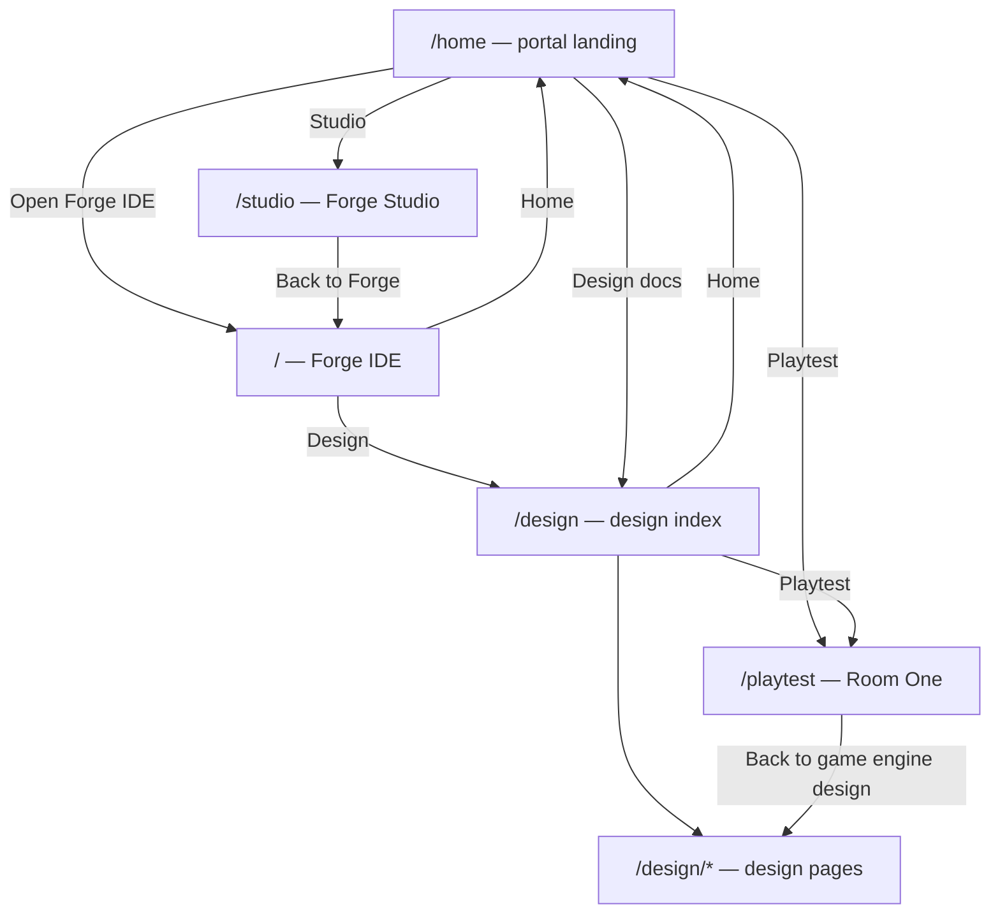

# Forge portal landing page

**Status** Implemented v1 at `/home`.
**Planning baseline:** GitHub `main` at `c57ef4b`.

## Current launcher layout

The visual revision uses a solid primary IDE action beside the Design action,
three full-card tool links with decorative line icons, and a compact grid of
five documentation links. IDE screen guidance lives with the wireframe link.
The header provides the Home wordmark and GitHub link. A compact footer carries
repository information. The page uses a static Homelab workspace label.

The Home styles are declared in Rust and scoped to this page. They provide
three dark surface levels, subtle borders, visible keyboard focus, and a
responsive launcher and documentation grid. The shared Design index retains
its own stylesheet. Follow the
[modern UI quality skill](../../../.agents/skills/design-modern-ui/SKILL.md)
when revising the layout. The remaining sections preserve the initial design
and its route and behavior decisions.

## The problem

The portal has no starting point. Every surface exists, but there is no page
whose job is to show a user what the portal contains and take them to it. The
navigation audit (main `c57ef4b`) found:

1. `/` is the IDE app shell, not a landing page (`assets.rs` maps `/` to
   `index.html`). A user who arrives at the portal lands inside the workbench
   with no orientation.
2. `/design` is the only hub page, and it is scoped to design documents: four
   topic panels, ten design pages, one playtest link. It says nothing about
   Studio, and nothing about the IDE screens.
3. `/studio` is effectively orphaned. Its only inbound link in the whole
   portal is one entry in the game-engine page's section nav
   (`design/game_engine.rs`). It is on no index and in no shell navigation.
4. `/playtest` is two hops from the IDE (IDE → Design → Playtest) and
   unreachable from the IDE shell directly.
5. The IDE shell's navigation has exactly one outbound link: Design
   (`generate/component.rs`: `PortalDocument` has one variant). Chat, Mail,
   and Workbench are in-app screens with no URLs, so they cannot be
   deep-linked at all.
6. Live tools and design docs live in two navigation worlds connected by a
   single link. There is no global nav, no footer, no breadcrumb; each page
   carries only the shared shell's one back link.

The landing page unifies those worlds: one page that names everything the
portal contains and links to it, following the portal's own design system.

## Decisions

### 1. Route: `/home`, a new `DesignPage` variant

| Route | Verdict | Reason |
|---|---|---|
| `/` | Rejected | The IDE lives there. Moving it churns the stale-navigation redirect (`http.rs` sends unknown document navigations to `/`), bookmarks, the workspace tab key, and the journey's return assertions. |
| `/design` (extend it) | Rejected | `/design` is scoped to design documents; its panels, heading order, and journey assertions are all design-scoped. Mixing live tools into it muddles both purposes. |
| `/portal` | Rejected | The codebase already calls `/` "the portal" (`Response::return_to_portal`, `http.rs`). A `/portal` route that is not the portal would collide in meaning. |
| `/home` | Chosen | A new top-level route. Short, and the name every user already understands — home is where you start. Free — no route, asset, or test uses it. |
| `/start` | Superseded | The earlier proposal; Leonardo chose `/home` instead. |

The page is built the established way: a new module `design/home.rs` with
`pub(super) const BODY: &[Node]`, a `DesignPage::Home` variant, a `build.rs`
entry, an `assets.rs` `embedded_asset()` arm serving both `/home` and
`/home/`, and consumer + journey tests. It is a content page: script-free,
typed `element!` markup only, portal-shell palette.

### 2. Information architecture

One primary action, then grouped cards. Every entry is a `design_link!`
(title link + one-line description). Descriptions name what you DO there, in
task language, not what the thing IS.

| Section (h2 order) | Entries | Destination |
|---|---|---|
| Hero (`.intro`) | "Open Forge IDE" (primary action); "Browse the design docs" (secondary) | `/`; `/design` |
| Tools | Forge IDE — "Chat with the model, read mail, and work in the source workbench."; Forge Studio — "Submit a build, watch it run, and open its preview."; Room One playtest — "Play the Forge game runtime in the browser, with the debug drawer." | `/`; `/studio`; `/playtest` |
| Design documentation | Forge plug-and-play — "The primary guide: factories, providers, and wiring."; then the four topic panels as anchor links: Forge foundations, Chat and Mail, Game development, Wireframes and workspace | `/design/forge-providers`; `/design#forge-foundations`, `/design#chat-and-mail`, `/design#game-development`, `/design#wireframes-and-workspace` |
| Inside the IDE | Forge IDE screens — "Chat, Mail, and Workbench live inside the IDE; open it and switch screens from its navigation." | `/` |
| About | One paragraph: what Forge is, plus a link to the homelab repository on GitHub | `https://github.com/roachmaster/homelab` |

Notes on the table:

- The design docs are NOT duplicated onto the landing page. `/design` stays
  the docs hub; the landing page links to its four sections in one hop. One
  doc is surfaced directly — the plug-and-play guide — because it is the
  primary guide for all Forge work.
- The IDE screens get one entry, not three links to the same URL. They have
  no URLs (see §5); three identical destinations would be a confusing list.
- `/playtest/assets/*` and the replay archive are data endpoints fetched by
  the game, intentionally unlinked; the landing page does not surface them.

### 3. Layout

The page reuses the portal shell and the index patterns; it introduces no new
layout system.

- Hero: the shell's `.intro` block — h1 "Forge portal", one lede sentence,
  the two hero actions. The primary action is a link styled with the accent
  treatment the index uses for its first foundation item (accent left border
  + raised background), at 44px minimum height.
- Sections: the `.design-index` grid from `/design/index.css` (auto-fit
  panels, 27rem minimum, stacking on phones). The Home variant's stylesheet
  arm links both `/design/index.css` and a small `/design/home.css`
  carrying only the hero-action rules — the shell's arm already returns
  multiple tags via `concat!` (Overview links a stylesheet and a script), so
  no shell change is needed. Do not restyle the grid; do not duplicate its
  rules.
- Panels: `.index-panel` with `h2` + `design_link!` list, exactly as
  `/design` does. The `main` element takes the `page-width` class (add
  `Home` to the Overview|Playtest arm), not `history-contract`.
- No imagery in v1. CSP allows only same-origin images, and there is no
  served brand asset; the wordmark in the shell header is the only brand
  mark. A served illustration or logo is a later addition, not a v1
  dependency.
- The shell header, skip link, and back link come free. The back link is `/`
  "Back to Forge", the Overview pattern: the landing page's parent is the
  IDE.

### 4. Navigation wiring

| From | To | Mechanism |
|---|---|---|
| IDE shell | `/home` | New `PortalDocument::Home` variant (`generate/component.rs`) + a `navigation_link "open-home", "Home"` in the navigation component (`generate/application.rs`), placed before Design. Same `data-workspace-navigation` leave-warning behavior as the Design link. |
| `/design` intro | `/home` | One sentence in the intro paragraph: "New here? Start at the portal home page." with a link. Not a section-nav entry — that nav is in-page anchors with a "Jump to design topic" label, and an off-page link would break its meaning. |
| `/home` | everything | The sections in §2. |
| `/home` | `/` | The shell back link ("Back to Forge"). |

Nothing else moves in v1. The other twelve pages keep their back links;
`/design` keeps its four panels and their order. The landing page ADDS a hub;
it does not rewire the existing graph.

### 5. What v1 does not do

1. **Search.** A search box needs either a server-side index (new gateway
   work) or client-side JS (the page is script-free by the content-page
   pattern). Deferred until there is a real corpus to search; thirteen pages
   do not need a search box.
2. **Deep links into IDE screens.** Chat, Mail, and Workbench have no URLs;
   they are model-action screen switches inside the single-page IDE. Hash
   routing (`/#chat`) would need app-shell changes and a decision about what
   a deep link means for session restore. Open decision below.
3. **Live status.** No build status, no model status, no counts. Design
   pages deliberately send no gateway traffic (the journey asserts dispatch
   counts are unchanged across Design navigation), and the landing page is a
   public document served before any session check. Status belongs inside
   the tools, not on the hub.
4. **Session-gated content.** The page is public, like every design page. It
   must not name the user, their projects, or their recent work.
5. **Palette reconciliation.** The portal shell (`design/style.css`, accent
   `#9bc4ff`) and the IDE theme (`ui/theme.yaml`, accent `#60a5fa`) differ.
   The landing page uses the portal palette, like every other portal-shell
   page. Reconciling the two palettes is a separate design decision, not a
   landing-page dependency.
6. **Clickable wordmark — implemented.** The Forge name in the IDE and
   shared document header opens `/home`. The IDE uses its existing workspace
   handoff to preserve drafts and selection across navigation.

### 6. Constraints honored

| Constraint | How the design honors it |
|---|---|
| No handwritten app JS | Script-free page; the consumer test asserts no `<script`, like the other content pages. |
| CSP (`http.rs`) | No external resources. The GitHub link is a plain anchor (the plug-and-play page already links to GitHub the same way). No inline styles, no forms. |
| Typed markup only | `element!` + `html_names!` — no raw HTML strings in the body. |
| 44px touch targets | Hero actions, panel links, and the back link all meet the 44px minimum, asserted by bounding-box checks in the journey. |
| Keyboard navigation | Every entry is a native link; the focus-visible outline comes from the shared sheet. The journey navigates by keyboard Enter, as it does for the Design link. |
| Responsive | The index grid stacks on phones and flows to columns on desktop; viewport-fit checks at 375/390px and desktop side-by-side checks follow the index journey. |
| Bounded everything | Fixed entry list, fixed routes, no user input, no fetch. |

## Navigation map

The map shows the change: `/home` becomes the hub, `/studio` gains a
discoverable path, and the IDE shell gains a second outbound link. No
existing edge is removed.

## Implementation

1. `src/rust/forge-ide-web-host/src/design/home.rs` — `BODY` (hero, Tools,
   Design documentation, Inside the IDE, About) + `stylesheet()` for the
   hero-action rules only.
2. `src/rust/forge-ide-web-host/src/design/mod.rs` — `mod home;`,
   `DesignPage::Home`, the render arm (`"Forge portal · Forge IDE"`, `/`,
   `"Back to Forge"`, `home::BODY`), the stylesheet arm (link
   `/design/index.css` and `/design/home.css`), and `Home` in the
   `page-width` arm.
3. `src/rust/forge-ide-web-host/build.rs` — `("home.html",
   DesignPage::Home)` + write `home.css`.
4. `src/rust/forge-ide-web-host/src/assets.rs` — `include_bytes!` for
   `home.html` and `home.css`, `embedded_asset()` arms for `/home` and
   `/home/`.
5. `src/rust/forge-ide-web/src/generate/component.rs` —
   `PortalDocument::Home => "/home"`.
6. `src/rust/forge-ide-web/src/generate/application.rs` —
   `navigation_link "open-home", "Home"` before Design; update the
   `html.rs` navigation assertion and add one for the Home link.
7. `src/rust/forge-ide-web-host/src/design/landing.rs` — the intro sentence
   linking to `/home`.
8. Tests (below). `docs/README.md` — this proposal is already linked; no
   portal publication step in v1 (the landing page itself is the published
   artifact, not a rendering of this doc).

## Verification

The rendered page is the deliverable, so the tests assert the rendered page:
its links, their destinations, and its layout — not just that the markup
exists.

Consumer tests (`forge-ide-web-host/tests/consumer.rs`, following the
design-reference pattern): both `/home` and `/home/` return 200 with
`text/html` and the CSP header; the exact `<h1>Forge portal</h1>`; every
entry href from §2 present; the back link `href="/"`; no `<script` and no
`target="_blank"`; HEAD returns 200 with an empty body; POST returns 405;
`/home/unknown` returns 404. The IDE-shell assertion in `generate/html.rs`
covers the new Home link's href and `data-workspace-navigation` attribute.

Journey tests (`forge-ide-web/tests/browser/journey.mjs`, extending the
design journey): from the IDE, the Home link is visible, has
`href="/home"`, no `target`, a bounding box of at least 44×44, and keyboard
Enter navigates in the same tab with the same workspace key; on the landing
page, the h1 and the section h2s appear in the §2 order; the primary action
navigates to `/`; every Tools and Docs link navigates to a page that returns
200 (click through, assert, go back); at 375px and 390px the page fits the
viewport and the panels stack; at 1440px the first two panels sit side by
side; "Back to Forge" returns to the IDE. A rendered screenshot of the
landing page is captured while it is on screen and kept as evidence, the way
the chat journey keeps `ide-chat-rendered.png`.

## Caveats and things to consider

- The landing page is a hub, not a dashboard. The moment it shows live data
  it needs the gateway, a session, and a loading story — all of which the
  content-page pattern deliberately avoids. Keep it static.
- Do not duplicate the design docs onto the landing page. `/design` is the
  docs hub; the landing page links to its sections. Two lists of the same
  links drift.
- Do not add entries without destinations. Every card on the page must be a
  working link; a "coming soon" card is a dead end wearing a description.
- The IDE screens entry links to `/` and says so. Do not dress it up as
  three links — three identical destinations are worse than one honest one.
- The route name is the one decision that is hard to change later
  (bookmarks, links, tests). `/home` is the decision — `/start` was the
  earlier proposal. Changing it after implementation means updating every
  link and test.
- The `/design` intro link is one sentence. Resist growing it into a fifth
  panel — that would make `/design` a second hub and split the graph again.

## Open decisions

1. **Route name — decided.** `/home`. `/start` was the proposal; Leonardo
   chose `/home`.
2. **Deep links into IDE screens.** Hash routing (`/#chat`) needs app-shell
   work and a session-restore decision. Until then, the landing page links
   to `/` and names the screens.
3. **Clickable wordmark — decided.** The shared wordmark opens `/home`.
4. **Palette reconciliation.** The portal shell and the IDE theme differ. The
   landing page accepts the portal palette; unifying the two is a separate
   design.
5. **Search.** Deferred until the portal has a corpus that needs it. A search
   box on thirteen pages is decoration.

## Cross-references

- Forge IDE UI proposal — `forge-ide-ui.md` (browser state, generated
  assets, same-origin admission)
- Forge worker and main-thread ownership — `forge-worker-ownership.md`
  (Rust authority, I/O workers, replay, Studio builds)
- Extending Homelab with a Rust game engine — `forge-game-engine.md`
  (Studio build and preview flow and a link to `/studio`)
- Wire Forge Providers skill — `.agents/skills/wire-forge-providers/SKILL.md`
  (the primary guide; surfaced directly from the landing page)
- Portal host factory — `src/rust/forge-ide-web-host/src/service.rs` (the
  working example the plug-and-play skill points at)
- Rendered-deliverable verification —
  `.agents/skills/test-forge-ui/SKILL.md` ("Assert the rendered deliverable")
