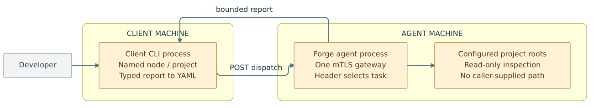
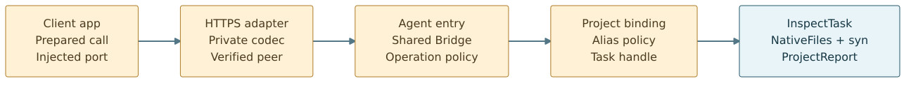
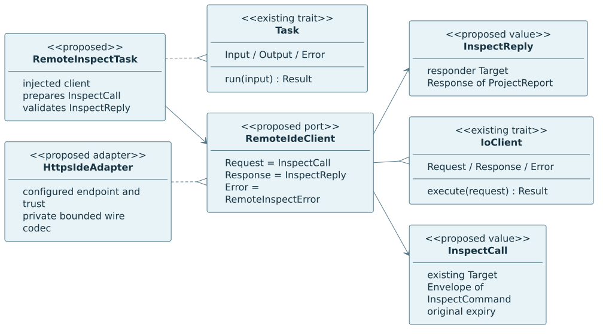
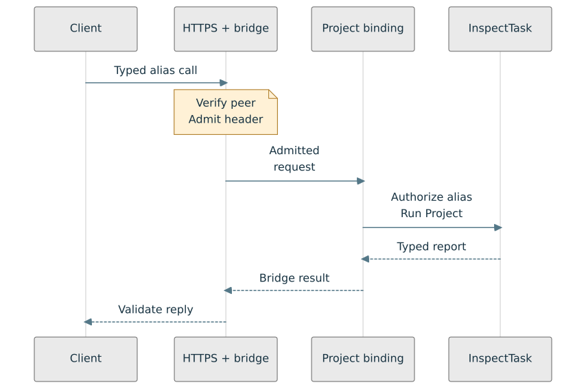
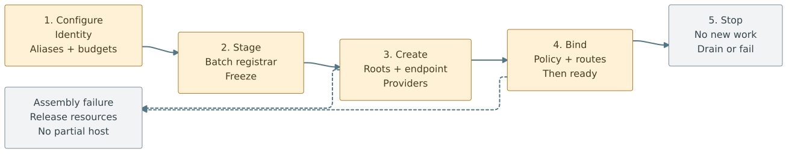

# Proposal: Forge IDE across two machines

**Status: design, not an implemented remote IDE or deployment.** Reviewed against
public baseline `a11d327a3fd1aadec232a47f1c7cc8d086a7ef0f`. The repository currently
has a local IDE inspection capability and a separate authenticated, loopback-only
`node.info` proof. This proposal connects those foundations incrementally without
changing the one-front-door architecture.

[Visual PDF](remote-ide-proposal.pdf) · [Mermaid/SVG gallery](../diagrams/mermaid/README.md#remote-ide-proposal)
· [Current network implementation](../remote-node-info.md)
· [Single-front-door skill](../../../.agents/skills/design-forge-front-door/SKILL.md)

## 1. The outcome

From a client machine, select a configured node name and a server-published project
alias, then obtain a typed project report rendered as YAML at the client boundary.
The agent owns filesystem authority; the caller never supplies an arbitrary host
path. Use the existing HTTPS/mTLS direction first, not a second transport merely
to prove extensibility. No new website, cloud deployment, LSP, editor, job scheduler,
file mutation, shell execution or Bitwave integration is part of this milestone.

M13 is a **C4-style context/container view**, not strict C4 notation. Boxes for CLI
and agent are proposed processes; crates are not deployed containers. Amber marks
proposed assembly/behavior; gray marks the human actor. Lines are
runtime conversations, not Cargo imports. The current proof still uses loopback.

## 2. Reuse the real pieces; name the gaps

| Existing code | Verified responsibility | Required next change |
| --- | --- | --- |
| [`forge-remote`](../../../src/rust/forge-remote/src/lib.rs) | `NodeCall` wraps `Target`, `Envelope<NodeCommand>` and expiry; `RemoteNodeClient`, `ReadNodeTask`, node-only `Destination` and injected `Authorize` | Keep these public node contracts working; do not claim `Destination` already accepts IDE commands |
| [`forge-remote-https`](../../../src/rust/forge-remote-https/src/transport.rs) | `HttpsClient`, loopback `HttpsServer::serve_one`, private DTOs, mTLS mapping and one checked POST gateway | Opt-in agent serving lifecycle and IDE codec; non-loopback configuration is new, not an existing option |
| [`forge_ide::assembly`](../../../src/rust/forge-ide/src/assembly.rs) | `IdeConfig::Native`, `register_ide`, `InspectFactory`; root opening occurs at factory creation after freeze | Add a batch registrar for one typed collection of configured project factories |
| [`forge_ide::task`](../../../src/rust/forge-ide/src/task.rs) | `InspectTask<C>: Task<Input=InspectRequest, Output=ProjectReport, Error=InspectError>`; `InspectRequest::Project` inspects its configured root | Reuse the task unchanged behind an authorized alias binding; do not inject remote paths into it |
| [`filesystem` / `syntax` / `model`](../../../src/rust/forge-ide/src/lib.rs) | Injected native List/Read, actual Rust parsing, typed declaration hierarchy and report | Bound remote report serialization/decoding; preserve partial-report status and privacy caveats |
| [`forge-bootstrap`](../../../src/rust/forge-bootstrap/src/lib.rs), [`forge-provider`](../../../src/rust/forge-provider/src/lib.rs), [`forge-bridge`](../../../src/rust/forge-bridge/src/lib.rs) | Typed staged factory groups, explicit construction/acquisition, header-selected admitted dispatch | Reuse contracts; no universal container, global business enum or mandatory async conversion |

The local IDE report is a **structural syntax summary**, not a full expression AST,
type checker or macro evaluator. It includes declaration nesting, traits/impls,
spans/counts and line counts (`str::lines().count()`: empty file 0; trailing newline
adds no phantom line). Other languages receive file/text metadata. Preserve those
meanings remotely rather than claiming stronger analysis.

## 3. Package and module layout

**Proposed placement, not empty crates to create now:**

- **`forge-agent` application package:** composition root plus private `config`,
  `catalog`, `policy`, `dispatch` and `lifecycle` modules. Selects optional node and
  IDE capabilities; owns `AgentCommand`/`AgentResult` sums, project-to-task bindings,
  route metadata and readiness. It imports capabilities and adapters, never the
  reverse. Extract private policy/catalog modules only if actual reuse warrants it.
- **`forge-ide::remote` optional contract module:** a consumer-owned typed
  `RemoteIdeClient` conversation and remote inspection task. It may import ingress
  contracts when enabled, but no TLS/HTTP/YAML runtime types. The existing local
  inspection task and default dependency profile remain independent of networking.
- **`forge-remote-https` optional IDE adapter module:** owns the versioned wire DTOs,
  bounded encode/decode and typed client implementation. Its IDE feature may depend
  inward on `forge-ide`'s contract feature; no reverse dependency. Factor shared
  HTTP machinery internally rather than cloning TLS/authentication code. Preserve
  the existing node-only facade and omission profile.
- **`forge-agent` client entry point:** a thin companion CLI in the application
  package selects a named node
  from explicit startup configuration, injects a prepared client and displays YAML.
  Its thin parser maps commands through a local shared-bridge binding before
  `RemoteInspectTask`; it does not call task handlers directly. Command descriptions
  and protected help remain separate from Task execution. Local admission is not
  a substitute for the remote agent's authentication/authorization.
  The business task receives a typed target/project request, not an endpoint URL,
  credential lookup or service locator. The existing `forge-ide` CLI stays local.
  This avoids a Cargo cycle: the agent imports both IDE contracts and HTTPS, while
  the HTTPS IDE adapter may import IDE contracts; `forge-ide` never imports HTTPS.

The HTTPS inbound path must expose a narrow **typed gateway dispatch seam** for
application-owned `AgentCommand`/`AgentResult`, rather than import `forge-agent`.
The application supplies a finite route/version codec binding; transport-private
DTO conversion uses that mapping and the shared bridge still checks variants.
A generic/static dispatcher or object-safe interface with all associated types
fixed is feasible. Choosing its final Rust signature is an implementation gate;
there is no claim that the current node-only server already has this extension.
Keep protocol schemas/DTOs at the adapter edge, not an internal `Value` tree.

## 4. Typed interfaces and ownership

M15 abbreviates Rust type parameters; **PROPOSED** names are not public exports.
The concrete sketch is deliberately small:

| Contract | Proposed semantics |
| --- | --- |
| `InspectProject` | Bounded logical project alias only; no absolute/relative filesystem path or endpoint |
| `InspectCall` | `Target` + `Envelope<InspectCommand>` + unchanged absolute expiry; `InspectCommand::Project(InspectProject)` |
| `InspectReply` | Responder target/incarnation + correlated typed `Response<ProjectReport>` |
| `RemoteIdeClient` | `IoClient<Request=InspectCall, Response=InspectReply, Error=RemoteInspectError>`; a prepared-call execution port, not a task locator |
| `RemoteInspectTask<C>` | Prepares the route/version and typed call, invokes injected client, validates the reply; endpoint configuration stays in composition |
| `AgentCommand` / `AgentResult` | Finite application-owned sums for selected node/IDE payloads and results; not an enum added to core |
| `RemoteInspectError` | Bounded invalid/unauthenticated/forbidden/wrong-target/unknown-route/unavailable/limit/deadline/transport categories; preserve uncertain execution after send |

These names are design vocabulary, **not compile-tested declarations**. The typed
client codec converts the capability call to the application wire variant; the
agent codec produces its local sum. Header route/version chooses the binding,
not the payload. Fix associated types if using `dyn IoClient`; do not erase an
`InstanceProvider::Lease<'a>` GAT into a universal dyn registry. `Factory::create`
and provider acquisition retain their existing independent roles.

**Compatibility:** leave `NodeCall`, `NodeCommand`, `NodeReply` and existing node
client usage intact. The agent envelope is a new composition contract, not a silent
change to exhaustive public enums. Select and document a wire contract version for
IDE; version reply format separately from operation identity where necessary.
Existing `ProjectReport` serializes optionally for YAML but is not already a fully
validated network decoder. Implement private wire-to-domain validation before
accepting a report: node/depth/count/string/byte limits, known enum variants,
format version, target/incarnation, route and original request/correlation IDs.

## 5. One entry path, two checks on authority

1. Client bootstrap maps a node name to address, expected TLS server identity and
   expected logical target/incarnation. No network address is chosen by task data.
2. Use **POST `/forge/v1/dispatch`** for both current `node.info` and proposed
   `ide.inspect`; `Forge-Destination` selects the registered operation. Reuse the
   [actual header projection](../../../src/rust/forge-remote-https/README.md#http-header-projection),
   including version, target, expiry and request/correlation fields. The body carries
   typed arguments only. Do not add `/ide`, `/files` or a controller per task.
3. mTLS verifies the peer; explicit verified-leaf mapping produces the subject.
   Headers cannot assert an authenticated user. Destination admission checks target,
   version, deadline and operation permission. The bridge rejects variant mismatch.
4. The selected binding checks **subject + operation + project alias** before any
   inspection call. Only then resolve the configured task handle and run
   `InspectRequest::Project`. Denied/unknown aliases reveal no root path; protect
   any future catalog/discovery with the same resource visibility policy.
5. Native I/O stays in the injected client. Return a bounded typed report; preserve
   `complete=false`, unreadable/binary/excluded entries and syntax diagnostics.
   Client validation precedes bounded YAML output. A failed encode/decode must not
   emit a partial success document.

There are two distinct checks: authenticated transport identity is not permission
to inspect a project. The current `Authorize` receives subject/target/header, not
project arguments; **project policy in the binding is new**. The existing trusted
`dispatch_verified` seam is not a cryptographic principal issuer. A stronger private
verified-context constructor belongs at the new trusted ingress boundary; ordinary
wire input must never gain access to that constructor.

Only POST is in this milestone. Future GET must not mutate or depend on a request
body; PUT/PATCH/DELETE require real operation semantics and separate authorization.
Unsupported methods stay 405 with an accurate Allow header. A shared path does not
mean arbitrary methods or arbitrary task names are accepted.

## 6. Bootstrap and lifecycle

Bootstrap reads explicitly supplied configuration through a boundary, validates
named-node/project maps and credential references, and calls capability registrars.
Registrars stage complete factory groups; they do not open directories, connect or
bind sockets. Reject duplicate aliases/routes/groups, malformed limits and missing
dependencies without partially publishing an application. The existing tuple registry grows its Rust type on each `register` call; a
runtime-length alias list cannot be accumulated in a loop as though its type stayed
fixed. Add a **proposed public batch registrar** alongside `register_ide`: validate
all alias/root configs and stage one cohesive `ProjectFactories` group containing a
homogeneous `Vec<(ProjectAlias, InspectFactory)>`. Reject duplicate aliases/group
bindings atomically, with no construction. The batch helper reuses capability-owned
configuration/factory policy; it is not an existing export. Freeze the outer typed
registry first, then iterate the factory collection to construct typed handles;
on any failure publish none and release previously created resources. Reuse the
HTTPS public registration pattern. Agent startup config is not a runtime payload.

For this first host, choose a single owner and bounded sequential service. Own ready
inspection tasks in host-scoped providers; the alias map contains configured typed
handles, not factories selected by request strings. Default singleton construction
opens roots at startup. That authorized startup effect is distinct from the guarantee
that a **denied request causes no inspection reads**. A transient alternative must
remain lazy and requires an explicit construction/error policy rather than an eager
throwaway instance.

Freeze the route registry and finish policy/codec wiring before serving. Readiness
means these dependencies and credentials are usable, not healthy hardware or the
whole network. On assembly failure release only resources this attempt owns and
report the failure; no partially available agent. On shutdown stop new admission,
finish or reject the active request under a declared policy, and close owned listeners
and providers. The current synchronous bridge is not Send/Sync-shareable unchanged.
The HTTPS private runtime does not make synchronous parser/filesystem callbacks
preemptible: deadlines may expire while work continues. Report grace exhaustion;
do not claim forced cancellation, bounded drain or success without a tested mechanism.
Process isolation or an async/cancellable inspection API is a **later decision** if
hard stop guarantees become necessary.

## 7. Delivery sequence and acceptance gates

| Phase | Small deliverable | Evidence required before calling it complete |
| --- | --- | --- |
| **0 — Existing** | Local IDE and authenticated loopback node.info | Existing public exports/examples; not evidence of a reachable remote agent |
| **1 — Proposed agent** | Explicit agent config, trusted credentials, node.info only, named-node client and clean lifecycle | Separate processes on loopback first; then an explicitly authorized two-machine test. Wrong identity/target/expiry/unknown route cause no observation; restart/incarnation mismatch and shutdown outcomes tested |
| **2 — Proposed remote IDE** | Server-owned project aliases, resource policy, shared IDE route and bounded report codec; client YAML | Authorized alias returns structurally equivalent typed report to local task; denied/unknown alias reads nothing; symlink and native-name cases, malformed report, partial report, oversized request/report, unreachable node and slow callback tests |
| **3 — Later** | Remote job inspect/status/cancel, then durable execution if required | Define ownership, persistence, bounded deduplication and cancellation acknowledgments first; no inference of exactly-once execution |
| **4 — Later** | File/process mutation or alternative carriers | Separate authority, audit, safety and lifecycle design; Bitwave/gRPC are optional adapters, not current work |

Keep default/minimal profiles free of unselected transport/parser dependencies.
Use a separate consumer to prove public config → registrar → freeze → factory →
provider → typed call; also prove substituting a client leaves task policy unchanged.
Retain header mismatch tests for direct in-process calls, not just HTTP decoding.
No automatic retry is implied: lost replies and timeouts can follow completed reads;
request IDs alone are not idempotency keys.

### Limits and decisions to resolve before implementation

- **Credential operations:** who supplies identities/trust roots, rotation/revocation
  and key storage; this proposal provisions nothing and changes no trust stores.
- **Resource budgets:** choose remote-specific entry/byte/depth/report limits;
  current 4 KiB default HTTP body cap is not an IDE report budget. Cap during
  collection/encoding, not only after building an unbounded buffer; reject oversize
  rather than silently truncate. Pagination/streaming are deferred until needed.
- **Trusted project contents:** current `syn` analysis and native calls have no hard
  execution deadline. Keep first configured projects trusted; hostile source
  analysis requires isolation, not just a byte cap. No compiler/macro execution.
- **Filesystem/report privacy:** no-follow rooted operations are not a complete
  filesystem sandbox, immutable snapshot, hard-link/mount provenance policy or
  secret scrubber. Names/type spellings/diagnostics can reveal sensitive content.
  Server operators must allowlist suitable roots and subjects; do not log reports,
  credentials or local paths by default.
- **Catalog/version policy:** decide stable aliases and inspection contract version,
  error visibility and report limit defaults. Example CLI spelling such as
  `forge-agent inspect --node lab --project workspace` is a proposal, **not a
  runnable command**. Today use the documented `make ide` and `make remote` separately.

## Source and visual maintenance

This is design synthesis from the linked current source, not a claim that upstream
libraries supply these application policies. No source/private credentials were copied
from other Forge repositories. The five new diagrams are canonical Mermaid assets;
the PDF embeds their rendered images and links back here and to source. Existing M11
and M12 remain the authoritative **implemented** local/network views.

[PDF rebuild instructions](remote-ide-pdf.md) · [Diagram rebuild/validation](../diagrams/mermaid/README.md#rebuild-locally)
