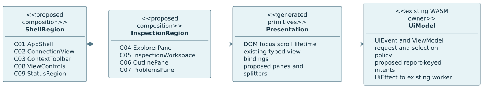
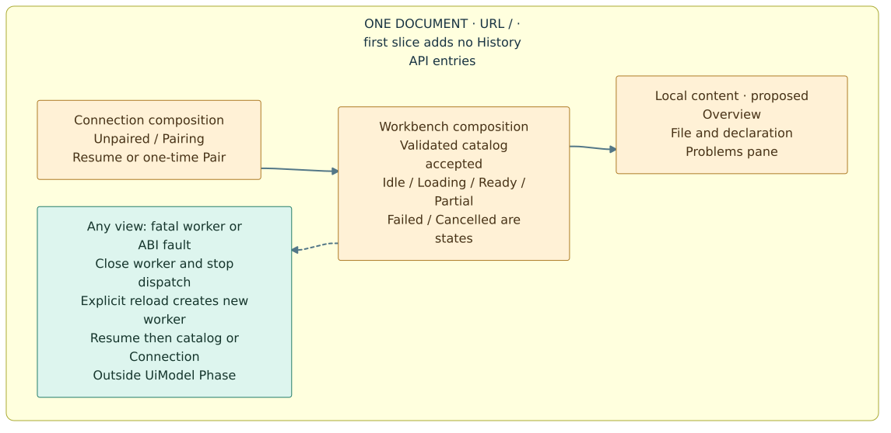
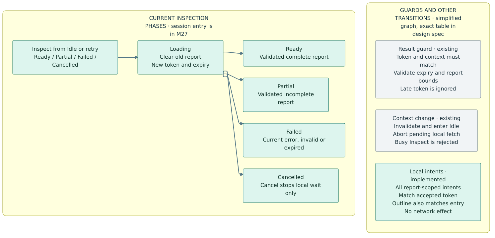

# Forge IDE — components, views and transitions

**Design decomposition, not runtime implementation.** This takes the
[workbench wireframes](../forge-ide-wireframes/README.md) into component contracts
and a buildable interaction plan. Evidence baseline:
[`6e86ad0c`](https://github.com/roachmaster/homelab/tree/6e86ad0c45c3b26fb14d53ab9d640f00e4a88ba1),
2026-11-02. The existing generated UI remains unchanged. Names marked **proposed**
are design vocabulary, not exported Rust APIs or new crates.

Read [component contracts](components.md) for inputs/outputs and ownership, then
[transition contracts](transitions.md) for guards, effects, lifecycle and tests.
Apply [Forge IDE UX](../../../.agents/skills/design-forge-ide-ux/SKILL.md) and
[Forge UI authoring](../../../.agents/skills/design-forge-ui/SKILL.md): YAML tokens
and typed Rust declarations generate the application assets; no handwritten app
HTML/CSS/JS or hidden raw-code templates.

## Three design views

| View | Editable source | SVG | Question |
| --- | --- | --- | --- |
| M26 component ownership | [Mermaid](../../architecture/diagrams/mermaid/m26-ui-components.mmd) | [Image](../../architecture/diagrams/mermaid/images/m26-ui-components.svg) | Which component composes which views, and where does application state live? |
| M27 screens and local navigation | [Mermaid](../../architecture/diagrams/mermaid/m27-ui-navigation.mmd) | [Image](../../architecture/diagrams/mermaid/images/m27-ui-navigation.svg) | What is a screen, a panel or a state—not an HTTP route? |
| M28 inspection lifecycle | [Mermaid](../../architecture/diagrams/mermaid/m28-ui-transitions.mmd) | [Image](../../architecture/diagrams/mermaid/images/m28-ui-transitions.svg) | When can a result become visible, and what invalidates it? |

These complement the actual [M25 runtime architecture](../../architecture/diagrams/mermaid/README.md#m25--generated-ui-implementation),
not replace it. New component names/navigation are proposed; M28 retains current
request semantics and marks its extensions. The tables, not a simplified arrow,
define error and stale-event behavior.

## Pages, panels and states

There are **two screen compositions**, one static application document and no new
backend URLs. “Page” below means a client-side screen composition, not another
server handler or a route per task.

| Composition | Content | Entry / exit |
| --- | --- | --- |
| **Connection** | Session resume status, pairing form, bounded validation/recovery message | Worker startup sends Resume. A matching validated catalog enters Workbench. Failed resume/pair stays here. Not a username/password login or certificate manager. |
| **Workbench** | Context toolbar; Explorer; central inspection workspace; optional Outline; Problems; status/view controls | Requires an accepted catalog. It can have no allowed project or no report yet. Changing context, loading, partial results and failures do not create separate pages. |
| **Worker recovery** | Generated fail-closed message with explicit reload | Not a third domain page. Fatal ABI/startup failure is outside `Phase`; stop dispatch and recover via a new instance. |

Within Workbench:

- **Project overview / no selection** and **file + declaration details** are
  central content projections. A file-local symbol selection is not an editor tab.
- **Explorer, Outline and Problems** are panes. Desktop can show several; narrow
  mode exposes one dominant pane with visible switches. Problems may be expanded
  into the working area without navigating to a new document.
- **Idle, Loading, Ready, Partial, Failed and Cancelled** describe the inspection
  lifecycle. Empty data, no matches, binary content and unavailable Rust syntax
  are content conditions—not additional global phases or pages.
- A complete empty project still has its root entry. “No declarations” is valid
  only for inspectable data with no emitted declarations; unavailable parsing is
  a different message. Do not turn zero results into a compiler/type-check claim.

## Navigation and persistence decision

**First redesign slice: keep one document at `/`; do not add History API entries,
deep links, URL query state or an application Back/Forward stack.** Explorer,
Outline, Problems and pane switches provide local navigation. This deliberately
avoids treating report-local integer IDs as stable cross-refresh addresses.

Browser Back/Forward keeps normal browser behavior and may leave the document.
Existing `pagehide` tears down the worker; a restored page starts a fresh worker
and resumes its host session. Refresh also obtains a fresh admitted catalog,
selects its current default node/project and starts with no report. Neither action
replays an inspection or restores an old report automatically. If resumable
navigation/deep links are later requested, design stable identifiers and privacy
rules separately rather than serializing current view state into URLs.

The new presentation contract must also clear protected DOM during teardown and
before session recheck; current worker teardown alone does not clear a browser-
cached view. This is explicit proposed lifecycle work, not an existing guarantee.

During a live worker instance, switching panes or focus preserves valid selected
entry/declaration, expansions, filters and pagination **within the same accepted
report**. Geometry, scroll and focus can survive pane closure/reopening in memory.
A new inspection, node/project change, session replacement or teardown invalidates
report-scoped selection and diagnostic references. Do not carry them to a new
report even when it happens to reuse entry `0`. First slice adds no localStorage,
report cache or cross-tab state. Pairing codes, CSRF, session identifiers, reports
and protected aliases must not be copied into URLs/history/storage/logs.

## Existing implementation versus proposed modules

| Package | Existing baseline | Cohesive proposed change, if later approved |
| --- | --- | --- |
| `forge-ide-ui` | `protocol`, `model`, `view`, `validate`; typed `UiEvent`, `UiEffect`, `ReportView`, `UiModel::dispatch` | Keep one model owner. Introduce small private projection/filter/navigation modules only as complexity warrants; add report-scoped local intents and Problems projections. No native I/O dependencies. |
| `forge-ide-web` | `component!`, strict YAML theme, generic HTML/CSS/JS emitters, real WASM ABI | Compose C01–C09 from reusable primitives. Extend typed SplitPane/PaneSwitch/FilterInput/DiagnosticList capabilities where current primitives are insufficient. Preserve generator validation and default portable dependency tree. |
| `forge-ide-web-host` | Asset verification, pairing/session/CSRF, configured aliases, client factories/providers and shared bridge | No backend feature required for panes/filter/Problems. Retain public registrar/factory integration and independent host/agent permission checks. |
| `forge-agent` / inspection capability | Read-only configured-project inspection through mTLS and the same command gateway | Unchanged. No arbitrary discovery, read-file, write-file, shell, Run, Debug or editor endpoint is introduced. |

Do not create a crate per widget or add a global UI service locator. Pure component
and model code needs no empty registrar. Native capabilities retain real public
config/factory/registrar integration; asset-build bootstrap is separate from host
runtime bootstrap. Existing `Task`, `IoClient`, provider and bridge contracts do
not change for this design.

## Implementation stages and acceptance — not executed by this document

1. **Compose existing data first.** Reorganize typed declarations/tokens into the
   compact toolbar and dominant file workspace. Preserve current phases and real
   gateway. Prove generated drift, safe text and current real-WASM/browser journeys.
2. **Add report-scoped local projections.** Retain the accepted request token;
   reject old row events; implement bounded filters and diagnostic navigation in
   WASM. Add pure-model tests before connecting controls. No new backend call.
3. **Add reusable pane/keyboard primitives.** Resize/collapse/reset, narrow pane
   switching and focus restoration live in audited generated presentation logic.
   Prove a non-IDE fixture, keyboard alternatives, no hidden focus targets and
   no main-thread business fetches. Do not broaden into a general docking IDE.
4. **Run interrupted/repeated flows.** Cover all cases in the transition document
   through actual generated UI + WASM, including a real host/agent path and
   separately labeled controlled failure cases. Review desktop/narrow pixels,
   keyboard behavior and assistive-technology support; static design review is
   not evidence of those runtime results.

The choices above make the next implementation bounded. They do not freeze every
widget API or certify the design before compiled and browser-tested prototypes.
No implementation, new PDF, deployment or operational credential setup is part of
this decomposition delivery.

## Rebuild the diagrams

Use the [existing pinned Mermaid pipeline](../../architecture/diagrams/mermaid/README.md#rebuild-locally),
which validates official grammar, renders locally and records source/SVG hashes.
Inspect the three diagrams after rendering; no external rendering service receives
repository content. Their SVGs are design documentation, not runtime UI templates.

[Wireframes](../forge-ide-wireframes/README.md) · [Homelab](../../../README.md) ·
[Documentation](../../README.md)
