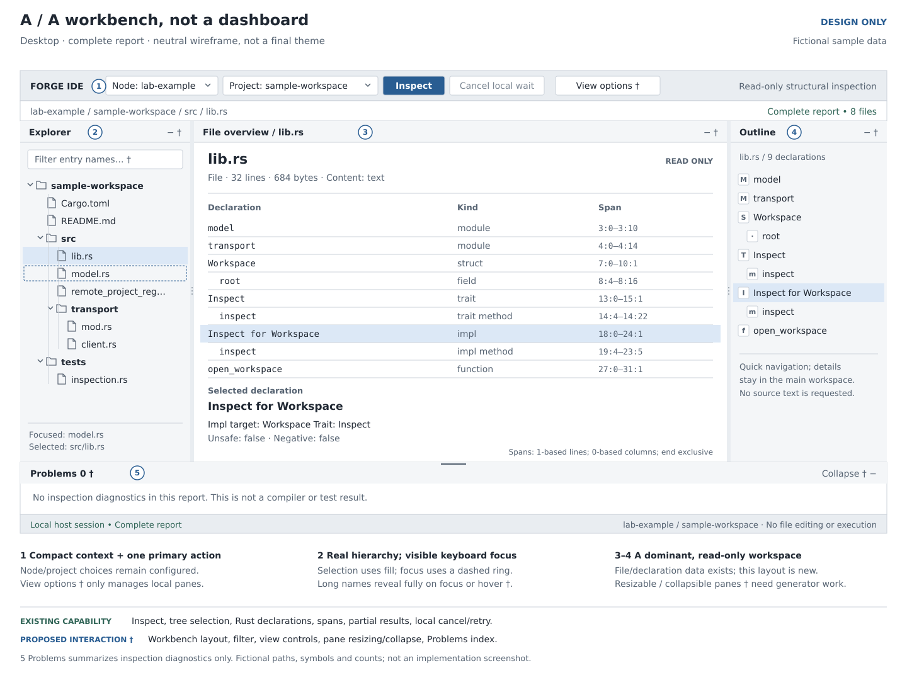
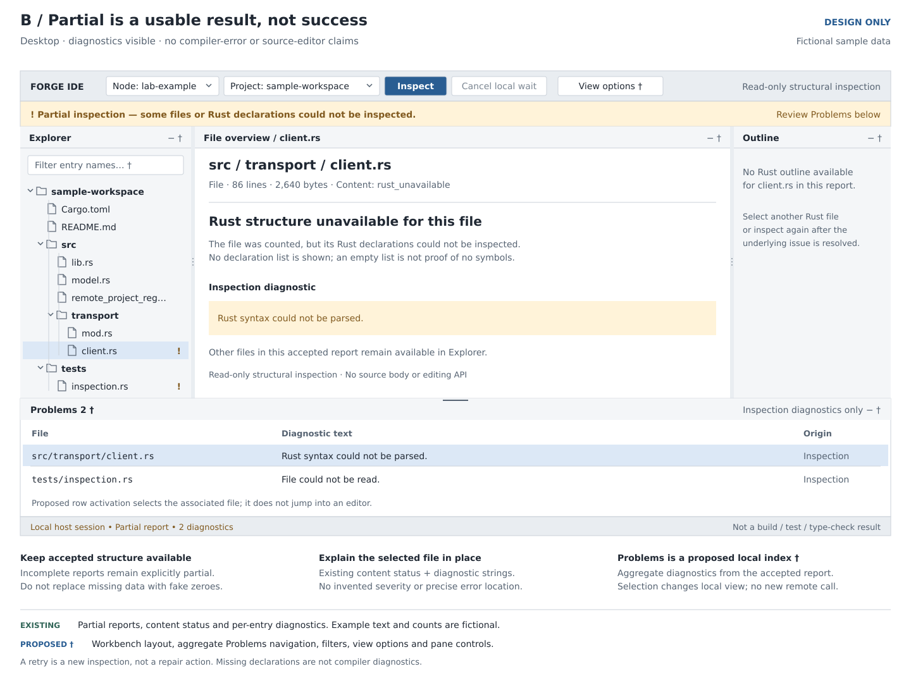
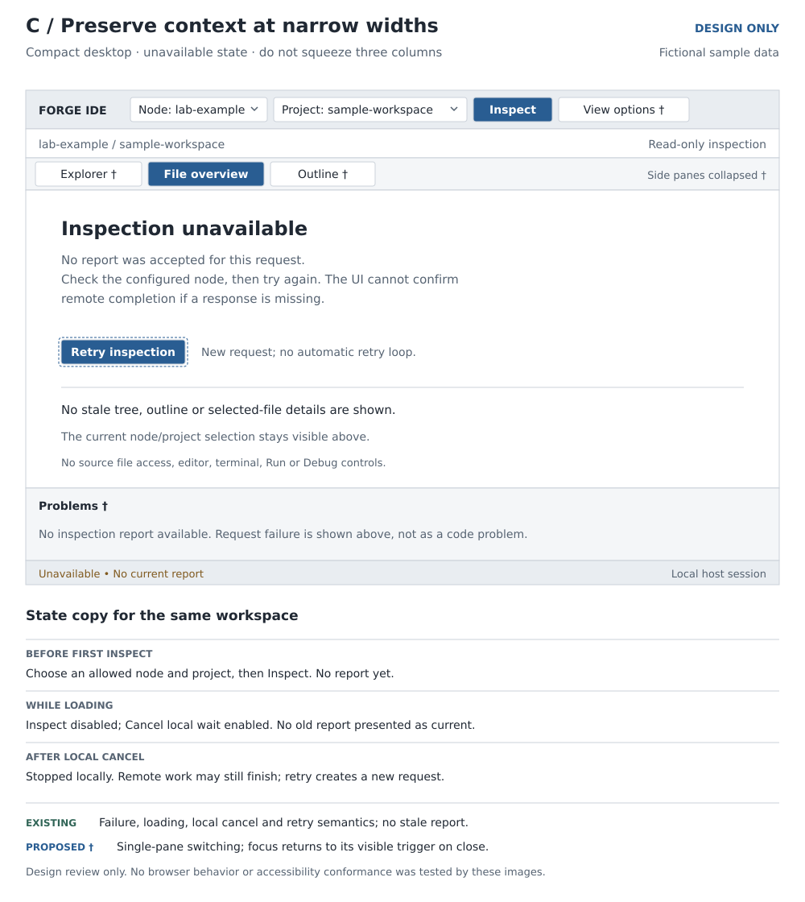

# Forge IDE workbench — wireframe first

**Design proposal, 2026-11-02. No runtime UI changes.** These low/mid-fidelity
views apply [Design Forge IDE UX](../../../.agents/skills/design-forge-ide-ux/SKILL.md)
to the [implemented generated inspection UI](../../../src/rust/forge-ide-web/README.md)
at [baseline 2913393e](https://github.com/roachmaster/homelab/tree/2913393e24556313ce0f63d86b65022ec6d2aa21).
They are reviewable visual artifacts, not screenshots of a redesigned application.
Fictional project names, files, symbols and values illustrate real data shapes.

The task is **inspect an allowed project → locate a file → understand its Rust
declarations and any missing analysis**. This is not a source editor, type checker,
debugger or terminal. The current product's successful browser tests do not prove
the new layout, controls or keyboard behavior proposed here.

The next design step is the [component, view and transition decomposition](../forge-ide-components/README.md), which assigns C01–C09 responsibilities and turns these pictures into guarded interactions. It does not implement the pictured controls.

## Visuals

| View | Editable source | Preview | Decision it illustrates |
| --- | --- | --- | --- |
| Desktop inspection | [SVG](forge-ide-workbench-desktop.svg) | [PNG](forge-ide-workbench-desktop.png) | Compact context, Explorer, dominant file/declaration workspace, optional Outline |
| Partial report / Problems | [SVG](forge-ide-workbench-partial.svg) | [PNG](forge-ide-workbench-partial.png) | Incomplete analysis remains useful and visibly incomplete |
| Narrow window / unavailable | [SVG](forge-ide-workbench-narrow.svg) | [PNG](forge-ide-workbench-narrow.png) | Collapse secondary panes, retain context and explicit recovery |







## What changes, and what already exists

| Area | Existing support | Proposed presentation / new work |
| --- | --- | --- |
| Context bar | Admitted catalog, node/project selection, Inspect/local Cancel and pairing form hidden after admission | Compact toolbar and persistent read-only/context labels; retain existing pairing lifecycle |
| Explorer | Ordered file hierarchy, expand/select, bounded pagination, native-name encoding | Original file/status glyphs, denser rows, complete-name affordance, resizable/collapsible pane |
| Central workspace | Selected entry metadata and declaration properties | Make these the primary surface; file summary and selected declaration details, not invented source text |
| Outline | Hierarchical declaration kind/name/span and impl metadata | Optional right pane with clearer kind glyphs and selection/focus; new collapse/resizing |
| Problems | Per-entry diagnostic strings, content/entry status and report completeness | New aggregate view with counts and entry navigation; diagnostic locations/severity only if actually present |
| Filter | No current filter event/control | Proposed bounded in-memory file/symbol-name filter, applied in WASM to the accepted report, not remote/full-text search |
| Narrow arrangement | Existing responsive generated layout | Proposed single dominant workspace with reversible pane switches; not proof of mobile interaction support |

All new arrangement and controls need later component/token/generator/model work.
The wireframes use **existing / proposed / out of scope** distinctions in their
annotations; pictured controls are not a claim of working code.

## Layout and content contract

1. **Context toolbar:** show the selected named node and authorized project alias,
   connection/session state, Inspect and contextual Cancel. Retain visible text
   labels; do not use a wall of unexplained icon buttons. Pairing is a separate
   entry/recovery state and never displays credentials in a normal workspace.
2. **Explorer:** preserve parent/child structure and selection. File-kind/status
   glyphs supplement names; a symlink is not a navigable remote path. Long names
   can truncate in a row, but the selected item's details reveal the entire safe
   representation with wrapping. Native encoded names remain visibly encoded,
   never silently replaced with a misleading UTF-8 spelling.
   View options is a proposed pane visibility/reset control, not a command palette
   or remote shell.
3. **Central structural workspace:** show selected file name/path, known line/byte
   counts, analysis availability, and selected declaration kind/name/span. A trait
   or impl can reveal its real nested members through the Outline. No fabricated
   signature, source gutter, code body, editable tab or Run action is shown.
4. **Outline:** file-local hierarchy, not a project-wide semantic symbol index.
   Distinguish methods from free functions and impls from traits. Derive any new
   counts from emitted nodes and label their scope; partial data is not a complete
   project total. Out-of-line modules are not resolved by this view.
5. **Problems and status:** group inspection diagnostics with their file/context.
   A parse/unreadable/size-limit result is not a compiler error count. Do not invent
   line positions by parsing arbitrary diagnostic text. Show an unavailable value
   as “Unavailable”, not zero. Status indicates completeness, selected context and
   request state—not machine health or guaranteed agent cancellation.

Real [report types](../../../src/rust/forge-ide-ui/src/protocol.rs) contain
`ReportView.complete/files/bytes_read`, per-entry `lines/size_bytes/diagnostics`, and
declaration hierarchy plus `SourceSpan`/optional implementation metadata. Report
spans use one-based lines, zero-based Unicode-character columns and an exclusive
end. Line counts follow `str::lines()`: empty = 0; `a\n` = 1; `a\n\n` = 2. No line
count is fabricated for binary/unreadable content. See the
[inspection contract](../../../src/rust/forge-ide/README.md#output-a-tree-and-an-outline-not-just-counts).

The neutral palette is a wireframe convention, not a replacement runtime theme.
The desktop sketches use roughly 28px rows, a 48px context bar and a 248px Explorer;
these are starting proportions for review, not fixed accessibility or phone-size
requirements. Selection fill, dashed focus and warning text have different roles.
Original letter/glyph badges identify kinds without importing a product icon set.

## Interaction and ownership

- **Select and inspect:** a node/project change invalidates the old selection and
  accepted report. Inspect prepares a new request; only a matching session,
  revision, request and project result can populate the workspace. Repeated Inspect
  while busy does not start overlapping work. Retry is an explicit new attempt.
- **Select a file or declaration:** changes the accepted local report projection,
  not a backend read. Keep selection and keyboard focus independent so browsing
  with keys does not lose the current result or cause remote inspection.
- **Filter (proposed):** match names in the bounded accepted report; retain parent
  context and show “matches in this inspection”. Search all accepted entries before
  paging displayed matches; do not search only currently visible rows. Explain
  partial/excluded data. Empty matches are not “the repository contains nothing”.
  Changing/clearing the filter must preserve valid selection or explain its absence.
- **Problems (proposed):** selecting a problem selects its report entry and shows
  the supplied diagnostic. No jump into an imaginary source editor. Use neutral
  “inspection diagnostics” unless the data genuinely encodes severity/location.
- **Resize/collapse (proposed):** drag or keyboard-adjust bounded pane widths; keep
  a usable central minimum. Collapse restores its prior width when reopened.
  Provide a reset and a visible reopen control. If a pane containing focus closes,
  move focus to its reopen control; no lost keyboard target.
- **Narrow window (proposed):** replace side-by-side secondary panes with explicit
  Explorer/Outline/Problems switches. Preserve selected IDs and scroll context;
  only one pane's focusable contents are active. Do not shrink text to fit. The
  936px application region on a 1000px sheet is a narrow desktop window, not a
  validated phone layout.

Main-thread generated primitives own geometry, focus, scroll, disclosure controls
and lifecycle. WASM owns selected project/file/declaration, proposed filters and
request/result policy. Worker glue sends only prepared effects; native host/agent
independently authorize them through the existing shared header-routed gateway.
All input and output text is safely rendered, never treated as markup or a URL.
No selector, filter or pane state grants authority or exposes credentials.

## Keyboard acceptance — proposed, not yet implemented

The workbench's future implementation must prove these behaviors in a browser:

| Interaction | Expected behavior |
| --- | --- |
| Tab / Shift+Tab | Reach labeled toolbar controls and each active pane without a trap; focused element remains visible |
| Tree arrows / Home / End | Move focus among visible nodes; Left/Right collapse, expand or reach parent/child as appropriate |
| Enter on file/symbol | Select the focused item without remote I/O; selection fill remains distinct from focus outline |
| Tree type-ahead | Move focus by visible name; distinct from the proposed report filter and not a backend query |
| Focused separator | Arrow keys resize within bounds; Enter collapses/restores; reset is discoverable |
| Collapse / reopen / async update | Restore an intelligible target; never steal focus on background result arrival |
| Narrow pane switch | Activate one pane and restore its last valid focus/selection; no hidden tabbable rows |

Use native semantic controls before additional ARIA. Label Explorer, Outline,
Problems and resizers. Announce meaningful completion/error changes politely,
without narrating every row update. Do not capture browser shortcuts or block
zoom/paste. Reduced motion and sufficient contrast remain implementation gates.
The [W3C tree pattern](https://www.w3.org/WAI/ARIA/apg/patterns/treeview/) guides the
navigation model; the [splitter guidance](https://www.w3.org/WAI/ARIA/apg/patterns/windowsplitter/)
is a design reference with its documented review caveat, not an accessibility
certification. A static drawing cannot establish screen-reader support.

## State contract

| State | Visible behavior and safe next step |
| --- | --- |
| Unpaired / expired session | Pair/reconnect guidance; no leaked catalog or previous report; never show the one-use code in screenshots |
| No allowed project | Explain that configuration/permission supplies choices; no arbitrary URL/path entry |
| Idle / no report | State the next action; distinguish “not inspected” from an inspected empty result |
| Loading | Selected context and indeterminate activity; Cancel local wait; no guessed completion percentage |
| Complete | Accepted file/declaration data, scoped totals and read-only label |
| Partial | Keep usable accepted data; persistent incomplete notice and diagnostic entry points, not a success-only green indicator |
| Denied / unavailable | Actionable category without secret/internal details; correct pairing/configuration or retry explicitly as appropriate |
| Timeout / cancelled | No stale report presented as current; state that remote computation may have occurred or may continue |
| New selection / late result | Drop mismatched results; do not flash an old project's tree or restore obsolete focus |
| Fatal worker/protocol failure | Stop that worker instance, clear invalid state and offer explicit reload/recovery; do not silently keep dispatching |

These constraints retain the existing model's request-token discipline. Improved
wording/layout and any new recovery control still require implementation and tests.
Refreshing currently resumes the admitted session and obtains its filtered catalog;
it is not persistence of a previous report or proof of remote cancellation.

## From approved wireframe to generated UI — later work only

Apply [Design Forge UI](../../../.agents/skills/design-forge-ui/SKILL.md). Extend
typed component declarations and strict YAML tokens for layout/density/icons;
add reusable, separately tested generator primitives only where necessary. Add
typed WASM events/view projections for filters and Problems, not a JS domain
controller. Preserve `POST /forge/v1/dispatch`, public factories/registrars,
providers and host/agent authorization; this design needs no new endpoint.

The documentation SVGs and their Python builder are **not application assets**.
They must not be copied into the runtime as an HTML/CSS/JS authoring escape hatch.
No source files, generator APIs, dependencies, browser UI, existing PDF or backend
behavior are changed by this wireframe delivery.

Before implementation, review the dominant workspace versus optional Outline,
the density and the narrow-pane behavior. Acceptance then needs generated-output
drift tests; model filtering/state tests; real keyboard/focus/resize/repeated-event
journeys; safe long/native names; partial/denied/timeout cases; and actual
WASM → host → agent integration. Wireframe approval is not runtime test evidence.

## Rebuild and review

The [design-only builder](build_wireframes.py) owns the three editable SVGs and PNG
previews. Its header describes dependencies and reproduction/check commands. Run
it only for these documentation outputs, then inspect every image at its intended
size. Keep source/image changes together. For example, from the repository root:

```bash
python docs/design/forge-ide-wireframes/build_wireframes.py --output-dir /tmp/forge-wireframes-review
# Compare the six rendered files with docs/design/forge-ide-wireframes/ before replacing them.
```

The builder needs Python 3, Pillow, DejaVu fonts and Inkscape; use workspace tooling
without installing globally. Byte-for-byte PNG reproduction assumes the same
renderer/font versions. SVGs remain editable text; review rendered pixels as well
as hashes. Source provenance is in the
[UX skill reference](../../../.agents/skills/design-forge-ide-ux/references/sources.md).

[Homelab](../../../README.md) · [Documentation index](../../README.md) ·
[Runtime architecture](../../architecture/diagrams/mermaid/README.md#m25--generated-ui-implementation)
