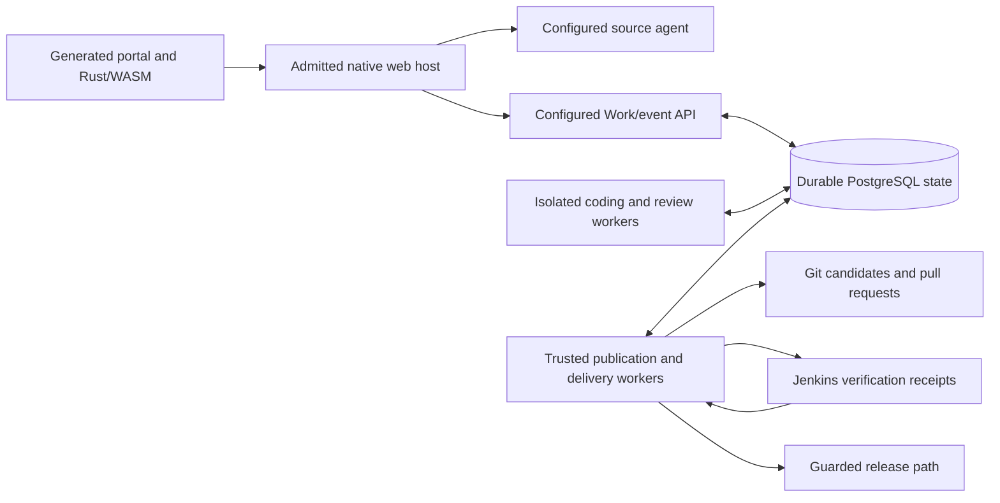

# Current Forge implementation

Reviewed **26 November 2026** against consolidated application source
`0163a615` in [draft PR29](https://github.com/roachmaster/homelab/pull/29).
Documentation changes do not attest a new build, deployment or successful task.

## The system we are building

Forge has two complementary layers. The reusable Rust framework supplies typed
admission, explicit configuration, registrars, factories, providers and owned
lifetimes. The concrete delivery application uses those boundaries to let an
operator assign work, retain a public Plan, obtain independent review and move
verified source through branch CI, merge, observed-main verification and trusted
release. Application workflow policy belongs to the delivery application, not
the framework core.

The generated Rust/YAML portal is the operator surface. Rust/WASM owns browser
intent; generated adapters own presentation and admitted I/O. The native web
host admits requests. Python/PostgreSQL services own the durable coding workflow,
worker leases, feedback, retry events and delivery receipts. Git is the current
publication transport; canonical content identities describe source and frozen
verification generations without making Git branch names the content identity.
Jenkins produces independent verification evidence. A model response, UI badge,
console log or webhook observation cannot approve its own work or authorize a
release.

The diagram shows responsibilities, not a healthy request trace. Database-backed
workers remain separate processes when the API runner is stopped. Native CLI
authors and external database authors such as Muse have different execution
contracts, while independent review, immutable feedback and trusted delivery
remain shared requirements.

## Pre-deployment operating and source checkpoints — 26 November 2026

| Layer | Checked or implemented state | Practical implication |
| --- | --- | --- |
| Mission Control, 26 November | `forge-agent-runner.service` is inactive/disabled. Coding, dedicated Codex author, Gemini, Grok, publication, external-delivery, web, source-agent and Jenkins services are active/enabled. | The event/API front door is intentionally stopped; other consumers were not stopped. Process state does not establish task progress, provider allowance or health. |
| Database, read-only observation | Highest migration is **40**, `provider_author_handoff`; 39 is `terminal_retry_settlement`. | Schema41 branch/stage tables are not established by the observed live migration registry. This observation is not a full role/function audit. |
| Installed release selection | Web ExecStart names `portal-auto-0070e78f…`; API/worker/publisher/external-delivery ExecStart paths select `codex-quota-handoff-0070e78f`. | These are configured source labels, not a new artifact-digest or browser qualification. |
| Git/source | `main` advanced to `4bf1d230` with the preserved resubmission queue; consolidated `backup/main` is under draft PR29. `feature/muse` is retained separately. | Task/development branch names were retired after preserving their committed tips. Worktree files remain available; consolidation is not main promotion. |
| Consolidated contract | **ABI16**, native HTTP protocol1, migrations **41–50** through the schema50 rollout target. Migration41 is `agent_branch_and_cicd_stages`; migrations 1–40 are unchanged. | Host, assets, WASM, schema and grants need a coordinated, qualified rollout. Source presence does not establish runtime activation. |

The current portal navigation is **Agents, Workbench, Home and Design**. Chat is
inactive and Mail retired as portal views; their PostgreSQL history and inert
local snapshots remain preserved. Consolidated source adds an attention-focused
Now / Why / Next task summary, persistent per-agent branch ownership, correlation
CI/CD stages and bounded Errors/Tests/Console inspection through
`ide.work.cicd.stage_log`.

## Consolidated capabilities and next decisions

| Capability | Present in source | Next evidence or decision |
| --- | --- | --- |
| Author/reviewer workflows | Separate configured author and independent reviewer, retained Plans, immutable feedback, source-bound AGY-to-Codex quota handoff | Qualify the combined source and preserve original workflow authority, workspace and budgets across any selected handoff. |
| Branch ownership and CI visibility | One default `forge/agent/<profile-slug>` branch, exclusive workflow reservation, main synchronization, cache scope and correlation-stage/log projection | Apply migrations41–50 only in an authorized rollout with matching services/grants. Prove stale-owner, open-PR, restart and paging behavior through the real path. |
| Verification identity and recovery | Opt-in content-v2 manifests/policy generations; retained legacy bindings; private historical-CI pass and completion helpers | Verify actual source, process ownership and genuine receipts. Helpers do not authorize CI, reset event allowances or deploy themselves. |
| Triage and Workbench | Needs attention, task detail/evidence disclosures, focus/scroll retention; admitted source inspection and opt-in managed writes | Complete current actual-WASM/browser and desktop/narrow visual acceptance. Recheck live write/Studio configuration before describing either as enabled. |
| Other framework consumers | Durable Rust jobs, local tools, game simulation/assets/replay and static-web Studio service | Keep their contracts distinct from the Python/PostgreSQL delivery workflow; expand them when a concrete consumer and acceptance case require it. |

The immediate direction is to make this integrated delivery loop understandable
and qualified before adding a broader control plane. Follow the selected CI
profile: fast in-memory evidence belongs to branch scope; database/browser
acceptance belongs to main scope on the observed merged commit. Local disposable
fixtures provide supplemental integration evidence, not a main-scoped receipt.
Then qualify any coordinated rollout and prove one complete authored → reviewed →
verified → merged → main-verified → deployed path with source-bound evidence.
Restarting the deliberately stopped runner requires a separate operator action.

Generic fleet scheduling, automatic peer discovery, a universal editor/LSP,
framework-wide lifecycle automation, a queue/broker split and Kubernetes/K3s
remain separate proposals or deferred work. This roadmap introduces none of
those dependencies and does not change the native-systemd operating boundary.

## Preserved work queue and planning direction

The [resubmission queue](../../resubmission-queue/README.md) preserves task
prompts and acceptance criteria collected before a planned database reset. Its
saved task states and `resubmit` flags describe collection-time intent. They are
not current completion, deployment or automatic-resubmission decisions. The
read-only runtime check above still observed schema40; this documentation pass
performs no database reset.

| Saved work | Relation to the consolidated system | Planning treatment |
| --- | --- | --- |
| Branch cleanup | The requested task/development refs were merged and deleted; `main`, `backup/main` and remote `feature/muse` remain | Preserve the archived request; do not repeat the original 35-branch cleanup literally. |
| Agent branch setup and portal correlation stages | Persistent per-agent ownership and correlation stage/log inspection are present in PR29 | Compare the original instruction, acceptance and rollout requirements against source/tests before filing remaining work; implementation is not live acceptance. |
| External base-refresh override and failure/review/deadline/pin defects | Consolidated code contains related integration/recovery mechanisms | Reproduce the original failure against current code and retained evidence; record the actual gap instead of declaring every saved defect fixed or replaying superseded assumptions. |
| Defect and backlog workflows | Saved feature requests for dedicated filing, deferral and promotion paths | Treat as product work requiring a scoped design and acceptance case, distinct from the existing per-event repair loop. |
| PostgreSQL proxy / recipe-resolution backlog | Preserved design work with an explicit deferral of the only-writer cutover in the task notes | Review the retained `feature/muse` work and those scope notes separately. This PR does not establish a deployed single-writer proxy or authorize changing database grants. |
| Main-pipeline Drive snapshot refresh | Saved request for a post-verification archive refresh | Keep it tied to the exact successfully verified main revision and a separately qualified external-publication path; no Drive operation is performed here. |
| Archived old-main verification repairs | Five requests refer to superseded main revisions and say not to resubmit | Retain provenance; obtain verification for the actual current candidate/main rather than recreating those stale-tip repair tasks. |

## Validation boundary

The latest consolidation recorded 326 native Rust tests, 35 generated-asset
tests, 18 CI recovery tests and 7 relay tests passing, plus a generated
input-presentation fixture. Earlier integration records retain their own test
scopes; these counts are not a complete final-head release gate. Historical
source-fingerprint checks still fail against the combined source. `make ui-qa`
stopped at the absent locked Playwright dependency, so browser assertions and
screenshot acceptance did not run. The generated-emitter fixture used a
header-only WASM fixture and is not actual-WASM browser evidence.

See the [task consolidation record](../reports/task-branch-consolidation-20261126.json),
[local branch record](../reports/local-branch-consolidation-20261126.json),
[dated runtime inventory](../architecture/forge-ide-system-inventory.yaml) and
[delivery roadmap](../roadmap/forge-framework.md). These distinguish implementation,
local evidence, installed selection and release authority.

## Existing content identity and retry contracts

Source now includes an opt-in [content identity protocol](../architecture/content-identity.md)
and its UML data, component and sequence views. Canonical SHA-256 source manifests,
frozen verification policies and explicit generations are wired through native
CI and external-agent review using factory-selected providers. Private atomic
snapshots survive restart without reinterpreting runtime rules. Existing queued
native generations and external workflow records keep their legacy bindings.
The Rust Design reader exposes `/design/content-identity` when this source is
deployed. Source implementation does not establish live protocol activation.

The retry implementation uses **20 attempts for each unresolved failure event**
across native and external agents. Compilation, test phases, reviews and feedback
delivery have independent counters. Migration31 records event identity and atomic
admissions; task and lineage totals may exceed20. Passing an independently
verified phase closes its event; builds, commits and agent handoffs never reset
it. The portal shows event progress separately from revision history. A stopped
legacy plan can adopt its actual spent retries and continue with its retained
plan and review. This source description is not a live activation receipt;
the delivery panel and protected rollout records establish the deployed version.

## Historical qualified release — 23 November 2026

The retained pre-delivery live checkpoint was main `95651a5` (tree `6d380c5a`) on
23 November 2026. Its Rust/UI artifacts and native/browser qualification retain
their actual built revision `a3a14e9`: all **499 consumed build inputs** match
the final source exactly. Genuine Jenkins native build 17 and companion build 1
completed successfully, covering all 965 backend tests with zero skips. Separate
artifact qualification passed 195 UI tests, 65 host tests and all 28 browser groups
with successful cleanup. These are distinct evidence scopes, not a summed test
count or a new execution claim for the reused artifacts.

That Web-only rollout preserved **PostgreSQL schema26**, API/worker/source-agent
services, configuration, credentials and replay archives. Origin and entry-bridge
checks passed. Work, Usage and workspace persistence were configured; the host
had **no Studio relay**, and the `homelab` source project had neither managed-write
opt-in nor write grants. Protected activation and bridge receipts are retained
under `/var/lib/forge-provisioning/portal-web-activation/operator-main-release/`.

At that historical checkpoint, the delivery follow-on added migrations29–31, unified verification,
automatic normal-policy repairs, observed-main capture and guarded web deployment.
The Agents project/task delivery panel and protected Root receipts are the runtime
authority for the latest source, checks and activation. This historical checkpoint
remains for rollback/provenance; updating this reference does not establish a new
rollout. Optional M27 Jenkins observations retain their separate default-off
selection and never grant trusted verification or deployment authority. The separate PostgreSQL/queue split is
a [proposal](https://github.com/roachmaster/homelab/blob/main/docs/architecture/proposals/postgres-queue-split.md), not an installed
broker or orchestration service. Native `forge-coding-v10` and external
`forge-external-db-v2` remain separate contracts.

The typed agent catalog and usage contracts accept Grok when the configured
backend advertises it. Missing allowance and token observations stay unknown;
policy9/migration18 add its supervised native adapter and independent default-off
execution fences. A usage-only profile does not configure runnable work. The
one authorized free-preview response verified structured token output, while
production execution and numerical allowance remain unqualified. See the
[Grok provider design](https://github.com/roachmaster/homelab/blob/main/docs/architecture/grok-coding-provider.md).

An earlier successful runtime checkpoint activated M17 / `forge-coding-v8` from
`8a1faf496f76ef30dd6f1362a32e5d70f80f012a`, with the prior checked UI assets.
A real Gemini-author/Codex-reviewer workflow completed one repair round, passed
`make ci`, all 28 browser groups, 466 zero-skip backend tests and all three exact-head
hosted checks, then automatically published/merged PR10. Earlier operator-led
infrastructure recoveries remain distinct from that automatic completion.
See `AGENT_WORK.md` and the scoped operational evidence for release identities.
Earlier observations below are dated history, not current readiness claims.

## Portal and workspace

| Surface | Implemented behavior | Boundary or remaining work |
| --- | --- | --- |
| Home | `/home` launches the IDE, Agents, Studio and Room One; compact documentation links lead to the Design hub. The Forge name returns here in the same tab. | A launcher link does not establish backend readiness. |
| Design | `/design` is an index. Focused readers have shared Forge navigation, sticky topics and a Design breadcrumb. Previous chats has a local sandbox with Reset. | The sandbox uses sample data and does not mutate saved conversations. |
| Chat (inactive portal view) | PostgreSQL history and full dormant tab snapshots retain drafts, transcripts, model choice, conversation identities and pending-run hints. | No portal controls, Chat/history/models/run requests or pending-run replay. Legacy Chat entry links lead to Agents. |
| Mail (retired portal view) | Saved PostgreSQL threads and private backend contracts are preserved; old local draft hints stay inert. | No active Mail controls, requests or polling. Legacy Mail URLs lead to Agents; public Mail flags are disabled during rollout. |
| Workbench | Header project breadcrumb and view sheet; unified search with entry-name mode; Explorer, verified File source, Outline and supplied Problems. Markdown has Raw/Display and source has Wrap. | Search covers the accepted report, not arbitrary filesystem contents or resolved references. Problems are inspection diagnostics, not compiler/test results. |
| Agents | Catalog-backed autonomous assignments with configured independent author/reviewer roles, bounded revisions/repairs, exact-head checks and trusted automatic publication/merge; legacy assignments retain their manual lifecycle. Task/usage cards use semantic badges, readable times, precise token metrics and scoped refresh. | Independent Work/Usage grants and supervised workers remain required. Quota blocks never automatically rotate accounts or purchase credits. Runtime activation is recorded separately from source UI delivery. |
| Grok provider | Pinned native 1.0.92 adapter, explicit fresh sessions, bound terminal cache accounting, instruction-only project trust and owned credential cleanup. Typed cards render supplied catalog/usage data. | Execution defaults off in API and worker config. Usage-only visibility reports Not reported; no quota polling, inferred allowance, paid fallback or change to Gemini/Codex roles. Historical M18/P9 qualification remains distinct from schema26/P10/ABI13 source support and separately verified runtime enablement. |
| Muse database workflow | A scoped `muse-db-primary` external runner authors Plan/Implement through PostgreSQL. The API coordinator queues actual independent native Codex reviews, bounded revisions and trusted Jenkins delivery; the root envelope displays phase, reviewer links and verified candidate/merge receipts. | Muse owns its process. No Mission Control Muse CLI or email runner is used. External artifacts supply no native attempt, stop proof or inferred allowance. Activation requires the matching schema22 scopes, `external_reviews:true`, delivery service and Jenkins job. |
| Main delivery | Negotiated projections separate merged history, main verification, per-event repairs and release. Project delivery covers observed main changes without a fabricated task. | The native relay selects delivery and retry-event version1 headers. A main pass is not deployment: Deployed requires a healthy release receipt. ABI16 host/assets/WASM must be activated with matching backend support. |
| Task envelopes and history | Every task has an immutable correlation UUID; every event has its own UUID and derives correlation from its owning task. One task row opens a visual event-stream stage diagram (current stage, workflow-specific path, loops/halts, post-merge delivery and bounded observed transitions) alongside paged lifecycle/progress history with exact identities in disclosures. | Rust retains one 50-event page, a 256KiB summary budget, 64 cursor bookmarks and a bounded 32-hop monotonic stage trace. Native current-attempt milestones keep their separate 21-entry bound. Foreign attempt/assignment/workflow summaries are omitted. |
| Editing | Direct textarea editing, Undo and status reconciliation are implemented for admitted managed projects. Chat questions and model-generated proposal controls are inactive; backend contracts remain preserved. | Writes require an opted-in managed workspace, independent agent authorization and revision/journal checks. They were not enabled for the last checked live `homelab` project. A rendered button is not write authority. |

The current [implementation captures](/design/wireframes) use disposable acceptance fixtures. Some fixtures contain partial inspection results or mask editable controls. Chat and Mail wireframes are dated historical references; they do not show the current active navigation. All captures use controlled data, not private operator data.

## State, storage and inference

| Concern | Implemented ownership | Practical limit |
| --- | --- | --- |
| Browser application | `forge-ide-ui` Rust/WASM owns domain state, event guards, display formatting and prepared effects. Generated main JS renders, handles focus and owns browser lifecycle. Generated worker JS runs admitted I/O and returns results. | The source browser ABI is **16**; deploy matching host and HTML/CSS/JS/WASM as one verified bundle. The HTTP protocol remains version1. |
| Same-tab navigation | The IDE saves a checkpoint and bounded local JSON handoff before Home/Design. Return resumes admission, restores state and re-verifies Workbench source. Declared `#workbench` and `#agents` entry actions run after restore and are consumed. Legacy `#chat` and `#mail` map to Agents. Inert restore/save preserves Chat metadata without hydration. | URLs contain view intent, not reports, credentials or source identities. A fresh tab does not inherit another tab's unsent drafts. |
| Chat persistence | PostgreSQL keeps operator history, tab checkpoints, conversation retention and queued runs. The history DAO supports list/open, expiry, long-term retention and deletion. | A default expiry applies automatically; deleting a saved conversation is distinct from cancelling a model run. |
| Mail persistence | PostgreSQL retains threads, ordered messages, queued runs and recall metadata for backend access. | Supported legacy navigation snapshots retain inert draft hints. No Mail UI or polling is active, and there is no durable cross-device Mail-draft table. |
| Dispatch | Mission Control commits scoped queued work and events. Native workers own isolated CLI processes; Muse claims its external assignments; the database coordinator validates actual results and schedules review/delivery successors. | Notifications only wake discovery. Committed rows, leases, immutable hashes, current grants and actual receipts authorize transitions. The browser never advances workflow state. |
| Trusted delivery | A separate scoped delivery worker prepares a sanitized same-tree candidate, requests fixed Jenkins checks and records a guarded remote-main receipt. A private journal reconciles lost queue/merge acknowledgements. | Models receive no GitHub/Jenkins credentials. Required gates are `make ci`, `make ui-qa` and the full backend Python suite on the exact reviewed source; GitHub Actions stay disabled. Cancellation needs actual process cleanup. |
| Jenkins observations | Authenticated `ci.jenkins.*` dispatch, HMAC webhook translation, immutable event records, leased consumer deliveries and monotonic observations use explicit factories and an optional API-owned consumer. | These observations do not authorize CI, review or merge. The default-disabled capability requires M27 and explicit runtime configuration; source support does not establish live activation. See the [Jenkins event contract](https://github.com/roachmaster/homelab/blob/main/docs/architecture/jenkins-events.md). |
| Queue process split | A [design proposal](https://github.com/roachmaster/homelab/blob/main/docs/architecture/proposals/postgres-queue-split.md) separates PostgreSQL state from queue delivery and reconciliation. | No message broker, new queue consumer or orchestration microservice is implemented or enabled by that document. Existing committed rows, leases and scoped coordinator admissions remain authoritative. |
| Historical Mail token profile | Earlier runner observations recorded **4,096 context / 1,024 completion / 16 safety margin / 256 minimum follow-up tokens**. | These are dated profile observations, not a fresh GPU/model qualification or active Mail UI promise. New profiles require separate verification; context reservation never guarantees response length. |
| Coding execution | Root-managed namespace supervisor drops to the approved signed-in CLI UID, zero capabilities and no-new-privileges; scoped worker/reconciler roles, isolated worktree, database-time leases, stop proofs and immutable full results. | Source capability; deployment is separately verified. Expiry/uncertain stop keeps the workspace reserved and requires trusted reconciliation plus explicit user resume. |
| Agent usage | Codex supported metadata-only allowance/activity; fresh-session per-job counters for both adapters; decimal counters, provenance and stale/unknown states. | Antigravity headless allowance is `unsupported_headless`; external Muse allowance and unsupplied token observations stay Not reported. Account activity is separate from project totals. Context/cost estimates are future work; metadata refresh never generates a model turn. |
| Recall/cache | The complete selected thread is re-tokenized within its profile. Mail can request llama.cpp prefix-cache reuse; the database remains the transcript authority. | Prefix caching is an optimization, not persistent model memory. A full thread archives for review when follow-up no longer fits. |

The current [external workflow](https://github.com/roachmaster/homelab/blob/main/docs/architecture/external-agent-workflow.md) documents the full Plan → independent review → Implement → code review → Jenkins → merge saga and factory/provider boundaries. [Task envelopes](https://github.com/roachmaster/homelab/blob/main/docs/architecture/proposals/forge-task-event-envelope.md) records M21 and bounded Rust history.

Read the focused [Chat history](/design/chat-history), [dispatch](/design/chat-dispatch), [Mail](/design/mail) and [workspace recovery](/design/workspace) contracts for the exact DAO/DTO, event and recovery flows.

## Framework and game capabilities

| Area | Implemented repository slice | Remaining boundary |
| --- | --- | --- |
| Plug-and-play | Typed configuration and registrars stage factory recipes; bootstrap validates/freezes before creation, then injects ready ports or scoped providers. Singleton, Transient and borrow-tied leases have distinct lifetimes. | Consumers do not access a global registry. Pure values and reducers do not need empty registrars. |
| Durable jobs/access | `forge-jobs` and `forge_core::access` provide authenticated contracts, retained receipts, leases, retry/recovery and owned execution. | This Rust jobs capability is distinct from the Python/PostgreSQL Chat/Mail runner and Studio service. |
| Game runtime | Fixed-tick Q16 simulation, controller/collision queries, movement/jump, animation poses, bounded snapshots, debug traces and replay are implemented. | Room One is a browser playtest, not a complete general-purpose game editor. |
| Assets | Offline cooking, manifests, atlas scale, verified level loading, two authored rooms and replay resource admission are implemented. | Browser I/O workers return bytes; Rust verifies and owns simulation activation. |
| Studio | Generated Studio UI and a Python/PostgreSQL static-web build service implement admission, idempotency, worker leases, cancellation and verified previews. | The last qualified live host had no Studio relay. Studio's browser controller is generated JavaScript; moving its application intent into Rust/WASM remains work. Native/desktop/mobile game export is not implied. |
| CI/CD & YAML AST | `forge-ide` exposes `ast_graph` (`ide.ast_graph@1`, YAML default and `--format json` interchange) alongside unchanged `ide.inspect@1`, with inline-module ancestry, truncation incompleteness, and lossless non-UTF-8 unsupported path reporting. Root Make targets provide `make fmt`/`fmt-check`/`portal-style-check`, `make ast-yaml`, `make dead-code` (authoritative Rust clippy dead-code/unused checks without `RUSTFLAGS` cache invalidation, advisory Rust YAML AST orphan/pub/allow census, and Python AST checks), and strictly 1-hop `make build-affected`/`check-affected`/`test-affected` (`SCOPE=all` default, schema validation, base/current deletion+rename tracking, conservative invalidation on incomplete graphs or global/unmapped changes, and skipped transitive reporting). | 1-hop selective targets accelerate local and PR feedback (`pr-fast-gate`); Cargo may still compile required upstream prerequisites. Full `make ci`, Mission Control backend suites, and the 28 browser QA groups (`make ui-qa`, distinct from `make ui-qa-check` helper tests) remain authoritative before merge. |

Explore [Scout character creation](/design/characters) for the greybox-to-illustrated workflow and all 16 authored animation clips.

See [plug-and-play](/design/forge-providers), [workers](/design/forge-workers), [game runtime](/design/game-studio), [physics](/design/game-physics) and [assets](/design/game-asset-pipeline).

## Historical preliminary M27 source context — 22 November 2026

An earlier draft described unapproved M27 observations on corrected cache context
`4dc2214` (tree `db1036f5`, then-held main `c5d8647`). It preserved helper047,
its correctness addendum, historical b870 timing reports, Owner4f private
source-followup authority, nativeca8 accounting compatibility, M1–26 and the
earlier Rust7b ACK/browser ABI12 tree. Those identities describe that draft's
qualification boundary; they are not the current main, browser ABI or a live M27
activation receipt. The subsequent `95651a5` Web rollout above did not apply M27.

## Historical feedback-loop source checkpoint — 20 November 2026

The [feedback-loop implementation](https://github.com/roachmaster/homelab/blob/main/docs/architecture/proposals/forge-agent-feedback-loop.md)
adds migration15 and `forge-coding-v5`, immutable lease-bound repair feedback,
independent local/hosted verification, append-only retry runs and a frozen root
repair budget. The default policy permits three repair rounds, two successive
rounds without verified progress and one infrastructure retry. The owner must
explicitly opt in when submitting Implement or resuming an approved plan;
configuration changes and linked tasks do not reset that authorization/budget.

A local pass pauses for owner review before publication. Open findings require
individual source-bound attestations and a note; a model completion claim grants
no approval. Final acceptance requires every configured hosted check to pass on
the exact delivered head, with no open findings. Merge remains a separate action.
A completed legacy task first imports and verifies its owner-selected project
commit; its repair receipt has no child ID until a real linked task exists.

Rust controls/protocols, generator/host checks and owned backend/runtime fixtures
have focused implementation evidence. The final integrated full CI, backend and
28 actual-browser groups, screenshot review, hosted exact-head checks and any
real-agent repair pilot must be recorded separately. At that historical source checkpoint, deployment had not yet been qualified.
Later activation is recorded separately; this dated entry is not the current
schema, policy or ABI declaration.
The new focused design reader is [/design/agent-feedback-loop](/design/agent-feedback-loop).

## Historical deployment checkpoint — 19 November 2026

On **19 November 2026**, code commit `aa2eb1a` was deployed as release
`20261119T225400Z-aa2eb1a-agents-dashboard`. Gemini publishes a public plan first
and reports milestones through the supervising worker's scoped database port.
The portal reads those checkpoint events at unchanged task revision and restores
current-attempt history when a saved task is reopened. Completion still requires
a coherent final result and confirmed process stop; review acceptance is explicit.
Codex keeps its existing sandbox and terminal-result reporting.

Full local `make ci`, 75 UI model/protocol tests, all 28 sandboxed browser groups
and 210 backend tests passed. An actual included-account Gemini plan-mode fixture
published both plan and progress while its process was alive, returned its final
reply, preserved its read-only repository and stopped cleanly. That model check
used an owned fixture outside the production queue; separate actual PostgreSQL
tests verified persistence, API projection, idempotency and lease fences.

The existing operator task was allowed to finish before activation and was
subsequently observed Accepted. The migration12 transaction was proved twice on
a disposable schema11 database, then backed up and applied/verified atomically
on the live database. API/worker configuration, credentials and policy2 stayed
unchanged. Live read-only browser checks verified the saved result, current task
status, truthful absence of a retroactive plan, provider cards and phone/desktop
layout. The public proxy serves the exact ABI7 bundle and updated dispatch
design; staging is closed. Evidence is under
`/mnt/data/homelab-build/agent-progress-20261119/` on Mission Control, with the
real model proof under `/mnt/data/homelab-build/agents-progress-20261119/plan-proof/`.

### Earlier dashboard and workspace-autonomy rollout

On **19 November 2026**, code commit `679088c` was deployed as release
`20261119T215116Z-679088c-agents-dashboard`. The web host, API runner and coding
worker are active and enabled. [Agents](https://portal.thedevex.com/agents)
now shows the compact dashboard above. Full `make ci`, all 28 sandboxed browser
groups and 190 backend tests passed. Separate read-only staged and live browser
checks verified the real catalog, saved result, both provider cards, truthful
quota states, inline accounting and layouts at 320, 390 and 1440px. The public
proxy serves the exact verified ABI7 bundle; the staging listener is closed.

Gemini's new policy allows coding commands, read-only URL reads and scoped
implement-mode file writes without approval prompts. The actual factory/CLI
candidate check ran `rg` and `grep`, wrote/read its task file and produced a
coherent result without a permission stop; that check used an owned fixture
outside the production job queue. The live API profiles select policy2 and the
worker advertises its exact digest. OS isolation and read-only plan/review mounts
remain in force. The original blocked policy1 task was not automatically replayed.

PostgreSQL was backed up privately and migration11, grants and the complete schema
verification committed atomically. Policy1 history remains intact. Only the API,
coding worker and web host restarted; SSH, Cloudflare, PostgreSQL and the source
agent kept their PIDs. Existing credentials and unrelated service settings were
preserved. Evidence is under
`/mnt/data/homelab-build/agents-dashboard-20261119/` on Mission Control.

### Earlier functional Agents rollout

On **19 November 2026**, code commit `619ac0a` was deployed as release
`20261119T191912Z-619ac0a-agents`. Open [Agents](https://portal.thedevex.com/agents)
from Home. Work/Usage are enabled for `homelab`: `agy-primary` uses
`Gemini 4 Neon (High)` and `codex-primary` uses `gpt-6.1-sol`, with plan, review
and isolated implementation modes. The web host, API runner and coding worker
are active and enabled. Chat/Mail configuration is preserved; manual Mail
archive remains opt-in and disabled on this host.

Full `make ci`, all 28 browser groups and 184 Python tests passed. Real included-account
jobs from both profiles completed through the header-routed API, PostgreSQL,
worker and manifest-checked result reader, then explicit acceptance. Queued
cancellation and usage collection passed. A separate live 390px browser verified
task forms, saved results and both usage cards without overflow, extra tabs or
runtime errors. Codex allowance/account activity is available; Antigravity
headless allowance remains explicitly unknown/unsupported. Forge job tokens are
separate from account-wide metrics. There is no inherited llama.cpp token cap,
paid fallback, automatic account rotation or automatic code merge.

PostgreSQL was backed up privately and migrated through version10, then reloaded
without restart. Worker and reconciler use separate scoped roles. SSH, Cloudflare,
PostgreSQL and the source agent kept their PIDs. The public proxy serves the
verified ABI6 bundle. Detailed private evidence is under
`/mnt/data/homelab-build/portal-agents-20261119/` on Mission Control.

### Earlier observation

Read-only checks on 18 November 2026 found the local web host, source agent and Chat/Mail runner active. The web host uses the trusted-proxy origin `https://portal.thedevex.com` and listener `127.0.0.1:8788`. The checked host has **no Studio relay configured**. Its source agent has the `homelab` project without managed-write opt-in. Studio and managed edits are therefore repository capabilities, not enabled live-portal operations at this checkpoint.

The live source agent is an older deployed release; repository improvements do not update it automatically. GPU driver/model residency and remote hardware observations have not been requalified by this documentation pass. The service inventory keeps those earlier observations dated separately.

## Source and verification

Implementation authority is the code and its configuration, not the older diagrams:

- [UI declarations and transport map](https://github.com/roachmaster/homelab/blob/main/src/rust/forge-ide-web/src/generate/application.rs), [Rust UI model](https://github.com/roachmaster/homelab/blob/main/src/rust/forge-ide-ui/src/model.rs), [Workbench guide](https://github.com/roachmaster/homelab/blob/main/src/rust/forge-ide-web/WORKBENCH.md).
- [Native host](https://github.com/roachmaster/homelab/tree/main/src/rust/forge-ide-web-host/src), [managed agent](https://github.com/roachmaster/homelab/tree/main/src/rust/forge-agent/src).
- [Chat/Mail runner](https://github.com/roachmaster/homelab/tree/main/deploy/mission-control/agent-runner), [Mail profile](https://github.com/roachmaster/homelab/blob/main/deploy/mission-control/agent-runner/mail_tokenizer.py), [Studio service](https://github.com/roachmaster/homelab/tree/main/deploy/mission-control/studio).
- [Framework roadmap](https://github.com/roachmaster/homelab/blob/main/docs/roadmap/forge-framework.md), [service inventory](https://github.com/roachmaster/homelab/blob/main/docs/architecture/forge-ide-system-inventory.yaml).

Native/model tests, actual-WASM checks, controlled worker faults and sandboxed browser journeys establish different evidence. Captures illustrate fixture states; they do not establish physical Safari behavior, production credential rotation, or successful execution of an unconfigured service. Fresh validation results belong to the change/release record rather than a permanent claim that every future revision passes.
