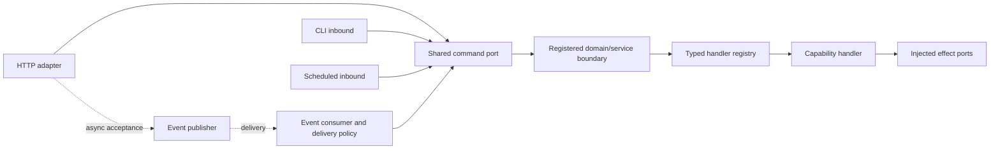

# Mission Control: recover the seams, not the whole assembly

**Review snapshot:** default branch `main`, 30 October 2026. Read-only architecture review; no repository code changes, builds, test execution, or deployment. The immutable revision, branch comparisons, source identities, and detailed evidence inventory are retained privately. References below are repository-relative paths at that snapshot, not links to private material.

## Assessment

Mission Control contains a credible precursor to the proposed Rust capability framework. Its strongest achievement is a transport-independent command port: HTTP, event, CLI, and scheduled runners can receive the **same command-port instance**, with domain execution behind it. Typed handler registration, deterministic memory adapters, processing leases, and sibling shutdown are implemented—not merely diagrams.

The problem is not that those ideas failed, nor that Rust requires fewer crates. The repository combines framework mechanics, agent workflows, research, UI, infrastructure operations, deployment, and composition in increasingly broad packages. Boundaries exist, but several are advisory or bypassable. **Extract a small contract-and-runtime spine; retain Mission Control as a reference application. Do not make it the framework wholesale.**

## What is actually assembled

The workspace has **23 members** (`Cargo.toml:1–27`):

| Area | Current members |
|---|---|
| Contracts and execution mechanics | `forge-core`, `forge-command-framework`, `forge-runtime`, `forge-serde-adapter` |
| Transport and infrastructure | `forge-ingress`, `forge-gateway`, `forge-egress`, `forge-db` |
| Agent/application capabilities | `forge-harness`, `forge-inference`, `forge-toolbox`, `forge-workspace`, `forge-repo-index`, `forge-ops` |
| Compute/research and web products | `forge-bitwave-system`, `forge-bitwave-web-wasm`, `forge-llm-system`, `forge-llm-runtime`, `forge-llm-web-service`, `forge-ui`, `forge-ui-web-service` |
| Composition and verification | `mission-control-cli`, `forge-e2e-tests` |

The complete tree contains 3,282 files and 2,016 Rust files; 702 Rust files are under `forge-ops`. These are scope indicators, not quality scores or executable-test counts. Three CLI implementation files alone total 9,130 lines: `api.rs` 4,434, `adapter.rs` 3,702, and `worker.rs` 994.

Static inspection of all workspace manifests found **no local normal/build dependency cycle**, including optional edges. The issue is dependency reach and ownership, not a demonstrated Cargo cycle. Examples:

- The CLI directly depends on **14 Forge crates**, despite the facade doctrine (`services/mission-control-cli/Cargo.toml:14–31`).
- `forge-runtime` depends on `forge-serde-adapter`, which depends on `forge-workspace`; generic runtime consumers therefore inherit a workspace dependency (`services/forge-runtime/Cargo.toml:9–22`; `services/forge-serde-adapter/Cargo.toml:9–13`).
- `forge-core` exposes compute, Bitwave, LLM web contracts, templates, events, and command primitives; CPU compute and mapped memory are default features (`services/forge-core/src/lib.rs:1–23`; `Cargo.toml:13–24`).

Both non-default branches were inventoried privately. One is already behind main; the other is a substantially diverged, narrow research branch. Neither supplies a newer general framework assembly that should silently supersede main.

## A real request path

The canonical database command path is especially useful because it reaches an actual registered handler and an injected effect port:

1. **HTTP adapter:** Axum dispatches an operation endpoint to `ForgeHttpIngress::handle`. The adapter bounds body size and validates method/content type. Domain, command, request identity, and idempotency identity come from headers; the payload comes from the body (`services/forge-ingress/src/http/server.rs:23–34,111–145`; `http/adapter.rs:104–162`).
2. **Canonical packet:** `ForgeCommandRequest` explicitly carries domain, operation, command, version, delivery, and identities. `into_envelope` puts routing into header metadata rather than inferring destination from business payload (`services/forge-command-framework/src/mission_control/model.rs:84–115,148–197`). This is close to the desired explicit-destination contract, although destination is string metadata rather than a dedicated typed header field.
3. **Shared logical port:** synchronous HTTP invokes `MissionControlCommandPort::execute`. A static router may select a registered domain; alternatively the gateway resolves a domain to a service and forwards canonical routing headers (`http/adapter.rs:60–85`; `mission_control/port.rs:52–97`; `services/forge-gateway/src/domain_route.rs:180–285`; `forwarder.rs:93–125`). These are alternative compositions, not mandatory sequential hops.
4. **Service boundary:** `PostgresManagerApi::execute` reconstructs the canonical request, checks the operation, then calls its registry-backed API (`services/forge-db/src/manager/api.rs:38–84`).
5. **Registered dispatch:** `PostgresEnvelopeBridge` creates the typed service request. `RegistryBackedForgeApi::receive_envelope` validates and dispatches; the registry resolves the handler key (`services/forge-db/src/manager/framework.rs:16–54`; `services/forge-command-framework/src/api.rs:66–77`; `dispatcher.rs:32–39`).
6. **Handler and effect:** `SelectRowsCommand` validates the request/spec, invokes `PostgresManagerPort`, and returns a response envelope (`services/forge-db/src/manager/command/select_rows.rs:82–125`). Transport code does not implement the database operation.

`WorkerRuntime` wires the same `Arc` command port into all four inbound families (`services/mission-control-cli/src/worker.rs:838–905`). That is the most valuable assembly seam.

Async HTTP instead publishes `CommandRequested` and returns 202. `CanonicalEventCommandBridge` validates the event, async intent, and matching correlation/idempotency identities before reconstructing the envelope. `EventWorkerRunner` handles claims, execution, result recording/publication, and settlement (`http/adapter.rs:87–99`; `services/forge-runtime/src/event_worker/bridge.rs:13–38`; `runner.rs:278–405`). This is transport-delivery policy around the same business port, not a separate implementation of the command.

However, this is **not the only ingress architecture**. The older `IngressRouter` accepts conversation-shaped `IngressRequest`, emits `UserMessageReceived`, or invokes an `IngressGateway` (`services/forge-ingress/src/router.rs:38–105`). Domain-specific event workers and CLI argument re-entry also remain. They need compatibility adapters or retirement, not recognition as additional canonical frameworks.

## Successful invariants to preserve

- **Registration before dispatch.** `CommandHandlerRegistry::bind` rejects duplicate and mismatched handler keys before insertion; `assert_exhaustive` checks expected coverage. Unknown commands return errors (`services/forge-command-framework/src/registry.rs:38–97`). This is a useful foundation for capability registration.
- **Behavior ports separate effects.** The repository's I/O doctrine names small ports, factories, and memory/production adapters. Concrete workflow-store contract tests apply one behavior suite to memory and file implementations, including recreation (`docs/architecture/io-traits-factories-and-test-contracts.md:5–45`; `services/forge-harness/tests/adapter_contract_tests.rs:9–73`).
- **Fail-closed model admission.** `RuntimeHealthGate` allows only Healthy; the LLM flow checks it before invocation (`services/forge-runtime/src/runtime_health/gate.rs:14–34`; `services/forge-harness/src/llm_flow.rs:257–334`). Preserve the mechanism, not the assumption that every package is an LLM.
- **Delivery failure is modeled.** Event execution has lease renewal, duplicate suppression, resumable publication, retry classification, and terminal rejection/dead-letter states (`event_worker/runner.rs:278–448`; `policy.rs:37–52`).
- **Task lifetime is explicit.** `WorkerSupervisor` distinguishes resident and one-shot runners, validates wiring, stops siblings on failure, and imposes shutdown grace (`services/forge-runtime/src/worker_host/supervisor.rs:13–77,115–192`). This is substantially better than detached, unowned background tasks.
- **Mutation has a policy pattern.** `ToolInvocationContractFlow` looks up a registered tool, checks enablement/approval, validates arguments, and requires a successful dry run before actual execution (`services/forge-toolbox/src/executor/contract.rs:82–172`). It is an application-specific example from which a general authorization hook can be designed.

## Why the assembly became difficult to manage

### 1. Shared packages accumulated unrelated reasons to change

The central event enum includes dialogue, prompt/context, LLM, Postgres, egress, and generic command events (`services/forge-core/src/event/kind.rs:9–31`). Adding an application event changes foundational code and its central codecs. Meanwhile the runtime groups generic FSM/worker mechanics with remote-host operations, verification, model lifecycle, and request states specific to agent conversations (`services/forge-runtime/src/lib.rs:6–20`; `request_lifecycle/aggregate.rs:9–25`). This is semantic coupling even without a dependency cycle.

### 2. Composition remained application-aware and centralized

The small `main.rs` is misleading as a measure of startup simplicity. `WorkerRuntime::from_config` selects domain/backend combinations and constructs their infrastructure; its worker assembly imports many capabilities (`services/mission-control-cli/src/worker.rs:1–76,298–350`). Some domains route a canonical request back into CLI arguments and `MissionControlCliApi::run` (`worker_domain.rs:85–101,263–305`). This creates a conceptual loop through a presentation adapter rather than a reusable typed capability entry point.

### 3. Facades did not consistently enforce substitution

The harness offers eight planes, but their maturity differs (`services/forge-harness/src/harness.rs:6–15`):

| Plane | Observed implementation and consequence |
|---|---|
| Control/lifecycle | `ControlPlaneFacade` is chiefly state translation and output summaries, not the promised orchestration owner (`facade/control_plane.rs:44–115`). |
| Memory | Dialogue-store trait injection is real; memory-only access remains available and panics on a non-memory backend (`facade/memory_plane.rs:46–70`). |
| Runtime/health | Custom factory injection stores trait ports **and separate fresh memory doubles**; `health_snapshot` reads the latter, not the injected gate (`facade/runtime_plane.rs:186–217`). This is a concrete source-of-truth mismatch. |
| Tool | Executor/factory injection exists, but the built-in catalog knows workspace tools (`facade/tool_plane.rs:109–145`). Keep that catalog in an agent capability. |
| Workspace | `memory_default` produces a stateless facade whose operations directly instantiate the local filesystem adapter (`facade/workspace_plane.rs:169–239`). A memory profile is therefore not an isolation guarantee. |
| Event | Bus injection exists, but a memory-specific getter panics with another implementation (`facade/event_plane.rs:68–97`). |

`K3sHarness::default_k3s` constructs these same default/memory facades; the name does not itself establish durable infrastructure (`services/forge-harness/src/profile/k3s.rs:56–66`). Separate production worker composition does construct real adapters, so it would also be wrong to claim the entire repository is fake.

### 4. Architecture enforcement lagged renamed ownership

The crate-collapse doctrine calls for a thin CLI and domain-owned adapters (`docs/architecture/crate-collapse-and-harness-factory.md:71–123`). The boundary script usefully guards serde and deleted adapter-sidecar crates, but its forbidden CLI imports target old leaf-crate names. Consolidated `forge-runtime` and `forge-toolbox` access can pass those name-based rules (`scripts/check-crate-boundaries.sh:89–132`). More doctrine alone will not fix this: rules must follow current capabilities and dependency direction.

### 5. Research, product, and infrastructure verification share a release surface

UI, Bitwave/LLM research, orchestration, and framework primitives share one workspace and aggregate verifier. Explicit long-test and research-feature tiers mitigate this; they do not make these concerns one reusable framework. Keep the valuable tiering while giving capability packages independent release and conformance boundaries.

## Contracts that must be strengthened before reuse

**Authorization is not registration.** The command-framework README explicitly excludes authorization (`services/forge-command-framework/README.md:8–11`), and dispatch only looks up a key and invokes the handler. Optional user metadata is not an authenticated principal. The new bridge must obtain trusted identity from adapters and enforce a registered capability policy before dispatch. Application approvals remain handler/policy concerns, not bridge business logic.

**Destination/version validation must be universal.** The canonical model checks shape, while service-specific enforcement varies. For example the database port checks operation but does not itself reject a different domain or unsupported version (`services/forge-db/src/manager/api.rs:38–84`). Move destination ownership/version compatibility into common dispatch validation.

**Readiness must reflect resources.** `/healthz` and `/readyz` currently share a constant-success handler (`services/forge-ingress/src/http/server.rs:25–27,188–192`). Preserve distinct liveness, initialized readiness, and capability-specific degraded status. Startup should validate dependencies and roll back partially acquired resources.

**At-least-once delivery is not exactly-once effects.** Result recording occurs after handler execution; a crash in that interval can replay the effect (`event_worker/runner.rs:326–354`). Preserve replayable result publication, but require transactional outbox/inbox or handler-level idempotency for mutations. Lease methods with permissive defaults are not proof that every ledger fences stale workers (`event_bus/processing.rs:27–88`).

**Registration and shutdown need failure atomicity.** The domain router inserts before reporting a duplicate, replacing the previous entry even on error (`mission_control/port.rs:31–42`). Also the worker fleet is spawned outside the supervisor's join set (`services/mission-control-cli/src/worker.rs:929–942`). Before extraction, require failed registration to preserve existing bindings and every background task/resource to have an owner, cancellation path, and awaited termination.

## Reuse decisions

| Decision | Candidate | Required boundary |
|---|---|---|
| **Adapt first** | Typed command registry, bridges, canonical command-port pattern | Small contracts crate; typed destination and trusted context; shared authorization and version checks. |
| **Adapt first** | Worker supervisor and event-worker delivery mechanics | Runtime capability with bounded queues, explicit cancellation and effect/idempotency contracts. |
| **Reuse pattern; verify implementations** | Port/factory pairs, memory adapters, adapter contract suites | Same conformance suite for every declared production adapter. |
| **Adapt selectively** | Error/correlation conventions, health gate, lifecycle/FSM primitives | Remove agent-specific state names and heavy compute defaults from the kernel. |
| **Keep as optional capabilities** | Database, workspace, toolbox, inference, gateway, egress | Each owns handlers, schemas, policy, adapters, migrations, and lifecycle registration. |
| **Reference application only** | Harness planes, codegen/conversation workflows, CLI orchestration | Demonstrate composition; do not become mandatory runtime services. |
| **Exclude from baseline kernel** | UI/game products, numerical research, deployment/provider-specific operations | Separate examples, research packages, or optional operational capabilities. |

“Exclude” means exclude from mandatory framework dependencies—not delete or abandon valuable work.

## A controlled extraction sequence

1. **Freeze one behavioral slice:** a read-only capability and one idempotent mutation through HTTP and CLI, then the event adapter. Preserve request/result contracts and negative cases before moving code.
2. **Create the smallest spine:** envelope/header identity, typed destination, registry, authorization interface, failure types, cancellation/deadline, and tracing context. No database client, LLM enum, workspace codec, or deployment backend in this layer.
3. **Make capability registration declarative:** each package registers destinations/versions, handlers, schemas, policy, dependencies, health probes, and start/stop hooks. Build and validate a dependency DAG once. Keep transport selection separate from capability selection.
4. **Move composition out of the CLI:** the application names capabilities and adapters; package factories own their wiring. All adapters submit to one shared logical ingress bridge. After authorized dispatch, handlers may call internal ports or fan out events; the bridge never selects business workflows.
5. **Prove failure and replacement:** reject duplicate/unknown routes, denied principals, unsupported versions, bad payloads, partial startup, unready dependencies, queue saturation, lost leases, publication failure, cancellation, and shutdown timeout. Swap memory/local/remote adapters without changing the handler tests. Retire compatibility paths only after parity evidence.

The desired developer experience is Spring Boot-like assembly convenience, not a universal service locator: **install a capability, configure its adapters, validate the graph, start, and observe it**.

## Verification evidence and limits

This review inventoried the complete tree, inspected all manifests, and materialized 178 selected source/document files for targeted reading; their Git blob identities were verified. No `AGENTS.md` or repository skill directory appeared in the pinned tree. No repository scripts or tests were executed.

Observed test sources cover duplicate/mismatched registration, canonical round trips, sync HTTP-to-database dispatch, async redelivery with one mutation, CLI/event coexistence, supervisor sibling failure, and shutdown grace (`services/forge-command-framework/src/dispatcher_tests.rs:141–213`; `services/forge-e2e-tests/src/polymorphic_worker_flow_tests.rs:36–240`; `services/forge-runtime/src/worker_host_tests.rs:139–313`). The redelivery test uses memory collaborators; it is not a live broker/crash-consistency certification.

The verification contract defines short/medium/long tiers, separate feature profiles, explicit live tests, and source-fingerprint receipts (`verification/contract.yaml:11–85,99–122`; `scripts/verify.sh:191–234`). No GitHub Actions workflow files appeared in the tree, and the reviewed commit had no returned Actions runs, check runs, or commit statuses at inspection. Local/operator CI may exist; **there is no observed passing CI result for this snapshot**.

**Conclusion:** Mission Control provides strong evidence for the shared-port and lifecycle direction. Its sprawl is a warning about composition ownership, unenforced profile semantics, and application policy entering shared packages—not a reason to discard the architecture's successful contracts.
