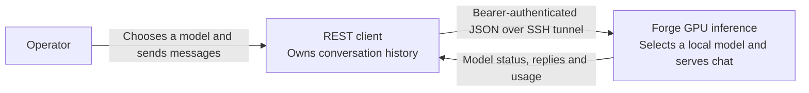
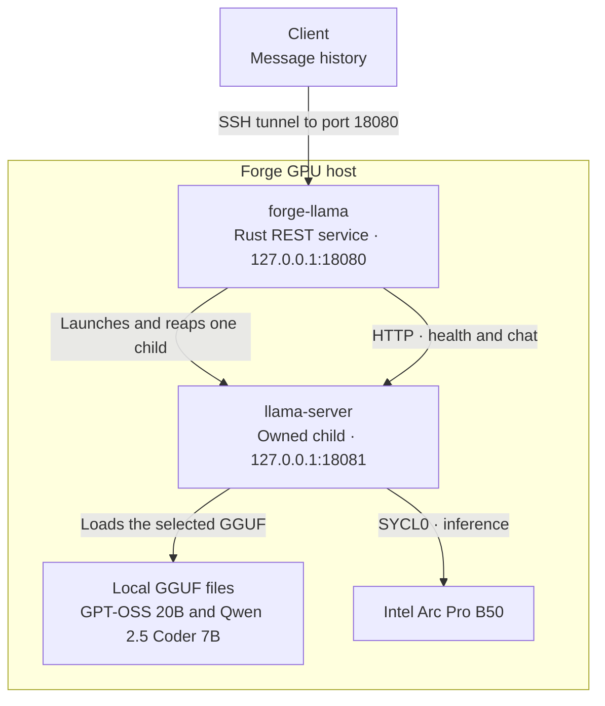
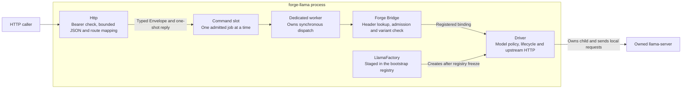
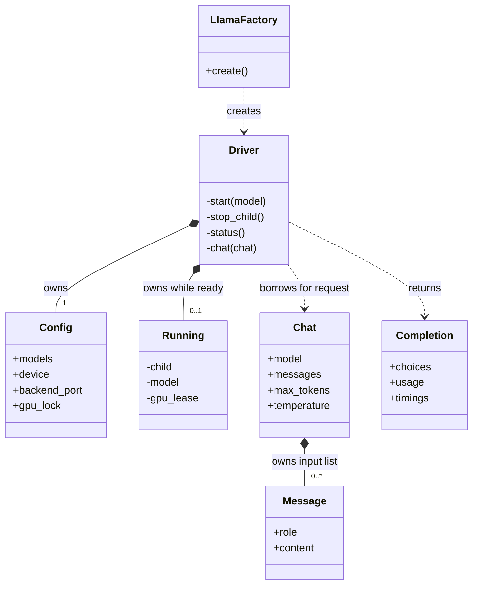
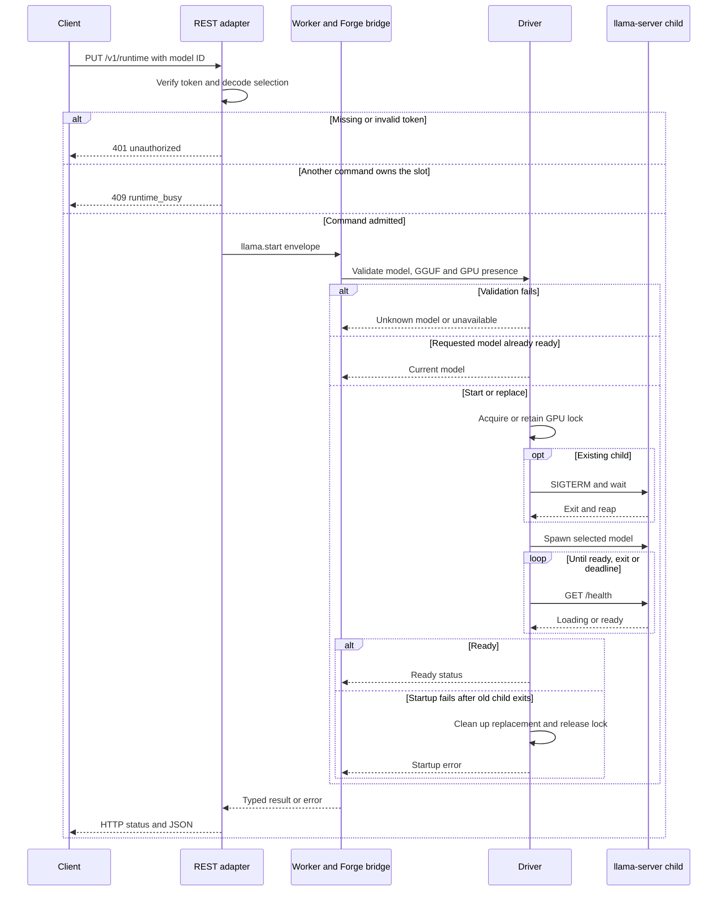
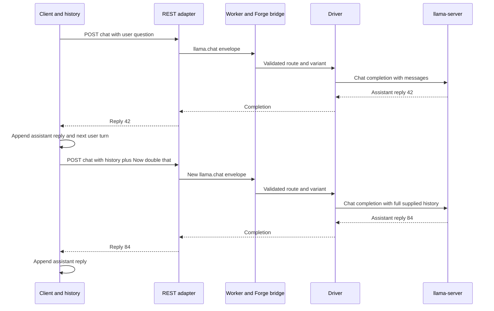
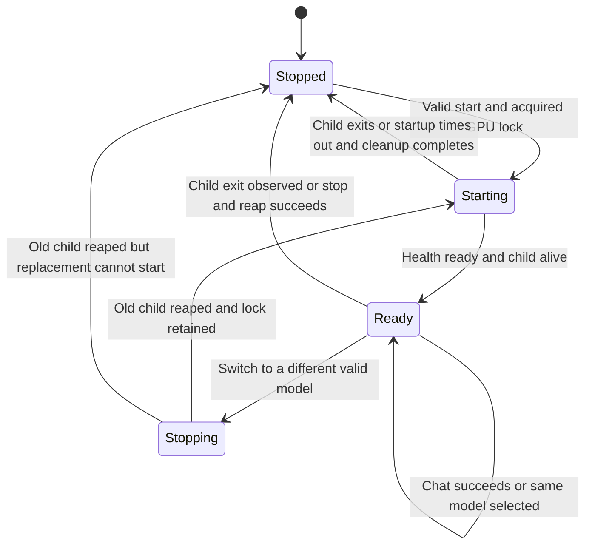

# Forge llama.cpp adapter architecture

These views describe the implemented adapter and its Forge configuration. The [usage guide](README.md) records the hardware test and current recovery status.

## C4 level 1 — System context

A caller on Forge can use loopback directly. The SSH tunnel is the remote path shown here.

## C4 level 2 — Containers on Forge GPU

The user systemd unit starts the adapter. The adapter starts a model only after an admitted selection. The GPU lock coordinates processes that use the same lock file.

## C4 level 3 — Components inside the adapter

The transport selects the route by method and path. The body supplies typed data for that route. The worker owns the driver in a singleton. See [HTTP routing and worker assembly](src/main.rs) and [the typed route bindings](src/lib.rs).

## UML — Ownership and chat data

The input type can represent an empty list. Chat validation requires 1–64 messages with at least one user message. A child still loading is held by the start operation and moves into the driver's `Running` field after readiness. See [driver ownership](src/driver.rs).

## UML sequence — Start or switch a model

An unknown model maps to HTTP 404, and an unavailable GPU maps to HTTP 503. A lock conflict or shutdown failure can also end the operation before spawning a replacement.

## UML sequence — Continue a chat

The second turn is illustrative. The adapter sends each request upstream with `stream: false` and `cache_prompt: false`. It checks that a supplied model ID matches the ready model. A new request gets its own Forge envelope. The client saves the messages when it wants to resume a conversation later.

## UML state — Model lifecycle

`Starting` and `Stopping` are internal phases. The REST status response exposes only `ready` or `stopped`, and a concurrent command can receive `409 runtime_busy`. When the upstream HTTP exchange times out or fails, the driver attempts to stop the child before accepting another command.
